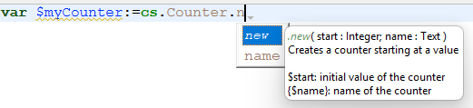

## Basics

Comments are inactive lines of code. These lines are not interpreted by the 4D language and are not executed when the code is called. Specific features rely on comments for documenting and tagging your code. 

There are two ways to create comments:

- `//` for single line comments
- `/* ... */` for inline or multiline comments.

Both styles of comments can be used simultaneously.

### Single line comments (`//comment`)

Insert `//` at the beginning of a line or after a statement to add a single line comment. Example:

```4d
//This is a comment
For($vCounter;1;100) //Starting loop
  //comment
  //comment
  //comment
End for
```

### Inline or multiline comments (`/*comment*/`)

Surround contents with `/*` ... `*/` characters to create inline comments or multiline comment blocks. Both inline and multiline comment blocks begin with `/*` and end with `*/`.

- **Inline comments** can be inserted anywhere in the code. Example:

```4d
For /* inline comment */ ($vCounter;1;100)
	...
End for
```

- **Multiline comment blocks** allow commenting an unlimited number of lines. Comment blocks can be nested (useful since the 4D code editor supports block collapsing). Example:

```4d
For ($vCounter;1;100)
/*
comments  
	/*
	other comments
	*/
*/
...
End for
```

## Comments for syntax description

Comments can describe the syntax of your methods, class functions, or constructors. 

- For a method, write the comment block in the first lines of the method. In the 4D code editor, comments are displayed in its [Help tips](../code-editor/write-class-method.md#help-tips) (the 5 first lines are displayed). 
- For a class function or constructor, write the comment block immediately above the `Function` or `Class constructor` declaration. Comments are displayed with the signature in 4D code assistance and in VS Code (completion details, help tips, and signature help). Add a dedicated comment for every parameter with the `// $paramName: <text>` syntax (see below). 

Example:

```4d

// Adds or updates a local dependency (as a file URL) in the "dependencies" object of the environment file
// $folder: folder of the dependency to register
// $optionalName: optional dependency name (defaults to the folder's full name)
#DECLARE($folder : 4D.Folder; $optionalName : Text)

//...code

```

The comment block follows these rules:

- It is made of `//` lines and/or a `/* */` block. Each line of a `/* */` block is handled like a `//` line, and the `/*` and `*/` markers are not displayed.
- For a class function or constructor, it must be placed immediately above the declaration. A blank line between the comment block and the declaration breaks the association: only the signature is displayed.
- Each comment block is associated only with the next declaration, even when it is written right after the code of the previous function.
- Only the saved code is read: after you edit a comment, the code assistance shows the new text once the class is saved.
- The text is displayed as plain text: Markdown markers such as `**` or `*` are shown as written.


#### Example 1

You want to document a function and its parameter so that they are displayed in the code editor:

```4d
// Class: Invoice

// Returns the price with taxes
// The rate is a percentage
// $rate: tax rate to apply (20 for 20%)
Function priceWithTaxes($rate : Real) : Real
	return This.price*(1+($rate/100))
```

When you type `$invoice.priceWithTaxes(` in a method, the help displays the signature with:

```
Returns the price with taxes
The rate is a percentage

$rate: tax rate to apply (20 for 20%)
```

#### Example 2

You want to document a class constructor with a `/* */` block:

```4d
// Class: Counter
property value : Integer
property name : Text

/*
Creates a counter starting at a value
$start: initial value of the counter
{$name}: name of the counter
*/
Class constructor($start : Integer; $name : Text)
	This.value:=$start
	This.name:=$name || "default name"
```

You can display: 




## Comments for specific features

### MCP tool

When a function is published as an **MCP tool**, its comments are used to provide [MCP tool code description](../WebServer/mcp-server.md#describing-the-tools), including MCP behavior tags.


### Code navigation markers

Code navigation markers such as `MARK:`, `TODO:`, and `FIXME:` are inserted through comments. See [Manual tagging](../code-editor/write-class-method.md#manual-tagging).

