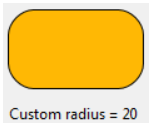
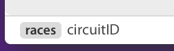
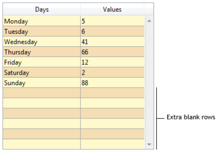
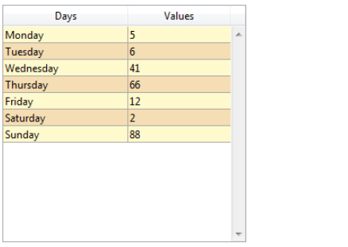
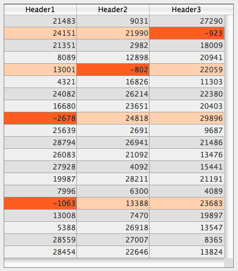

## Alternate Background Color

Allows setting a different background color for odd-numbered rows/columns in a list box. By default, *Automatic* is selected for list box columns: the column uses the alternate background color set at the list box level.

You can also set this property using the [`OBJECT SET RGB COLORS`](../commands/object-set-rgb-colors) command.

#### JSON Grammar

|Name|Data Type|Possible Values|
|---|---|---|
|alternateFill|string|any css value; "transparent"; "automatic"; "automaticAlternate"|

#### Objects Supported

[List Box](listbox_overview.md) - [List Box Column](listbox-column.md)

#### Commands

[`OBJECT GET RGB COLORS`](../commands/object-get-rgb-colors) - [`OBJECT SET RGB COLORS`](../commands/object-set-rgb-colors)

---

## Background Color / Fill color

Defines the background color / fill color of an object. It can be defined for some standard objects (`fill` JSON property) or ["custom style" objects](#custom-style-button-check-box-or-radio-button) (`borderFillColor` JSON property). 

:::note

The **Fill color** property is named **Background color** with [List Box](listbox_overview.md), [List Box Column](listbox-column.md) and [List Box Footer](listbox-header-footer.md#footers) objects. 

:::

### Standard objects


In the case of a list box column, by default *Automatic* is selected: the column uses the background color set at the list box level.

#### JSON Grammar

|Name|Data Type|Possible Values|
|---|---|---|
|fill|string|any css value; "transparent"; "automatic"|

#### Objects Supported

[Hierarchical List](list_overview.md) - [Input](input_overview.md) - [List Box](listbox_overview.md) - [List Box Column](listbox-column.md) - [List Box Footer](listbox-header-footer.md#footers) - [Oval](shapes_overview.md#oval) - [Rectangle](shapes_overview.md#rectangle) - [Text Area](text.md)

#### Commands

[`LISTBOX Get row color`](../commands/listbox-get-row-color) - [`LISTBOX SET ROW COLOR`](../commands/listbox-set-row-color) - [`OBJECT GET RGB COLORS`](../commands/object-get-rgb-colors) - [`OBJECT SET RGB COLORS`](../commands/object-set-rgb-colors)


### Custom button, custom check box, or custom radio button

This property allows you to assign a fill color attribute to [custom buttons](./button_overview.md#custom), [custom check boxes](./checkbox_overview.md#custom), or [custom radio buttons](./radio_overview.md#custom). In addition, [custom buttons](./button_overview.md#custom) must have the ["custom" Border Line Style](#border-line-style). In other contexts, the property is ignored.


#### JSON Grammar

|Name|Data Type|Possible Values|
|---|---|---|
|borderFillColor|string|any css value; "transparent"; "automatic"|

#### Objects Supported

[Custom Button](./button_overview.md#custom) (with ["custom" Border Line Style](#border-line-style)) - [Custom Check Box](checkbox_overview.md#custom) - [Custom Radio Button](radio_overview.md#custom) 


#### Commands

[`OBJECT GET RGB COLORS`](../commands/object-get-rgb-colors) - [`OBJECT SET RGB COLORS`](../commands/object-set-rgb-colors)


#### See also

[Transparent](#transparent)


---

## Background Color Expression {#background-color-expression}

`Selection and collection type list boxes`

An expression or a variable (array variables cannot be used) to apply a custom background color to each row of the list box. The expression or variable will be evaluated for each row displayed and must return a RGB color value. For more information, refer to the description of the [`OBJECT SET RGB COLORS`](../commands/object-set-rgb-colors) command.

You can also set this property using the [`LISTBOX SET PROPERTY`](../commands/listbox-set-property) command with `lk background color expression` constant.

>With collection or entity selection type list boxes, this property can also be set using a [Meta Info Expression](properties_Text.md#meta-info-expression).

#### JSON Grammar

|Name|Data Type|Possible Values|
|---|---|---|
|rowFillSource|string|An expression returning a RGB color value|

#### Objects Supported

[List Box](listbox_overview.md) - [List Box Column](listbox-column.md)

#### Commands

[`LISTBOX Get property`](../commands/listbox-get-property) - [`LISTBOX SET PROPERTY`](../commands/listbox-set-property) 

---

## Border Color {#border-color}

Allows defining the border color. The effect of this property varies slightly depending on the type of object to which it is applied.


- **objects with text properties**: [buttons](./button_overview.md) (all styles except "custom", see  below), [hierarchical lists](list_overview.md), [inputs](input_overview.md), [list boxes](listbox_overview.md), [progress indicators](./progressIndicator.md), [rulers](./ruler.md), and [text areas](text.md).   
By default, the border color of these objects is automatically set to their [**font color**](./properties_Text.md#font-color) property. This default configuration corresponds to the **Same as font** option in the Property List (`borderColor` property is undefined in JSON).   
You can separate these two properties by setting a color value for the object's "Border color" property (only available when the [**border line style**](#border-line-style) property is **plain** (`solid` in JSON property) or **dotted**).

- **objects without text properties**: [4D View Pro areas](viewProArea_overview.md), [4D Write Pro areas](writeProArea_overview.md), [button grids](buttonGrid_overview.md), [picture buttons](pictureButton_overview.md), [picture pop-up menus](picturePopupMenu_overview.md), [plug-in areas](pluginArea_overview.md), [subforms](subform_overview.md), [spinners](spinner.md), [splitters](splitters.md), [steppers](stepper.md), [web areas](webArea_overview.md).  
The border color property sets the color of the borders. The default color value is "Automatic", i.e. the border is displayed with the automatic color set by your OS. 


- **custom-styled buttons**: [custom buttons](./button_overview.md#custom) with ["custom" Border Line Style](#border-line-style), [custom check boxes](./checkbox_overview.md#custom), and [custom radio buttons](./radio_overview.md#custom).  
In this case, the border color property defines the color of an *inner* border, which is an attribute of the object itself ans not a decoration property. This inner border can also have a [width](#border-width) (it is displayed only if the width > 0). 


#### JSON Grammar

|Name|Data Type|Possible Values|
|---|---|---|
|borderColor|string|any css value; "transparent"; "automatic"|


#### Objects Supported

[4D View Pro area](viewProArea_overview.md) - [4D Write Pro area](writeProArea_overview.md) - [Button](./button_overview.md) - [Button Grid](buttonGrid_overview.md) - [Check Box ("custom" style)](checkbox_overview.md#custom) - [Hierarchical List](list_overview.md) - [Input](input_overview.md) - [List Box](listbox_overview.md) - [Picture Button](pictureButton_overview.md) - [Picture Pop-up Menu](picturePopupMenu_overview.md) - [Plug-in Area](pluginArea_overview.md) - [Progress Indicator](./progressIndicator.md) - [Radio Button ("custom" style)](radio_overview.md#custom) - [Ruler](./ruler.md) - [Text Area](text.md) - [Spinner](spinner.md) - [Splitter](splitters.md) - [Stepper](stepper.md) - [Subform](subform_overview.md) - [Web Area](webArea_overview.md)


#### Commands

[`OBJECT GET RGB COLORS`](../commands/object-get-rgb-colors) - [`OBJECT SET RGB COLORS`](../commands/object-set-rgb-colors)

#### See also

[Line Color](#line-color) (for shapes)


## Border Line Style {#border-line-style}

Allows setting a style for the object border. The following choices are available (all choices are not possible depending on the object):

|Style |Objects (\*)|Description|
|----|----|----|
|None|all|Objects appear with no border.|
|Plain |all|Objects appear framed with a continuous 1-pt. border line. ("solid" json value) |
|Dotted |all|Objects appear framed with a dotted 1-pt. border line.|
|Raised|all|Objects appear framed with a 3D effect.|
|Sunken |all|Objects appear framed with a sunken 3D effect.|
|Double|all|Objects appear framed with a double line, i.e., two continuous 1-pt. lines separated by a pixel.|
|System|all *except* [buttons](button_overview.md) and [text areas](text.md)|Objects appear with a border line based on the graphic specifications of the OS.|
|System rounded|[inputs](input_overview.md)|On macOS, objects appear with a native "Liquid Glass" system border effect (for information about Liquid Glass, see [this 4D blog post](https://blog.4d.com/the-new-macos-tahoe-design-comes-to-your-4d-applications/)). It includes system-defined inner border, corner radius, grey border color, and inner padding. Note that the "Liquid Glass" appearance is *not* used in a multiline input object if the [scroll bars property](./properties_Appearance.md#vertical-scroll-bar) is enabled ("System" is used in this case).<br/> On Windows, this style is similar to "System" at runtime. |
|Custom|[custom buttons](./button_overview.md#custom)|Enables the inner border design, that includes a set of extra properties: [Fill color](#fill-color), [Border color](#border-color), [Border width](#border-width), and [Corner radius](#corner-radius). <br/>|

(\*) "all" means "all objects supported" listed below.


:::tip Related blog posts

- [Customize Buttons, Radio Buttons, and Check Boxes with Background and Border Properties](https://blog.4d.com/customize-buttons-radio-buttons-and-check-boxes-with-background-and-border-properties).  
- [Give Your Form Objects the Border Color They Deserve](https://blog.4d.com/give-your-form-objects-the-border-color-they-deserve)
- [Choose the Right Native Input Style for Your Interface on macOS](https://blog.4d.com/choose-the-right-native-input-style-for-your-interface-on-macos)


:::


#### JSON Grammar

|Name|Data Type|Possible Values|
|---|---|---|
|borderStyle|text |"custom", "dotted", "double", "none", "raised", "solid", "sunken", "system", "systemRounded"|


#### Objects Supported

[4D View Pro Area](viewProArea_overview.md) - [4D Write Pro areas](writeProArea_overview.md) - [Buttons](button_overview.md) - [Button Grid](buttonGrid_overview.md) - [Hierarchical List](list_overview.md) - [Input](input_overview.md) - [List Box](listbox_overview.md) - [Picture Button](pictureButton_overview.md) - [Picture Pop-up Menu](picturePopupMenu_overview.md) - [Plug-in Area](pluginArea_overview.md) - [Progress Indicator](progressIndicator.md) - [Ruler](ruler.md) - [Spinner](spinner.md) - [Stepper](stepper.md) - [Subform](subform_overview.md) - [Text Area](text.md) - [Web Area](webArea_overview.md)


#### Commands

[`OBJECT Get border style`](../commands/object-get-border-style) - [`OBJECT SET BORDER STYLE`](../commands/object-set-border-style) 


#### See also

[Dotted Line Type](#dotted-line-type) (shapes)


---

## Border Width {#border-width}

Allows defining the width of the inner border for:
- [custom buttons](./button_overview.md#custom) with the ["custom" Border Line Style](#border-line-style), 
- [custom check boxes](./checkbox_overview.md#custom), 
- [custom radio buttons](./radio_overview.md#custom). 

In other contexts, the property is ignored.


The value is expressed in pixels. 

#### JSON Grammar

|Name|Data Type|Possible Values|
|---|---|---|
|borderWidth|number|Integer value (pixels). Minimum value = 0|


#### Objects Supported

[Button ("custom" style)](./button_overview.md#custom) (with ["custom" Border Line Style](#border-line-style)) - [Check Box ("custom style")](checkbox_overview.md#custom) - [Radio Button ("custom" style)](radio_overview.md#custom) 


---

## Corner Radius

<details><summary>History</summary>

|Release|Changes|
|---|---|
|21 R5|Support for custom-styled buttons, radio buttons and check boxes |
|19 R7|Support for inputs and text areas|

</details>


Defines the corner roundness (in pixels) of the object. By default, the radius value is 0 pixels. You can change this property to draw rounded objects with custom shapes:



Minimum value is 0, in this case a standard non-rounded object rectangle is drawn.
Maximum value depends on the rectangle size (it cannot exceed half the size of the shortest rectangle side) and is calculated dynamically.

In [text areas](./text.md) and [inputs](./input_overview.md):

- the corner radius property is only available with "none", "solid", or "dotted" [border line styles](#border-line-style),
- the corner roundness is drawn **outside** the area of the object (the object appears larger in the form but its [width](./properties_CoordinatesAndSizing.md#width) and [height](./properties_CoordinatesAndSizing.md#height) are not extended).




In [custom buttons](./button_overview.md#custom) (with a ["custom" Border Line Style](#border-line-style)), [custom check boxes](checkbox_overview.md#custom) and [custom radio buttons](radio_overview.md#custom), the corner radius is drawn **inside** the area of the object. 


#### JSON Grammar

|Name|Data Type|Possible Values|
|---|---|---|
|borderRadius|integer |minimum: 0|

#### Objects Supported

[Button ("custom" style)](./button_overview.md#custom) (with ["custom" Border Line Style](#border-line-style)) - [Check Box ("custom" style)](checkbox_overview.md#custom) - [Input](input_overview.md) - [Rectangle](shapes_overview.md#rectangle) - [Text Area](text.md) - [Radio Button ("custom" style)](radio_overview.md#custom)  

#### Commands

[OBJECT GET CORNER RADIUS](../commands/object-get-corner-radius) - [OBJECT SET CORNER RADIUS](../commands/object-set-corner-radius)


---

## Dotted Line Type {#dotted-line-type}

Describes dotted line type as a sequence of black and white points.

#### JSON Grammar

|Name|Data Type|Possible Values|
|---|---|---|
|strokeDashArray|number array or string|Ex. "6 1" or \[6,1\] for a sequence of 6 black point and 1 white point|

#### Objects Supported

[Rectangle](shapes_overview.md#rectangle) - [Oval](shapes_overview.md#oval) - [Line](shapes_overview.md#line)

---


## Hide extra blank rows

Controls the display of extra blank rows added at the bottom of a list box object. By default, 4D adds such extra rows to fill the empty area:



You can remove these empty rows by selecting this option. The bottom of the list box object is then left blank:



#### JSON Grammar

|Name|Data Type|Possible Values|
|---|---|---|
|hideExtraBlankRows|boolean|true, false|

#### Objects Supported

[List Box](listbox_overview.md)

#### Commands

[`LISTBOX Get property`](../commands/listbox-get-property) - [`LISTBOX SET PROPERTY`](../commands/listbox-set-property) 

---

## Line Color

Designates the color of the object's lines.
The color can be specified by:

* a color name - like "red"
* a HEX value - like "#ff0000"
* an RGB value - like "rgb(255,0,0)"

You can also set this property using the [`OBJECT SET RGB COLORS`](../commands/object-set-rgb-colors) command.

#### JSON Grammar

|Name|Data Type|Possible Values|
|---|---|---|
|stroke |string |any css value, "transparent", "automatic"|

:::note

This property is also available for objects with text properties, in which case it designates both the [Font color](properties_Text.md#font-color) and the object's lines, except if you used the [Border color](#border-color) property.

:::

#### Objects Supported

[Line](shapes_overview.md#line) - [Oval](shapes_overview.md#oval) - [Rectangle](shapes_overview.md#rectangle)

#### Commands

[`OBJECT GET RGB COLORS`](../commands/object-get-rgb-colors) - [`OBJECT SET RGB COLORS`](../commands/object-set-rgb-colors)


---

## Line Width

Designates the thickness of a line.

#### JSON Grammar

|Name|Data Type|Possible Values|
|---|---|---|
|strokeWidth|number|0 for smallest width on a printed form, or any integer value < 20|

#### Objects Supported

[Line](shapes_overview.md#line) - [Oval](shapes_overview.md#oval) - [Rectangle](shapes_overview.md#rectangle)

---

## Row Background Color Array {#row-background-color-array}

`Array type list boxes`

The name of an array to apply a custom background color to each row of the list box or column.

The name of a Longint array must be entered. Each element of this array corresponds to a row of the list box (if applied to the list box) or to a cell of the column (if applied to a column), so the array must be the same size as the array associated with the column. You can use the constants described in the [`OBJECT SET RGB COLORS`](../commands/object-set-rgb-colors) command. If you want the cell to inherit the background color defined at the higher level, pass the value -255 to the corresponding array element.

For example, given a list box where the rows have an alternating gray/light gray color, defined in the properties of the list box. A background color array has also been set for the list box in order to switch the color of rows where at least one value is negative to light orange:

```4d
 <>_BgndColors{$i}:=0x00FFD0B0 // orange
 <>_BgndColors{$i}:=-255 // default value
```


Next you want to color the cells with negative values in dark orange. To do this, you set a background color array for each column, for example `<>_BgndColor_1`, `<>_BgndColor_2` and `<>_BgndColor_3`. The values of these arrays have priority over the ones set in the list box properties as well as those of the general background color array:

```4d
 <>_BgndColorsCol_3{2}:=0x00FF8000 // dark orange
 <>_BgndColorsCol_2{5}:=0x00FF8000
 <>_BgndColorsCol_1{9}:=0x00FF8000
 <>_BgndColorsCol_1{16}:=0x00FF8000
```



You can get the same result using the [`LISTBOX SET ROW FONT STYLE`](../commands/listbox-set-row-font-style) and [`LISTBOX SET ROW COLOR`](../commands/listbox-set-row-color) commands. They have the advantage of letting you skip having to predefine style/color arrays for the columns: instead they are created dynamically by the commands.

#### JSON Grammar

|Name|Data Type|Possible Values|
|---|---|---|
|rowFillSource|string|The name of a longint array.|

#### Objects Supported

[List Box](listbox_overview.md) - [List Box Column](listbox-column.md)

#### Commands

[`LISTBOX Get array`](../commands/listbox-get-array) - [`LISTBOX GET ARRAYS`](../commands/listbox-get-arrays) 


---

## Transparent

Sets the list box background to "Transparent". When set, any [alternate background color](#alternate-background-color) or [background color](#background-color--fill-color) defined for the column is ignored.

#### JSON Grammar

|Name|Data Type|Possible Values|
|---|---|---|
|fill|text|"transparent"|

#### Objects Supported

[List Box](listbox_overview.md)

#### Commands

[`OBJECT GET RGB COLORS`](../commands/object-get-rgb-colors) - [`OBJECT SET RGB COLORS`](../commands/object-set-rgb-colors)


#### See also

[Background Color / Fill Color](#background-color--fill-color)

