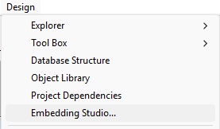
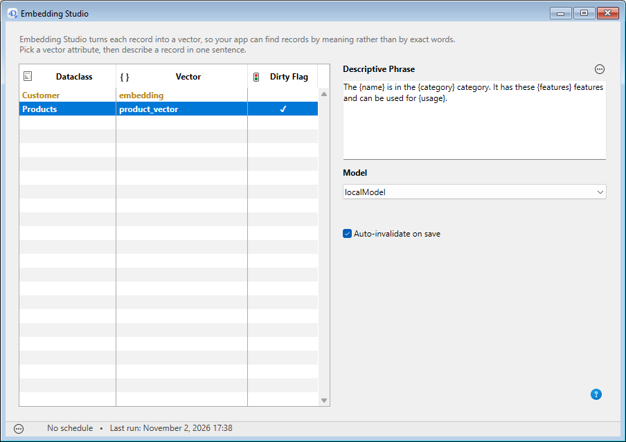

# 4D-Embedding-Studio

## Overview

4D Embedding Studio is a component for defining, processing, and maintaining AI embedding vectors directly in your 4D dataclass entities. 

You can use the component without writing a single line of code: select attributes from your dataclasses to construct the sentences to be vectorized and specify the model to use. For each entity, the component calls the embedding API and stores the resulting `4D.Vector` values. Configure the embedding scheduler to (re)calculate the vectors for your data at fixed intervals or on demand. 

You can then use the ORDA [`query()` by vector feature](https://developer.4d.com/docs/API/DataClassClass#query-by-vector-similarity) to request your data using semantics.

If you want to have more control over your embeddings, the component offers an extensive API that allows you to customize each step of the data vectorization process, manage the scheduler, and integrate high-performance RAG (*Retrieval Augmented Generation*) features into your 4D application.


## Requirements

- [4D-AIKit](https://github.com/4d/4D-AIKit) (loaded automatically as a dependency). 
- 4D project (21 R5 or later) with the following configuration:
  - a valid model alias 
  - a dataclass with a `4D.Vector` attribute (object field at the database level).


## Quick Start

**1. Add a field of type Object to the table and associate it with the `4D.Vector` class.**  
**2. Select **Embedding Studio...** in the **Design** menu to display the Embedding Studio window.**  

  

**3. For each listed `4D.Vector` attribute, write a descriptive phrase based upon attributes of the dataclass.**  
Use the contextual menu to insert appropriate attributes.  
This phrase will be vectorized for every entity.  
**4. Select a model alias (or create a new one).**   
**5. Select "Execute now" to launch the vectorization of your data or configure the scheduler.**   


## User Guide

### Configuring the dataclass

To use the 4D Embedding Studio interface, you need to create at least one object attribute associated to a `4D.Vector` class in your datastore. This must be done at the database level (only storage attributes can be embeddings).

In the Structure editor, add an Object field to the dataclass (table) whose entities you want to query using AI and enter ["4D.Vector" as class](https://developer.4d.com/docs/Develop/structure-fields#class). 

#### Dirty-flag support

In a production application, data is rarely static. If an embedding is based on an attribute value that has changed (e.g. a product description), it becomes obsolete and could no longer be relevant. By default, 4D automatically invalidates and flags for recalculation affected embeddings.

If you do not use a dirty-flag field (see below), 4D simply replaces any invalidated vector by `Null`. It is therefore no longer used in searches until its next calculation. This option is suitable for applications that prioritize strict consistency: it is better to return no results than to rely on an embedding that no longer matches the current data.

Or, you can add a Boolean field named `<vectorName>_dirty` (e.g. "myVector_dirty") to the structure. In this case, when an update is required, this field is set to `True`, and the associated vector is retained until it is recalculated. Your application can then choose to continue using this vector temporarily or exclude it using a filter on `dirty = False`. The flag is cleared automatically after a successful save.
This strategy promotes service continuity while allowing you to precisely identify vectors awaiting recalculation. If your business logic requires full control, you can also disable automatic invalidation and manage this lifecycle yourself.

*Note: Certain modifications, such as a model changes, require vectors to be replaced immediately.* 


### Creating an embedding

When you select **Embedding Studio...** in the **Design** menu, the Embedding Studio window is displayed. 

The list on the left side shows all `4D.Vector` class attributes defined in the datastore. You can add as many vector attributes as you want per dataclass. 

A check mark (✓) in the Dirty Flag column indicates that a [`<vectorName>_dirty` boolean field](#dirty-flag-support) is associated to the vector field.  

**Note:** Any change in the database structure will require that you restart the 4D application so that the 4D Embedding Studio lists up-to-date values.

#### Writing a descriptive sentence

To create or edit an embedding, select the attribute to configure in this list and write the embedding definition in the "Descriptive sentence" area on the right side. Use the associated menu to build the sentence and to add references to dataclass available attributes with the `{attribute_name}` syntax. 

The sentence must build a text that describes the entity just like a human would do it. The embedding could then capturate the semantics and not only attribute values. 

For example, for a `Product` dataclass with many attributes such as name and category, you could write: 
"The {name} product is a {category} from the {brand} brand. Description: {description}. Key features: {features}."




### Selecting a model

Once you have defined your vector attribute, choose the model to use for generating the embedding. The list of models includes the **model aliases** you defined in the [Project Settings](https://developer.4d.com/docs/settings/ai#model-aliases). 

The choice of model is important because it determines the relevance and quality of your embeddings. You’ll also need to provide this model with every query on the dataclass data so that the comparison is performed using the same model. 

### Auto-invalidate on save

When this option is checked (default), embeddings are automatically invalidated when at least one of their definition attributes has been modified and the entity was successfully saved. 

However, you might want to handle invalidation in a custom way using the [4D Embedding Studio API](#api-guide). In this case, uncheck this option to disable the automatic mechanism.

### Calculating embeddings

Embeddings are calculated by sending a request to the AI model, which then returns the vectorization result, which is subsequently stored in the `4D.Vector` attribute in the dataclass. 4D automatically handles this operation and optimizes it by calculating only the necessary vectors. Each vector is processed independently. Thus, an error on one element does not interrupt the recalculation of the others. Elements that fail will be automatically retried during the next run. Recalculations are performed asynchronously, without blocking users.
 
These calculations can be performed **on demand** or **scheduled at regular intervals** using the scheduler in the 4D Embedding Studio component. 

**Note:** You can also customize embedding calculations per dataclass or entity using the [4D Embedding Studio API](#api-guide).

#### On demand

To launch an embedding calculation, select **Run now** in the menu at the bottom of the 4D Embedding Studio window. This item is disabled if the datastore does not contain any embedding to calculate. When started, you can select **Cancel run** at any moment. 

#### Scheduler

You can configure the 4D Embedding Studio component scheduler to adjust the calculation frequency to suit your application’s needs. 

**Important:** The scheduler needs a 4D worker process to run. You can start it manually for testing purposes (**Start now** button in the scheduler dialog box) but to make sure a worker is available every times the application opens, you need to configure it. You can either:
- select the **Execute "On Host Database Event" method of the components** option in the [project Settings](https://developer.4d.com/docs/settings/security#options)
- or write the following code in your startup code:

```4d
  //at startup
cs.EmbeddingStudio.Scheduler.me.start()
```

The scheduler allows you can set the time interval between two calculations. Select the tab corresponding to your needs and click **Save**.
- **Never**: the scheduler is off and never runs
- **At regular interval**: set the time interval between each calculation starting from a specified time. 
- **Once a day**: the calculation takes place every day at a specific time 
 starting from a specific time.


### Building queries with embeddings

Once you have defined embeddings in your datastore, you can start [querying your dataclasses using AI-based features](https://developer.4d.com/docs/API/DataClassClass#query-by-vector-similarity). You just need to make sure that you use the same model for your embedding definition and in the query string.

For example, assuming that:

• you have defined a `4D.Vector` attribute named "product_vector" in the Products dataclass using a sentence: "The {name} is in the {category} category. It has these {features} features and can be used for {usage}."  
•	you want to find products that "can be used safely outside". 

You can write:

```4d
// Retrieve the model alias from the embedding definition, configured in 4D Embedding Studio
var $settings:=cs.EmbeddingStudio.Settings.new()
var $definition:=$settings.find("Products"; "product_vector")

// Compute the vector of the query with the same model
var $result:=cs.EmbeddingStudio.StudioEmbedder.new().embed("products that can be used safely outside"; $definition)
var $vector:=$result.vector

  //search with default metric (cosine)
var $products:=ds.Products.query("product_vector > :1 order by product_vector desc"; {vector : $vector})

```

If you use a dirty field, simply add a criterion to exclude vectors waiting to be recalculated:

```4d
var $products:=ds.Products.query("product_vector > :1 and product_vector_dirty = false order by product_vector desc"; {vector : $vector})
```


## API Guide

### Quick start

**1. Configure your vectors** in `Settings/embeddings.json`:

```json
{
  "batchSize": 50,
  "definitions": [
    {
      "dataclassName": "Students",
      "vectorName": "student_vector_1",
      "modelAlias": "text-embedding",
      "phrase": "Student {firstName} {lastName}, enrolled in {program}",
      "autoInvalidate": true
    }
  ]
}
```

**2. Run the full pipeline** (all definitions, all records):

```4d
var $p:=cs.EmbeddingStudio.Process.new()
var $r:=$p.process()

If ($r.success)
    ALERT("Updated "+String($r.entitiesUpdated)+" entities in "+String($r.duration)+" ms")
End if
```

**3. Process a single entity on save** (e.g. in a trigger or REST hook):

```4d
var $p:=cs.EmbeddingStudio.Process.new()
$p.processEntity($entity)
```


### Class reference

| Class | Description |
|---|---|
| [Process](Classes/Process.md) | Main orchestrator — entry point for all batch and entity operations. |
| [Scheduler](Classes/Scheduler.md) | Automated recalculation scheduler — background task, force/cancel, and runtime status. |
| [StudioEmbedder](Classes/StudioEmbedder.md) | Renders and embeds on demand using your saved definitions — e.g. to build a search query vector. Nothing is persisted. |
| [Settings](Classes/Settings.md) | Loads and saves the `embeddings.json` configuration file. |
| [Definition](Classes/Definition.md) | Describes one vector field: dataclass, field name, model alias, and phrase template. |
| [Embedder](Classes/Embedder.md) | Thin wrapper around the AIKit embeddings API with retry/backoff logic. |
| [EmbedderResult](Classes/EmbedderResult.md) | Typed wrapper normalizing API responses — vectors, usage metrics, rate-limit state. |
| [ProcessResult](Classes/ProcessResult.md) | Returned by every batch function — statistics and error breakdown. |
| [ProcessError](Classes/ProcessError.md) | Typed entry in `ProcessResult.errors` — scope, severity, code, ref, message, retryable. |
| [ProcessErrorCode](Classes/ProcessErrorCode.md) | Singleton catalogue of machine-readable error codes and their default severity/retryability. |
| [Phrase](Classes/Phrase.md) | Lightweight `{variable}` template engine used to build text from entity attributes. |


### See also

Blog post: [Vectorize your data effortlessly with 4D Embedding Studio](https://blog.4d.com/vectorize-your-data-effortlessly-with-4d-vector-studio)