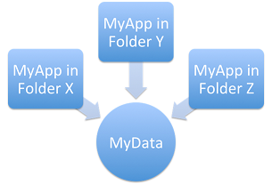
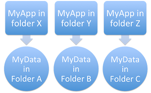
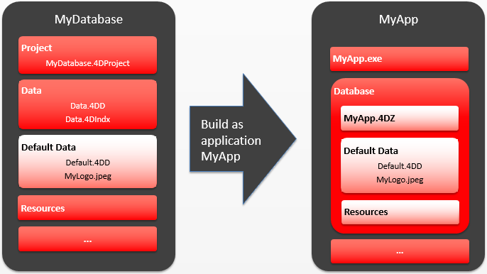

## Apertura del archivo de datos

Cuando un usuario lanza una aplicación fusionada o una actualización (aplicaciones monopuesto o cliente/servidor), 4D intenta seleccionar un archivo de datos válido. Varias ubicaciones son examinadas sucesivamente por la aplicación.

La secuencia de lanzamiento de una aplicación fusionada es:

1. 4D intenta abrir el último archivo de datos abierto, [como se describe a continuación](#last-data-file-opened) (no aplicable durante el lanzamiento inicial).
2. Si no se encuentra, 4D intenta abrir el archivo de datos en una carpeta de datos por defecto junto al archivo .4DZ en modo de sólo lectura.
3. Si no se encuentra, 4D intenta abrir el archivo de datos estándar por defecto (mismo nombre y misma ubicación que el archivo .4DZ).
4. Si no se encuentra, 4D muestra una caja de diálogo estándar "Abrir archivo de datos".

## Último archivo de datos abierto

### Ruta del último archivo de datos

Toda aplicación autónoma o servidor generada con 4D almacena la ruta de acceso del último archivo de datos abierto en la carpeta de preferencias del usuario de la aplicación.

La ubicación de la carpeta de preferencias del usuario de la aplicación corresponde a la ruta devuelta por la instrucción siguiente:

```4d
userPrefs:=Get 4D folder(Carpeta 4D activa)
```

La ruta del archivo de datos se almacena en un archivo dedicado, llamado *lastDataPath.xml*.

Gracias a esta arquitectura, cuando usted ofrece una actualización de su aplicación, el archivo de datos del usuario local (último archivo de datos utilizado) se abre automáticamente en el primer lanzamiento.

Este mecanismo suele ser adecuado para los despliegues estándar. Sin embargo, para necesidades específicas, por ejemplo, si duplica sus aplicaciones fusionadas, es posible que desee cambiar la forma en que el archivo de datos está vinculado a la aplicación (se describe a continuación).

### Configurar el modo de enlace de los datos

Con sus aplicaciones compiladas, 4D utiliza automáticamente el último archivo de datos abierto. Por defecto, la ruta del archivo de datos se almacena en la carpeta de preferencias del usuario de la aplicación y está vinculada al **nombre de la aplicación**.

Esto puede ser inadecuado si se quiere duplicar una aplicación fusionada destinada a utilizar diferentes archivos de datos. Las aplicaciones duplicadas en realidad comparten la carpeta de preferencias del usuario de la aplicación y, por lo tanto, siempre utilizan el mismo archivo de datos - incluso si el archivo de datos se cambia de nombre, porque se abre el último archivo utilizado para la aplicación.

Por lo tanto, 4D le permite vincular la ruta del archivo de datos a la ruta de la aplicación. En este caso, el archivo de datos se relacionará con una ruta específica y no será simplemente el último archivo abierto. Por lo tanto, 4D le permite vincular la ruta del archivo de datos a la ruta de la aplicación.

Este modo le permite duplicar sus aplicaciones fusionadas sin romper el vínculo con el archivo de datos. Sin embargo, con esta opción, si el paquete de la aplicación se mueve en el disco, se pedirá al usuario un archivo de datos, ya que la ruta de la aplicación ya no coincidirá con el atributo "executablePath" (después de que el usuario haya seleccionado un archivo de datos, el archivo *lastDataPath.xml* se actualiza en consecuencia).

*Duplicación cuando los datos están vinculados por nombre de la aplicación:*


*Duplicación cuando los datos están vinculados por ruta de la aplicación:*


Puede seleccionar el modo de vinculación de datos durante el proceso de generación de la aplicación. Puede:

- Utilice la [página Aplicación](building.md#application-page) o la [Página cliente/servidor](building.md#clientserver-page) de la caja de diálogo del Generador de aplicaciones.
- Use the **LastDataPathLookup** XML key ([single-user application](../BuildApplication/runtime-vl.md#lastdatapathlookup) or [server application](../BuildApplication/client-server.md#lastdatapathlookup)).

## Definir una carpeta de datos por defecto

4D le permite definir un archivo de datos por defecto en la fase de construcción de la aplicación. Cuando la aplicación se lanza por primera vez, si no se encuentra ningún archivo de datos local (ver \[secuencia de lanzamiento descrita anteriormente\](#opening-the-data-file)), el archivo de datos por defecto se abre automáticamente y de forma silenciosa en modo de sólo lectura por 4D. Cuando la aplicación se lanza por primera vez, si no se encuentra ningún archivo de datos local (ver \[secuencia de lanzamiento descrita anteriormente\](#opening-the-data-file)), el archivo de datos por defecto se abre automáticamente y de forma silenciosa en modo de sólo lectura por 4D.

Más específicamente, se cubren los siguientes casos:

- Evitar la visualización de la caja de diálogo "Abrir archivo de datos" de 4D al lanzar una nueva aplicación fusionada o actualizada. Puede detectar, por ejemplo al inicio, que se ha abierto el archivo de datos por defecto y así ejecutar su propio código y/o diálogos para crear o seleccionar un archivo de datos local.
- Permitir la distribución de aplicaciones fusionadas con datos de sólo lectura (para aplicaciones de demostración, por ejemplo).

Para definir y utilizar un archivo de datos por defecto:

- Debe suministrar un archivo de datos por defecto (llamado "Default.4DD") y almacenarlo en una carpeta específica por defecto (llamada "Default Data") dentro de la carpeta del proyecto de la aplicación. Este archivo debe suministrarse junto con todos los demás archivos necesarios, dependiendo de la configuración del proyecto: índice (.4DIndx), blobs externos, journal, etc. Es su responsabilidad proveer un archivo de datos válido por defecto. Es su responsabilidad proveer un archivo de datos válido por defecto.
- Cuando se genera la aplicación, la carpeta de datos por defecto se integra en la aplicación fusionada. Todos los archivos dentro de esta carpeta por defecto también están anidados.

El siguiente gráfico ilustra esta funcionalidad:



Cuando se detecta el archivo de datos por defecto en el primer lanzamiento, se abre silenciosamente en modo de sólo lectura, lo que le permite ejecutar toda operación personalizada que no modifique el archivo de datos en sí.
