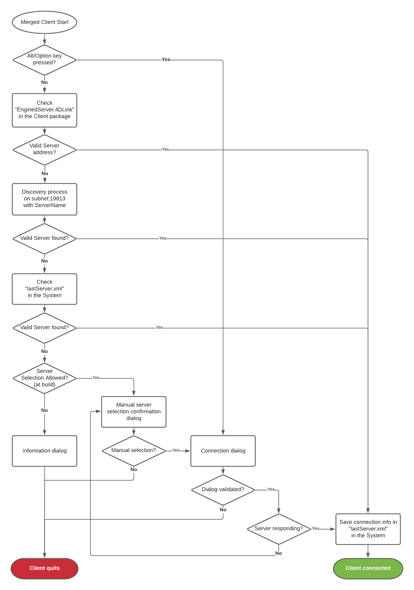
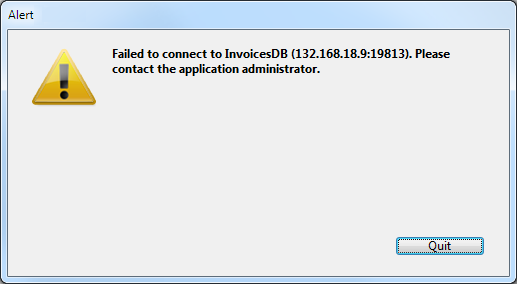
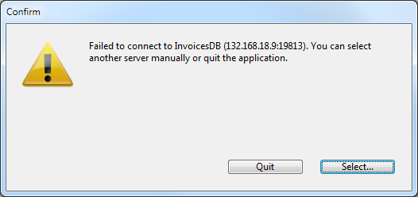
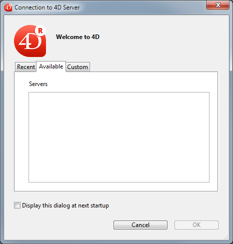

La gestión de las conexiones de las aplicaciones clientes abarca los mecanismos por los que una aplicación cliente fusionada se conecta al servidor objetivo, una vez que está en su entorno de producción.

## Escenario de conexión

El procedimiento de conexión para las aplicaciones cliente fusionadas admite los casos en los que el servidor dedicado no está disponible. El escenario de inicio de una aplicación cliente 4D es el siguiente:

1. Si la información de conexión válida se encuentra almacenada en el archivo "EnginedServer.4DLink" dentro de la aplicación cliente, la aplicación cliente se conecta a la dirección del servidor especificada.\
   O\
   La aplicación cliente intenta conectarse al servidor utilizando el servicio de descubrimiento (basado en el nombre del servidor, transmitido en la misma subred).\
   O\
   La aplicación cliente intenta conectarse al servidor utilizando el servicio de descubrimiento (basado en el nombre del servidor, transmitido en la misma subred).  
   O  
   La aplicación cliente intenta conectarse al servidor utilizando el servicio de descubrimiento (basado en el nombre del servidor, transmitido en la misma subred).

2. Si esto falla, la aplicación cliente intenta conectarse al servidor utilizando la información almacenada en la carpeta de preferencias del usuario de la aplicación (archivo "lastServer.xml", ver último paso).
3. Si esto falla, la aplicación cliente muestra una caja de diálogo de error de conexión.

- Si el usuario hace clic en el botón **Seleccionar...** (cuando lo permite el desarrollador 4D al momento de la generación, ver más abajo), se muestra la caja de diálogo estándar "Conexión al servidor".
- Si el usuario hace clic en el botón **Salir**, la aplicación cliente se cierra.

4. Si la conexión tiene éxito, la aplicación cliente guarda esta información de conexión en la carpeta de preferencias usuario de la aplicación para su uso futuro.

Todo el procedimiento se describe en el siguiente diagrama:



## Almacenando la última ruta del servidor

La última ruta servidor utilizada y validada se guarda automáticamente en un archivo llamado "lastServer.xml" en la carpeta de preferencias usuario de la aplicación. Esta carpeta se guarda en la siguiente ubicación:

```4d
userPrefs:=Get 4D folder(Carpeta 4D activa)
```

Este mecanismo aborda el caso en el que el servidor objetivo primario esté disponible temporalmente por alguna razón (modo mantenimiento, por ejemplo). Cuando se produce este caso por primera vez, se muestra la caja de diálogo de selección de servidor (si está permitido, ver más adelante) y el usuario puede seleccionar manualmente un servidor alternativo, cuya ruta se guarda si la conexión tiene éxito. Toda indisponibilidad posterior se gestionaría automáticamente a través de la información de la ruta "lastServer.xml".

> - Cuando las aplicaciones cliente no pueden beneficiarse permanentemente del servicio de descubrimiento, por ejemplo debido a la configuración de la red, se recomienda que el desarrollador indique un nombre de host en el momento de la generación utilizando la llave [IPAddress](../BuildApplication/client-server.md#ipaddress) en el archivo "BuildApp.4DSettings". El mecanismo aborda los casos de indisponibilidad temporal.
> - Presionar la tecla **Alt/Opción** al inicio para mostrar la caja de diálogo de selección del servidor sigue siendo soportado en todos los casos.

## Disponibilidad de la caja de diálogo de selección del servidor en caso de error

Puede elegir si mostrar o no la caja de diálogo estándar de selección de servidor en las aplicaciones cliente fusionadas cuando no se puede acceder al servidor. La configuración depende del valor de la [ServerSelectionAllowed](../BuildApplication/client-server.md#serverselectionallowed) La llave XML en la máquina donde se generó la aplicación:

- **Visualización de un mensaje de error sin poder acceder a la caja de diálogo de selección del servidor**.  
  Funcionamiento por defecto. La aplicación solo puede cerrarse.  
  `ServerSelectionAllowed`: **False** or key omitted

  

- **Visualización de un mensaje de error con acceso posible a la caja de diálogo de selección del servidor**.  
  El usuario puede acceder a la ventana de selección del servidor haciendo clic en el botón **Seleccionar...**.  
  `ServerSelectionAllowed`: **True**

    
  
