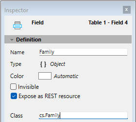

<!-- INCLUDE my.section.id.Desc -->

### Class

Esta propiedad está disponible para campos de tipo **Objeto** (en los proyectos 4D únicamente). Permite definir un **campo de tipo clase de objeto**, mejorando la compleción de código, la verificación de sintaxis y la validación en tiempo de ejecución al escribir código que incluya campos objeto.

Puede introducir cualquier nombre de clase válido en esta propiedad, incluyendo:

- Clases usuario (por ejemplo, `cs.MyClass`)
- Clases 4D integradas (por ejemplo, `4D.File`, `4D.Folder`)
- las clases [exposed](../Extensions/develop-components.md#sharing-of-classes) definidas por componentes (por ejemplo, `cs.MyComponent.MyClass`)

Si introduce un nombre de clase inválido, se activa una advertencia y se rechaza la entrada.

:::note

Las [**clases no transmisibles**](../Concepts/dt_object.md#streaming-support), como [las clases del modelo de datos ORDA](../ORDA/ordaClasses.md), [los identificadores de archivo](../API/FileHandleClass.md), [el servidor web](../API/WebServerClass.md)... no pueden asociarse a campos objeto.

:::

En su código, al asignar un valor a un campo de tipo clase de objeto, 4D verifica que pertenece a la clase declarada. Si no es así o si el objeto no tiene clase, se produce un error. El acceso a atributos desconocidos también provocará errores de sintaxis.

Para recuperar el nombre de la clase asociada en tiempo de ejecución, utilice la propiedad [`classID`](../API/DataClassClass.md#attributename), por ejemplo `ds.MyTable.MyField.classID`.

:::tip Entrada de blog relacionada

[Stricter class-based typing for objects](https://blog.4d.com/stricter-class-based-typing-for-objects/)

:::

### `4D.Vector` class

If you assign `4D.Vector` as the class of an Object type field, you define a **vector field**. Such fields store embessings and can be used to query data using AI features. See the [`4D.Vector` class](../API/VectorClass.md) documentation to see how to query with vectors.

Note that the [**4D Embedding Studio** component](corner.4d.com/component/4d-embedding-studio) can help you configuring and updating your 4D.Vector fields.

When you assign `4D.Vector` as the class of an Object type field, a specific icon is displayed as field type in the Structure editor: 

:::tip Entrada de blog relacionada

[Vector Indexing in 4D: Faster Similarity Search for 4D.Vector Fields](https://blog.4d.com/vector-indexing-in-4d-faster-similarity-search-for-4d-vector-fields)

:::

