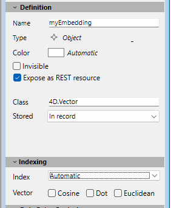
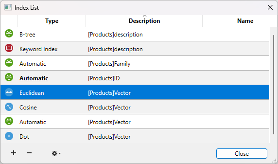
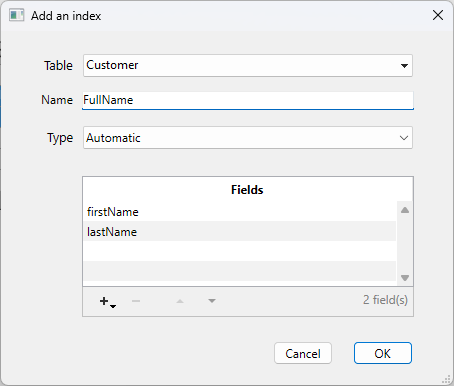

Puede asociar índices con campos que utiliza frecuentemente para buscar y ordenar. Por ejemplo, puede indexar LastName, CompanyName o ProductName si planea buscar o ordenar entidades usando estos atributos. También utiliza esta propiedad para campos que establecen relaciones entre las tablas.

Cuando un índice está asociado con un campo, 4D crea una tabla de índice interna para el campo. Esta tabla permite a 4D realizar búsquedas y ordenaciones rápidas en ese campo. Al buscar o ordenar en un campo indexado, 4D se mueve a través de datos secuencialmente, examinando cada registro en el orden. La indexación permite a 4D realizar búsquedas y ordenar los datos sin tener que revisar todos los registros.

Puede indexar campos de tipo Alpha, Text, Date, Time, Boolean, Integer, Long integer, Integer 64 bits, Real, Picture y Object. A medida que añade y elimina registros, 4D actualiza automáticamente su tabla de índices. Si crea un índice para un campo que ya existe, 4D indexa automáticamente los datos existentes. Puede especificar tantos campos indexados como desee. Los índices también se reconstruyen durante operaciones específicas, como la conversión de bases de datos anteriores o la [compactación de datos](../MSC/compact.md).

Cada tabla de índices puede contener hasta:

- 128 mil millones de llaves para los índices Alpha, Text y Float
- 256 mil millones de llaves para otros tipos de índice (datos escalares)

No indexar todos los campos. Un índice aumenta el tamaño de la base de datos, usando más espacio en el disco. Utilizar muchos índices también aumenta el tiempo necesario para guardar un registro desde que 4D actualiza la tabla con cada validación de registro.

Los campos indexados se muestran en el tipo **negrita** en el editor de estructura.

## Tipos de índices

4D ofrece diferentes tipos de índices. La elección entre los diferentes tipos se basa generalmente en el resultado esperado y el tipo de datos presentes en el campo. Hay cuatro tipos principales de índices:

- **Índice estándar:** estos son índices de un solo campo utilizados para acelerar las operaciones estándar de bases de datos (búsquedas y ordenes). 4D le permite elegir la arquitectura interna de este tipo de índice (excepto los campos de objetos): B-Tree o Cluster B-Tree.
- **Índice compuesto:** este índice almacena los valores combinados de dos o más campos que a menudo se buscan juntos, por ejemplo Apellido+Nombre.
- **Índice de palabras clave:** estos índices solo están disponibles para campos de tipo Alfa, Texto e Imagen. Su objetivo es facilitar la búsqueda rápida dentro del texto o, en el caso de las imágenes, entre las palabras clave asociadas a las imágenes.
- **Índices vectoriales**: estos índices están diseñados para acelerar las consultas IA basadas en los campos objeto almacenando las [representaciones vectoriales](./field-properties.md#4dvector-class).

### Índices estándar

Un índice estándar está destinado a acelerar las operaciones de base de datos (un índice estándar se refiere a un índice genérico frente a una palabra clave o índice compuesto). 4D ofrece dos tipos de arquitecturas para índices estándar: B-Tree y Cluster B-Tree.

- **B-Tree:** Índice de tipo B-Tree estándar. Este tipo de índice polivalente satisface la mayoría de los requisitos de indexación.
- **B-Clúster B-Tree:** índice de tipo B-Tree usando clusters. Esta arquitectura es más eficiente cuando el índice no contiene un gran número de llaves, es decir, cuando los mismos valores ocurren frecuentemente en los datos.

:::note

Un índice B-Tree asociado a un campo de tipo Texto almacena los primeros 1024 caracteres del campo (máximo). Por lo tanto, en este contexto, las búsquedas de cadenas que contengan más de 1024 caracteres fallarán.

:::

Cuando elige la arquitectura de índice, 4D también ofrece la opción Automática. En este caso, 4D selecciona automáticamente la arquitectura de acuerdo con el tipo de datos en cuestión.
La opción **Automática** es la única opción disponible para campos de tipo Objeto, excepto si asoció una clase 4D.Vector al campo ([ver abajo](#vector-index)). De hecho, con la opción **Automático**, todas las rutas de atributos se indexan automáticamente.

### Índices compuestos

Los índices compuestos almacenan los valores combinados de dos o más campos para cada entrada. El ejemplo clásico es un índice compuesto basado en los campos FirstName+LastName. La búsqueda de “Peter Smith” se optimizará en comparación con una búsqueda estándar (buscando “Smith” y luego buscando “Peter”).

4D aprovecha automáticamente los índices compuestos durante consultas y ordenaciones. Por ejemplo, si existe un índice compuesto “City+ZipCode”, se utilizará en el caso de una consulta del tipo “lastname=carter and city=new york y zipcode =102@”.

En el editor de estructuras, los índices compuestos solo se pueden crear usando el cuadro de diálogo de creación de índices. Para una descripción detallada de este cuadro de diálogo, consulte la sección "Crear un índice" a continuación.

### Índice de palabras claves

Puede utilizar un tipo específico de índice con los campos Alfa, Texto e Imagen: un índice de palabras claves.

- Cuando asocia este tipo de índice con un campo Alfa o Texto, el texto almacenado en el campo se indexará palabra por palabra. Todas las palabras serán indexadas incluso si tienen sólo 1 o 2 caracteres. Este tipo de índice acelerará las búsquedas de palabras clave posteriores entre los campos de texto de una manera dramática.  
  Es posible asociar tanto un índice estándar como un índice de palabras clave con los campos Alfa y Texto (cuando se almacena en los registros). 4D usará el índice apropiado dependiendo del contexto.

- Cuando asocia este tipo de índice con un campo Imagen, las búsquedas entre las palabras claves asociadas con las imágenes (metadatas) se aceleran considerablemente. Aviso: los índices de palabras claves se basan exclusivamente en metadatos del tipo IPTC/Keywords. Estos tipos de metadatos son soportados en particular por los formatos TIFF y JPEG (tenga en cuenta que BMP, PNG y GIF no los soportan). Otros tipos de metadatos no se gestionan mediante la indexación.  
  Los índices de palabras clave para las imágenes se actualizan automáticamente por 4D cada vez que se guarda el campo Imagen (cuando se crea o modifica un registro, cuando se importan datos, y así sucesivamente). Los metadatos de tipo IPTC/Keywords son indexados automáticamente por 4D cuando se encuentran en la imagen (no es necesario ejecutar el comando [`SET PICTURE METADATA`](../commands/set-picture-metadata) para incluirlos en el índice del campo Imagen).

Puede utilizar el comando [`DISTINCT VALUES`](../commands/distinct-values) para obtener la lista de palabras claves que contiene un índice de palabras claves.

Para utilizar los índices de palabras claves de imágenes o de texto, se emplea el operador [`%`](../Concepts/dt_string.md#keywords): este operador debe incluirse en las fórmulas de consulta o de ordenación para poder utilizar específicamente un valor de índice. Por ejemplo:

```4d
QUERY([PICTURES];[PICTURES]Photos %"cats")
// busca fotos relacionadas con la palabra clave gatos
```

Esto funciona de la misma manera para todos los comandos de consulta y ordenación: [`QUERY BY FORMULA`](../commands/query-by-formula), [`QUERY SELECTION`](../commands/query-selection), [`ORDER BY`](../commands/order-by), etc.

### Vector index

Un índice vectorial puede asociarse a un campo de tipo Object asociado a una `[clase](./field-properties.md#4dvector-class) `4D.Vector\`. En este caso, están disponibles las siguientes opciones:



- **Coseno**: el índice vectorial está optimizado para cálculos de [similitud coseno](../API/VectorClass.md#understanding-the-different-vector-computations).
- **Dot**: el índice vectorial está optimizado para cálculos de [similitud dot](../API/VectorClass.md#understanding-the-different-vector-computations).
- **Euclidiano**: el índice vectorial está optimizado para cálculos de [distancia euclidiana](../API/VectorClass.md#understanding-the-different-vector-computations).
- **Automático**: tipo de índice de objeto estándar ([ver arriba](#standard-indexes)). You can select this index type to handle null vectors, it will be automatically used in this case.

You can select one or more index types for your vector fields, the appropriate index will be automatically used depending on the actual computation. For optimization reasons, it is recommended to only select necessary index types.

:::tip Entrada de blog relacionada

[Vector Indexing in 4D: Faster Similarity Search for 4D.Vector Fields](http://blog.4d.com/vector-indexing-in-4d-faster-similarity-search-for-4d-vector-fields)

:::

:::warning Limitation: Vector indexes and transactions

Vector indexes are not compatible with [transaction processing](../Develop/transactions). When vector-indexed records are inserted, updated, or deleted within a transaction, the corresponding index changes are not committed or rolled back with the transaction. As a result, the vector index may become inconsistent with the database state after a rollback, and search results may not reflect the persisted data.

:::

## Index List

The  button of the toolbar in the Structure editor displays the Index List window. This window displays the list of all the indexes of the structure, regardless of their type:



The Index List can be used to view the main properties of the indexes:

- **Tipo:** tipo de índice. Each type of index (B-tree, Cluster B-tree, Keyword, Euclidean, Cosine, Dot) is depicted with a different icon.
- **Description:** Table and field(s) of index. For a composite index, this list contains all the fields of the index.
- **Nombre:** nombre del índice. This property is used in particular by the language commands. You can change or add an index name by double-clicking in this column.

The **[+]** button displays the index property dialog box and allows you to edit the selected index or to add a new index when no index was selected.  
The **[-]** button deletes the selected index (a confirmation dialog box appears).  
This button can be used more particularly to delete composite indexes.

Two additional commands are available in the menu associated with the tool button (enabled when an index is selected:

- **Edit:** Displays the properties of the selected index in the index property dialog box (see next paragraph). This command has the same effect as double-clicking on a row of the list (except for in the name area).
- **Rebuild:** Can be used to delete and rebuild the selected index. A confirmation dialog box appears when you select this command.

## Creating an index

To create a **standard index** directly:

1. Select a field then choose a value from the "Index" menu of the **Inspector palette**.
   **OR**  
   Right-click on the field then select a value from the **Index>** submenu of the context menu.

To create a **composite index** or any other type of index using the index creation dialog box:

1. Select several fields while holding down the **Shift** key (for adjacent selection) or **Ctrl** (Windows) or **Command** (macOS) button then right click on one of the fields and select **New Composite Index...** in the context menu.
   **OR**  
   Select the **New Index...** in the context menu of the table or select **Index** in the add objects menu of the Structure editor tool bar.

The index configuration dialog box then appears.



It contains the following elements:

- **Table:** List of all the database tables. Choose the table to which the index will belong from this menu.
- **Name:** Index name entry area. This name is used by the 4D language commands.
- **Type:** Selection menu for type of index to be created. If you keep the "Automatic" option, 4D will automatically choose the index type according to the contents of the field.
- **List of Fields:** This area is used to specify the field(s) associated with the index. It can contain a field by default depending on the current selection in the editor.

To add a field to the index, click on the **[+]** button. The list of fields of the selected table is displayed so that you can indicate the field to be added to the index.

- If you want to create a composite index, add each field to be included in the index successively. Once the list is completed, you can reorder the fields using the arrow buttons or using drag and drop.
- If you create a composite index based on primary key fields, make sure you put the fields in the same order in the primary key and in the index.
- If you have chosen the “Keyword Index” type, only Alpha, Text, or Picture fields can be selected. Also in this case, you can include only one field in the index.

To delete a field from the index, select it in the list and click on the **[-]** button.

Once the index has been configured, click on **OK** to generate the index.

## Deleting an index in the Structure editor

You can delete indexes that are no longer useful at any time. This can be carried out directly in the Structure editor or using the [Index List](#index-list) window.

To delete a standard index in the Structure editor:

1. Select the field associated with the index you want to delete, then choose the **None** or uncheck the **Keyword Index** option (for a keyword index) in the Index menu of the **Inspector palette**
   **OR**  
   Right-click on the field associated with the index, then choose the **None** or uncheck the **Keywords** option from the **Index>** submenu of the context menu.

The deletion (and viewing) of a composite index can only be carried out from the List Index window, see above.

## Reindexación de un campo

You can reindex a field at any time; in other words, rebuild the index table(s) associated with it, in accordance with the data present. This can be useful in the case of application maintenance.

Reindexing can be carried out using the **Rebuild** command in the [Index List](#index-list) window.

Note that modifying the [data language](../settings/database.md#text-comparison) or maintenance operations such as [compacting](../MSC/compact.md) will also cause the indexes to be rebuilt.
