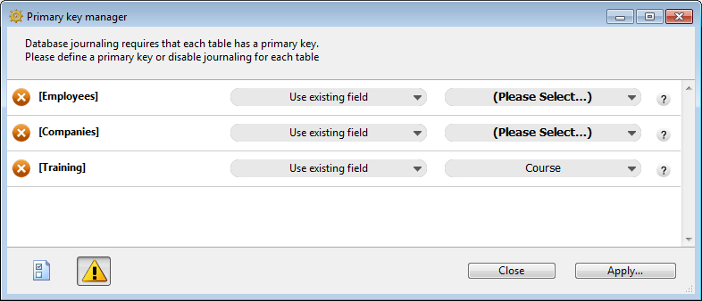

Tables are the foundation of every 4D database. Each table defines a collection of records that share the same set of fields and properties. In the Structure editor, tables are represented as graphic objects that you can create, rename, or delete, and whose attributes you can configure individually.

Using the tools provided by 4D, you can:

- Define tables and manage their primary keys and relations
- Set and edit table-level properties such as triggers, visibility, and replication
- Control naming rules and organize tables into folders for easier maintenance

## Creating a table

You can create a new table either directly in the Structure window, or via a dialog box. Direct creation is faster; but creation using the dialog box lets you specify certain parameters of the table and cancel the operation when necessary. You can also create tables using copy-paste.

- To create a new table directly:

1. Right-click an empty area of the Structure editor window, then choose **Add Table...** from the context menu.  
   **OR**  
   In the add objects menu of the [Structure editor toolbar](./structure-editor.md#toolbar), choose the Table option.

4D creates the table directly in the Structure editor. You can then change its name, add fields, etc.

:::note

If you want to put the table in a specific folder, you need to use the Home Page of the Explorer.

:::

- To create a new table using the "New table" dialog box:

1. Choose **New > Table...** in the **File** menu (or in the **New** button of the 4D tool bar).  
   **OR**  
   On the Tables Page of the Explorer, click on the **\[+]** button.

The "New table" dialog box appears. 4D names the first table `Table_1` and then numbers them sequentially:

2. (optional) Modify the [name of the table](../Concepts/identifiers.md#tables-and-fields) you want to create.
3. (optional) Specify the folder in which you want to place the new table.  
   By default, the table is placed at the highest level of the folder hierarchy ("Top Level"). Folders are handled in Home Page of the Explorer.
4. Click **OK** to validate.  
   4D creates a new table image. It becomes the selected table image in the Structure editor window.

- To create a new table by copy-paste:

1. Select and copy the table(s) to be duplicated.
2. Paste the table(s) in the Structure editor window.

The table is pasted with all its fields and properties.

## Renaming a table

You can rename tables at any time. If you have used the old table name in a method, 4D automatically changes it to the new name provided the method is closed. If the method is open, you must make the changes yourself. Each table name must be unique in the database.

You can rename a table directly in the Structure editor, in the Explorer, or using the Inspector palette.

To rename a table directly (Structure editor or Tables page of the Explorer), **click twice** on the table name (if the table is already selected, click once), so that it switches to editing mode:

Enter the new name and click outside of the table.

To rename a table using the Inspector palette of the Structure editor, double-click on the table name (or select **Table Properties...** in the context menu of the table) and enter the new name in the "Name" area.

4D displays the name and properties of the selected table in the Inspector palette. This palette also indicates the table number. If the Inspector palette is already open but is displaying the properties of another table or another object, just select the desired table image and the palette will then display its properties.

## Deleting a table

You can delete tables from your database. There are two ways of deleting tables in 4D: **permanent deletion** (the table and its data are actually removed from the database) and **non-permanent deletion** (the table is simply put into the Trash of the Explorer and may be recovered subsequently).

:::info

You can also remove tables using the [SQL engine of 4D](https://doc.4d.com/4Dv21/4D/21/4D-SQL-Reference.100-7649299.en.html).

:::

### Permanent deletion

To permanently delete one or more database tables in the Structure editor:

Select the table(s) to be deleted then choose **Clear** from the **Edit** menu or choose **Delete** from the context menu of the table.

A warning dialog box will ask you to confirm the operation. When you click **OK**, 4D carries out the following operations:

- The table is permanently deleted from the structure. All the data associated with the table are deleted permanently from the data file.
- Any trigger method associated with the table is deleted.
- The forms and lists associated with the table are transformed into project forms and are placed in the Trash of the Explorer.

### Non-permanent deletion

Non-permanent deletion of a table consists in putting it in the Trash of the project (which can be accessed via the Explorer), just like the file deletion mechanisms implemented by Windows and macOS.

The table then no longer appears in the 4D editors and its contents become inaccessible but it can still be recovered so long as the Trash is not emptied.

To put one or more tables into the Trash from the Structure editor, choose the **Move to Trash** command from the context menu of the table or select the table(s) to be deleted then press the **Delete** or **Backspace** key. A confirmation dialog box appears. If you click **OK**, the table is put into the Trash. It can be recovered at any time from the Trash Page of the Explorer.

### Numbers of deleted tables

When a table is deleted, the other tables of the database are not renumbered, so as to avoid endangering the stability of the database. It is therefore possible, for example, to have a database with three tables numbered 2, 4 and 5.

Note that the numbers of permanently deleted tables are reused when new tables are created subsequently.

## Table properties

You can set several properties for tables using the **Inspector palette** or, for certain properties, using the context menu for the tables.

### Triggers

A [trigger](./triggers) is a method that runs automatically when certain events related to the table occur. Trigger events can be set in the **Inspector palette** or using the context menu associated with the table (right-click on the title area of the table). Check each event for which you want to [activate the trigger](./triggers#activating-and-creating-a-trigger).

You can access the trigger of a table directly from the Structure editor by clicking on the **Edit...** button in the Inspector palette or by selecting **Edit Method...** in the context submenu. You can also create and display triggers with the **Methods Page** of the Explorer.

The [information bar](./structure-editor.md#information-bar) of the **Structure editor** indicates the triggers that are activated for each table.

### Atributos

You can set different attributes to configure the appearance and general behavior of each table.

#### Invisible

This option lets you make a table invisible in the Application mode and for plug-ins. You can activate this option for utility tables or tables that are not being used temporarily.

Making a table invisible allows you to limit the operations that a user can perform on a table by making the table and its fields invisible in all editors and some dialog boxes that appear in the Application environment. It can also not be used by plug-ins.

The editors and dialog boxes concerned in the Application environment include the following:

- All query editors
- Order by editor
- [Label editor](../Desktop/labels.md)
- Quick report editor
- Exporting and importing data dialog boxes
- Formula editor

In each of these editors, the user is unable to see or choose the table or any of its fields. For instance, the user cannot include any fields from an invisible table in a report or label.

:::note Notas

- When using these editors, users have the option of saving their specifications (e.g., the query or sort they created) to disk files. In this case, any specified tables or fields that are subsequently made invisible may still be used in the operation.
- Users can type the names of invisible tables and fields in the dialog box.
- It is also possible to set this attribute for each field individually.

:::

Invisible tables and fields are displayed in *italics* in the Structure editor window.

#### Color of the table image

A color can be attributed to each table. Using colors helps to organize the structure of a large database. For example, you could use one color for all tables that relate to customers and another for tables that relate to inventory.

:::note

It is also possible to attribute a color to each field individually as well as to each relation.

:::

To set the color of one or more tables, make your selection and then choose the color using:

- The **Color** button of the Structure editor toolbar
- The **Color** command in the context menu of the tables
- The **Color** option in the **Inspector palette**

The **Automatic** option can be used to apply the standard original color to the table.

#### Expose as REST resource

This option controls whether the [table is exposed to REST requests](../REST/configuration.md#exposing-tables).

:::note Notas

- You can also set this option at the level of each field of the table.
- This option is used in the context of [ORDA remote datastore features](../ORDA/remoteDatastores.md).

:::

#### Records definitively deleted

This option lets you optimize the deletion of a selection of records made using the [`DELETE SELECTION`](../commands/delete-selection) command.

When 4D deletes a selection, the record markers are also deleted. A record marker is a header attached to the record that contains information relating to this record. Deleting both markers and records is slower than deleting only records. In certain cases, it may be desirable to not automatically delete the record markers.

To accelerate the deletion of a large selection made using the [`DELETE SELECTION`](../commands/delete-selection) command, deselect the **Records definitively deleted** option. Record markers will then not be deleted. This option cannot be set by programming.

#### Enable replication

:::info Obsoleto

Replication and synchronize mechanisms using SQL are deprecated as of 4D 20 R3. They are still supported but it is now recommended to use the [ORDA-based Global Stamp feature](../ORDA/global-stamp.md), providing a flexible and robust solution to implement replication and synchronization in 4D.

:::

#### Include in Log File

By default, this option is checked for all new tables created and for all tables in converted databases. Check this option in order for operations performed on the table’s data to be included in the [database log file](../Backup/log.md) (when it is generated).

This option must generally be checked for most tables. However, for optimization purposes, you can uncheck it, for example for temporary tables or tables used for importing data.

It is important to note that this option only indicates that the table’s data must be journaled if the database uses a log file; it does not enable the journaling procedure itself at the database level.

:::note Notas

- This option is grayed out when the table does not have a primary key.
- 4D displays a warning icon to the right of the **Include in Log File** option when the required conditions are not met. As long as this icon is shown, journaling is not yet enabled.

:::

#### Encryptable

This option controls whether the data stored in the table must be encrypted on disk when [data file encryption is enabled](../MSC/encrypt.md).

Since encrypting/decrypting can be time consuming, selecting the tables to encrypt allows you to optimize the performance of encrypted databases. For example, you could set only the tables that contain personal data as **Encryptable**.

Note that this option flags table(s); it does not perform any encryption or decryption operation. To actually encrypt or decrypt selected table(s) in the data file, you must use the [MSC](../MSC/encrypt.md) or call the [`Encrypt data file`](../commands/encrypt-data-file) command.

:::warning

- When you modify the value of this option for a table in an already encrypted database, you must also use the [MSC](../MSC/encrypt.md) or call the [`Encrypt data file`](../commands/encrypt-data-file) command to preserve data consistency. Otherwise, you will not be allowed to save data in the modified table (errors will be returned by 4D when trying to save records).
- Encryption of data stored outside of the data file is not managed by this option.

:::

### Comentarios

The **Comments** area of the **Inspector palette** lets you store additional information about the table. These comments are available for all the developers. Note that each field and each relation has its own comments area.

### SQL

- The "Schemas" menu lists all the SQL schemas specified in the database. You can use this menu to set the schema to which the table will belong (it is also possible to modify this property via SQL commands). Every database has at least one schema, named **DEFAULT_SCHEMA**. By default, all the tables belong to this schema. For more information about SQL schemas, refer to the [**Schemas** section](https://doc.4d.com/4Dv21/4D/21/4D-SQL-engine-implementation.300-7649386.en.html#148386) in the *4D SQL Reference guide*.
- The information area indicates whether the name of the table respects the rules regarding SQL nomenclature (for example, unlike 4D, SQL does not allow a field name to contain spaces).

### Primary keys

A primary key designates the field(s) used for uniquely identifying the records in a table. Setting a primary key is necessary for the [journaling features](../Backup/log.md).

You create, edit and/or remove primary keys directly using the context menu of the Structure editor or the [Primary key manager](#primary-key-manager).

> **Note:** Primary keys can also be set using the SQL language by means of the **PRIMARY KEY** clause followed by the list of columns.

#### Rules for using primary key fields

Primary key fields should be handled with care to ensure data integrity at all times. In particular, a primary key field must respect the following rules:

- it must not be empty,
- it must be unique,
- once created, it should (in principle) never be modified, especially if:
  - [Global stamp features](../ORDA/global-stamp.md) are enabled,
  - [REST (or similar) feature](../REST/gettingStarted.md) is enabled,
  - the database is periodically synchronized (backup or logical mirror using the [log file](../Backup/log.md)).

Modifying primary key field value is highly discouraged, even if 4D allows it for specific use cases.  
If you absolutely need to modify a primary key value (e.g. you used a social security number field as primary key and incorrect values have been entered), it is preferable to disable (remove) the current primary key and to add a new field used as primary key with automatic assignment.

Primary key fields can be long integer type or UUID format (alpha type). In most cases, we recommend the UUID format with the Auto UUID option enabled. Even though the long integer type takes up less disk space, UUIDs have many advantages, for example, facilitating the merge of independent databases, data import/export, implementation of elaborate mirror/replication strategies or synchronization with external systems.

#### Setting primary keys

To create a primary key from the Structure editor:

1. Select the field(s) that make up the table’s primary key.
2. Right-click and choose **Create primary key** in the context menu (this command is only displayed for fields whose type is eligible for primary keys).

You cannot have more than one primary key for each table. If a primary key is already specified, a warning dialog box appears indicating that the existing primary key will first be disabled.

The primary key is created immediately. Fields included in the primary key are *underlined* in the editor and their SQL description displays the **PRIMARY KEY** keyword.

When you create a primary key in a table that already contains records (using an existing field or adding a new one), 4D checks the conformity of all the values present or automatically performs updating operations:

- The field(s) belonging to the primary key cannot contain any duplicated values. If any duplicated values for the key exist in the table records, a warning dialog box appears to indicate that it is not possible to create the key because of this.
- If the duplicated values are blank or null values (case of an added key field), you can check the corresponding automatic generation option (for Alpha fields in or for Longint fields).  
  In this case, 4D examines all the records of the table and automatically assigns a calculated value to each primary key. Note that this process is sequential and may require a significant amount of time if there are a sizable number of records.

> **Note:** The column(s) belonging to the primary key do not accept NULL values.

#### Removing primary keys

To remove a primary key from a table:

1. Right-click on the table containing the primary key and choose **Remove primary key** in the context menu:

[picture here]

A confirmation dialog box appears. Click **OK** to remove the primary key.

#### Default primary key field

Every new table created in the database contains a primary key by default. This field, named **"ID"** by default, is of the Longint type, and has, in particular, the following attributes:

- Unique,
- Reject NULL value input,
- Autoincrement,
- Automatic index.

You can use this field as is, or change its name and/or its properties if you want (for example, you may want to use an UUID field). You can also delete it if you want to use another field (or fields) as primary key(s). However, it is strongly recommended to keep at least one primary key in each 4D table.

:::note

In the [Structure page of the Preferences](../Preferences/structure.md), you can modify the name and type of the primary keys that are created by default.

:::

:::info

Default primary keys are not added to tables that are created using the SQL **CREATE TABLE** command, or tables that are imported into the database.

:::

## Primary key manager

The **Primary key manager** is an assistant intended to facilitate the resolution of errors related to the presence of tables without primary keys, particularly in the context of a journaled database:

You can use this assistant to:

- diagnose the compatibility of each database table with the 4D journaling mechanism,
- propose a correction for each table found that is not compatible, more particularly by creating a primary key.

### Accessing assistant

There are two ways to display the **Primary key manager** window:

- From the **Primary key error window**: click on the **Run assistant** button to display the assistant window.

**Note:** The Primary key manager is displayed in Design mode. If the database starts in Application mode, the assistant does not appear right away and you will need to switch to Design mode.

- From the **Structure editor**: click on the button in the [toolbar](./structure-editor.md#toolbar) of this window to display the assistant.

### Using the assistant

The **Primary key manager** window displays a line for every table in the database:

The assistant does not take tables placed in the Trash into account.

The icon at the head of each line indicates whether the table requires the attention of the user:

| Icono                                  | Estado                                               | Descripción                                                                                                                                                                                                                                                               |
| -------------------------------------- | ---------------------------------------------------- | ------------------------------------------------------------------------------------------------------------------------------------------------------------------------------------------------------------------------------------------------------------------------- |
|  | OK                                                   | A valid primary key is set for the table.                                                                                                                                                                                                                 |
|  | No primary key, eligible field(s) | The table does not have a primary key but contains at least one field that could become the primary key.                                                                                                                                                  |
|  | No primary key, no eligible fields                   | The table does not have a primary key and does not have any fields that could become one (you will have to create a primary key field).                                                                                                |
|  | Atención                                             | The table does not have a primary key but it is not journaled ("Include in Log File" option disabled for the table). It is possible to hide tables that have this status by unchecking the option to display warnings. |

For each journaled table that does not have a primary key, the assistant displays a menu to set the action to be performed. You can choose from the following options:

- **Ignore:** does not modify the table. The errors are not corrected and the status of the table is not changed. Use this option if you wish to intervene later, or if you want to create the primary key outside of the assistant. This option is necessary in particular when you want to create a primary key based on several fields in the table.

- **Use existing field** (only shown for tables with at least one field eligible to be a primary key): designates one of the table fields as the primary key. When you choose this option, the assistant suggests the most appropriate field by default. If you want to use another field or if the assistant fails to identify a particularly suitable field (the assistant displays *Select a field*), click on the second menu in the row to display the list of eligible fields.

- **Create a new field:** creates a new primary key field in the table. This field will have the same characteristics as the one [added by default when a new table is created](#default-primary-key-field). By default, the assistant proposes to create a field of the Longint type, named “ID”. You can modify the name and type of default primary key fields in the [Preferences](../Preferences/structure.md#primary-key). You can also change the name and/or type of the field directly in the Primary key manager window.

- **Do not log this table:** unchecks the [**Include in Log File**](#include-in-log-file) option for the table. You can choose this option in the case of temporary tables. After you validate this dialog box, a “Warning” status is assigned to the table.

Once you have made your settings, click on **Apply...** to apply the changes to the database or **Close** to close the dialog box without modifying the database. When you click on **Apply...**, a confirmation dialog box appears listing the operations to be performed; you can either confirm or cancel the operation.

If you have designated existing fields as primary keys, 4D checks each table to make sure that its existing data respects the rules concerning uniqueness and null values for this type of field. If, for example, a field contains duplicate values or null values, an error is generated. You will need to find and remove these anomalies before you can enable journaling for the data.

:::note

In order to facilitate the correction of errors related to primary keys, the primary key values are displayed in the [**Activity analysis** page of the Maintenance and Security Center](../MSC/analysis.md).

:::
