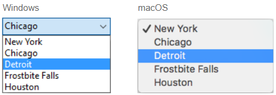
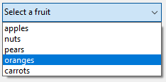
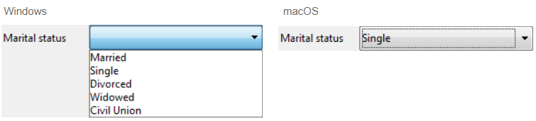
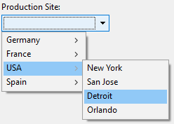

Las listas desplegables son objetos de formulario que permiten al usuario seleccionar de una lista. Los elementos mostrados en la lista desplegable se gestionan mediante un objeto, array, una lista de selección o una acción estándar.

En macOS, las listas desplegables también se denominan a veces "menú emergente". Ambos nombres se refieren a los mismos objetos. Como muestra el siguiente ejemplo, el aspecto de estos objetos puede variar ligeramente según la plataforma:



## Tipos de listas desplegables

Puede crear diferentes tipos de listas desplegables con distintas funcionalidades. Para definir un tipo, seleccione los valores apropiados **Tipo de expresión** y **Tipo de datos** en la lista Propiedades o utilice su equivalente JSON.

| Tipo                                        | Funcionalidades                                                                           | Tipo de expresión | Tipos de datos                       | Definición JSON                                                                                                                     |
| ------------------------------------------- | ----------------------------------------------------------------------------------------- | ----------------- | ------------------------------------ | ----------------------------------------------------------------------------------------------------------------------------------- |
| Object                                      | Creado sobre una colección                                                                | Object            | Numeric, Text, Date o Time           | `dataSourceTypeHint: object` + `numberFormat: <format>` or `textFormat: <format>` o `dateFormat: <format>` o `timeFormat: <format>` |
| Array                                       | Basado en un array                                                                        | Array             | Numeric, Text, Date o Time           | `dataSourceTypeHint: arrayNumber` o `arrayText` o `arrayDate` o `arrayTime`                                                         |
| Lista de selección guardada como valor      | Crear en una lista de selección (estándar)                             | Lista             | Valor del elemento seleccionado      | `dataSourceTypeHint: text` + `saveAs: value`                                                                                        |
| Lista de selección guardada como referencia | Creado sobre una lista de selección. La posición del elemento es guardada | Lista             | Referencia del elemento seleccionado | `dataSourceTypeHint: integer` + `saveAs: reference`                                                                                 |
| Lista de selección jerárquica               | Puede mostrar contenido jerárquico                                                        | Lista             | Referencia de la lista               | `dataSourceTypeHint: integer`                                                                                                       |
| Acción estándar                             | Creado automáticamente por la acción                                                      | *cualquiera*      | *todo excepto referencia de lista*   | toda definición + `action: <action>` (+ `focusable: false` para acciones que se aplican a otras áreas)           |

## Gestión de listas desplegables

### Utilizar un objeto

> Esta funcionalidad sólo está disponible en proyectos 4D.

Un [objeto](Concepts/dt_object.md) encapsulando una [colección](Concepts/dt_collection.md) puede utilizarse como fuente de datos de una lista desplegable. El objeto debe contener las siguientes propiedades:

| Propiedad      | Tipo                 | Descripción                                                                                                                                                                                                                                                                             |
| -------------- | -------------------- | --------------------------------------------------------------------------------------------------------------------------------------------------------------------------------------------------------------------------------------------------------------------------------------- |
| `valores`      | Collection           | Obligatorio - Colección de valores escalares. Todos los valores deben ser del mismo tipo. Tipos soportados:<li>cadenas</li><li>números</li><li>fechas</li><li>horas</li>Si está vacío o no se define, la lista desplegable estará vacía |
| `index`        | number               | Índice del elemento seleccionado actualmente (valor comprendido entre 0 y `collection.length-1`). Si se establece -1, `currentValue` se muestra como una cadena de marcador de posición                                                              |
| `currentValue` | igual que Collection | Elemento seleccionado actualmente (se utiliza como valor de marcador de posición si se define por código)                                                                                                                                                            |

Si el objeto contiene otras propiedades, se ignoran.

Para inicializar el objeto asociado a la lista desplegable, puede:

- Introduzca una lista de valores por defecto en las propiedades del objeto seleccionando `\<Lista Estática>` en el tema [Fuente de Datos](properties_DataSource.md) de la Lista de Propiedades. Los valores por defecto se cargan en un objeto automáticamente.

- Ejecutar código que crea el objeto y sus propiedades. Por ejemplo, si "myList" es la variable  asociada a la lista desplegable, puede escribir en el evento de formulario [On Load](Events/onLoad.md):

```4d
// Form.myDrop es la fuente de datos del objeto formulario
 
Form.myDrop:=New object
Form.myDrop.values:=New collection("apples"; "nuts"; "pears"; "oranges"; "carrots")
Form.myDrop.index:=-1  //currentValue es un marcador de posición
Form.myDrop.currentValue:="Select a fruit" 
```

La lista desplegable se muestra con la cadena del marcador de posición:


Después de que el usuario seleccione un valor:



```4d
Form.myDrop.values // ["apples","nuts","pears","oranges","carrots"]
Form.myDrop.currentValue //"oranges"
Form.myDrop.index //3
```

### Utilizar un array

Un [array](Concepts/arrays.md) es una lista de valores en memoria a la que se hace referencia por el nombre del array. Una lista desplegable puede mostrar un array como una lista de valores cuando se hace clic en ella.

Para inicializar el array asociado a la lista desplegable, puede:

- Introduzca una lista de valores por defecto en las propiedades del objeto seleccionando `\<Lista Estática>` en el tema [Fuente de Datos](properties_DataSource.md) de la Lista de Propiedades. Los valores por defecto se cargan en un array automáticamente. Puede referirse al array utilizando el nombre de la variable asociada al objeto.

- Antes de mostrar el objeto, ejecute el código que asigna valores a los elementos del array. Por ejemplo:

```4d
  ARRAY TEXT(aCities;6) 
  aCities{1}:="Philadelphia" 
  aCities{2}:="Pittsburg" 
  aCities{3}:="Grand Blanc" 
  aCities{4}:="Bad Axe" 
  aCities{5}:="Frostbite Falls" 
  aCities{6}:="Green Bay" 
```

En este caso, el nombre de la [variable](properties_Object.md#variable-or-expression) asociada al objeto en el formulario debe ser `aCities`. Este código podría colocarse en el método formulario y ejecutarse cuando se ejecute el evento formulario `On Load`.

- Antes de que se muestre el objeto, cargue los valores de una lista en el array utilizando el comando [`LIST TO ARRAY`](../commands/list-to-array). Por ejemplo:

```4d
   LIST TO ARRAY("Cities";aCities)
```

En este caso también, el nombre de la [variable](properties_Object.md#variable-or-expression) asociada al objeto en el formulario debe ser `aCities`. Este código puede ejecutarse en lugar de las sentencias de asignación mostradas anteriormente.

Si necesita guardar la elección del usuario en un campo, deberá utilizar una sentencia de asignación que se ejecute después de aceptar el registro. El código podría ser así:

```4d
  Case of
    :(Form event=On Load)
       LIST TO ARRAY("Cities";aCities)
       If(Record number([People])<0) //nuevo registro
          aCities:=3 //mostrar un valor por defecto
       Else //registro existente, mostrar valor almacenado
          aCities:=Find in array(aCities;City)
       End if
    :(Form event=On Clicked) //el usuario modifica la selección
       City:=aCities{aCities} //el campo obtiene un nuevo valor
    :(Form event=On Validate)
       City:=aCities{aCities}
    :(Form event=On Unload)
       CLEAR VARIABLE(aCities)
 End case
```

Debe seleccionar cada evento que pruebe en sus sentencia Case. Los arrays siempre contienen un número finito de elementos. La lista de elementos es dinámica y puede ser modificada por un método. Los elementos de un array pueden modificarse, ordenarse y añadirse.

### Utilizar una lista de selección

Si desea utilizar una lista desplegable para gestionar los valores de un área de entrada (campo listado o variable), 4D le permite hacer referencia al campo o variable directamente como [fuente de datos](properties_Object.md#variable-or-expression) de la  Esto facilita la gestión de los campos/variables listados. Esto facilita la gestión de los campos/variables listados.

Por ejemplo, en el caso de un campo "Color" que sólo puede contener los valores "Blanco", "Azul", "Verde" o "Rojo", es posible crear una lista que contenga estos valores y asociarla a una lista desplegable que haga referencia al campo "Color" 4D. 4D se encarga entonces de gestionar automáticamente la entrada y la visualización del valor actual en el formulario.

> Si utiliza una lista jerárquica, sólo se muestra el primer nivel y se puede seleccionar. Si utiliza una lista jerárquica, sólo se muestra el primer nivel y se puede seleccionar.

Para asociar una lista desplegable a un campo o variable, introduzca directamente el nombre del campo o variable como campo [Variable o Expresión](properties_Object.md#variable-or-expression) de la lista desplegable en la Lista de propiedades.

> No es posible utilizar esta funcionalidad con una lista desplegable de objetos o arrays. Si introduce un nombre de campo en el área "Variable o expresión", deberá utilizar una lista de selección.

Cuando se ejecuta el formulario, 4D gestiona automáticamente la lista desplegable durante la introducción o la visualización: cuando un usuario elige un valor, éste se guarda en el campo; este valor de campo se muestra en la lista desplegable cuando se visualiza el formulario:



#### Valor del elemento seleccionado o Referencia del elemento seleccionado

Cuando haya asociado una lista desplegable con una lista de opciones y con un campo o una variable, puede definir la propiedad [**Tipo de datos**](properties_DataSource.md#data-type-list) en **Valor del elemento seleccionado** o **Referencia del elemento seleccionado**. Esta opción permite optimizar el tamaño de los datos guardados.

### Uso de una lista de selección jerárquica

Una lista desplegable jerárquica tiene una sublista asociada a cada elemento de la lista. Este es un ejemplo de lista desplegable jerárquica:



> En los formularios, las listas desplegables jerárquicas están limitadas a dos niveles.

Puede asignar la lista de selección jerárquica al objeto de lista desplegable utilizando el campo [Lista de selección](properties_DataSource.md#choice-list) de la Lista de propiedades.

Las listas jerárquicas desplegables se gestionan utilizando los comandos **Listas jerárquicas** del Lenguaje 4D. Todos los comandos que soportan la sintaxis `(*; "name")` pueden utilizarse con listas desplegables jerárquicas, por ejemplo, [`List item parent`](../commands/list-item-parent).

### Utilizar una acción estándar

Puede crear automáticamente una lista desplegable utilizando una acción estándar. Esta funcionalidad es soportada en los siguientes contextos:

- Uso de la acción estándar `gotoPage`. En este caso, 4D mostrará automáticamente la [página del formulario](FormEditor/forms.md#form-pages) que corresponda al número del elemento seleccionado. Por ejemplo, si el usuario selecciona el tercer elemento, 4D mostrará la tercera página del formulario actual (si existe). En tiempo de ejecución, la lista desplegable muestra por defecto los números de página (1, 2...).

- Uso de una acción estándar que muestra una sublista de elementos, por ejemplo `backgroundColor`. Esta funcionalidad requiere que:
  - un área de texto con estilo ([área 4D Write Pro](writeProArea_overview.md) o [entrada](input_overview.md) con la propiedad [multiestilo](properties_Text.md#multi-style)) está presente en el formulario como objetivo de la acción estándar.
  - la propiedad [focusable](properties_Entry.md#focusable) no está definida en la lista desplegable.
    En tiempo de ejecución, la lista desplegable mostrará una lista automática de valores, por ejemplo, colores de fondo. Puede reemplazar esta lista automática asignando además una lista de selección en la que cada elemento tenga asignada una acción estándar personalizada.

> Esta funcionalidad no puede utilizarse con una lista desplegable jerárquica.

## Acciones estándar soportadas

Las siguientes acciones están disponibles en el selector de acciones estándar de la lista desplegable. Consulte [Acciones estándar](../Desktop-legacy/standard-actions.md) y [Acciones estándar 4D Write Pro](../WritePro/user-legacy/standard-actions.md) para obtener las descripciones y los requisitos de las acciones.

[`gotoPage`](../Desktop-legacy/standard-actions.md#gotopage) - [`fontSize`](../Desktop-legacy/standard-actions.md#fontsize) - [`color`](../Desktop-legacy/standard-actions.md#color) - [`backgroundColor`](../WritePro/user-legacy/standard-actions.md#action-backgroundcolor) - [`textUnderlineStyle`](../WritePro/user-legacy/standard-actions.md#action-textunderlinestyle) - [`textUnderlineColor`](../WritePro/user-legacy/standard-actions.md#action-textunderlinecolor) - [`textLinethroughStyle`](../WritePro/user-legacy/standard-actions.md#action-textlinethroughstyle) - [`textLinethroughColor`](../WritePro/user-legacy/standard-actions.md#action-textlinethroughcolor) - [`textShadowOffset`](../WritePro/user-legacy/standard-actions.md#action-textshadowoffset) - [`textShadowColor`](../WritePro/user-legacy/standard-actions.md#action-textshadowcolor) - [`textTransform`](../WritePro/user-legacy/standard-actions.md#action-texttransform) - [`dpi`](../WritePro/user-legacy/standard-actions.md#action-dpi) - [`zoom`](../WritePro/user-legacy/standard-actions.md#action-zoom) - [`userUnit`](../WritePro/user-legacy/standard-actions.md#action-userunit) - [`pageMode`](../WritePro/user-legacy/standard-actions.md#action-pagemode) - [`pageSize`](../WritePro/user-legacy/standard-actions.md#action-pagesize) - [`tabDecimalSeparator`](../WritePro/user-legacy/standard-actions.md#action-tabdecimalseparator) - [`pageOrientation`](../WritePro/user-legacy/standard-actions.md#action-pageorientation) - [`section/pageOrientation`](../WritePro/user-legacy/standard-actions.md#action-pageorientation) - [`columnCount`](../WritePro/user-legacy/standard-actions.md#action-columncount) - [`section/columnCount`](../WritePro/user-legacy/standard-actions.md#action-columncount) - [`columnSpacing`](../WritePro/user-legacy/standard-actions.md#action-columnspacing) - [`section/columnSpacing`](../WritePro/user-legacy/standard-actions.md#action-columnspacing) - [`columnRuleStyle`](../WritePro/user-legacy/standard-actions.md#action-columnrulestyle) - [`section/columnRuleStyle`](../WritePro/user-legacy/standard-actions.md#action-columnrulestyle) - [`columnRuleColor`](../WritePro/user-legacy/standard-actions.md#action-columnrulecolor) - [`section/columnRuleColor`](../WritePro/user-legacy/standard-actions.md#action-columnrulecolor) - [`columnRuleWidth`](../WritePro/user-legacy/standard-actions.md#action-columnrulewidth) - [`section/columnRuleWidth`](../WritePro/user-legacy/standard-actions.md#action-columnrulewidth) - [`bookmark`](../WritePro/user-legacy/standard-actions.md#action-bookmark) - [`width`](../WritePro/user-legacy/standard-actions.md#action-width) - [`paragraph/width`](../WritePro/user-legacy/standard-actions.md#action-width) - [`image/width`](../WritePro/user-legacy/standard-actions.md#action-width) - [`column/width`](../WritePro/user-legacy/standard-actions.md#action-width) - [`image/height`](../WritePro/user-legacy/standard-actions.md#action-height) - [`row/height`](../WritePro/user-legacy/standard-actions.md#action-height) - [`minWidth`](../WritePro/user-legacy/standard-actions.md#action-minwidth) - [`paragraph/minWidth`](../WritePro/user-legacy/standard-actions.md#action-minwidth) - [`image/minWidth`](../WritePro/user-legacy/standard-actions.md#action-minwidth) - [`minHeight`](../WritePro/user-legacy/standard-actions.md#action-minheight) - [`paragraph/minHeight`](../WritePro/user-legacy/standard-actions.md#action-minheight) - [`image/minHeight`](../WritePro/user-legacy/standard-actions.md#action-minheight) - [`margin`](../WritePro/user-legacy/standard-actions.md#action-margin) - [`doc/margin`](../WritePro/user-legacy/standard-actions.md#action-margin) - [`paragraph/margin`](../WritePro/user-legacy/standard-actions.md#action-margin) - [`paragraph/inside/margin`](../WritePro/user-legacy/standard-actions.md#action-margin) - [`paragraph/outside/margin`](../WritePro/user-legacy/standard-actions.md#action-margin) - [`image/margin`](../WritePro/user-legacy/standard-actions.md#action-margin) - [`section/margin`](../WritePro/user-legacy/standard-actions.md#action-margin) - [`header/margin`](../WritePro/user-legacy/standard-actions.md#action-margin) - [`footer/margin`](../WritePro/user-legacy/standard-actions.md#action-margin) - [`table/margin`](../WritePro/user-legacy/standard-actions.md#action-margin) - [`padding`](../WritePro/user-legacy/standard-actions.md#action-padding) - [`doc/padding`](../WritePro/user-legacy/standard-actions.md#action-padding) - [`paragraph/padding`](../WritePro/user-legacy/standard-actions.md#action-padding) - [`paragraph/inside/padding`](../WritePro/user-legacy/standard-actions.md#action-padding) - [`paragraph/outside/padding`](../WritePro/user-legacy/standard-actions.md#action-padding) - [`image/padding`](../WritePro/user-legacy/standard-actions.md#action-padding) - [`section/padding`](../WritePro/user-legacy/standard-actions.md#action-padding) - [`header/padding`](../WritePro/user-legacy/standard-actions.md#action-padding) - [`footer/padding`](../WritePro/user-legacy/standard-actions.md#action-padding) - [`cell/padding`](../WritePro/user-legacy/standard-actions.md#action-padding) - [`column/padding`](../WritePro/user-legacy/standard-actions.md#action-padding) - [`doc/backgroundColor`](../WritePro/user-legacy/standard-actions.md#action-backgroundcolor) - [`paragraph/backgroundColor`](../WritePro/user-legacy/standard-actions.md#action-backgroundcolor) - [`image/backgroundColor`](../WritePro/user-legacy/standard-actions.md#action-backgroundcolor) - [`section/backgroundColor`](../WritePro/user-legacy/standard-actions.md#action-backgroundcolor) - [`header/backgroundColor`](../WritePro/user-legacy/standard-actions.md#action-backgroundcolor) - [`footer/backgroundColor`](../WritePro/user-legacy/standard-actions.md#action-backgroundcolor) - [`table/backgroundColor`](../WritePro/user-legacy/standard-actions.md#action-backgroundcolor) - [`row/backgroundColor`](../WritePro/user-legacy/standard-actions.md#action-backgroundcolor) - [`cell/backgroundColor`](../WritePro/user-legacy/standard-actions.md#action-backgroundcolor) - [`column/backgroundColor`](../WritePro/user-legacy/standard-actions.md#action-backgroundcolor) - [`backgroundPositionH`](../WritePro/user-legacy/standard-actions.md#action-backgroundpositionh) - [`doc/backgroundPositionH`](../WritePro/user-legacy/standard-actions.md#action-backgroundpositionh) - [`paragraph/backgroundPositionH`](../WritePro/user-legacy/standard-actions.md#action-backgroundpositionh) - [`image/backgroundPositionH`](../WritePro/user-legacy/standard-actions.md#action-backgroundpositionh) - [`section/backgroundPositionH`](../WritePro/user-legacy/standard-actions.md#action-backgroundpositionh) - [`header/backgroundPositionH`](../WritePro/user-legacy/standard-actions.md#action-backgroundpositionh) - [`footer/backgroundPositionH`](../WritePro/user-legacy/standard-actions.md#action-backgroundpositionh) - [`table/backgroundPositionH`](../WritePro/user-legacy/standard-actions.md#action-backgroundpositionh) - [`row/backgroundPositionH`](../WritePro/user-legacy/standard-actions.md#action-backgroundpositionh) - [`cell/backgroundPositionH`](../WritePro/user-legacy/standard-actions.md#action-backgroundpositionh) - [`column/backgroundPositionH`](../WritePro/user-legacy/standard-actions.md#action-backgroundpositionh) - [`backgroundPositionV`](../WritePro/user-legacy/standard-actions.md#action-backgroundpositionv) - [`doc/backgroundPositionV`](../WritePro/user-legacy/standard-actions.md#action-backgroundpositionv) - [`paragraph/backgroundPositionV`](../WritePro/user-legacy/standard-actions.md#action-backgroundpositionv) - [`image/backgroundPositionV`](../WritePro/user-legacy/standard-actions.md#action-backgroundpositionv) - [`section/backgroundPositionV`](../WritePro/user-legacy/standard-actions.md#action-backgroundpositionv) - [`header/backgroundPositionV`](../WritePro/user-legacy/standard-actions.md#action-backgroundpositionv) - [`footer/backgroundPositionV`](../WritePro/user-legacy/standard-actions.md#action-backgroundpositionv) - [`table/backgroundPositionV`](../WritePro/user-legacy/standard-actions.md#action-backgroundpositionv) - [`row/backgroundPositionV`](../WritePro/user-legacy/standard-actions.md#action-backgroundpositionv) - [`cell/backgroundPositionV`](../WritePro/user-legacy/standard-actions.md#action-backgroundpositionv) - [`column/backgroundPositionV`](../WritePro/user-legacy/standard-actions.md#action-backgroundpositionv) - [`backgroundRepeat`](../WritePro/user-legacy/standard-actions.md#action-backgroundrepeat) - [`doc/backgroundRepeat`](../WritePro/user-legacy/standard-actions.md#action-backgroundrepeat) - [`paragraph/backgroundRepeat`](../WritePro/user-legacy/standard-actions.md#action-backgroundrepeat) - [`image/backgroundRepeat`](../WritePro/user-legacy/standard-actions.md#action-backgroundrepeat) - [`section/backgroundRepeat`](../WritePro/user-legacy/standard-actions.md#action-backgroundrepeat) - [`header/backgroundRepeat`](../WritePro/user-legacy/standard-actions.md#action-backgroundrepeat) - [`footer/backgroundRepeat`](../WritePro/user-legacy/standard-actions.md#action-backgroundrepeat) - [`table/backgroundRepeat`](../WritePro/user-legacy/standard-actions.md#action-backgroundrepeat) - [`row/backgroundRepeat`](../WritePro/user-legacy/standard-actions.md#action-backgroundrepeat) - [`cell/backgroundRepeat`](../WritePro/user-legacy/standard-actions.md#action-backgroundrepeat) - [`column/backgroundRepeat`](../WritePro/user-legacy/standard-actions.md#action-backgroundrepeat) - [`backgroundClip`](../WritePro/user-legacy/standard-actions.md#action-backgroundclip) - [`doc/backgroundClip`](../WritePro/user-legacy/standard-actions.md#action-backgroundclip) - [`paragraph/backgroundClip`](../WritePro/user-legacy/standard-actions.md#action-backgroundclip) - [`image/backgroundClip`](../WritePro/user-legacy/standard-actions.md#action-backgroundclip) - [`section/backgroundClip`](../WritePro/user-legacy/standard-actions.md#action-backgroundclip) - [`header/backgroundClip`](../WritePro/user-legacy/standard-actions.md#action-backgroundclip) - [`table/backgroundClip`](../WritePro/user-legacy/standard-actions.md#action-backgroundclip) - [`row/backgroundClip`](../WritePro/user-legacy/standard-actions.md#action-backgroundclip) - [`cell/backgroundClip`](../WritePro/user-legacy/standard-actions.md#action-backgroundclip) - [`column/backgroundClip`](../WritePro/user-legacy/standard-actions.md#action-backgroundclip) - [`backgroundOrigin`](../WritePro/user-legacy/standard-actions.md#action-backgroundorigin) - [`doc/backgroundOrigin`](../WritePro/user-legacy/standard-actions.md#action-backgroundorigin) - [`paragraph/backgroundOrigin`](../WritePro/user-legacy/standard-actions.md#action-backgroundorigin) - [`image/backgroundOrigin`](../WritePro/user-legacy/standard-actions.md#action-backgroundorigin) - [`section/backgroundOrigin`](../WritePro/user-legacy/standard-actions.md#action-backgroundorigin) - [`header/backgroundOrigin`](../WritePro/user-legacy/standard-actions.md#action-backgroundorigin) - [`footer/backgroundOrigin`](../WritePro/user-legacy/standard-actions.md#action-backgroundorigin) - [`table/backgroundOrigin`](../WritePro/user-legacy/standard-actions.md#action-backgroundorigin) - [`row/backgroundOrigin`](../WritePro/user-legacy/standard-actions.md#action-backgroundorigin) - [`cell/backgroundOrigin`](../WritePro/user-legacy/standard-actions.md#action-backgroundorigin) - [`column/backgroundOrigin`](../WritePro/user-legacy/standard-actions.md#action-backgroundorigin) - [`backgroundSizeH`](../WritePro/user-legacy/standard-actions.md#action-backgroundsizeh) - [`doc/backgroundSizeH`](../WritePro/user-legacy/standard-actions.md#action-backgroundsizeh) - [`paragraph/backgroundSizeH`](../WritePro/user-legacy/standard-actions.md#action-backgroundsizeh) - [`image/backgroundSizeH`](../WritePro/user-legacy/standard-actions.md#action-backgroundsizeh) - [`section/backgroundSizeH`](../WritePro/user-legacy/standard-actions.md#action-backgroundsizeh) - [`header/backgroundSizeH`](../WritePro/user-legacy/standard-actions.md#action-backgroundsizeh) - [`footer/backgroundSizeH`](../WritePro/user-legacy/standard-actions.md#action-backgroundsizeh) - [`table/backgroundSizeH`](../WritePro/user-legacy/standard-actions.md#action-backgroundsizeh) - [`row/backgroundSizeH`](../WritePro/user-legacy/standard-actions.md#action-backgroundsizeh) - [`cell/backgroundSizeH`](../WritePro/user-legacy/standard-actions.md#action-backgroundsizeh) - [`column/backgroundSizeH`](../WritePro/user-legacy/standard-actions.md#action-backgroundsizeh) - [`backgroundSizeV`](../WritePro/user-legacy/standard-actions.md#action-backgroundsizev) - [`doc/backgroundSizeV`](../WritePro/user-legacy/standard-actions.md#action-backgroundsizev) - [`paragraph/backgroundSizeV`](../WritePro/user-legacy/standard-actions.md#action-backgroundsizev) - [`image/backgroundSizeV`](../WritePro/user-legacy/standard-actions.md#action-backgroundsizev) - [`section/backgroundSizeV`](../WritePro/user-legacy/standard-actions.md#action-backgroundsizev) - [`header/backgroundSizeV`](../WritePro/user-legacy/standard-actions.md#action-backgroundsizev) - [`footer/backgroundSizeV`](../WritePro/user-legacy/standard-actions.md#action-backgroundsizev) - [`table/backgroundSizeV`](../WritePro/user-legacy/standard-actions.md#action-backgroundsizev) - [`row/backgroundSizeV`](../WritePro/user-legacy/standard-actions.md#action-backgroundsizev) - [`cell/backgroundSizeV`](../WritePro/user-legacy/standard-actions.md#action-backgroundsizev) - [`column/backgroundSizev`](../WritePro/user-legacy/standard-actions.md#action-backgroundsizev) - [`borderStyle`](../WritePro/user-legacy/standard-actions.md#action-borderstyle) - [`doc/borderStyle`](../WritePro/user-legacy/standard-actions.md#action-borderstyle) - [`paragraph/borderStyle`](../WritePro/user-legacy/standard-actions.md#action-borderstyle) - [`paragraph/inside/borderStyle`](../WritePro/user-legacy/standard-actions.md#action-borderstyle) - [`paragraph/outside/borderStyle`](../WritePro/user-legacy/standard-actions.md#action-borderstyle) - [`image/borderStyle`](../WritePro/user-legacy/standard-actions.md#action-borderstyle) - [`section/borderStyle`](../WritePro/user-legacy/standard-actions.md#action-borderstyle) - [`header/borderStyle`](../WritePro/user-legacy/standard-actions.md#action-borderstyle) - [`footer/borderStyle`](../WritePro/user-legacy/standard-actions.md#action-borderstyle) - [`table/borderStyle`](../WritePro/user-legacy/standard-actions.md#action-borderstyle) - [`row/borderStyle`](../WritePro/user-legacy/standard-actions.md#action-borderstyle) - [`cell/borderStyle`](../WritePro/user-legacy/standard-actions.md#action-borderstyle) - [`column/borderStyle`](../WritePro/user-legacy/standard-actions.md#action-borderstyle) - [`borderColor`](../WritePro/user-legacy/standard-actions.md#action-bordercolor) - [`doc/borderColor`](../WritePro/user-legacy/standard-actions.md#action-bordercolor) - [`paragraph/borderColor`](../WritePro/user-legacy/standard-actions.md#action-bordercolor) - [`paragraph/inside/borderColor`](../WritePro/user-legacy/standard-actions.md#action-bordercolor) - [`paragraph/outside/borderColor`](../WritePro/user-legacy/standard-actions.md#action-bordercolor) - [`image/borderColor`](../WritePro/user-legacy/standard-actions.md#action-bordercolor) - [`section/borderColor`](../WritePro/user-legacy/standard-actions.md#action-bordercolor) - [`header/borderColor`](../WritePro/user-legacy/standard-actions.md#action-bordercolor) - [`footer/borderColor`](../WritePro/user-legacy/standard-actions.md#action-bordercolor) - [`table/borderColor`](../WritePro/user-legacy/standard-actions.md#action-bordercolor) - [`row/borderColor`](../WritePro/user-legacy/standard-actions.md#action-bordercolor) - [`cell/borderColor`](../WritePro/user-legacy/standard-actions.md#action-bordercolor) - [`column/borderColor`](../WritePro/user-legacy/standard-actions.md#action-bordercolor) - [`borderWidth`](../WritePro/user-legacy/standard-actions.md#action-borderwidth)- [`doc/borderWidth`](../WritePro/user-legacy/standard-actions.md#action-borderwidth) - [`paragraph/borderWidth`](../WritePro/user-legacy/standard-actions.md#action-borderwidth) - [`paragraph/inside/borderWidth`](../WritePro/user-legacy/standard-actions.md#action-borderwidth) - [`paragraph/outside/borderWidth`](../WritePro/user-legacy/standard-actions.md#action-borderwidth) - [`image/borderWidth`](../WritePro/user-legacy/standard-actions.md#action-borderwidth) - [`section/borderWidth`](../WritePro/user-legacy/standard-actions.md#action-borderwidth) - [`header/borderWidth`](../WritePro/user-legacy/standard-actions.md#action-borderwidth) - [`footer/borderWidth`](../WritePro/user-legacy/standard-actions.md#action-borderwidth) - [`table/borderWidth`](../WritePro/user-legacy/standard-actions.md#action-borderwidth) - [`row/borderWidth`](../WritePro/user-legacy/standard-actions.md#action-borderwidth) - [`cell/borderWidth`](../WritePro/user-legacy/standard-actions.md#action-borderwidth) - [`column/borderWidth`](../WritePro/user-legacy/standard-actions.md#action-borderwidth) - [`borderRadius`](../WritePro/user-legacy/standard-actions.md#action-borderradius) - [`doc/borderRadius`](../WritePro/user-legacy/standard-actions.md#action-borderradius) - [`paragraph/borderRadius`](../WritePro/user-legacy/standard-actions.md#action-borderradius) - [`image/borderRadius`](../WritePro/user-legacy/standard-actions.md#action-borderradius) - [`section/borderRadius`](../WritePro/user-legacy/standard-actions.md#action-borderradius) - [`header/borderRadius`](../WritePro/user-legacy/standard-actions.md#action-borderradius) - [`footer/borderRadius`](../WritePro/user-legacy/standard-actions.md#action-borderradius) - [`direction`](../WritePro/user-legacy/standard-actions.md#action-direction) - [`textAlign`](../WritePro/user-legacy/standard-actions.md#action-textalign) - [`lineHeight`](../WritePro/user-legacy/standard-actions.md#action-lineheight) - [`listStyleType`](../WritePro/user-legacy/standard-actions.md#action-liststyletype) - [`listStartNumber`](../WritePro/user-legacy/standard-actions.md#action-liststartnumber) - [`listNumberFormat`](../WritePro/user-legacy/standard-actions.md#action-listnumberformat) - [`textIndent`](../WritePro/user-legacy/standard-actions.md#action-textindent) - [`verticalAlign`](../WritePro/user-legacy/standard-actions.md#action-verticalalign) - [`image/verticalAlign`](../WritePro/user-legacy/standard-actions.md#action-image-verticalalign) - [`cell/verticalAlign`](../WritePro/user-legacy/standard-actions.md#action-verticalalign) - [`column/verticalAlign`](../WritePro/user-legacy/standard-actions.md#action-verticalalign) - [`tableAlign`](../WritePro/user-legacy/standard-actions.md#action-tablealign) - [`table/tableAlign`](../WritePro/user-legacy/standard-actions.md#action-tablealign) - [`emptyDatasource`](../WritePro/user-legacy/standard-actions.md#action-emptydatasource) - [`table/emptyDatasource`](../WritePro/user-legacy/standard-actions.md#action-emptydatasource) - [`styleSheet`](../WritePro/user-legacy/standard-actions.md#action-stylesheet) - [`paragraph/styleSheet`](../WritePro/user-legacy/standard-actions.md#action-stylesheet) - [`image/styleSheet`](../WritePro/user-legacy/standard-actions.md#action-stylesheet) - [`newLineStyleSheet`](../WritePro/user-legacy/standard-actions.md#action-newlinestylesheet) - [`anchorLayout`](../WritePro/user-legacy/standard-actions.md#action-anchorlayout) - [`anchorHorizontalAlign`](../WritePro/user-legacy/standard-actions.md#action-anchorhorizontalalign) - [`anchorVerticalAlign`](../WritePro/user-legacy/standard-actions.md#action-anchorverticalalign) - [`anchorOrigin`](../WritePro/user-legacy/standard-actions.md#action-anchororigin) - [`anchorSection`](../WritePro/user-legacy/standard-actions.md#action-anchorsection) - [`anchorPage`](../WritePro/user-legacy/standard-actions.md#action-anchorpage) - [`image/displayMode`](../WritePro/user-legacy/standard-actions.md#action-image-displaymode) - [`backgroundDisplayMode`](../WritePro/user-legacy/standard-actions.md#action-backgrounddisplaymode) - [`doc/backgroundDisplayMode`](../WritePro/user-legacy/standard-actions.md#action-backgrounddisplaymode) - [`paragraph/backgroundDisplayMode`](../WritePro/user-legacy/standard-actions.md#action-backgrounddisplaymode) - [`image/backgroundDisplayMode`](../WritePro/user-legacy/standard-actions.md#action-backgrounddisplaymode) - [`section/backgroundDisplayMode`](../WritePro/user-legacy/standard-actions.md#action-backgrounddisplaymode) - [`header/backgroundDisplayMode`](../WritePro/user-legacy/standard-actions.md#action-backgrounddisplaymode) - [`footer/backgroundDisplayMode`](../WritePro/user-legacy/standard-actions.md#action-backgrounddisplaymode) - [`table/backgroundDisplayMode`](../WritePro/user-legacy/standard-actions.md#action-backgrounddisplaymode) - [`row/backgroundDisplayMode`](../WritePro/user-legacy/standard-actions.md#action-backgrounddisplaymode) - [`cell/backgroundDisplayMode`](../WritePro/user-legacy/standard-actions.md#action-backgrounddisplaymode) - [`column/backgroundDisplayMode`](../WritePro/user-legacy/standard-actions.md#action-backgrounddisplaymode) - [`formulaHighlight`](../WritePro/user-legacy/standard-actions.md#action-formulahighlight) - [`formulaHighlightColor`](../WritePro/user-legacy/standard-actions.md#action-formulahighlightcolor) - [`headerRowCount`](../WritePro/user-legacy/standard-actions.md#action-headerrowcount)

:::note

Para las listas de formato de texto automáticas, consulte [Utilizar una acción estándar](#using-a-standard-action) para conocer los requisitos de área de destino y de foco, así como la restricción relativa a las listas desplegables jerárquicas. Los requisitos de área de destino y de foco del formato de texto no se aplican a `gotoPage`.

Las acciones asignadas a elementos individuales de la lista de selección son independientes de la acción asignada a la lista desplegable.

:::

Consulte la [tabla de compatibilidad de las acciones estándar](../Desktop-legacy/standard-actions.md#supported-form-objects).

## Propiedades soportadas

[Alpha Format](properties_Display.md#alpha-format) - [Bold](properties_Text.md#bold) - [Bottom](properties_CoordinatesAndSizing.md#bottom) - [Choice List](properties_DataSource.md#choice-list) - [Class](properties_Object.md#css-class) - [Data Type (expression type)](properties_DataSource.md#data-type-expression-type) - [Data Type (list)](properties_DataSource.md#data-type-list) - [Date Format](properties_Display.md#date-format) - [Expression Type](properties_Object.md#expression-type) - [Focusable](properties_Entry.md#focusable) - [Font](properties_Text.md#font) - [Font Color](properties_Text.md#font-color) - [Font Size](properties_Text.md#font-size) - [Height](properties_CoordinatesAndSizing.md#height) - [Help Tip](properties_Help.md#help-tip) - [Horizontal Alignment](properties_Text.md#horizontal-alignment) - [Horizontal Sizing](properties_ResizingOptions.md#horizontal-sizing) - [Italic](properties_Text.md#italic) - [Left](properties_CoordinatesAndSizing.md#left) - [Not rendered](properties_Display.md#not-rendered) - [Object Name](properties_Object.md#object-name) - [Right](properties_CoordinatesAndSizing.md#right) - [Standard action](properties_Action.md#standard-action) - [Save value](properties_Object.md#save-value) - [Time Format](properties_Display.md#time-format) - [Top](properties_CoordinatesAndSizing.md#top) - [Type](properties_Object.md#type) - [Underline](properties_Text.md#underline) - [Variable or Expression](properties_Object.md#variable-or-expression) - [Vertical Sizing](properties_ResizingOptions.md#vertical-sizing) - [Visibility](properties_Display.md#visibility) - [Width](properties_CoordinatesAndSizing.md#width)

## Eventos soportados

[On After Edit](../Events/onAfterEdit.md) - [On After Keystroke](../Events/onAfterKeystroke.md) - [On Before Keystroke](../Events/onBeforeKeystroke.md) - [On Begin Drag Over](../Events/onBeginDragOver.md) - [On Clicked](../Events/onClicked.md) - [On Data Change](../Events/onDataChange.md) - [On Drag Over](../Events/onDragOver.md) - [On Drop](../Events/onDrop.md) - [On Header](../Events/onHeader.md) - [On Load](../Events/onLoad.md) - [On Mouse Enter](../Events/onMouseEnter.md) - [On Mouse Leave](../Events/onMouseLeave.md) - [On Mouse Move](../Events/onMouseMove.md) - [On Printing Break](../Events/onPrintingBreak.md) - [On Printing Detail](../Events/onPrintingDetail.md) - [On Printing Footer](../Events/onPrintingFooter.md) - [On Unload](../Events/onUnload.md) - [On Validate](../Events/onValidate.md)

