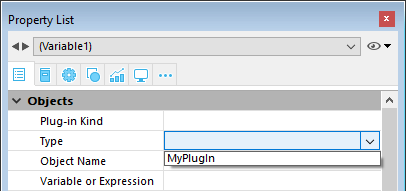

Un área plug-in es un área en el formulario que está completamente controlada por un [plug-in](../Extensions/develop-plug-ins.md). La capacidad de integrar plug-ins en los formularios le ofrece posibilidades ilimitadas a la hora de crear aplicaciones personalizadas.

Al abrir una aplicación, 4D crea una lista interna de los plug-ins [instalados en la aplicación](../Concepts/plug-ins.md#installing-plug-ins). Una vez que haya insertado un área de plug-in en un formulario, puede asignar un plug-in al área directamente en la lista **Tipo** en la lista de propiedades:

> Ciertos plug-ins, como 4D Internet Commands, no pueden utilizarse en formularios o ventanas externas. Cuando un plug-in no puede ser utilizado en un formulario, no aparece en la lista de plug-ins de la Lista de Propiedades.

Si dibuja un área de plug-in demasiado pequeña, 4D la mostrará como un botón cuyo título es el nombre de la variable asociada al área. Durante la ejecución, el usuario puede hacer clic en este botón para abrir una ventana específica que muestre el plug-in.

## Propiedades avanzadas

Si el autor del plug-in proporciona opciones avanzadas, se puede activar un tema **Plug-in** que contenga un botón [**Propiedades avanzadas**](properties_Plugins.md) en la lista de propiedades. En este caso, puede hacer clic en este botón para definir estas opciones, normalmente a través de una caja de diálogo personalizada.

## Propiedades soportadas

[Border color](./properties_BackgroundAndBorder.md#border-color) - [Border Line Style](properties_BackgroundAndBorder.md#border-line-style) - [Bottom](properties_CoordinatesAndSizing.md#bottom) - [Advanced Properties](properties_Plugins.md) - [Class](properties_Object.md#css-class) - [Draggable](properties_Action.md#draggable) - [Droppable](properties_Action.md#droppable) - [Expression Type](properties_Object.md#expression-type) - [Focusable](properties_Entry.md#focusable) - [Height](properties_CoordinatesAndSizing.md#height) - [Horizontal Sizing](properties_ResizingOptions.md#horizontal-sizing) - [Left](properties_CoordinatesAndSizing.md#left) - [Method](properties_Action.md#method) - [Object Name](properties_Object.md#object-name) - [Plug-in Kind](properties_Object.md#plug-in-kind) - [Right](properties_CoordinatesAndSizing.md#right) - [Top](properties_CoordinatesAndSizing.md#top) - [Type](properties_Object.md#type) - [Variable or Expression](properties_Object.md#variable-or-expression) - [Vertical Sizing](properties_ResizingOptions.md#vertical-sizing) - [Visibilty](properties_Display.md#visibility) - [Width](properties_CoordinatesAndSizing.md#width)

## Eventos soportados

[On Begin Drag Over](../Events/onBeginDragOver.md) - [On Clicked](../Events/onClicked.md) - [On Data Change](../Events/onDataChange.md) - [On Double Clicked](../Events/onDoubleClicked.md) - [On Drag Over](../Events/onDragOver.md) - [On Drop](../Events/onDrop.md) - [On Getting focus](../Events/onGettingFocus.md) - [On Header](../Events/onHeader.md) - [On Load](../Events/onLoad.md) - [On Losing focus](../Events/onLosingFocus.md) - [On Mouse Enter](../Events/onMouseEnter.md) - [On Mouse Leave](../Events/onMouseLeave.md) - [On Mouse Move](../Events/onMouseMove.md) - [On Plug in Area](../Events/onPlugInArea.md) - [On Printing Break](../Events/onPrintingBreak.md) - [On Printing Detail](../Events/onPrintingDetail.md) - [On Printing Footer](../Events/onPrintingFooter.md) - [On Unload](../Events/onUnload.md) - [On Validate](../Events/onValidate.md)