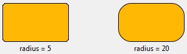
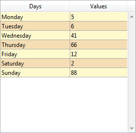

## Color de fondo alternado

Permite definir un color de fondo diferente para las líneas o columnas impares de un list box. By default, *Automatic* is selected for list box columns: the column uses the alternate background color set at the list box level.

También puede definir esta propiedad utilizando el comando [`OBJECT SET RGB COLORS`](../commands/object-set-rgb-colors).

#### Gramática JSON

| Nombre        | Tipos de datos | Valores posibles                                                        |
| ------------- | -------------- | ----------------------------------------------------------------------- |
| alternateFill | string         | todos los valores css; "transparent"; "automatic"; "automaticAlternate" |

#### Objetos soportados

[List Box](listbox_overview.md) - [Columna List Box](listbox-column.md)

#### Comandos

[`OBJECT GET RGB COLORS`](../commands/object-get-rgb-colors) - [`OBJECT SET RGB COLORS`](../commands/object-set-rgb-colors)

---

## Color de fondo / Color de relleno

Define el color de fondo o el color de relleno de un objeto. Se puede definir para algunos objetos estándar (propiedad JSON `fill`) o para los [objetos de "estilo personalizado"](#custom-style-button-check-box-or-radio-button) (propiedad JSON `borderFillColor`).

:::note

The **Fill color** property is named **Background color** with [List Box](listbox_overview.md), [List Box Column](listbox-column.md) and [List Box Footer](listbox-header-footer.md#footers) objects.

:::

### Objetos estándar

In the case of a list box column, by default *Automatic* is selected: the column uses the background color set at the list box level.

#### Gramática JSON

| Nombre | Tipos de datos | Valores posibles                         |
| ------ | -------------- | ---------------------------------------- |
| fill   | string         | un valor css; "transparent"; "automatic" |

#### Objetos soportados

[Lista jerárquica](list_overview.md) - [Entrada](input_overview.md) - [List Box](listbox_overview.md) - [Columna List Box](listbox-column.md) - [Pie List Box](listbox-header-footer.md#footers) - [Óvalo](shapes_overview.md#oval) - [Rectángulo](shapes_overview.md#rectangle) - [Área de texto](text.md)

#### Comandos

[`LISTBOX Get row color`](../commands/listbox-get-row-color) - [`LISTBOX SET ROW COLOR`](../commands/listbox-set-row-color) - [`OBJECT GET RGB COLORS`](../commands/object-get-rgb-colors) - [`OBJECT SET RGB COLORS`](../commands/object-set-rgb-colors)

### Botón personalizado, casilla de selección personalizada o botón radio personalizado

This property allows you to assign a fill color attribute to [custom buttons](./button_overview.md#custom), [custom check boxes](./checkbox_overview.md#custom), or [custom radio buttons](./radio_overview.md#custom). Además, los [botones personalizados](./button_overview.md#custom) deben tener el [estilo de línea de borde "personalizado"](#border-line-style). En otros contextos, esta propiedad se ignora.

#### Gramática JSON

| Nombre          | Tipos de datos | Valores posibles                         |
| --------------- | -------------- | ---------------------------------------- |
| borderFillColor | string         | un valor css; "transparent"; "automatic" |

#### Objetos soportados

[Custom Button](./button_overview.md#custom) (with ["custom" Border Line Style](#border-line-style)) - [Custom Check Box](checkbox_overview.md#custom) - [Custom Radio Button](radio_overview.md#custom)

#### Comandos

[`OBJECT GET RGB COLORS`](../commands/object-get-rgb-colors) - [`OBJECT SET RGB COLORS`](../commands/object-set-rgb-colors)

#### Ver también

[Transparente](#transparente)

---

## Expresión color de fondo {#background-color-expression}

`List box de tipo colección y de tipo selección de entidades`

Una expresión o una variable (no se pueden utilizar variables array) para aplicar un color de fondo personalizado a cada línea del list box. La expresión o la variable se evaluará para cada línea mostrada y debe devolver un valor de color RGB. Para más información, consulte la descripción del comando [`OBJECT SET RGB COLORS`](../commands/object-set-rgb-colors).

También puede establecer esta propiedad utilizando el comando [`LISTBOX SET PROPERTY`](../commands/listbox-set-property) con la constante `lk background color expression`.

> Con los list box de tipo colección o selección de entidades, esta propiedad también puede definirse utilizando una [Meta Info Expression](properties_Text.md#meta-info-expression).

#### Gramática JSON

| Nombre        | Tipos de datos | Valores posibles                                 |
| ------------- | -------------- | ------------------------------------------------ |
| rowFillSource | string         | Una expresión que devuelve un valor de color RGB |

#### Objetos soportados

[List Box](listbox_overview.md) - [Columna List Box](listbox-column.md)

#### Comandos

[`LISTBOX Get property`](../commands/listbox-get-property) - [`LISTBOX SET PROPERTY`](../commands/listbox-set-property)

---

## Color del borde {#border-color}

Allows defining the border color. The effect of this property varies slightly depending on the type of object to which it is applied.

- **objects with text properties**: [buttons](./button_overview.md) (all styles except "custom", see  below), [hierarchical lists](list_overview.md), [inputs](input_overview.md), [list boxes](listbox_overview.md), [progress indicators](./progressIndicator.md), [rulers](./ruler.md), and [text areas](text.md).  
  By default, the border color of these objects is automatically set to their [**font color**](./properties_Text.md#font-color) property. This default configuration corresponds to the **Same as font** option in the Property List (`borderColor` property is undefined in JSON).  
  You can separate these two properties by setting a color value for the object's "Border color" property (only available when the [**border line style**](#border-line-style) property is **plain** (`solid` in JSON property) or **dotted**).

- **objects without text properties**: [4D View Pro areas](viewProArea_overview.md), [4D Write Pro areas](writeProArea_overview.md), [button grids](buttonGrid_overview.md), [picture buttons](pictureButton_overview.md), [picture pop-up menus](picturePopupMenu_overview.md), [plug-in areas](pluginArea_overview.md), [subforms](subform_overview.md), [spinners](spinner.md), [splitters](splitters.md), [steppers](stepper.md), [web areas](webArea_overview.md).  
  The border color property sets the color of the borders. The default color value is "Automatic", i.e. the border is displayed with the automatic color set by your OS.

- **custom-styled buttons**: [custom buttons](./button_overview.md#custom) with ["custom" Border Line Style](#border-line-style), [custom check boxes](./checkbox_overview.md#custom), and [custom radio buttons](./radio_overview.md#custom).  
  In this case, the border color property defines the color of an *inner* border, which is an attribute of the object itself ans not a decoration property. This inner border can also have a [width](#border-width) (it is displayed only if the width > 0).

#### Gramática JSON

| Nombre      | Tipos de datos | Valores posibles                         |
| ----------- | -------------- | ---------------------------------------- |
| borderColor | string         | un valor css; "transparent"; "automatic" |

#### Objetos soportados

[4D View Pro area](viewProArea_overview.md) - [4D Write Pro area](writeProArea_overview.md) - [Button](./button_overview.md) - [Button Grid](buttonGrid_overview.md) - [Check Box ("custom" style)](checkbox_overview.md#custom) - [Hierarchical List](list_overview.md) - [Input](input_overview.md) - [List Box](listbox_overview.md) - [Picture Button](pictureButton_overview.md) - [Picture Pop-up Menu](picturePopupMenu_overview.md) - [Plug-in Area](pluginArea_overview.md) - [Progress Indicator](./progressIndicator.md) - [Radio Button ("custom" style)](radio_overview.md#custom) - [Ruler](./ruler.md) - [Text Area](text.md) - [Spinner](spinner.md) - [Splitter](splitters.md) - [Stepper](stepper.md) - [Subform](subform_overview.md) - [Web Area](webArea_overview.md)

#### Comandos

[`OBJECT GET RGB COLORS`](../commands/object-get-rgb-colors) - [`OBJECT SET RGB COLORS`](../commands/object-set-rgb-colors)

#### Ver también

[Color de línea](#line-color) (para formas)

## Estilo de línea de borde {#border-line-style}

Allows setting a style for the object border. The following choices are available (all choices are not possible depending on the object):

| Style          | Objects (\*)                                      | Descripción                                                                                                                                                                                                                                                                                                                                                                                                                                                                                                                                                                                                                                                                                             |
| -------------- | -------------------------------------------------------------------- | ------------------------------------------------------------------------------------------------------------------------------------------------------------------------------------------------------------------------------------------------------------------------------------------------------------------------------------------------------------------------------------------------------------------------------------------------------------------------------------------------------------------------------------------------------------------------------------------------------------------------------------------------------------------------------------------------------- |
| Ninguno        | all                                                                  | Objects appear with no border.                                                                                                                                                                                                                                                                                                                                                                                                                                                                                                                                                                                                                                                          |
| Plain          | all                                                                  | Objects appear framed with a continuous 1-pt. border line. ("solid" json value)                                                                                                                                                                                                                                                                                                                                                                                                                                                                                                                                                                      |
| Dotted         | all                                                                  | Objects appear framed with a dotted 1-pt. border line.                                                                                                                                                                                                                                                                                                                                                                                                                                                                                                                                                                                                                  |
| Raised         | all                                                                  | Objects appear framed with a 3D effect.                                                                                                                                                                                                                                                                                                                                                                                                                                                                                                                                                                                                                                                 |
| Sunken         | all                                                                  | Objects appear framed with a sunken 3D effect.                                                                                                                                                                                                                                                                                                                                                                                                                                                                                                                                                                                                                                          |
| Double         | all                                                                  | Objects appear framed with a double line, i.e., two continuous 1-pt. líneas separadas por un píxel.                                                                                                                                                                                                                                                                                                                                                                                                                                                                                                                                     |
| System         | all *except* [buttons](button_overview.md) and [text areas](text.md) | Objects appear with a border line based on the graphic specifications of the OS.                                                                                                                                                                                                                                                                                                                                                                                                                                                                                                                                                                                                        |
| System rounded | [inputs](input_overview.md)                                          | On macOS, objects appear with a native "Liquid Glass" system border effect (for information about Liquid Glass, see [this 4D blog post](https://blog.4d.com/the-new-macos-tahoe-design-comes-to-your-4d-applications/)). It includes system-defined inner border, corner radius, grey border color, and inner padding. Note that the "Liquid Glass" appearance is *not* used in a multiline input object if the [scroll bars property](./properties_Appearance.md#vertical-scroll-bar) is enabled ("System" is used in this case).<br/> On Windows, this style is similar to "System" at runtime. |
| Personalizado  | [custom buttons](./button_overview.md#custom)                        | Enables the inner border design, that includes a set of extra properties: [Fill color](#fill-color), [Border color](#border-color), [Border width](#border-width), and [Corner radius](#corner-radius). <br/>                                                                                                                                                                                                                                                                                                                                                                                                            |

(\*) "all" means "all objects supported" listed below.

:::tip Entradas de blog relacionadas

- [Customize Buttons, Radio Buttons, and Check Boxes with Background and Border Properties](https://blog.4d.com/customize-buttons-radio-buttons-and-check-boxes-with-background-and-border-properties).
- [Give Your Form Objects the Border Color They Deserve](https://blog.4d.com/give-your-form-objects-the-border-color-they-deserve)
- [Choose the Right Native Input Style for Your Interface on macOS](https://blog.4d.com/choose-the-right-native-input-style-for-your-interface-on-macos)

:::

#### Gramática JSON

| Nombre      | Tipos de datos | Valores posibles                                                                             |
| ----------- | -------------- | -------------------------------------------------------------------------------------------- |
| borderStyle | text           | "custom", "dotted", "double", "none", "raised", "solid", "sunken", "system", "systemRounded" |

#### Objetos soportados

[Área 4D View Pro](viewProArea_overview.md) - [Áreas 4D Write Pro](writeProArea_overview.md) - [Botones](button_overview.md) - [Rejilla de botones](buttonGrid_overview.md) - [Lista jerárquica](list_overview.md) - [Entrada](input_overview.md) - [List Box](listbox_overview.md) - [Botón imagen](pictureButton_overview.md) - [Menú emergente con imagen](picturePopupMenu_overview.md) - [Área Plug-in](pluginArea_overview.md) - [Indicador de progreso](progressIndicator.md) - [Regla](ruler.md) - [Spinner](spinner.md) - [Stepper](stepper.md) - [Subformulario](subform_overview.md) - [Área de texto](text.md) - [Área web](webArea_overview.md)

#### Comandos

[`OBJECT Get border style`](../commands/object-get-border-style) - [`OBJECT SET BORDER STYLE`](../commands/object-set-border-style)

#### Ver también

[Tipo de línea punteada](#dotted-line-type) (formas)

---

## Ancho del borde {#border-width}

Permite definir el ancho del borde interior para:

- los [botones personalizados](./button_overview.md#custom) con el [estilo de borde "personalizado"](#border-line-style),
- las [casillas de selección personalizadas](./checkbox_overview.md#custom),
- los [botones radio personalizados](./radio_overview.md#custom).

En otros contextos, esta propiedad se ignora.

El valor se expresa en píxeles.

#### Gramática JSON

| Nombre      | Tipos de datos | Valores posibles                                                            |
| ----------- | -------------- | --------------------------------------------------------------------------- |
| borderWidth | number         | Valor entero (píxeles). Valor mínimo = 0 |

#### Objetos soportados

[Button ("custom" style)](./button_overview.md#custom) (with ["custom" Border Line Style](#border-line-style)) - [Check Box ("custom style")](checkbox_overview.md#custom) - [Radio Button ("custom" style)](radio_overview.md#custom)

---

## Radio de redondeo

<details><summary>Historia</summary>

| Lanzamiento | Modificaciones                                                             |
| ----------- | -------------------------------------------------------------------------- |
| 21 R5       | Soporte para botones, botones radio y casillas de selección personalizados |
| 19 R7       | Soporte para entradas y áreas de texto                                     |

</details>

Define la redondez de las esquinas (en píxeles) del objeto. Por defecto, el valor del radio es de 0 píxeles. Puede cambiar esta propiedad para dibujar objetos redondeados con formas personalizadas:



El valor mínimo es 0, en este caso se dibuja un objeto estándar no redondeado.
El valor máximo depende del tamaño del rectángulo (no puede superar la mitad del tamaño del lado más corto del rectángulo) y se calcula dinámicamente.

En las [áreas de texto](./text.md) y las [áreas de entrada](./input_overview.md):

- la propiedad de radio de la esquina solo está disponible con los [estilos de línea de borde](#border-line-style) "ninguno", "sólido" o "punteado",
- the corner roundness is drawn **outside** the area of the object (the object appears larger in the form but its [width](./properties_CoordinatesAndSizing.md#width) and [height](./properties_CoordinatesAndSizing.md#height) are not extended).


In [custom buttons](./button_overview.md#custom) (with a ["custom" Border Line Style](#border-line-style)), [custom check boxes](checkbox_overview.md#custom) and [custom radio buttons](radio_overview.md#custom), the corner radius is drawn **inside** the area of the object.

#### Gramática JSON

| Nombre       | Tipos de datos | Valores posibles          |
| ------------ | -------------- | ------------------------- |
| borderRadius | integer        | mínimo: 0 |

#### Objetos soportados

[Button ("custom" style)](./button_overview.md#custom) (with ["custom" Border Line Style](#border-line-style)) - [Check Box ("custom" style)](checkbox_overview.md#custom) - [Input](input_overview.md) - [Rectangle](shapes_overview.md#rectangle) - [Text Area](text.md) - [Radio Button ("custom" style)](radio_overview.md#custom)

#### Comandos

[OBJECT GET CORNER RADIUS](../commands/object-get-corner-radius) - [OBJECT SET CORNER RADIUS](../commands/object-set-corner-radius)

---

## Tipo de línea punteada {#dotted-line-type}

Describe el tipo de línea punteada como una secuencia de puntos blancos y negros.

#### Gramática JSON

| Nombre          | Tipos de datos             | Valores posibles                                                                                                                                 |
| --------------- | -------------------------- | ------------------------------------------------------------------------------------------------------------------------------------------------ |
| strokeDashArray | arrays numéricos o cadenas | Ej. "6 1" o \[6,1\] para una secuencia de 6 puntos negros y 1 punto blanco |

#### Objetos soportados

[Rectángulo](shapes_overview.md#rectangle) - [Óvalo](shapes_overview.md#oval) - [Línea](shapes_overview.md#line)

---

## Ocultar líneas vacías finales

Controla la visualización de las líneas vacías adicionales añadidas en la parte inferior de un objeto list box. Por defecto, 4D añade esas líneas adicionales para llenar el área vacía:


Puede eliminar estas líneas vacías seleccionando esta opción. La parte inferior del objeto del list box se deja vacía:



#### Gramática JSON

| Nombre             | Tipos de datos | Valores posibles |
| ------------------ | -------------- | ---------------- |
| hideExtraBlankRows | boolean        | true, false      |

#### Objetos soportados

[List Box](listbox_overview.md)

#### Comandos

[`LISTBOX Get property`](../commands/listbox-get-property) - [`LISTBOX SET PROPERTY`](../commands/listbox-set-property)

---

## Color de línea

Designa el color de las líneas del objeto.
El color puede ser especificado por:

- un nombre de color - como "red"
- un valor HEX - como "# ff0000"
- un valor RVA - como "rgb (255,0,0)"

También puede definir esta propiedad utilizando el comando [`OBJECT SET RGB COLORS`](../commands/object-set-rgb-colors).

#### Gramática JSON

| Nombre | Tipos de datos | Valores posibles                         |
| ------ | -------------- | ---------------------------------------- |
| stroke | string         | un valor css, "transparent", "automatic" |

:::note

This property is also available for objects with text properties, in which case it designates both the [Font color](properties_Text.md#font-color) and the object's lines, except if you used the [Border color](#border-color) property.

:::

#### Objetos soportados

[Línea](shapes_overview.md#line) - [Óvalo](shapes_overview.md#oval) - [Rectángulo](shapes_overview.md#rectangle)

#### Comandos

[`OBJECT GET RGB COLORS`](../commands/object-get-rgb-colors) - [`OBJECT SET RGB COLORS`](../commands/object-set-rgb-colors)

---

## Ancho de línea

Designa el grosor de una línea.

#### Gramática JSON

| Nombre      | Tipos de datos | Valores posibles                                                                                                |
| ----------- | -------------- | --------------------------------------------------------------------------------------------------------------- |
| strokeWidth | number         | 0 para el ancho más pequeño en un formulario impreso, o cualquier valor de entero < 20 |

#### Objetos soportados

[Línea](shapes_overview.md#line) - [Óvalo](shapes_overview.md#oval) - [Rectángulo](shapes_overview.md#rectangle)

---

## Array colores de fondo {#row-background-color-array}

`List boxes de tipo array`

El nombre de un array para aplicar un color de fondo personalizado a cada línea o columna del list box.

Debe introducirse el nombre de un array Entero largo. Cada elemento de este array corresponde a una línea del list box (si se aplica al list box) o a una celda de la columna (si se aplica a una columna), por lo que el array debe tener el mismo tamaño que el array asociado a la columna. Puede utilizar las constantes descritas en el comando [`OBJECT SET RGB COLORS`](../commands/object-set-rgb-colors). Puede utilizar las constantes del tema <a href="https://doc.4d.com/4Dv20/4D/20.1/SET-RGB-COLORS.302-6481080.en.html">SET RGB COLORS</a>.

Por ejemplo, dado un list box en el que las líneas tienen un color gris/gris claro alternado, definido en las propiedades del list box. También se ha definido para el list box un array de color de fondo con el fin de cambiar a naranja claro el color de las líneas en las que al menos un valor es negativo:

```4d
 <>_BgndColors{$i}:=0x00FFD0B0 // naranja
 <>_BgndColors{$i}:=-255 // valor por defecto
```


A continuación, quiere colorear las celdas con valores negativos en naranja oscuro. A continuación, quiere colorear las celdas con valores negativos en naranja oscuro. Los valores de estos arrays tienen prioridad sobre los definidos en las propiedades del list box, así como los del array de color de fondo general:

```4d
 <>_BgndColorsCol_3{2}:=0x00FF8000 // naranja oscuro
 <>_BgndColorsCol_2{5}:=0x00FF8000
 <>_BgndColorsCol_1{9}:=0x00FF8000
 <>_BgndColorsCol_1{16}:=0x00FF8000
```


Puede obtener el mismo resultado utilizando los comandos [`LISTBOX SET ROW FONT STYLE`](../commands/listbox-set-row-font-style) y [`LISTBOX SET ROW COLOR`](../commands/listbox-set-row-color). Tienen la ventaja de permitirle omitir el tener que predefinir arrays de estilo/color para las columnas: en su lugar son creadas dinámicamente por los comandos.

#### Gramática JSON

| Nombre        | Tipos de datos | Valores posibles                                    |
| ------------- | -------------- | --------------------------------------------------- |
| rowFillSource | string         | El nombre de un array entero largo. |

#### Objetos soportados

[List Box](listbox_overview.md) - [Columna List Box](listbox-column.md)

#### Comandos

[`LISTBOX Get array`](../commands/listbox-get-array) - [`LISTBOX GET ARRAYS`](../commands/listbox-get-arrays)

---

## Transparente

Define el fondo del list box como "Transparent". Cuando se define, se ignora cualquier [color de fondo alternativo](#alternate-background-color) o [color de fondo](#background-color--fill-color) definido para la columna.

#### Gramática JSON

| Nombre | Tipos de datos | Valores posibles |
| ------ | -------------- | ---------------- |
| fill   | text           | "transparent"    |

#### Objetos soportados

[List Box](listbox_overview.md)

#### Comandos

[`OBJECT GET RGB COLORS`](../commands/object-get-rgb-colors) - [`OBJECT SET RGB COLORS`](../commands/object-set-rgb-colors)

#### Ver también

[Color de fondo / Color de relleno](#background-color--fill-color)

