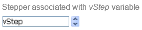

Un stepper permite al usuario desplazarse por valores numéricos, duraciones (tiempos) o fechas por pasos predefinidos haciendo clic en los botones de flecha.

## Uso del stepper

Puede asignar la variable asociada al objeto a un área introducible (campo o variable) para almacenar o modificar el valor actual del objeto.

Se puede asociar un stepper directamente a una variable numérica, hora o fecha.

- Para los valores de tipo hora, las propiedades Mínimo, Máximo y Paso representan segundos. Por ejemplo, para programar un paso de 8:00 a 18:00 con pasos de 10 minutos:
  - [mínimo](properties_Scale.md#minimum) = 28 800 (8\*60\*60)
  - [máximo](properties_Scale.md#máximo) = 64 800 (18\*60\*60)
  - [step](properties_Scale.md#step) = 600 (10\*60)
- Para los valores de tipo fecha, el valor introducido en la propiedad [step](properties_Scale.md#step) representa días. Las propiedades Mínimo y Máximo se ignoran.

> Para que el stepper funcione con una variable de hora o fecha, es imprescindible definir su tipo en el formulario Y para [declararla explícitamente](../Concepts/variables.md#declaring-variables) como `Time` o `Date`.

Para más información, consulte [Uso de indicadores](progressIndicator.md#using-indicators) en la página "Indicador de progreso".

## Propiedades soportadas

[Border color](./properties_BackgroundAndBorder.md#border-color) - [Border Line Style](properties_BackgroundAndBorder.md#border-line-style) - [Bottom](properties_CoordinatesAndSizing.md#bottom) - [Class](properties_Object.md#css-class) - [Enterable](properties_Entry.md#enterable) - [Execute object method](properties_Action.md#execute-object-method) - [Expression Type](properties_Object.md#expression-type) (only "integer", "number", "date", or "time") - [Height](properties_CoordinatesAndSizing.md#height) - [Help Tip](properties_Help.md#help-tip) - [Horizontal Sizing](properties_ResizingOptions.md#horizontal-sizing) - [Left](properties_CoordinatesAndSizing.md#left) - [Maximum](properties_Scale.md#maximum) - [Minimum](properties_Scale.md#minimum) - [Object Name](properties_Object.md#object-name) - [Right](properties_CoordinatesAndSizing.md#right) - [Step](properties_Scale.md#step) - [Top](properties_CoordinatesAndSizing.md#top) - [Type](properties_Object.md#type) - [Variable or Expression](properties_Object.md#variable-or-expression) - [Vertical Sizing](properties_ResizingOptions.md#vertical-sizing) - [Visibility](properties_Display.md#visibility) - [Width](properties_CoordinatesAndSizing.md#width)

## Eventos soportados

[On Begin Drag Over](../Events/onBeginDragOver.md) - [On Clicked](../Events/onClicked.md) - [On Data Change](../Events/onDataChange.md) - [On Double Clicked](../Events/onDoubleClicked.md) - [On Drag Over](../Events/onDragOver.md) - [On Drop](../Events/onDrop.md) - [On Getting focus](../Events/onGettingFocus.md) - [On Header](../Events/onHeader.md) - [On Load](../Events/onLoad.md) - [On Losing focus](../Events/onLosingFocus.md) - [On Mouse Enter](../Events/onMouseEnter.md) - [On Mouse Leave](../Events/onMouseLeave.md) - [On Mouse Move](../Events/onMouseMove.md) - [On Printing Break](../Events/onPrintingBreak.md) - [On Printing Detail](../Events/onPrintingDetail.md) - [On Printing Footer](../Events/onPrintingFooter.md) - [On Unload](../Events/onUnload.md) - [On Validate](../Events/onValidate.md)

## Ver también

- [indicadores de progreso](progressIndicator.md)
- [rulers](ruler.md)

