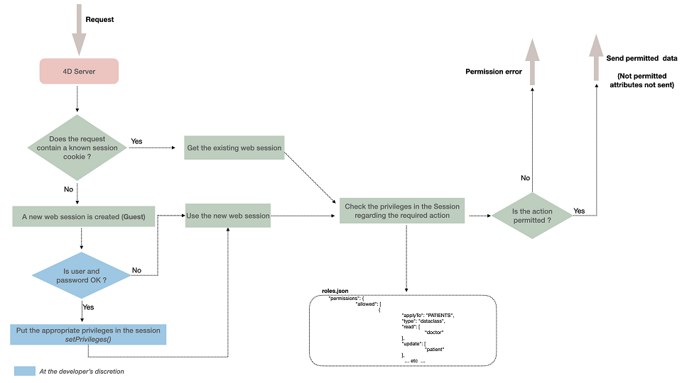

La arquitectura de seguridad ORDA controla el acceso a los recursos del proyecto para las sesiones web y REST. Le permite conceder permisos específicos sobre recursos tales como el datastore, las bases de datos, los atributos y las funciones.

## Generalidades

El modelo de seguridad combina **privileges**, **actions** (como `read` y `create`), y **resources**.

Asigne privilegios a una **session** utilizando [`Session.setPrivileges()`](../API/SessionClass.md#setprivileges).

Cada solicitud se verifica con los permisos definidos en el archivo `roles.json` del proyecto. Una acción no autorizada genera un error de privilegios. Los atributos sin permiso de lectura se omiten en la respuesta.



:::tip Entradas de blog relacionadas

[Filtre el acceso a sus datos con un sistema completo de permisos\*\*](https://blog.4d.com/filter-access-to-your-data-with-a-complete-system-of-permissions/)

:::

:::info

Los permisos controlan el acceso a los objetos o funciones del almacén de datos. Si desea filtrar los datos leídos según algún criterio, puede considerar [restringir las selecciones de entidades](entities.md#restricting-entity-selections) que puede ser más apropiado en este caso.

:::

## Alcance

Los permisos se aplican a **las sesiones web y REST**: [solicitudes REST](../REST/gettingStarted.md), incluidas las [páginas Qodly](https://developer.4d.com/qodly/4DQodlyPro/pageLoaders/pageLoaderOverview), las sesiones de [`Open datastore`](../commands/open-datastore), las [sesiones MCP](../WebServer/mcp-server.md) y **el código 4D ejecutado en un proceso web**. Esto incluye [las funciones expuestas](./ordaClasses.md), [los gestores de solicitudes HTTP](../WebServer/http-request-handler.md), el [método base On Web Connection](../commands/on-web-connection-database-method) y cualquier código al que estos hagan referencia. Por ejemplo, una llamada a una función permitida seguirá fallando si la función lee una clase de datos para la que la sesión no tiene permiso de lectura.

:::info Excepción

El permiso **execute** de un [singleton compartido](../Concepts/classes.md#shared-singleton) o una [función singleton](../Concepts/classes.md#singleton-classes) solo se verifica cuando la función se [invoca a través de REST](../REST/$singleton.md). Cuando el código 4D se ejecuta en una sesión web lo llama directamente (`cs.MySingleton.me.myFunction()`), no se comprueba ningún permiso, a diferencia de las funciones de dataclass, entidades, selección de entidades y de datastores que se verifican en ambos casos.

:::

Los permisos nunca se aplican al [código de sesión de escritorio](../Desktop/sessions.md) (autónomo, cliente/servidor, procedimientos almacenados) ni a [tool4d](../Admin/cli.md#tool4d).

:::warning

Cuando una entrada de permiso hace referencia a un [privilegio](#privileges-and-roles) no declarado, 4D registra un error e ignora la entrada. En este caso, el permiso se ignora. Si el [modo restringido por defecto](#restriction-modes) no está habilitado, el recurso es accesible a las sesiones `guest`.

:::

## Recursos

4D verifica los permisos de la sesión cada vez que se accede a un recurso. Los siguientes recursos pueden tener permisos específicos:

| Recurso                                                                                                                                                                           | `applyTo`                 | `tipo`            |
| --------------------------------------------------------------------------------------------------------------------------------------------------------------------------------- | ------------------------- | ----------------- |
| [Datastore](./dsMapping.md#datastore)                                                                                                                                             | `ds`                      | `datastore`       |
| [Función datastore class](./ordaClasses.md#datastore-class)                                                                                                                       | `ds.<function>`           | `method`          |
| [Dataclass](./dsMapping.md#dataclass)                                                                                                                                             | `<Dataclass>`             | `dataclass`       |
| [Atributo](./dsMapping.md#attribute) (incluidos [atributos calculados](./ordaClasses.md#computed-attributes-1) y [alias](./ordaClasses.md#alias-attributes-1)) | `<Dataclass>.<attribute>` | `atributo`        |
| [Función de dataclass, entity selection o entidad](./ordaClasses.md)                                                                                                              | `<Dataclass>.<function>`  | `method`          |
| [Singleton compartido](../Concepts/classes.md#shared-singleton) (todas sus funciones expuestas)                                                                | `<Singleton>`             | `singleton`       |
| [Función singleton](../Concepts/classes.md#singleton-classes)                                                                                                                     | `<Singleton>.<function>`  | `singletonMethod` |

Use the `applyTo` and `type` values shown in the table when defining permissions in [`roles.json`](#rolesjson-file).

:::note Asignación de permisos a las funciones de la clase ORDA

In `roles.json`, identify an ORDA class function in `applyTo` with this syntax:

```json
<DataclassName>.<functionName>
```

Por ejemplo, si desea aplicar un permiso a la siguiente función:

```4d
// cs.CityEntity class
Class extends Entity
  Function getPopulation() : Integer
   ...
```

Utilice este valor:

```json
"applyTo":"City.getPopulation"
```

Because permissions identify functions by dataclass and function name, functions with the same name in different ORDA classes (entity, entity selection, dataclass) cannot be assigned different privileges. Give them distinct names instead. For example, name the functions `dropEntity()` and `dropSelection()` in `cs.CityEntity` and `cs.CitySelection`, respectively:

```json
	"permissions": {
		"allowed": [
			{
				"applyTo": "City.dropEntity",
				"type": "method",
				"execute": [
					"cityAdmin"
				],
				"promote": [
					"name"
				]
			},
			{
				"applyTo": "City.dropSelection",
				"type": "method",
				"promote": [
					"name"
				]
			}
		]
	}
}
```

:::

## Permisos

A **permission** allows an action on a resource; for example, executing `ds.myTable.myFunction()`. Permissions are defined in [`roles.json`](#rolesjson-file) and granted to one or more [privileges](#privileges-and-roles).

If no permission is defined for a resource, access depends on the project's [restriction mode](#restriction-modes).

### Acciones de autorización

Available actions depend on the resource:

| Acción                                                 | Datastore                                                                                                             | Dataclass                                                                                                                   | Atributo                                                                                                       | Function                                                                                                                                                                                                                                                                                                                                                    |
| ------------------------------------------------------ | --------------------------------------------------------------------------------------------------------------------- | --------------------------------------------------------------------------------------------------------------------------- | -------------------------------------------------------------------------------------------------------------- | ----------------------------------------------------------------------------------------------------------------------------------------------------------------------------------------------------------------------------------------------------------------------------------------------------------------------------------------------------------- |
| **create**                                             | Create entities in any dataclass                                                                                      | Create entities in this dataclass                                                                                           | Create an entity with a non-default value for this attribute (ignored for alias attributes) | n/a                                                                                                                                                                                                                                                                                                                                                         |
| **read**                                               | Leer atributos en cualquier dataclass                                                                                 | Leer atributos en esta clase de datos                                                                                       | Read this attribute's content                                                                                  | n/a                                                                                                                                                                                                                                                                                                                                                         |
| **update**                                             | Actualizar atributos en cualquier clase de datos                                                                      | Actualiza los atributos de esta clase de datos                                                                              | Update this attribute's content (ignored for alias attributes)                              | n/a                                                                                                                                                                                                                                                                                                                                                         |
| **drop** ("Delete" in Qodly Studio) | Borrar datos en cualquier clase de datos                                                                              | Borrar los datos de esta clase de datos                                                                                     | Delete a non-null value for this attribute (except for alias and computed attributes)       | n/a                                                                                                                                                                                                                                                                                                                                                         |
| **execute**                                            | Execute any function on the project (datastore, dataclass, entity selection, entity, or singleton) | Execute any function on the dataclass; dataclass, entity, and entity selection functions are treated as dataclass functions | n/a                                                                                                            | Ejecutar esta función                                                                                                                                                                                                                                                                                                                                       |
| **promote**                                            | n/a                                                                                                                   | n/a                                                                                                                         | n/a                                                                                                            | Temporarily add a privilege for the duration of the function call. Only the process executing the function receives it, not the whole session. Use [`promote()`](../API/SessionClass.md#promote) and [`demote()`](../API/SessionClass.md#demote) to set or remove this action dynamically in a web process. |

### Permission rules

- **update** and **drop** require **read** on the resource; **create** does not.
- A function can be **promoted** by multiple privileges. During execution, it receives the combined permissions of all those privileges; there is no priority order.
- An [alias attribute](./ordaClasses.md#alias-attributes-1) can be read if the session has permission to read the alias, even if it cannot read the attributes the alias resolves to.
- A [computed attribute](./ordaClasses.md#computed-attributes-1) can be accessed even if its underlying attributes have no permissions.
- In REST [force login mode](../REST/authUsers.md#force-login-mode), guest users can always execute [`authentify()`](../REST/authUsers.md#function-authentify), regardless of the permissions configuration.

### Permisos heredados

Permission actions are inherited according to the following rules:

1. Permissions descend **datastore → dataclass → attribute / function**, and **datastore → singleton → singleton function**.
2. Resolution is **per action**. Defining `read` on a dataclass does not change how `create`, `update`, `drop` or `execute` are resolved for it.
3. **Dataclass replaces datastore**. A permission defined on a dataclass for an action replaces the datastore permission for that action. Privileges granted the action only on the datastore lose it on that dataclass.
4. **Function replaces dataclass**. An `execute` permission defined on a function replaces the dataclass (and datastore) `execute` permission for that function. Entity and entity selection functions follow the same rule as dataclass functions.
5. **Singleton replaces datastore**, **singleton function replaces singleton**.
6. **Datastore function replaces datastore**.
7. **A function inherits what it does not set**. At every level, an action that a function permission does not list is inherited from its dataclass or singleton, then from the datastore. For example, a singleton function permission that only defines `promote` keeps the `execute` permission of its singleton. A `promote` permission never grants `execute`: to let a privilege call a promoted function, list it in the function's `execute` permission.
8. **Attribute adds to its parent**. To act on an attribute that has its own permission, a session needs a privilege granted by the attribute permission **and** a privilege granted the action on the dataclass (directly or through the datastore).
9. An action granted to **no privilege** (for example, `"read": []`) is "not set", so the permission at the level above applies. It does not mean "nobody". To deny the action, use [restricted mode](#restriction-modes) without defining that permission, or grant it to a privilege that no session receives.

Permissions only grant access; there is no explicit deny. A dataclass or function permission can therefore narrow a broader datastore permission by replacing it. An attribute permission is additive: it grants access to that attribute only when the session also has the action on its dataclass.

:::tip Recommended practice

- Assign access to sessions through **roles** with `Session.setPrivileges({roles: [...]})`. Define roles around business profiles; privileges are the reusable building blocks. [Qodly Studio](https://developer.4d.com/qodly/4DQodlyPro/roles/overview) displays effective permissions by role.
- If an administration role needs full access, include every privilege in it except a lock privilege, if used. Add each new privilege to that role: a dataclass-level permission can replace a broader datastore permission.
- Review the effect of privilege changes on every role. In Qodly Studio, **Detailed Permission Review** shows a role's effective access; a role with no privileges can help you review guest-only access.

:::

## Privilegios y roles

A **privilege** grants actions on resources. A **role** groups privileges into a business profile that an administrator can assign to a session.

For example, `manageInvoices` could be a privilege and `secretary` a role that includes it and other privileges. Assign roles to sessions with [`Session.setPrivileges({roles: [...]})`](../API/SessionClass.md#setprivileges); the role grants all its privileges.

Privileges can be granted permission on multiple action-resource combinations, and an action can be granted to multiple privileges.

Define privileges and roles in [`roles.json`](#rolesjson-file), then grant roles to sessions with `Session.setPrivileges()`.

### Including privileges

A privilege can include other privileges using the `includes` property in `roles.json`. Inclusion is transitive and one-way: if A includes B, and B includes C, A receives the permissions of B and C.

[`Session.getPrivileges()`](../API/SessionClass.md#getprivileges) returns the expanded collection (for example, A, B, and C) in no guaranteed order. Declare an included privilege before the privilege that includes it; otherwise, 4D drops the inclusion and logs an error.

### Ejemplo

This authentication function assigns the user's role to the session:

```4d

exposed Function authenticate($identifier : Text; $password : Text)->$result : Text

    var $user : cs.UsersEntity

    Session.clearPrivileges()

    $result:="You are authenticated as Guest"

    $user:=ds.Users.query("identifier = :1"; $identifier).first()

    If ($user#Null)
        If (Verify password hash($password; $user.password))
            Session.setPrivileges(New object("roles"; $user.role))
            $result:="Your are authenticated as "+$user.role
        End if
    End if


```

## `guest` privilege

`guest` is built in; declaring a privilege named `Guest` is an error ("privilege already defined"). Sessions without privileges (`Session.isGuest() = True`) receive the permissions granted to `guest`.

Permissions granted to `guest` are available to every session, regardless of its other privileges. Do not grant `guest` access that should be withheld from other sessions, and account for its permissions when restricting access at the dataclass level.

## Archivo `roles.json`

The project's web security settings are defined in `roles.json`:

| Propiedad                       | Tipo                             | Requerido | Descripción                                                                                                                                      |
| ------------------------------- | -------------------------------- | --------- | ------------------------------------------------------------------------------------------------------------------------------------------------ |
| `privileges`                    | Collection of privilege objects  | Sí        | Defined privileges. Each object has a `privilege` name and can have an `includes` collection of privilege names. |
| `roles`                         | Collection of role objects       | No        | Defined roles. Each object has a `role` name and a `privileges` collection of privilege names.                   |
| `permissions.allowed`           | Collection of permission objects | Sí        | Permissions assigned to resources.                                                                                               |
| `permissions.allowed[].applyTo` | Text                             | Sí        | Target [resource](#resources) name.                                                                                              |
| `permissions.allowed[].type`    | Text                             | Sí        | [Resource](#resources) type: `datastore`, `dataclass`, `attribute`, `method`, `singletonMethod`, or `singleton`. |
| `permissions.allowed[].read`    | Colección de cadenas             | No        | Privileges granted read access.                                                                                                  |
| `permissions.allowed[].create`  | Colección de cadenas             | No        | Privileges granted create access.                                                                                                |
| `permissions.allowed[].update`  | Colección de cadenas             | No        | Privileges granted update access.                                                                                                |
| `permissions.allowed[].drop`    | Colección de cadenas             | No        | Privileges granted delete access.                                                                                                |
| `permissions.allowed[].execute` | Colección de cadenas             | No        | Privileges granted execute access.                                                                                               |
| `permissions.allowed[].promote` | Colección de cadenas             | No        | Privileges temporarily granted during function execution.                                                                        |
| `restrictedByDefault`           | Boolean                          | No        | If `true`, access to resources without explicit permissions is denied.                                                           |
| `forceLogin`                    | Boolean                          | No        | If `true`, enables [force login mode](../REST/authUsers.md#force-login-mode).                                                    |

:::note Notas

- The `WebAdmin` privilege name is reserved for the application; do not use it for custom privileges.
- Privilege and role names are case-insensitive. Unknown names passed to [`.setPrivileges()`](../API/SessionClass.md#setprivileges) are ignored.
- Qodly Studio can add an optional `id` property to privileges and roles to preserve references when they are renamed.
- Multiple entries with the same `applyTo` are not merged: the last entry wins without an error. Define only one entry per resource.
- A resource entry that grants no actions has no effect.

:::

:::warning

Cuando una entrada de permiso hace referencia a un [privilegio](#privileges-and-roles) no declarado, 4D registra un error e ignora la entrada. En este caso, el permiso se ignora. Si el [modo restringido por defecto](#restriction-modes) no está habilitado, el recurso es accesible a las sesiones `guest`.

:::

### Default location and content

New projects generate `roles.json` at:

```
<project folder>/Project/Sources/ 
```

See the [Architecture](../Project/architecture.md#sources) section for details.

Contenido predeterminado:

```json title="/Project/Sources/roles.json"

{
  "privileges": [
  ],
  "roles": [
  ],
  "permissions": {
    "allowed": [
      {
        "applyTo": "ds",
        "type": "datastore",
        "read": [],
        "create": [],
        "update": [],
        "drop": [],
        "execute": [],
        "promote": []
      }
    ]
  },
  "restrictedByDefault": false,
  "forceLogin": false
}
```

:::note Compatibilidad

In releases before 4D 20 R6, `roles.json` was not created by default. In 4D 20 R6 and later, opening an existing project without a `roles.json` file or `"forceLogin": true` setting makes the **Activate REST authentication through ds.authentify() function** button available on the [Web Features page of the Settings dialog box](../settings/web.md#access). This button upgrades the security settings; you may need to modify your code. Ver [esta entrada del blog](https://blog.4d.com/force-login-becomes-default-for-all-rest-auth/).

:::

:::note Qodly Studio

En Qodly Studio for 4D, el modo de conexión se puede definir utilizando la opción [**Forzar inicio de sesión**](https://developer.4d.com/qodly/4DQodlyPro/force-login) en el panel Roles y privilegios.

:::

## Modos de restricción

`restrictedByDefault` determines access to a [resource](#resources) when no [specific permission](#permissions) is defined:

- **Unrestricted mode** (`restrictedByDefault: false`): Resources without defined permissions are accessible to all requests.
- **Restricted mode** (`restrictedByDefault: true`): Resources without defined permissions are blocked. Access is granted explicitly, and the [permission inheritance rules](#inherited-permissions) still apply.

:::note Compatibilidad

- New projects set `restrictedByDefault` to `false` by default; see [recommended configurations](#recommended-configuration).
- For projects converted from earlier releases, enabling access to Qodly Studio through the [One-click configuration dialog](https://developer.4d.com/qodly/4DQodlyPro/gettingStarted#one-click-configuration) adds `restrictedByDefault: true` to `roles.json`.

:::

### Restriction strategies

#### Lock everything and open gradually

Choose either restricted mode or a lock privilege to close access by default:

|                              | Restricted mode                                                                                                                                                                                                                                                                                                                                            | Lock privilege                                                                                                                                     |
| ---------------------------- | ---------------------------------------------------------------------------------------------------------------------------------------------------------------------------------------------------------------------------------------------------------------------------------------------------------------------------------------------------------- | -------------------------------------------------------------------------------------------------------------------------------------------------- |
| Setting                      | `"restrictedByDefault": true` (Qodly Studio: **Restrict Access By Default**)                                                                                                                                                                                                                                            | `"restrictedByDefault": false`, with every action on `ds` granted to a privilege that no session receives (for example, `none`) |
| What is closed               | Every resource without a permission                                                                                                                                                                                                                                                                                                                        | Every resource that inherits datastore permissions                                                                                                 |
| How to open                  | Grant permissions on the datastore, dataclasses, attributes, and functions                                                                                                                                                                                                                                                                                 | Grant permissions on dataclasses and functions to replace the lock                                                                                 |
| If 4D drops an invalid entry | The resource stays closed                                                                                                                                                                                                                                                                                                                                  | The resource falls back to the lock and stays closed                                                                                               |
| Importante                   | Explicitly grant access to public resources, usually to `guest`, including the login function unless [force login](../REST/authUsers.md#force-login-mode) is used, and [HTTP request handlers](../WebServer/http-request-handler.md) called before login. In this mode, Qodly Studio's role review is currently incorrect. | Never assign the lock privilege to a role, including the administration role.                                                      |

Both approaches close access by default and follow the same inheritance and replacement rules. A lock privilege makes the lock visible in the editor; restricted mode requires no extra privilege.

#### Open everything, restrict gradually

Set unrestricted mode (`"restrictedByDefault": false`), grant `guest` read access to `ds`, then restrict sensitive dataclasses with dataclass-level permissions.

Remember that [guest](#guest-privilege) permissions apply to every session. Without a lock privilege, an invalid entry dropped by 4D leaves the resource open in unrestricted mode.

#### Configuración recomendada {#recommended-configuration}

Use these settings as a starting point:

- **Development**: Set both properties to `false` for easier access while developing and debugging. Apply restrictions gradually as needed.
- **Production**: Set `restrictedByDefault` and [`forceLogin`](../REST/authUsers.md#force-login-mode) to `true` so that users must authenticate and resource access must be explicitly granted.

## Permission errors

### Archivo `Roles_Errors.json`

4D parses `roles.json` at startup. Restart the application for changes to take effect.

If parsing fails, 4D writes the errors to `Roles_Errors.json` in the project's [`Logs` folder](../Project/architecture.md#logs). It deletes this file after `roles.json` is corrected.

Check at startup, especially in production, whether `Roles_Errors.json` exists. Its presence indicates a parsing error, and permissions may not be enforced as intended. Puede escribir, por ejemplo:

```4d title="/Sources/DatabaseMethods/onStartup.4dm"
If (Not(File("/LOGS/"+"Roles_Errors.json").exists))
...
Else // you can prevent the project to open
 ALERT("The roles.json file is malformed or contains inconsistencies, the application will quit.")
 QUIT 4D
End if
```

Permission errors are returned as follows:

| Ruta                                  | read / create / update / drop refused                                                                                                                                                                                                                                                                                                                                                                                                                                                                  | execute refused                                                                                                                               |
| ------------------------------------- | ------------------------------------------------------------------------------------------------------------------------------------------------------------------------------------------------------------------------------------------------------------------------------------------------------------------------------------------------------------------------------------------------------------------------------------------------------------------------------------------------------ | --------------------------------------------------------------------------------------------------------------------------------------------- |
| REST                                  | HTTP 401 with message                                                                                                                                                                                                                                                                                                                                                                                                                                                                                  | **HTTP 500** with message (singleton: "Bad permission...") |
| Code (web session) | Read: error 1557 (dataclass) or 1607 (attribute). Create: error 1608 when assigning an attribute to a new entity if create is restricted by a permission; in restricted mode without permission, `save()` returns `success: false` and `statusText: "Permission Error"`. Update/drop: error 1557 when loading the entity (both require read). | Error 1561                                                                                                                                    |

## Ejemplo

This example grants a broad set of permissions through a `manager` privilege, while the `payroll` privilege grants read access to the sensitive `Salaries` dataclass.

```json title="roles.json"
{
  "forceLogin": true,
  "restrictedByDefault": true,
  "privileges": [
    {"privilege": "payroll", "includes": []},
    {"privilege": "manager", "includes": []}
  ],
  "roles": [
    {"role": "administrator", "privileges": ["manager", "payroll"]}
  ],
  "permissions": {
    "allowed": [
      {
        "applyTo": "ds",
        "type": "datastore",
        "read": ["manager"],
        "create": ["manager"],
        "update": ["manager"],
        "drop": ["manager"],
        "execute": ["manager"]
      },
      {
        "applyTo": "Salaries",
        "type": "dataclass",
        "read": ["payroll"]
      }
    ]
  }
}

```

Estas son las reglas resultantes:

| Session                | Read Salaries                                                                                 | Create Salaries                                                                    | Update/drop Salaries                          | Read other dataclasses |
| ---------------------- | --------------------------------------------------------------------------------------------- | ---------------------------------------------------------------------------------- | --------------------------------------------- | ---------------------- |
| `manager`              | Refused (the `Salaries` read permission replaces the datastore permission) | Allowed (inherited from the datastore)                          | Refused (read is required) | Allowed                |
| `payroll`              | Allowed                                                                                       | Refused (the datastore permission is granted only to `manager`) | Refused                                       | Refused                |
| rol de `administrador` | Allowed                                                                                       | Allowed                                                                            | Allowed                                       | Allowed                |

The `Salaries` read permission replaces the datastore read permission, so `manager` alone cannot read that dataclass. The `administrator` role receives the combined permissions of `manager` and `payroll`.
