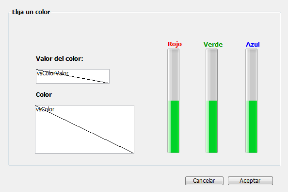
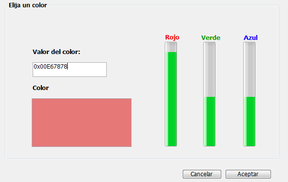
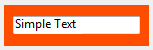
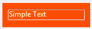
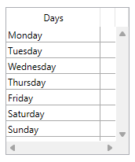

---
id: object-set-rgb-colors
title: OBJECT SET RGB COLORS
slug: /commands/object-set-rgb-colors
displayed_sidebar: docs
---

<!--REF #_command_.OBJECT SET RGB COLORS.Syntax-->**OBJECT SET RGB COLORS** ( * ; *objeto* : Text ; *colorPrimerPlano* : Text, Integer {; *colorFondo* : Text, Integer {; *colorFondoAlt* : Text, Integer {; *borderColor* : Text, Integer}}} )<br/>**OBJECT SET RGB COLORS** ( *objeto* : Variable, Field ; *colorPrimerPlano* : Text, Integer {; *colorFondo* : Text, Integer {; *colorFondoAlt* : Text, Integer {; *borderColor* : Text, Integer}}} )<!-- END REF-->
<!--REF #_command_.OBJECT SET RGB COLORS.Params-->
<div class="no-index">

| Parámetro | Tipo |  | Descripción |
| --- | --- | --- | --- |
| * | Operador | &#8594; | Si se especifica, objeto es un nombre de objeto (cadena) Si se omite, objeto es un campo o una variable |
| objeto | any | &#8594; | Nombre de objeto (si se especifica *), o Campo o variable (si se omite *) |
| colorPrimerPlano | Text, Integer | &#8594; | Valor del color RGB del primer plano |
| colorFondo | Text, Integer | &#8594; | Valor del color RGB del fondo |
| colorFondoAlt | Text, Integer | &#8594; | Valor del color RGB del fondo alterno |
| borderColor | Text, Integer | &#8594; | Valor del color RGB del borde ("" = sin cambios) |
</div>
<!-- END REF-->

<div class="no-index">
<details><summary>Historial</summary>

|Versión|Cambios|
|---|---|
|21 R5|Compatibilidad con el parámetro *borderColor*|
|17 R6|Modificado|
|14|Modificado|
|12|Renombrar|
|2004|Modificado|
|<6|Creado|

</details>
</div>

## Descripción 

<!--REF #_command_.OBJECT SET RGB COLORS.Summary-->El comando **OBJECT SET RGB COLORS** cambia los colores de primer plano y de fondo de los objetos especificados por el parámetro *objeto* y el parámetro opcional *\**.<!-- END REF--> Según el objeto al que se aplique el comando, pueden estar disponibles otros dos parámetros de color.

Si pasa el parámetro opcional *\**, especifica que el parámetro *objeto* es el nombre de objeto (una cadena). Si omite el parámetro opcional \*, especifica que *objeto* es un campo o una variable. En este caso, no pasa en *objeto* una cadena sino una referencia a un campo o a una variable (campo o variable de tipo objeto únicamente) en lugar de una cadena. Para mayor información sobre nombres de objetos, consulte la sección *Propiedades de los objetos*.

El parámetro opcional *colorFondoAlt* permite definir un color de fondo alternativo para las filas pares. Este parámetro solo se utiliza cuando el objeto especificado es un list box o una columna de list box. Cuando se utiliza, el parámetro *colorFondo* se aplica únicamente al fondo de las filas impares. El uso de colores alternos facilita la lectura de las listas.

Si *objeto* especifica un objeto List box, los colores alternos se utilizan en todo el List box. Si *objeto* especifica una columna del List box, sólo la columna utilizará los colores definidos.

El parámetro opcional *borderColor* permite cambiar el color del borde en tiempo de ejecución. Solo se puede aplicar a objetos que admitan la propiedad `borderColor` y requiere que el estilo del borde sea "plain" o "dotted" (excepto en los botones con estilo personalizado). Para más información, consulte la sección ["Color del borde"](../../FormObjects/properties_BackgroundAndBorder.md#border-color).

:::note

El parámetro *borderColor* no está disponible en las bases de datos binarias.

:::

Puede utilizar "" (cadena vacía) en *colorPrimerPlano*, *colorFondo*, *colorFondoAlt* y/o *borderColor* para dejar el color sin cambios.

**Definición de colores**

Los valores RGB se indican en el parámetro *colorPrimerPlano* y, opcionalmente, en *colorFondo*, *colorFondoAlt* y *borderColor*. Se admiten los siguientes formatos:

| **Nombre del formato<br/>** | **Tipo**     | **Descripción**                                                                                                                                                                                                                                                                                                                                                                                                                                                   | **Ejemplos**                                                                                      |
| ----------------------------------- | ------------ | ----------------------------------------------------------------------------------------------------------------------------------------------------------------------------------------------------------------------------------------------------------------------------------------------------------------------------------------------------------------------------------------------------------------------------------------------------------------- | ------------------------------------------------------------------------------------------------- |
| CSS color name                      | Texto        | Nombre de color CSS2 estándar. <ul><li>La lista de nombres disponibles se puede encontrar en varios lugares en la web, por ejemplo, en el sitio web [htmlcolorcodes.com](https://htmlcolorcodes.com/color-names/).</li><li>Utiliza "transparente" para definir la transparencia en el fondo (solo se puede utilizar con los parámetros *colorFondo* y *colorFondoAlt*).</li></ul> Utiliza "" (cadena vacía) en *colorPrimerPlano* y/o *colorFondo* para dejarlo sin cambios.                | "red", "cyan", "lightblue"                                                                        |
| CSS color "#rrggbb" syntax          | Texto        | Código de color hexadecimal CSS2 estándar:<ul><li>rr = componente rojo del color</li><li>gg = componente verde del color</li><li>bb = componente azul del color</li></ul>                                                                                                                                                                                                                                                                                                                          | "#ff0000", "#00FFFF", "#ADD8E6"                                                                   |
| CSS color "rgb(r,g,b)" syntax       | Texto        | Código de color rgb CSS2 estándar:<ul><li>r = componente rojo del color (0...255)</li><li>g = componente verde del color (0...255)</li><li>b = componente azul del color (0...255)</li></ul>                                                                                                                                                                                                                                                                                                       | "rgb(255,255,0)", "rgb(255,0,0)"                                                                  |
| 4-byte RGB value                    | Entero largo | Entero largo de 4 bytes (formato 0x00rrggbb). Valores hexadecimales:<ul><li>rr = componente rojo del color</li><li>gg = componente verde del color</li><li>bb = componente azul del color</li></ul>                                                                                                                                                                                                                                                                                   | 0x00000000, 0x00FF7F7F                                                                            |
| 4D "system" color constant          | Entero largo | Colores utilizados por 4D para dibujar objetos con colores automáticos. Constantes disponibles (del tema *DEFINIR COLORES RVA*):<ul><li>Background color</li><li>Background color none (solo puede utilizasrse con los parámetros *colorFondo* y *colorFondoAlt*)</li><li>Dark shadow color</li><li>Disable highlight item color</li><li>Foreground color</li><li>Highlight menu background color</li><li>Highlight menu text color</li><li>Highlight text background color</li><li>Highlight text color</li><li>Light shadow color</li></ul> | **Nota:** *los colores automáticos dependen del sistema y del tipo de objeto al cual se asignan.* |

## Ejemplo 1 

Este formulario contiene dos variables editables, *vsColorValor* y *vsColor* así como tres termómetros: *thRojo*, *thVerde*, y *thAzul*.



Estos son los métodos de estos objetos:

```4d
  // Método de objeto de la variable no editable vsColorValor
 Case of
    :(FORM Event.code=On Load)
       vsColorValor:="0x00000000"
 End case
 
  // Método de objeto de la variable no editable vsColor
 Case of
    :(FORM Event.code=On Load)
       vsColor:=""
       OBJECT SET RGB COLORS(vsColor;0x00FFFFFF;0x0000)
 End case
 
  // Método de objeto del termómetro thRojo
 CLIC EN TERMOMETRO DE COLOR
  // Método de objeto del termómetro thVerde
 CLIC EN TERMOMETRO DE COLOR
 
  // Método de objeto del termómetro thAzul
 CLIC EN TERMOMETRO DE COLOR
```

El método de proyecto llamado por los tres termómetros es:

```4d
  // Método de proyecto CLIC EN TERMOMETRO DE COLOR
 OBJECT SET RGB COLORS(vsColor;0x00FFFFFF;(thRojo&NBSP;<<&NBSP;16)+(thVerde&NBSP;<<&NBSP;8)+thAzul)
 vsColorValor:=String((thRojo << 16)+(thVerde << 8)+thAzul;" & x")
 If(thRojo=0)
    vsColorValor:=Substring(vsColorValor;1;2)+"0000"+Substring(vsColorValor;3)
 End if
```

Note la utilización de los *Bitwise operators* para el calculo de los valores de los colores a partir de los valores de los termómetros.

En ejecución, el formulario se ve así:



## Ejemplo 2 

Cambia a fondo transparente con un color de fuente claro:



```4d
 OBJECT SET RGB COLORS(*;"myVar";Light shadow color;Background color none)
```



## Ejemplo 3

Cambiar únicamente el color del borde del list box:



```4d
    //cambiar el estilo del borde a plain (system por defecto)
OBJECT SET BORDER STYLE(*; "listOfDays"; Border Plain)
    //definir el color del borde en rojo
OBJECT SET RGB COLORS(*; "listOfDays"; ""; ""; ""; "#ff0000")
```


## Ver también 

[OBJECT GET RGB COLORS](../commands/object-get-rgb-colors)  
[Select RGB color](../commands/select-rgb-color)  

## Propiedades

|  |  |
| --- | --- |
| Número de comando | 628 |
| Hilo seguro | no |

