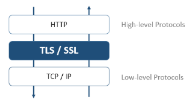
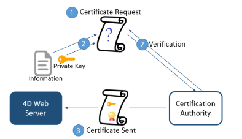

Todos los servidores 4D pueden comunicarse en modo seguro a través del protocolo TLS (Transport Layer Security):

- el servidor web
- el servidor de aplicaciones (aplicaciones de escritorio cliente-servidor)
- el servidor SQL

## Generalidades

El protocolo TLS (sucesor de SSL) ha sido diseñado para asegurar los intercambios de datos entre dos aplicaciones, principalmente entre un servidor web y un navegador. Este protocolo es ampliamente utilizado y es compatible con la mayoría de los navegadores web.

A nivel de red, el protocolo de seguridad se inserta entre la capa TCP/IP (nivel bajo) y el protocolo de alto nivel HTTP. Ha sido diseñado principalmente para trabajar con HTTP.

Configuración de red utilizando TLS:

El protocolo TLS está diseñado para autenticar al emisor y al receptor y para garantizar la confidencialidad e integridad de la información intercambiada:

- **Autenticación**: se confirma la identidad del emisor y del receptor.
- **Confidencialidad**: los datos enviados se cifran para que ninguna tercera persona pueda entender el mensaje.
- **Integridad**: los datos recibidos no han sido modificados, por accidente o de forma malintencionada.

TLS utiliza una técnica de cifrado de llave pública basada en un par de llaves asimétricas para el cifrado y el descifrado: una llave pública y una llave privada. La llave privada se utiliza para encriptar los datos. El remitente (el sitio web) no se la da a nadie. La llave pública se utiliza para descifrar la información y se envía a los receptores (navegadores web) a través de un certificado. Cuando se utiliza TLS con Internet, el certificado se entrega a través de una autoridad de certificación, como Verisign®. El sitio web paga a la Autoridad de Certificación para que le entregue un certificado que garantice la autentificación del servidor y que contenga la llave pública que permita el intercambio de datos de forma segura.

> For more information on the encryption method and the public and private key issues, refer to the `ENCRYPT BLOB` command description.

## Versión mínima

Por defecto, la versión mínima del protocolo seguro que acepta el servidor es TLS 1.2. You can modify this value by using the `Min TLS version` selector with the `SET DATABASE PARAMETER command`.

You can control the level of security of your web server by defining the [minimum TLS version](WebServer/webServerConfig.md#minimum-tls-version) accepted for connections.

## ¿Cómo obtener un certificado?

Un servidor que funciona en modo seguro significa que necesita un certificado digital de una autoridad de certificación. Este certificado contiene diversa información, como el ID del sitio, así como la llave pública utilizada para comunicarse con el servidor. Este certificado se transmite a los clientes (por ejemplo, los navegadores web) que se conectan a este servidor. Una vez identificado y aceptado el certificado, la comunicación se realiza en modo seguro.

> Los navegadores web sólo autorizan los certificados emitidos por una autoridad de certificación referenciada en sus propiedades.

La autoridad de certificación se elige en función de varios criterios. If the certification authority is well known, the certificate will be authorized by many browsers, however the price to pay will be expensive.

Para obtener un certificado digital:

1. Genere una llave privada utilizando el comando `GENERATE ENCRYPTION KEYPAIR`.

:::caution

Por razones de seguridad, la llave privada debe mantenerse siempre en secreto. En realidad, debería permanecer siempre en la máquina del servidor. Para el servidor web, el archivo Key.pem debe colocarse en la carpeta Project.

:::

2. Utilice el comando `GENERATE CERTIFICATE REQUEST` para emitir una solicitud de certificado.

3. Envíe la solicitud de certificado a la autoridad de certificación elegida.
   Para llenar una solicitud de certificado, es posible que tenga que ponerse en contacto con la autoridad de certificación. La autoridad de certificación comprueba que la información transmitida es correcta. La petición de certificado se genera en un BLOB utilizando el formato PKCS codificado en base64 (formato PEM). Este principio permite copiar y pegar las llaves como texto y enviarlas por correo electrónico sin modificar el contenido de la llave. Por ejemplo, puede guardar el BLOB que contiene la solicitud de certificado en un documento de texto (usando el comando `BLOB TO DOCUMENT`), luego abrir y copiar y pegar su contenido en un correo electrónico o un formulario Web para ser enviado a la autoridad de certificación.

4. Una vez que tenga el certificado, cree un archivo de texto llamado "cert.pem" y pegue en él el contenido del certificado.
   Puede recibir un certificado de diferentes maneras (normalmente por correo electrónico o formulario HTML). 4D acepta todos los formatos de texto relacionados con la plataforma para los certificados (macOS, PC, Linux, etc.). However, the certificate must be in PEM format, *i.e.*, PKCS encoded in base64.

> Los caracteres de fin de línea CR no se soportan por sí solos; debe utilizar CRLF o LF.

5. Coloca el archivo “cert.pem” en la [ubicación apropiada](#installation-and-activation).

El servidor 4D puede ahora trabajar en modo seguro. El certificado tiene una validez de entre 3 meses y un año.

## Instalación y activación

### Installing `key.pem` and `cert.pem` files

To be able to use the TLS protocol with the server, you must install the **key.pem** (document containing the private encryption key) and **cert.pem** (document containing the certificate) at the appropriate location(s). Se requieren diferentes ubicaciones en función del servidor en el que se quiera utilizar TLS.

:::caution

Default *key.pem* and *cert.pem* files are provided with 4D. Para un mayor nivel de seguridad, le recomendamos encarecidamente que sustituya estos archivos por sus propios certificados.

:::

#### Con el servidor Web

To be used by the 4D web server, the **key.pem** and **cert.pem** files must be placed:

- with 4D in local mode or 4D Server, next to the [project folder](Project/architecture.md#project-folder)
- con 4D en modo remoto, en la carpeta de la base cliente en la máquina remota (para más información sobre la ubicación de esta carpeta, ver el comando [`Get 4D folder`](https://doc.4d.com/4dv19/help/command/en/page485.html)).

Debe copiar estos archivos manualmente en la máquina remota.

#### Con el servidor de aplicaciones (aplicaciones de escritorio cliente-servidor)

To be used by the 4D application server, the **key.pem** and **cert.pem** files must be placed in the [**Resources** folder](Project/architecture.md#resources) of the 4D Server application.

#### Con el servidor Web

To be used by the 4D SQL server, the **key.pem** and **cert.pem** files must be placed next to the [project folder](Project/architecture.md#project-folder).

### Activar TLS

The installation of **key.pem** and **cert.pem** files makes it possible to use TLS with the 4D server. Sin embargo, para que las conexiones TLS sean aceptadas por el servidor, debe habilitarlas:

- With the 4D web server, you must [enable HTTPS](WebServer/webServerConfig.md#enable-https). You can set the [HSTS option](WebServer/webServerConfig.md#enable-hsts) to redirect browsers trying to connect in http mode.
- With the application server, you must select the **Encrypt Client-Server Communications** option in the "Client-server/Network options" page of the Settings dialog box.
- With the SQL server, you must select the **Enable TLS** option in the "SQL" page of the Settings dialog box.

> El servidor web 4D también soporta [la opción HSTS](WebServer/webServerConfig.md#enable-hsts) para declarar que los navegadores sólo deben interactuar con él a través de conexiones seguras HTTPS.

## Perfect Forward Secrecy (PFS)

[PFS](https://en.wikipedia.org/wiki/Forward_secrecy) añade una capa adicional de seguridad a sus comunicaciones. En lugar de utilizar llaves de intercambio predefinidas, PFS crea llaves de sesión de forma cooperativa entre las partes que se comunican utilizando algoritmos Diffie-Hellman (DH). La forma conjunta en que se construyen las llaves crea un "secreto compartido" que impide que partes externas puedan comprometerlas.

Cuando se habilita TLS en el servidor, PFS se habilita automáticamente. Si el archivo *dhparams.pem* (documento que contiene la llave privada DH del servidor) no existe todavía, 4D lo generará automáticamente con un tamaño de llave de 2048. La generación inicial de este archivo puede llevar varios minutos. The file is placed with the [*key.pem* and *cert.pem* files](#installing-keypem-and-certpem-files).

Si utiliza una [lista de cifrado personalizada](WebServer/webServerConfig.md#cipher-list) y desea activar PFS, debe verificar que contiene entradas con algoritmos DH o ECDH (Elliptic-curve Diffie-Hellman).
