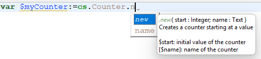

## Principes de base

Les commentaires sont des lignes d’instructions inactives. Ces lignes ne sont pas interprétées par le programme (4D n’applique aucun style spécifique à l’intérieur de la ligne de commentaire) et ne sont pas exécutées lorsque la méthode est appelée. Des fonctionnalités spécifiques s'appuient sur les commentaires pour documenter et baliser votre code.

Voici deux manières de créer des commentaires :

- `//` pour créer une ligne de commentaire
- `/* ... */` pour les commentaires sur une seule ligne ou sur plusieurs lignes.

Les deux styles de commentaires peuvent être utilisés simultanément.

### Commentaires sur une seule ligne (`//commentaire`)

Insérez les caractères `//` au début de la ligne ou après une instruction pour ajouter une ligne de commentaire. Exemple :

```4d
//Ceci est un commentaire
For($vCounter;1;100) //Début de la boucle
  //commentaire
  //commentaire
  //commentaire
End for
```

### Commentaires en ligne ou multilignes (`/*comment*/`)

Encadrez le contenu avec les caractères `/*` ... `*/` pour créer des blocs de commentaires en ligne ou multi-lignes. Les blocs de commentaire en ligne et multi-lignes commencent par `/*` et se terminent par `*/`.

- Les **lignes de commentaires en ligne** - peuvent être insérées n'importe où dans le code. Exemple :

```4d
For /* ligne de commentaire */ ($vCounter;1;100)
 ...
End for
```

- Les **blocs de commentaires multi-lignes** permettent de commenter un nombre illimité de lignes. Les blocs de commentaires peuvent être imbriqués (ce qui est utile, étant donné que l'éditeur de code 4D prend en charge les blocs condensés). Exemple :

```4d
For ($vCounter;1;100)
/*
commentaires  
	/*
	autres commentaires
	*/
*/
...
End for
```

## Commentaires de description de syntaxe

Les commentaires peuvent servir à décrire la syntaxe de vos méthodes, fonctions de classe ou constructeurs.

- Pour une méthode, écrivez le bloc de commentaire dans les premières lignes de la méthode. Dans l'éditeur de code 4D, les commentaires sont affichés dans ses [infobulles](../code-editor/write-class-method.md#help-tips) (les 5 premières lignes sont affichées).
- Pour une fonction de classe ou un constructeur, placez le bloc de commentaires immédiatement au-dessus de la déclaration `Function` ou `Class constructor`. Les commentaires s'affichent avec la signature dans l'aide du code 4D et dans VS Code (détails de complétion, astuces d'aide et aide relative à la signature). Ajoutez un commentaire spécifique pour chaque paramètre en utilisant la syntaxe `// $paramName: <text>` (voir ci-dessous).

Exemple :

```4d

// Ajoute ou met à jour une dépendance locale (URL de fichier) dans l'objet "dependencies" du fichier d'environnement
// $folder: dossier de la dépendance à enregistrer
// $optionalName: nom facultatif de la dépendance (par défaut : nom complet du dossier)
#DECLARE($folder : 4D.Folder; $optionalName : Text)

//...code

```

Le bloc de commentaires respecte les règles suivantes :

- It is made of `//` lines and/or a `/* */` block. Each line of a `/* */` block is handled like a `//` line, and the `/*` and `*/` markers are not displayed.
- Dans le cas d'une fonction de classe ou d'un constructeur, le commentaire doit être placé immédiatement au-dessus de la déclaration. A blank line between the comment block and the declaration breaks the association: only the signature is displayed.
- Each comment block is associated only with the next declaration, even when it is written right after the code of the previous function.
- Only the saved code is read: after you edit a comment, the code assistance shows the new text once the class is saved.
- The text is displayed as plain text: Markdown markers such as `**` or `*` are shown as written.

#### Exemple 1

You want to document a function and its parameter so that they are displayed in the code editor:

```4d
// Class: Invoice

// Returns the price with taxes
// The rate is a percentage
// $rate: tax rate to apply (20 for 20%)
Function priceWithTaxes($rate : Real) : Real
	return This.price*(1+($rate/100))
```

When you type `$invoice.priceWithTaxes(` in a method, the help displays the signature with:

```
Returns the price with taxes
The rate is a percentage

$rate: tax rate to apply (20 for 20%)
```

#### Exemple 2

You want to document a class constructor with a `/* */` block:

```4d
// Class: Counter
property value : Integer
property name : Text

/*
Creates a counter starting at a value
$start: initial value of the counter
{$name}: name of the counter
*/
Class constructor($start : Integer; $name : Text)
	This.value:=$start
	This.name:=$name || "default name"
```

Vous pouvez afficher :



## Commentaires pour des fonctionnalités spécifiques

### Outil MCP

Lorsqu'une fonction est publiée en tant qu'**outil MCP** (*MCP tool*), ses commentaires servent à fournir une [description du code de l'outil MCP](../WebServer/mcp-server.md#describing-the-tools), y compris les balises de comportement MCP.

### Marqueurs de navigation dans le code

Les marqueurs de navigation dans le code, tels que `MARK:`, `TODO:` et `FIXME:`, sont insérés sous forme de commentaires. Voir [Balisage manuel](../code-editor/write-class-method.md#manual-tagging).

