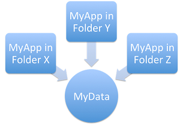
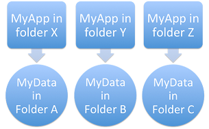
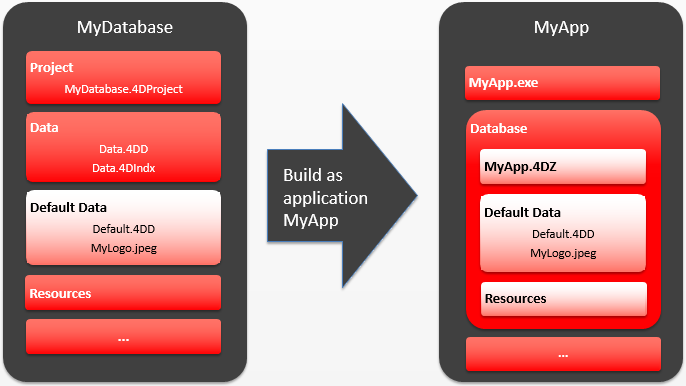

## Ouverture du fichier de données

Lorsqu'un utilisateur lance une application fusionnée ou une mise à jour (applications monopostes ou applications client-serveur), 4D va tenter d'ouvrir un fichier de données valide. Plusieurs emplacements sont successivement examinés par l'application.

La séquence de lancement d'une application fusionnée est la suivante :

1. 4D tente d'ouvrir le Dernier fichier de données ouvert, [comme décrit ci-dessous](#last-data-file-opened) (non applicable lors du lancement initial).
2. S'il n'est pas trouvé, 4D tente d'ouvrir en mode lecture seule le fichier de données situé dans le dossier de données par défaut au même niveau que le fichier .4DC.
3. S'il n'est pas trouvé, 4D tente d'ouvrir le fichier de données par défaut standard (même nom et même emplacement que le fichier .4DZ).
4. S'il n'est pas trouvé, 4D affiche une boîte de dialogue standard de sélection/création de fichier de données.

## Dernier fichier de données ouvert

### Chemin d'accès du dernier fichier de données

Toute application autonome ou serveur générée avec 4D stocke le chemin d'accès du dernier fichier de données ouvert dans le dossier de préférences de l'utilisateur de l'application.

L'emplacement du dossier de préférences de l'utilisateur de l'application correspond au chemin retourné par l'instruction suivante :

```4d
prefsUtilisateur:=Get 4D folder(Dossier 4D actif)
```

Le chemin d'accès du fichier de données est stocké dans un fichier dédié, nommé *lastDataPath.xml*.

Grâce à cette architecture, lorsque vous fournissez une mise à jour de votre application, le fichier de données de l'utilisateur local (le dernier fichier de données utilisé) est automatiquement ouvert dès le premier lancement.

Ce mécanisme est généralement adapté aux déploiements standard. Cependant, dans des cas spécifiques, par exemple si vous dupliquez vos applications fusionnées, vous pouvez avoir besoin de modifier la manière dont le fichier de données est lié à l'application.

### Configurer le mode de liaison des données

4D utilise automatiquement, avec vos applications compilées, le dernier fichier de données ouvert. Par défaut, le chemin d'accès du fichier de données est stocké dans le dossier de préférences de l'utilisateur de l'application et est lié au **nom de l'application**.

Ce fonctionnement peut s'avérer inadapté si vous souhaitez dupliquer une application fusionnée destinée à utiliser différents fichiers de données. En effet, les applications dupliquées vont en fait partager le même dossier de préférences de l'utilisateur et donc, toujours utiliser le même fichier de données -- même si le fichier de données est renommé, car l'application utilisera toujours le dernier fichier de données ouvert par l'application.

4D vous permet donc de lier votre chemin de fichier de données au chemin de l'application. Dans ce cas, le fichier de données sera relié via un chemin spécifique et ne sera plus simplement le dernier fichier utilisé. Vous liez donc vos données **par le chemin de l'application**.

Ce mode vous permet de dupliquer vos applications fusionnées sans rompre le lien vers le fichier de données. Cependant, avec cette option, si le package d'application est déplacé sur le disque, l'utilisateur sera invité à entrer un fichier de données, car le chemin de l'application ne correspondra plus à l'attribut "executablePath" (après qu'un utilisateur ait sélectionné un fichier de données, le fichier *lastDataPath.xml* est mis à jour en conséquence).

*Duplication lorsque les données sont liées par le nom de l'application:*


*Duplication lorsque les données sont liées par le chemin de l'application :*


Vous sélectionnez le mode de liaison des données lors de la phase de génération de l'application. Vous pouvez soit :

- Utiliser la [Page Application](building.md#application-page) ou la [Page Client/Serveur](building.md#clientserver-page) de boîte de dialogue du Générateur d'applications.
- Use the **LastDataPathLookup** XML key ([single-user application](../BuildApplication/runtime-vl.md#lastdatapathlookup) or [server application](../BuildApplication/client-server.md#lastdatapathlookup)).

## Définir un dossier de données par défaut

4D vous permet de définir un fichier de données par défaut lors de la phase de construction de l'application. 4D vous permet de définir un fichier de données par défaut lors de la phase de construction de l'application. Cela vous donne un meilleur contrôle sur la création et/ou l'ouverture des fichiers de données lors du premier lancement d'une application fusionnée.

Plus particulièrement, il permet de répondre aux besoins suivants :

- Eviter l'affichage de la boîte de dialogue d'ouverture de fichier de données de 4D au lancement d'une nouvelle application fusionnée ou d'une mise à jour. Vous pouvez détecter, par exemple dans la , que le fichier de données par défaut a été ouvert et donc, exécuter votre propre code et/ou boîtes de dialogue permettant de créer ou de sélectionner un fichier de données local.
- Permettre la distribution d'applications fusionnées comportant des données en lecture seulement (par exemple des applications de démonstration).

Pour définir et utiliser un fichier de données par défaut :

- Vous devez fournir un fichier de données par défaut (nommé "Default.4DD") et le stocker dans un dossier spécifique (nommé "Default Data") à l'intérieur du dossier du projet d'application. Ce fichier doit être accompagné de tous les fichiers nécessaires, en fonction de la configuration du projet : index (.4dIndx), blobs externes, journal, etc. Il est de votre responsabilité de livrer un fichier de données par défaut valide. A noter que, comme le fichier de données par défaut est ouvert en mode lecture seule, il est recommandé de désélectionner l'option "Utiliser le fichier d'historique" dans le fichier de structure original avant de créer le fichier de données.
- Au moment de la génération de l'application, le dossier de données par défaut est intégré dans l'application fusionnée. Tous les fichiers présents dans ce dossier par défaut sont également embarqués.

Le schéma suivant illustre cette fonctionnalité :



Lorsque le fichier de données par défaut est détecté au premier lancement, il est silencieusement ouvert en mode lecture seulement, vous permettant ainsi d'exécuter toute opération personnalisée (à condition qu'elle ne modifie pas le fichier de données lui-même).
