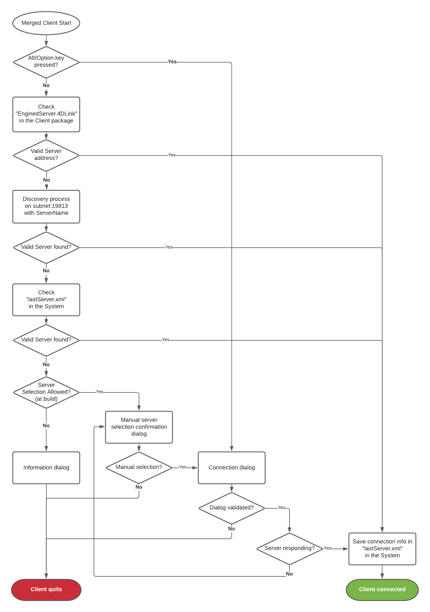
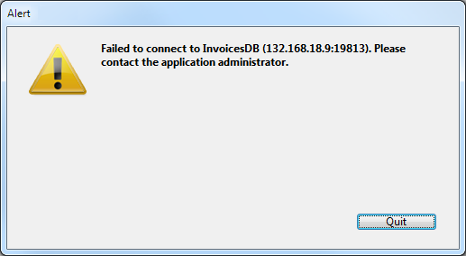
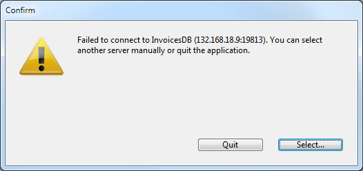
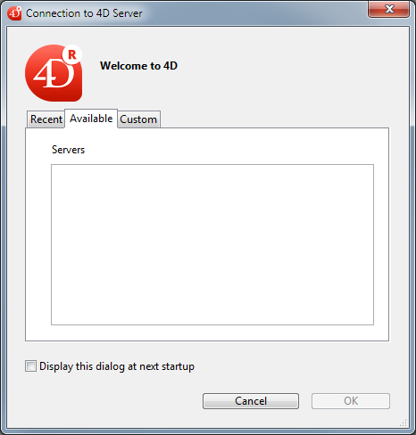

La gestion des connexions des applications clientes recouvre les mécanismes par lesquels une application cliente fusionnée se connectera au serveur cible, une fois en environnement de production.

## Scénario de connexion

Le processus de connexion des applications clientes fusionnées prend en charge les cas où le serveur dédié n'est pas disponible. Le scénario du démarrage d'une application cliente 4D est le suivant :

1. Si des informations de connexion valides sont stockées dans le fichier "EnginedServer.4DLink" à l'intérieur de l'application cliente, l'application cliente se connecte à l'adresse du serveur spécifiée.  
   OR  
   L'application cliente tente de se connecter au serveur en utilisant le service de découverte (basé sur le nom du serveur, diffusé sur le même sous-réseau).

2. En cas d'échec, l'application cliente tente de se connecter au serveur à l'aide des informations présentes dans le dossier de préférences utilisateur de l'application (fichier "lastServer.xml", cf. dernière étape).
3. En cas d'échec, l'application cliente affiche une boîte de dialogue d'erreur de connexion.

- Si l'utilisateur clique sur le bouton **Sélectionner...** (lorsqu'il été autorisé par le développeur 4D au moment de la génération de l'application, voir ci-dessous), la boîte de dialogue standard "Connexion au serveur" est affichée.
- Si l'utilisateur clique sur le bouton **Quitter**, l'application client quitte.

4. Si la connexion est établie avec succès, les paramètres de cette connexion sont sauvegardés dans le dossier de préférences utilisateur de l'application cliente, ce qui permettra de les réutiliser ultérieurement en cas de besoin.

La procédure complète est décrite dans le diagramme suivant :



## Sauvegarde du chemin du dernier serveur

Le chemin du dernier serveur utilisé est automatiquement sauvegardé dans un fichier nommé "lastServer.xml" placé dans le dossier de préférences utilisateur de l'application cliente. Ce dossier est situé à l'emplacement suivant :

```4d
prefsUtilisateur:=Get 4D folder(Dossier 4D actif)
```

Ce mécanisme permet de prendre en charge le cas où le serveur cible primaire est temporairement indisponible pour une raison quelconque (par exemple pour une opération de maintenance). Lorsque ce cas se produit pour la première fois, la boîte de dialogue de sélection de serveur est affichée (si elle est autorisée, cf. ci-dessous) et l'utilisateur peut manuellement sélectionner un serveur alternatif, dont le chemin est alors sauvegardé si la connexion est établie et validée. Toute indisponibilité ultérieure sera alors automatiquement prise en charge à l'aide des paramètres de connexion présents dans le fichier "lastServer.xml".

> - Lorsque les applications clientes ne peuvent pas bénéficier en permanence du service de découverte, par exemple en raison de la configuration réseau, il est recommandé que le développeur fournisse un nom d'hôte lors de la génération de l'application en utilisant la clé [IPAddress](../BuildApplication/client-server.md#ipaddress) dans le fichier "BuildApp.4DSettings". Le mécanisme de sauvegarde du chemin du dernier serveur est conçu pour les cas d'indisponibilité temporaire uniquement.
> - Dans tous les cas, il est possible de maintenir la touche **Alt/Option** au démarrage de l'application cliente afin d'afficher la boîte de dialogue de sélection du serveur.

## Accès à la boîte de dialogue de sélection de serveur en cas d'erreur

Vous pouvez choisir d'afficher ou non la boîte de dialogue standard de sélection de serveur sur les applications clientes fusionnées lorsque le serveur ne répond pas. La configuration dépend de la valeur de la clé XML [ServerSelectionAllowed](../BuildApplication/client-server.md#serverselectionallowed) sur la machine où l'application a été créée :

- **Affichage d'un message d'erreur sans accès possible à la boîte de dialogue de sélection de serveur**.  
  Fonctionnement par défaut. L'application ne peut que quitter.  
  `ServerSelectionAllowed`: **False** or key omitted

  

- **Affichage d'un message d'erreur avec accès possible à la boîte de dialogue de sélection de serveur.**.  
  L'utilisateur peut accéder à la fenêtre de sélection du serveur en cliquant sur le bouton **Sélectionner...**.  
  `ServerSelectionAllowed`: **True**

    
  
