L'Editeur de structure vous permet de gérer la structure de la base de données, c'est-à-dire les tables et leurs relations. Il vous donne le contrôle sur les tables, les propriétés des tables, les champs, les propriétés des champs y compris les index, et les liens entre les tables.

Vous pouvez accéder à l'**Editeur de structure** en sélectionnant la commande **Structure** dans le menu **Développement** ou en cliquant sur le bouton Structure 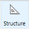 dans la barre d'outils 4D.

L'Editeur de structure offre une vue graphique de la structure d'une base de données, ainsi qu'une barre d'outils et des menus contextuels que vous pouvez utiliser pour effectuer des opérations de conception de base de données. Chaque table est représentée par une image. Il affiche les champs et leurs types sous forme d'icônes. Une barre d'informations affiche les caractéristiques des tables et des champs lorsque la souris les survole.

Une **palette "Inspecteur"** flottante permet de visualiser et de modifier les propriétés des objets de structure ainsi que celles de l'Editeur de structure lui-même. Cette fenêtre est décrite dans la section [Palette Inspecteur](#inspector-palette).

## Toolbar (Barre d’outils)

L'éditeur de structure dispose d'une barre d'outils contenant des fonctions telles que l'ajout d'objets, ainsi que des options de navigation et d'affichage :

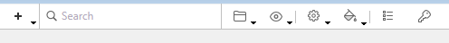

De gauche à droite, les icônes permettent d'effectuer les actions suivantes :

- ajouter des objets (tables, champs, index, liens)
- rechercher dans l'éditeur
- masquer/afficher les tables en fonction des dossiers définis dans la page d'accueil de l'Explorateur
- afficher des filtres
- Outils (taille, alignement, tri)
- couleurs
- Fenêtre de la liste d'index
- Gestionnaire de clés primaires

### Information verrouillage

Une icône représentant un cadenas fermé 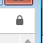 s'affiche si le fichier de structure est verrouillé.  
Le verrouillage peut se produire dans les modes projet et client/serveur lorsque :

- Le fichier `catalog.4DCatalog` est en *lecture seule* (projets uniquement). Cliquer sur l'icône représentant un cadenas affichera une alerte vous proposant de le déverrouiller, si cela est possible.
- Deux utilisateurs ou plus tentent de modifier la même structure en même temps. La structure ne peut pas être utilisée tant que le premier utilisateur ne l'a pas libérée en fermant la fenêtre. *(Client/serveur uniquement)*

Dans les deux cas, la structure peut être ouverte en mode *Lecture seule*, mais ne peut pas être utilisée tant que le verrou n'est pas supprimé.

## Barre d'informations

La partie inférieure de la fenêtre de l'éditeur est une barre d'informations qui affiche les données correspondant à la zone sur laquelle se trouve le curseur de la souris : table, champ ou lien.

#### Informations sur une table

- Nom et numéro de la table
- Triggers de la table :
  - **NEW :** Sur sauvegarde nouvel enregistrement
  - **SAVE :** Sur sauvegarde enregistrement
  - **DEL :** Sur suppression enregistrement

#### Informations sur un champ

- Nom et numéro de la table
- Nom et numéro du champ
- Type de champ
- Attributs du champ :
  - **NUL :** Traduire les Null en valeurs vides
  - **UNI :** Unique

#### Informations sur un lien

- Table et champ d'origine (champ N)
- Table et champ de destination (champ un)
- Type de relation et nom ORDA :
  - **N→1** (de N vers un) et nom de l'attribut relationnel `relatedEntities`
  - **1→N** (un vers N) et nom de l'attribut relationnel `relatedEntity`

:::note

Pour plus d'informations sur les noms ORDA, consultez la page [Objets du modèle de données](../ORDA/dsMapping.md#structure-mapping).

:::

## Palette Inspecteur {#inspector-palette}

Les propriétés des objets de l'Editeur de structure (tables, champs et liens) peuvent être consultées et modifiées via la palette "Inspecteur" :

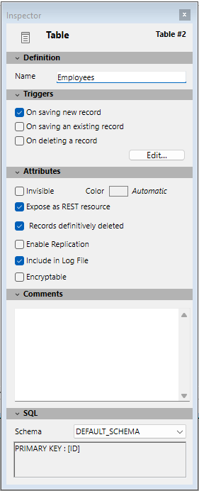

Cette palette s'affiche lorsque vous double-cliquez sur un objet. Lorsqu'elle s'affiche, son contenu est mis à jour dynamiquement en fonction des objets sélectionnés. L'Inspecteur affiche les [propriétés générales de la fenêtre de l'Editeur de structure](#customizing-the-editor-window) lorsque vous cliquez dans une zone vide de la fenêtre.

Les différentes sections de la palette peuvent être déployées ou contractées. Vous pouvez cliquer sur les triangles adjacents pour afficher ou masquer les informations correspondantes.

Vous pouvez utiliser les raccourcis suivants :

- **Maj+clic** sur la barre de titre d'un panneau contracté déploie ce panneau et contracte tous les autres.
- **Alt** (Windows) ou **Option** (macOS) + **clic** sur la barre de titre d'un panneau contracté permet de déplier tous les panneaux.
- **Alt** (Windows) ou **Option** (macOS) + **clic** sur la barre de titre d'un panneau déployé permet de contracter tous les panneaux.

La position de la palette et l'état déployé/contracté de ses panneaux sont sauvegardés.

## Sélection d'un objet

Pour manipuler l'image d'un objet dans l'Editeur de structure, vous devez d'abord le sélectionner. Vous pouvez ensuite définir ses propriétés, le déplacer, le redimensionner, le supprimer, etc. Vous pouvez sélectionner simultanément plusieurs objets du même type afin de modifier leurs propriétés communes dans la palette "Inspecteur".

Pour sélectionner :

- **Une table :** Cliquez sur l'image de la table, ou appuyez sur `Tab` / `Maj+Tab` pour sélectionner chaque table successivement.
- **Un champ ou un lien :** Cliquez sur le champ ou le lien, ou utilisez les touches fléchées pour naviguer.
- **Plusieurs objets :** utilisez `Maj + clic` pour sélectionner des objets adjacents, et `Ctrl + clic` (Windows) ou `Commande + clic` (macOS) pour les objets non adjacents.

## Utilisation des images de tables

Vous pouvez redimensionner ou déplacer les images des tables dans l'Editeur de structure selon vos besoins.

**4D Server** : En [mode développement](../Desktop/clientServer.md#development-mode), toute modification apportée aux images des tables (redimensionnement, emplacement...) est propagée à tous les développeurs travaillant dans l'environnement de développement.

### Défilement de la liste des champs

Lorsque vous ajoutez des champs à une table ou lorsque vous réduisez la taille d'une table, il peut y avoir plus de champs dans la table que l'image ne peut afficher. Dans ce cas, 4D ajoute automatiquement un curseur qui vous permet de faire défiler la liste des champs visibles :

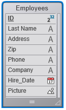

### Redimensionnement d'une image de table

Vous pouvez redimensionner une image de table pour afficher davantage de noms de champs ou réorganiser votre écran.

- **Redimensionnement manuel** : Il vous suffit de cliquer et de faire glisser le bas de l'image de la table ou son coin inférieur droit.

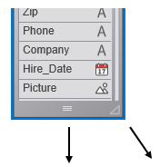

- **Taille optimale** : Cette option redimensionne automatiquement la ou les table(s) sélectionnée(s) pour que leur taille corresponde exactement au nombre de champs qu'elles contiennent (les lignes vides ne sont pas affichées). Pour appliquer la commande **Taille optimale** à une ou plusieurs tables, sélectionnez **Taille optimale** dans le menu associé au bouton de la barre d'outils de l'éditeur ou dans le menu contextuel de l'éditeur (cliquez sur une table).

- **Réduire** : La fonction **Réduire** réduit la ou les image(s) de table sélectionnée(s) afin que seuls leurs noms soient visibles.  Cette fonction est utile pour les grandes structures.

Pour appliquer la commande **Réduire** à une ou plusieurs tables, vous pouvez :

 ```
 - Sélectionner **Réduire** dans le menu contextuel de l'éditeur (cliquez dans la zone titre de la table).  
 - **Maj+Double-clic** dans la zone de nom de la table pour passer d'un état à l'autre dans la séquence *taille originale → réduire.*
 ```

:::note Notes

- Un double-clic standard sur la zone de nom de la table ouvre l'**inspecteur**.
- **Alt** (Windows) ou **Option** (macOS) + double-clic ouvre le trigger de la table dans **l'éditeur de méthodes**.
- **Ctrl** (Windows) ou **Commande** (macOS) + double-clic ouvre l'**Explorateur** sur la page du formulaire.

:::

### Déplacement des images de table

Vous pouvez déplacer les images de tables pour les regrouper par fonction ou pour réorganiser la fenêtre de l'Editeur de structure. Vous pouvez également les aligner pour améliorer la lisibilité de la structure. Tous les liens sont automatiquement redessinés pour s'adapter à l'emplacement des nouvelles tables.

Pour déplacer manuellement l'image d'une table, cliquez sur le nom de celle-ci et faites-la glisser à l'aide du curseur de la souris. Faites glisser la barre de nom de la table uniquement. Faire glisser d'autres parties de l'image de la table peut produire des effets différents, comme la création d'un nouveau lien ou la modification de la taille de l'image de la table.

Pour aligner deux ou plusieurs tables, sélectionnez les tables à aligner et choisissez une option d'alignement dans le menu outils :

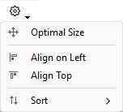

Ces commandes ne sont actives que si au moins deux tables sont sélectionnées.

## Défilement

Des fonctions de défilement spécifiques facilitent la navigation entre les grandes structures :

- La molette de la souris permet de faire défiler verticalement le contenu de la fenêtre de l'éditeur. Cela fera également défiler les champs d'une table lorsque le curseur est placé au-dessus de celle-ci.
- Maintenir la touche **Maj** enfoncée lors de l'utilisation de la molette de la souris fait défiler le contenu de la fenêtre horizontalement.
- Appuyer sur **Maj** active l'outil "main" qui peut être utilisé pour faire glisser tout le contenu de la fenêtre en cliquant dans la zone vide.

## Zoom

Vous pouvez modifier l'échelle d'affichage de la structure de la base de données à l'aide du menu **Zoom** situé à droite de la barre d'informations. La valeur par défaut lors de l'ouverture d'une base de données est 100 %. L'action de zoom est centrée sur la sélection s'il y en a une.

Le réglage du zoom courant est spécifique à chaque utilisateur et est mémorisé lorsque la fenêtre est fermée.

:::note

Vous pouvez [configurer le rendu graphique de l'Editeur de structure pendant un zoom](../Preferences/structure.md#graphic-quality-of-the-structure) en utilisant une préférence.

:::

## Affichage du type d'objet

Le bouton **Affichage** dans la barre d'outils de l'Editeur de structure est associé à un menu et vous permet de choisir les objets à afficher dans la structure selon leur type :

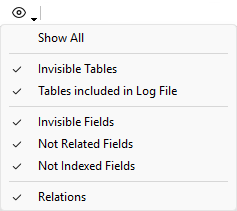

Par défaut, tous les objets sont affichés. Cette fonctionnalité permet diverses représentations ou vues, de la plus simple à la plus complète, et fournit un outil d'analyse pour la structure en fonction du niveau d'information requis.

Les choix sont appliqués à l'ensemble des tables et des champs. Ils sont enregistrés pour chaque utilisateur et conservés lorsque la fenêtre est fermée. Masquer des objets ne change pas la position des tables.

- Lorsque plusieurs types de champs sont cochés, un opérateur logique OU est utilisé pour déterminer les objets à afficher. Par exemple, si les options *Champs invisibles* et *Champs non indexés* sont toutes deux sélectionnées, tous les champs non indexés et invisibles (indexés ou non) sont affichés.
- Les tables ont la priorité sur les champs : si une table n'est pas affichée, ses champs ne le sont pas non plus.
- Si vous ajoutez un objet dont le type n'est pas affiché (table, champ ou lien), celui-ci devient visible. Pour le masquer à nouveau, vous devez désélectionner l'option correspondante dans le menu **Affichage**.

## Afficher/Masquer des tables par dossier

Vous pouvez masquer des groupes de tables dans l'Editeur de structure en fonction des dossiers définis dans la **page d'accueil** de la fenêtre de l'Explorateur. Vous pouvez configurer cet affichage à l'aide du bouton **Dossiers** situé dans la barre d'outils de l'éditeur de structure.

Le menu associé à ce bouton affiche les commandes permettant de gérer l'affichage ainsi que la liste des dossiers de la base de données. Une coche apparaît à côté de chaque dossier affiché. Vous pouvez modifier l'affichage courant en sélectionnant ou en désélectionnant un dossier dans ce menu.

Les commandes **Afficher tous les dossiers** et **Masquer tous les dossiers** permettent d'afficher ou de masquer toutes les tables contenues dans les dossiers de la base.

Chaque clic sur le bouton dossier de la barre d'outils inverse l'affichage des tables : les tables surlignées sont alors grisées, et inversement.

Lorsque les tables sont masquées, seuls leurs contours apparaissent dans la fenêtre de structure. Les tables qui ne sont pas masquées restent entièrement visibles.

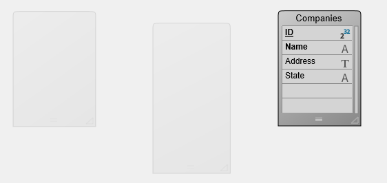

:::note

Vous pouvez définir l'apparence des tables masquées dans l'Editeur de structure sur *Atténué* ou *Invisible* à l'aide d'une [option de la page **Structure** des Préférences](../Preferences/structure.md#when-a-folder-is-dimmed-its-contents-are). Il est nécessaire de fermer puis de rouvrir la fenêtre de l'Editeur de structure pour que ce paramètre prenne effet.

:::

## Personnalisation de la fenêtre de l'éditeur

La fenêtre de l'Editeur de structures a des propriétés spécifiques qui peuvent être définies en utilisant l'**Inspecteur**.

Pour afficher ces propriétés, vous pouvez soit :

- Double-cliquer (ou cliquer, si la fenêtre est déjà affichée) dans une zone vide de la fenêtre, ou
- Cliquer avec le bouton droit de la souris sur une zone vide et sélectionner **Propriétés de la structure** dans le menu contextuel.

La palette Inspecteur affiche les propriétés de la structure.

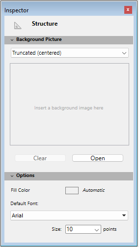

Les propriétés suivantes peuvent être définies :

- **Image d'arrière-plan :** Vous pouvez ajouter ou modifier l'image d'arrière-plan utilisée, ainsi que son format d'affichage. Pour ajouter ou modifier l'image, cliquez sur le bouton **Ouvrir** ou faites un clic droit dans la zone d'aperçu et sélectionnez **Ouvrir** dans le menu contextuel ; sélectionnez ensuite le fichier contenant l'image à afficher. Vous pouvez utiliser n'importe quel format d'image. L'image sélectionnée s'affiche immédiatement dans la zone d'aperçu et dans la fenêtre de l'éditeur.
  Pour modifier le format d'affichage de l'image, sélectionnez une valeur dans le menu des formats d'image. Les formats proposés correspondent aux formats d'affichage d'images standard de 4D.
  Pour supprimer une image personnalisée, cliquez sur le bouton **Effacer** ou faites un clic droit dans la zone d'aperçu et sélectionnez **Effacer** dans le menu contextuel.
- **Couleur de fond :** Vous pouvez modifier la couleur utilisée pour l'arrière-plan de la fenêtre de l'éditeur. Pour cela, cliquez dans la zone de sélection de couleurs et choisissez une couleur dans le menu de sélection.
- **Police par défaut :** Pour changer la police utilisée pour les noms de tables et de champs, choisissez une valeur dans ce menu. Vous pouvez également utiliser le menu Taille pour modifier la taille de police par défaut.

## Chercher dans la structure

4D vous permet d'effectuer des recherches directement dans la fenêtre de l'Editeur de structure. Les recherches peuvent porter sur les éléments suivants :

- Noms de tables et/ou noms de champs
- Numéros de table

Pour effectuer une recherche, saisissez un texte ou un numéro de table dans la zone **Chercher** de l'Editeur de structure. A mesure que vous tapez, une barre apparaît en dessous, dans laquelle vous pouvez définir des options de recherche :

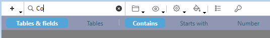

- **Portée** : *Tables & champs* ou *Tables* (tables seulement).
- **Types** :
  - *Contient* (par défaut) : en tapant "le", on trouve "Table", "Lettre", etc.
  - *Commence* : en tapant "pa", on trouve "paper" et "paid", mais pas "repair".
  - *Numéro* : en tapant"2", vous trouverez les tables numérotées 2, 12, 20, etc.

Les recherches s'effectuent en temps réel, au fur et à mesure que vous tapez. Les tables et les champs qui correspondent sont mis en surbrillance. Si aucun résultat n'est trouvé, la zone de recherche devient rouge. Pour quitter le mode **Chercher**, cliquez sur le bouton **x** dans la barre de recherche ou effacez tous les caractères de la zone de recherche.

