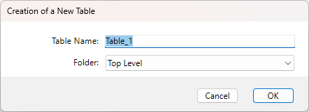
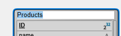
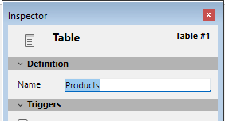
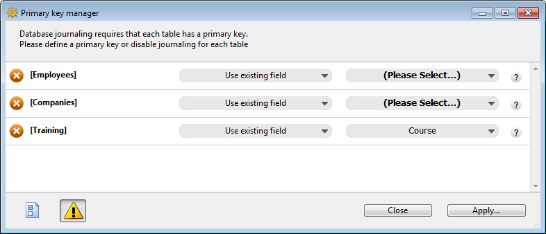

Les tables sont le fondement de chaque base de données 4D. Chaque table définit un ensemble d'enregistrements qui partagent les mêmes champs et propriétés. Dans l'Editeur de structure, les tables sont représentées sous forme d'objets graphiques que vous pouvez créer, renommer ou supprimer, et dont vous pouvez configurer les attributs individuellement.

Grâce aux outils fournis par 4D, vous pouvez :

- Définir des tables et gérer leurs clés primaires et leurs relations
- Définir et modifier les propriétés de tables, telles que les triggers, la visibilité et la réplication
- Gérer les règles de nommage et regrouper les tables dans des dossiers pour faciliter leur maintenance

## Créer une table

Vous pouvez créer une nouvelle table soit directement dans la fenêtre de Structure, soit via une boîte de dialogue. La création directe est plus rapide ; toutefois, la création via la boîte de dialogue vous permet de définir certains paramètres de la table et d'annuler l'opération si nécessaire. Vous pouvez également créer des tables par copier-coller.

- Pour créer directement une nouvelle table :

1. Cliquez avec le bouton droit de la souris sur une zone vide de la fenêtre de l'Editeur de structure, puis sélectionnez **Ajouter table** dans le menu contextuel.  
   **OU**  
   Dans le menu d'ajout d'objets de la [barre d'outils de l'éditeur de structure](./structure-editor.md#toolbar), sélectionnez l'option Table.

4D crée la table directement dans l'Editeur de structure. Vous pouvez ensuite modifier son nom, ajouter des champs, etc.

:::note

Si vous souhaitez placer la table dans un dossier spécifique, vous devez utiliser la page d'accueil de l'Explorateur.

:::

- Pour créer une table à l'aide de la boîte de dialogue "Nouvelle table" :

1. Sélectionnez **Nouveau > Table...** dans le menu **Fichier** (ou cliquez sur le bouton **Nouveau** de la barre d'outils 4D).  
   **OU**  
   Dans la page Tables de l'Explorateur, cliquez sur le bouton **\[+]**.

La boîte de dialogue "Créer une nouvelle table" s'affiche. 4D nomme la première table `Table_1` puis les numérote de manière séquentielle :

2. (facultatif) Modifiez le [nom de la table](../Concepts/identifiers.md#tables-and-fields) que vous souhaitez créer.
3. (facultatif) Indiquez le dossier dans lequel vous souhaitez placer la nouvelle table.  
   Par défaut, la table est placée au niveau le plus élevé de la hiérarchie des dossiers ("Niveau supérieur"). Les dossiers sont gérés dans la page d'accueil de l'Explorateur.
4. Cliquez sur **OK** pour valider.  
   4D crée une nouvelle image de table. Elle devient l'image de table sélectionnée dans la fenêtre de l'Editeur de structure.

- Pour créer une nouvelle table par copier-coller :

1. Sélectionnez et copiez la ou les table(s) à dupliquer.
2. Collez la ou les table(s) dans la fenêtre de l'éditeur de structure.

La table est collée avec tous ses champs et propriétés.

## Renommer une table

Vous pouvez renommer les tables à tout moment. Si vous avez utilisé l'ancien nom de table dans une méthode, 4D le remplace automatiquement par le nouveau nom, à condition que la méthode soit fermée. Si la méthode est ouverte, vous devez effectuer les modifications vous-même. Le nom de chaque table doit être unique dans la base de données.

Vous pouvez renommer une table directement dans l'Editeur de structure, dans l'Explorateur ou à l'aide de la palette Inspecteur.

Pour renommer directement une table (dans l'Editeur de structure ou la page Tables de l'Explorateur), **cliquez deux fois** sur le nom de la table (si celle-ci est déjà sélectionnée, cliquez une fois) afin de passer en mode édition :

Saisissez le nouveau nom, puis cliquez en dehors de la table.

Pour renommer une table en utilisant la palette Inspecteur de l'Editeur de structure, double-cliquez sur le nom de la table (ou sélectionnez **Propriétés de la Table...** dans le menu contextuel de la table) et entrez le nouveau nom dans la zone "Nom".

4D affiche le nom et les propriétés de la table sélectionnée dans la palette Inspecteur. Cette palette indique également le numéro de table. Si la palette Inspecteur est déjà ouverte mais affiche les propriétés d'une autre table ou d'un autre objet, il suffit de sélectionner l'image de la table souhaitée pour que la palette affiche alors ses propriétés.

## Supprimer une table

Vous pouvez supprimer des tables de votre base de données. Il existe deux façons de supprimer des tables dans 4D : la **suppression permanente** (la table et ses données sont effectivement supprimées de la base de données) et la **suppression non définitive** (la table est simplement placée dans la corbeille de l'Explorateur et peut être récupérée ultérieurement).

:::info

Vous pouvez également supprimer des tables à l'aide du [moteur SQL de 4D](https://doc.4d.com/4Dv21/4D/21/4D-SQL-Reference.100-7649299.en.html).

:::

### Suppression permanente

Pour supprimer définitivement une ou plusieurs table(s) de la base de données dans l'Editeur de structure :

Sélectionnez la ou les table(s) à supprimer, puis choisissez **Effacer** dans le menu **Édition** ou sélectionnez **Supprimer** dans le menu contextuel de la table.

Une boîte de dialogue d'avertissement vous demandera de confirmer l'opération. Lorsque vous cliquez sur **OK**, 4D effectue les opérations suivantes :

- La table est définitivement supprimée de la structure. Toutes les données associées à la table sont définitivement supprimées du fichier de données.
- Toute méthode trigger associée à la table est supprimée.
- Les formulaires et les énumérations associés à la table sont convertis en formulaires projet et placés dans la corbeille de l'Explorateur.

### Suppression non définitive

La suppression non définitive d'une table consiste à la placer dans la Corbeille du projet (accessible via l'Explorateur), tout comme les mécanismes de suppression de fichiers implémentés par Windows et macOS.

La table n'apparaît alors plus dans les éditeurs 4D et son contenu devient inaccessible, mais elle peut toujours être récupérée tant que la corbeille n'a pas été vidée.

Pour placer une ou plusieurs table(s) dans la corbeille à partir de l'Editeur de structure, choisissez la commande **Déplacer vers la corbeille** dans le menu contextuel de la table ou sélectionnez la ou les table(s) à supprimer, puis appuyez sur la touche **Suppr** ou **Retour arrière**. Une boîte de dialogue de confirmation s'affiche. Si vous cliquez sur **OK**, la table est mise dans la corbeille. Elle peut être récupérée à tout moment depuis la page "Corbeille" de l'Explorateur.

### Numéros des tables supprimées

Lorsqu'une table est supprimée, les autres tables de la base de données ne sont pas renumérotées, afin de ne pas compromettre la stabilité de la base de données. Il est donc possible, par exemple, d'avoir une base de données comportant trois tables numérotées 2, 4 et 5.

Notez que les numéros des tables supprimées définitivement sont réutilisés lors de la création ultérieure de nouvelles tables.

## Propriétés des tables

Vous pouvez définir plusieurs propriétés pour les tables en utilisant la **palette Inspecteur** ou, pour certaines propriétés, en utilisant le menu contextuel des tables.

### Triggers

Un [trigger](./triggers) est une méthode qui s'exécute automatiquement lorsque certains événements liés à la table se produisent. Les événements triggers peuvent être définis dans la **palette Inspecteur** ou via le menu contextuel associé à la table (clic droit sur la zone de titre de la table). Cochez chaque événement pour lequel vous souhaitez [activer le trigger](./triggers#activating-and-creating-a-trigger).

Vous pouvez accéder au trigger d'une table directement depuis l'Editeur de structure en cliquant sur le bouton **Editer...** dans la palette Inspecteur ou en sélectionnant **Modifier la méthode...** dans le sous-menu contextuel. Vous pouvez également créer et afficher les triggers dans la **Page Méthodes** de l'Explorateur.

La [barre d'informations](./structure-editor.md#information-bar) de l'**Editeur de structure** indique les triggers activés pour chaque table.

### Attributs

Vous pouvez définir différents attributs pour configurer l'apparence et le comportement général de chaque table.

#### Invisible

Cette option vous permet de masquer une table en mode Application et pour les plug-ins. Vous pouvez activer cette option pour les tables utilitaires ou celles qui sont temporairement inutilisées.

Rendre une table invisible vous permet de limiter les opérations qu'un utilisateur peut effectuer sur cette table, en masquant la table et ses champs dans tous les éditeurs et dans certaines boîtes de dialogue qui s'affichent en mode Application. Elle ne peut pas non plus être utilisée par les plug-ins.

Les éditeurs et boîtes de dialogue concernés dans le mode Application sont les suivants :

- Tous les éditeurs de recherche
- Editeur de tri
- [Éditeur d'étiquettes](../Desktop/labels.md)
- Éditeur d'états rapides
- Boîtes de dialogue d'exportation et d'importation de données
- Éditeur de formules

Dans chacun de ces éditeurs, l'utilisateur ne peut ni voir ni sélectionner la table ni aucun de ses champs. Par exemple, l'utilisateur ne peut pas inclure de champs provenant d'une table invisible dans un état ou une étiquette.

:::note Notes

- Lorsqu'ils utilisent ces éditeurs, les utilisateurs ont la possibilité d'enregistrer leurs spécifications (par exemple, la recherche ou le tri qu'ils ont créés) dans des fichiers sur le disque. Dans ce cas, les tables ou champs spécifiés qui sont ensuite rendus invisibles peuvent tout de même être utilisés dans l'opération.
- Les utilisateurs peuvent saisir les noms des tables et des champs invisibles dans la boîte de dialogue.
- Il est également possible de définir cet attribut individuellement pour chaque champ.

:::

Les tables et les champs invisibles s'affichent en *italique* dans la fenêtre de l'Editeur de structure.

#### Couleur de l'image de la table

Une couleur peut être attribuée à chaque table. L'utilisation des couleurs permet d'organiser la structure d'une base de données volumineuse. Par exemple, vous pourriez utiliser une couleur pour toutes les tables relatives aux clients et une autre pour celles relatives aux stocks.

:::note

Il est également possible d'attribuer une couleur à chaque champ individuellement, ainsi qu'à chaque lien.

:::

Pour définir la couleur d'une ou plusieurs tables, faites votre sélection puis choisissez la couleur en utilisant :

- Le bouton **Couleur** de la barre d'outils de l'éditeur de structure
- La commande **Couleur** dans le menu contextuel des tables
- L'option **Couleur** dans la **palette Inspecteur**

L'option **Automatique** permet d'appliquer la couleur d'origine standard à la table.

#### Exposer avec le service REST

Cette option contrôle si la [table est exposée aux requêtes REST](../REST/configuration.md#exposing-tables).

:::note Notes

- Vous pouvez également définir cette option au niveau de chaque champ de la table.
- Cette option est utilisée dans le cadre des [fonctionnalités ORDA de datastores distants](../ORDA/remoteDatastores.md).

:::

#### Enregistrements définitivement supprimés

Cette option vous permet d'optimiser la suppression d'une sélection d'enregistrements effectuée à l'aide de la commande [`DELETE SELECTION`](../commands/delete-selection).

Lorsque 4D supprime une sélection, les marqueurs d'enregistrement sont également supprimés. Un marqueur d'enregistrement est un en-tête associé à l'enregistrement qui contient des informations relatives à celui-ci. La suppression simultanée des marqueurs et des enregistrements est plus lente que la suppression des enregistrements seuls. Dans certains cas, il peut être préférable de ne pas supprimer automatiquement les marqueurs d'enregistrement.

Pour accélérer la suppression d'une sélection volumineuse effectuée à l'aide de la commande [`DELETE SELECTION`](../commands/delete-selection), désactivez l'option **Enregistrements définitivement supprimés**. Les marqueurs d'enregistrement ne seront alors pas supprimés. Cette option ne peut pas être configurée par programmation.

#### Activer réplication

:::info Obsolète

Les mécanismes de réplication et de synchronisation utilisant SQL sont obsolètes depuis la version 4D 20 R3. Ces fonctionnalités sont toujours prises en charge, mais il est désormais recommandé d'utiliser la [fonctionnalité Global Stamp basée sur ORDA](../ORDA/global-stamp.md), qui offre une solution flexible et robuste pour mettre en œuvre la réplication et la synchronisation dans 4D.

:::

#### Inclure dans le fichier d'historique

Par défaut, cette option est cochée pour toutes les nouvelles tables créées et pour toutes les tables des bases de données converties. Cochez cette option pour que les opérations effectuées sur les données de la table soient consignées dans le [fichier d'historique de la base de données](../Backup/log.md) (lorsqu'il est généré).

Cette option doit généralement être cochée pour la plupart des tables. Toutefois, à des fins d'optimisation, vous pouvez la désélectionner, par exemple pour les tables temporaires ou celles utilisées pour l'importation de données.

Il est important de noter que cette option indique simplement que les données de la table doivent être consignées dans le journal si la base de données utilise un fichier d'historique ; elle n'active pas la procédure de journalisation elle-même au niveau de la base de données.

:::note Notes

- Cette option est désactivée lorsque la table ne dispose pas de clé primaire.
- 4D affiche une icône d'avertissement à droite de l'option **Inclure dans le fichier d'historique** lorsque les conditions requises ne sont pas remplies. Tant que cette icône s'affiche, la fonction de journalisation n'est pas encore activée.

:::

#### Chiffrable

Cette option permet de déterminer si les données stockées dans la table doivent être chiffrées sur le disque lorsque [le chiffrement du fichier de données est activé](../MSC/encrypt.md).

Le chiffrement/déchiffrement pouvant prendre beaucoup de temps, le fait de sélectionner les tables à chiffrer vous permet d'optimiser les performances des bases de données chiffrées. Par exemple, vous pourriez définir comme **Chiffrable** uniquement les tables contenant des données à caractère personnel.

Notez que cette option marque les tables uniquement ; elle n'effectue aucune opération de chiffrement ou de déchiffrement. Pour chiffrer ou déchiffrer effectivement la ou les table(s) sélectionnée(s) dans le fichier de données, vous devez utiliser le [MSC](../MSC/encrypt.md) ou appeler la commande [`Encrypt data file`](../commands/encrypt-data-file).

:::warning

- Lorsque vous modifiez la valeur de cette option pour une table d'une base de données déjà chiffrée, vous devez également utiliser le [MSC](../MSC/encrypt.md) ou exécuter la commande [`Encrypt data file`](../commands/encrypt-data-file) afin de préserver la cohérence des données. Sinon, vous ne pourrez pas enregistrer de données dans la table modifiée (4D renverra des erreurs lorsque vous tenterez d'enregistrer des enregistrements).
- Le chiffrement des données stockées en-dehors du fichier de données n'est pas pris en charge par cette option.

:::

### Commentaires

La zone **Commentaires** de la **palette Inspecteur** vous permet d'enregistrer des informations supplémentaires concernant la table. Ces commentaires sont accessibles à tous les développeurs. Notez que chaque champ et chaque lien dispose de sa propre zone de commentaires.

### SQL

- Le menu "Schémas" répertorie tous les schémas SQL définis dans la base de données. Vous pouvez utiliser ce menu pour définir le schéma auquel la table appartiendra (il est également possible de modifier cette propriété via les commandes SQL). Chaque base de données comporte au moins un schéma, nommé **DEFAULT_SCHEMA**. Par défaut, toutes les tables appartiennent à ce schéma. Pour plus d'informations sur les schémas SQL, consultez la [**section Schémas**](https://doc.4d.com/4Dv21/4D/21/4D-SQL-engine-implementation.300-7649386.en.html#148386) du *Guide de référence 4D SQL*.
- La zone d'information indique si le nom de la table respecte les règles de nomenclature SQL (par exemple, contrairement à 4D, SQL n'autorise pas les espaces dans les noms de champs).

### Clés primaires

Une clé primaire désigne le ou les champ(s) utilisé(s) pour identifier de manière unique les enregistrements d'une table. La définition d'une clé primaire est nécessaire pour les [fonctionnalités de journalisation](../Backup/log.md).

Vous pouvez créer, modifier et/ou supprimer des clés primaires directement à l'aide du menu contextuel de l'éditeur de structure ou via le [Gestionnaire de clés primaires](#primary-key-manager).

> **Note:** Les clés primaires peuvent également être définies en utilisant le langage SQL au moyen de la clause **PRIMARY KEY** suivie de la liste des colonnes.

#### Règles d'utilisation des champs clé primaire

Les champs clé primaire doivent être manipulés avec précaution afin de garantir l'intégrité des données à tout moment. En particulier, un champ clé primaire doit respecter les règles suivantes :

- il ne doit pas être vide,
- il doit être unique,
- Une fois créé, il ne doit (en principe) jamais être modifié, surtout si :
  - [Les fonctionnalités de marqueur global](../ORDA/global-stamp.md) sont activées,
  - [La fonctionnalité REST (ou équivalente)](../REST/gettingStarted.md) est activée,
  - La base de données est synchronisée régulièrement (sauvegarde ou miroir logique à l'aide du [fichier d'historique](../Backup/log.md)).

Il est fortement déconseillé de modifier la valeur d'un champ clé primaire, même si 4D l'autorise dans certains cas particuliers.  
Si vous devez absolument modifier la valeur d'une clé primaire (par exemple, si vous avez utilisé un champ "numéro de sécurité sociale" comme clé primaire et que des valeurs erronées ont été saisies), il est préférable de désactiver (supprimer) la clé primaire actuelle et d'ajouter un nouveau champ qui servira de clé primaire avec attribution automatique.

Les champs clé primaires peuvent être de type entier long ou au format UUID (type alphanumérique). Dans la plupart des cas, nous recommandons d'utiliser le format UUID en activant l'option **UUID auto**. Même si le type Entier long occupe moins d'espace disque, les UUID présentent de nombreux avantages, notamment celui de faciliter la fusion de bases de données indépendantes, l'importation et l'exportation de données, la mise en œuvre de stratégies sophistiquées de mise en miroir ou de réplication, ou encore la synchronisation avec des systèmes externes.

#### Définition des clés primaires

Pour créer une clé primaire à partir de l'Editeur de structure :

1. Sélectionnez le ou les champ(s) qui constituent la clé primaire de la table.
2. Cliquez avec le bouton droit de la souris et sélectionnez **Créer une clé primaire** dans le menu contextuel (cette commande n'apparaît que pour les champs dont le type permet la création de clés primaires).

Une table ne peut pas comporter plusieurs clés primaires. Si une clé primaire est déjà définie, une boîte de dialogue d'avertissement s'affiche pour indiquer que la clé primaire existante sera d'abord désactivée.

La clé primaire est créée immédiatement. Les champs inclus dans la clé primaire sont *soulignés* dans l'éditeur et leur description SQL affiche le mot-clé **PRIMARY KEY**.

Lorsque vous créez une clé primaire dans une table contenant déjà des enregistrements (en utilisant un champ existant ou en ajoutant un nouveau), 4D vérifie la conformité de toutes les valeurs présentes ou effectue automatiquement des opérations de mise à jour :

- Le ou les champ(s) faisant partie de la clé primaire ne doivent pas contenir de valeurs dupliquées. Si des valeurs dupliquées pour la clé existent dans les enregistrements de la table, une boîte de dialogue d'avertissement s'affiche pour indiquer qu'il n'est pas possible de créer la clé pour cette raison.
- Si les valeurs en double sont vides ou nulles (dans le cas d'un champ clé ajouté), vous pouvez cocher l'option de génération automatique correspondante (pour les champs de type Alpha ou pour les champs de type Entier long).  
  Dans ce cas, 4D examine tous les enregistrements de la table et attribue automatiquement une valeur calculée à chaque clé primaire. Veuillez noter que ce processus est séquentiel et peut prendre un temps considérable si le nombre d'enregistrements est important.

> **Note :** La ou les colonne(s) faisant partie de la clé primaire n'acceptent pas les valeurs NULL.

#### Suppression des clés primaires

Pour supprimer une clé primaire d'une table :

1. Cliquez avec le bouton droit de la souris sur la table contenant la clé primaire, puis sélectionnez **Supprimer la clé primaire** dans le menu contextuel.
   Une boîte de dialogue de confirmation s'affiche. Cliquez sur **OK** pour supprimer la clé primaire.

#### Champ clé primaire par défaut

Chaque nouvelle table créée dans la base de données contient par défaut une clé primaire. Ce champ, nommé **"ID"** par défaut, est de type Entier long et possède notamment les attributs suivants :

- Unique,
- Refuser l'écriture de la valeur NULL,
- Incrémentation auto
- Index standard automatique.

Vous pouvez utiliser ce champ tel quel ou, si vous le souhaitez, modifier son nom et/ou ses propriétés (vous pouvez par exemple choisir d'utiliser un champ UUID). Vous pouvez également le supprimer si vous souhaitez utiliser un ou plusieurs autre(s) champ(s) comme clé(s) primaire(s). Il est toutefois vivement recommandé de conserver au moins une clé primaire dans chaque table 4D.

:::note

Dans la [page « Structure » des Préférences](../Preferences/structure.md), vous pouvez modifier le nom et le type des clés primaires créées par défaut.

:::

:::info

Les clés primaires par défaut ne sont pas ajoutées aux tables créées à l'aide de la commande SQL **CREATE TABLE**, ni aux tables importées dans la base de données.

:::

## Gestionnaire de clés primaires

Le **Gestionnaire de clés primaires** est un assistant destiné à faciliter la résolution des erreurs liées à la présence de tables sans clés primaires, en particulier dans le contexte d'une base de données journalisée :

Cet assistant vous permet de :

- diagnostiquer la compatibilité de chaque table de la base de données avec le mécanisme de journalisation de 4D,
- proposer une correction pour chaque table identifiée comme non compatible, notamment en créant une clé primaire.

### Accéder à l'assistant

Il y a deux façons d'afficher la fenêtre **Gestionnaire de clés primaires** :

- Depuis la **fenêtre Erreur de clé primaire** : cliquez sur le bouton **Lancer l'assistant** pour afficher la fenêtre de l'assistant.

**Note :** Le Gestionnaire de clés primaires est affiché en mode Développement. Si la base de données démarre en mode Application, l'assistant n'apparaît pas immédiatement et vous devrez passer en mode Développement.

- Depuis l'**Editeur de structure** : cliquez sur le bouton situé dans la [barre d'outils](./structure-editor.md#toolbar) de cette fenêtre pour afficher l'assistant.

### Utiliser l'assistant

La fenêtre **Gestionnaire de clés primaires** affiche une ligne pour chaque table de la base de données :

L'assistant ne tient pas compte des tables placées dans la corbeille.

L'icône située en tête de chaque ligne indique si la table nécessite l'attention de l'utilisateur :

| Icône                                  | Statut                                                                          | Description                                                                                                                                                                                                                                                                                                                       |
| -------------------------------------- | ------------------------------------------------------------------------------- | --------------------------------------------------------------------------------------------------------------------------------------------------------------------------------------------------------------------------------------------------------------------------------------------------------------------------------- |
|  | OK                                                                              | Une clé primaire valide est définie pour la table.                                                                                                                                                                                                                                                                |
|  | Pas de clé primaire, champ(s) éligible(s) | La table ne possède pas de clé primaire, mais contient au moins un champ susceptible de devenir la clé primaire.                                                                                                                                                                                                  |
|  | Pas de clé primaire, pas de champ éligible                                      | La table ne dispose pas de clé primaire et ne comporte aucun champ pouvant en devenir une (vous devrez créer un champ de clé primaire).                                                                                                                                                        |
|  | Attention                                                                       | La table ne possède pas de clé primaire, mais elle n'est pas journalisée (l'option "Inclure dans le fichier d'historique" est désactivée pour cette table). Il est possible de masquer les tables présentant ce statut en désactivant l'option d'affichage des avertissements. |

Pour chaque table journalisée qui n'a pas de clé primaire, l'assistant affiche un menu pour définir l'action à effectuer. Vous pouvez choisir parmi les options suivantes :

- **Ignorer :** ne modifie pas la table. Les erreurs ne sont pas corrigées et le statut de la table reste inchangé. Utilisez cette option si vous souhaitez intervenir ultérieurement ou si vous souhaitez créer la clé primaire en dehors de l'assistant. Cette option est notamment nécessaire lorsque vous souhaitez créer une clé primaire à partir de plusieurs champs de la table.

- **Utiliser un champ existant** (option affichée uniquement pour les tables comportant au moins un champ pouvant servir de clé primaire) : désigne l'un des champs de la table comme clé primaire. Lorsque vous sélectionnez cette option, l'assistant vous propose par défaut le champ le plus approprié. Si vous souhaitez utiliser un autre champ ou si l'assistant ne parvient pas à identifier un champ particulièrement adapté (l'assistant affiche alors *Sélectionnez un champ*), cliquez sur le deuxième menu de la ligne pour afficher la liste des champs éligibles.

- **Créer un nouveau champ :** crée un nouveau champ clé primaire dans la table. Ce champ présentera les mêmes caractéristiques que celui [ajouté par défaut lors de la création d'une nouvelle table](#default-primary-key-field). Par défaut, l'assistant propose de créer un champ de type Longint, nommé "ID". Vous pouvez modifier le nom et le type des champs clés primaires par défaut dans les [Préférences](../Preferences/structure.md#primary-key). Vous pouvez également modifier le nom et/ou le type du champ directement dans la fenêtre "Gestionnaire de clés primaires".

- **Ne pas journaliser cette table :** désactive l'option [**Inclure dans le fichier d'historique**](#include-in-log-file) pour cette table. Vous pouvez choisir cette option dans le cas des tables temporaires. Une fois cette boîte de dialogue validée, un statut "Attention" est attribué à la table.

Une fois vos paramètres définis, cliquez sur **Appliquer...** pour appliquer les modifications à la base de données ou sur **Fermer** pour fermer la boîte de dialogue sans modifier la base de données. Lorsque vous cliquez sur **Appliquer...**, une boîte de dialogue de confirmation s'affiche, répertoriant les opérations à effectuer ; vous pouvez alors soit confirmer, soit annuler l'opération.

Si vous avez défini des champs existants comme clés primaires, 4D vérifie chaque table afin de s'assurer que les données qu'elle contient respectent les règles relatives à l'unicité et aux valeurs nulles pour ce type de champ. Si, par exemple, un champ contient des valeurs dupliquées ou des valeurs nulles, une erreur est générée. Vous devrez repérer et corriger ces anomalies avant de pouvoir activer la journalisation des données.

:::note

Afin de faciliter la correction des erreurs liées aux clés primaires, les valeurs des clés primaires sont affichées sur la [**page Analyse de l'activité** du Centre de maintenance et de sécurité](../MSC/analysis.md).

:::
