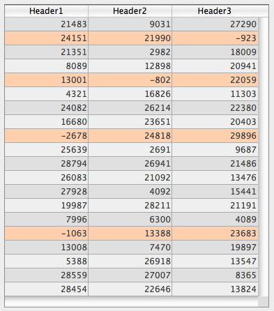

## Couleur de fond alternée

Permet de définir une couleur d'arrière-plan différente pour les lignes / colonnes impaires dans une list box. By default, *Automatic* is selected for list box columns: the column uses the alternate background color set at the list box level.

Vous pouvez également définir cette propriété à l'aide de la commande [`OBJECT SET RGB COLORS`](../commands/object-set-rgb-colors).

#### Grammaire JSON

| Nom           | Type de données | Valeurs possibles                                                        |
| ------------- | --------------- | ------------------------------------------------------------------------ |
| alternateFill | string          | toutes les valeurs css; "transparent"; "automatic"; "automaticAlternate" |

#### Objets pris en charge

[List Box](listbox_overview.md) - [Colonne de List Box](listbox-column.md)

#### Commandes

[`OBJECT GET RGB COLORS`](../commands/object-get-rgb-colors) - [`OBJECT SET RGB COLORS`](../commands/object-set-rgb-colors)

---

## Couleur de fond

Définit la couleur de fond / couleur de remplissage d'un objet. Elle peut être définie pour certains objets standard (propriété JSON `fill`) ou pour des [objets de style "Custom"](#custom-style-button-check-box-or-radio-button) (propriété JSON `borderFillColor`).

:::note

La propriété **Couleur de fond** est parfois appelée **Couleur d'arrière-plan** notamment pour les objets [List box](listbox_overview.md), [Colonne de List box](listbox-column.md) et [Pied de List box](listbox-header-footer.md#footers).

:::

### Objets standard

In the case of a list box column, by default *Automatic* is selected: the column uses the background color set at the list box level.

#### Grammaire JSON

| Nom  | Type de données | Valeurs possibles                          |
| ---- | --------------- | ------------------------------------------ |
| fill | string          | une valeur css; "transparent"; "automatic" |

#### Objets pris en charge

[Hierarchical List](list_overview.md) - [Input](input_overview.md) - [List Box](listbox_overview.md) - [List Box Column](listbox-column.md) - [List Box Footer](listbox-header-footer.md#footers) - [Oval](shapes_overview.md#oval) - [Rectangle](shapes_overview.md#rectangle) - [Text Area](text.md)

#### Commandes

[`LISTBOX Get row color`](../commands/listbox-get-row-color) - [`LISTBOX SET ROW COLOR`](../commands/listbox-set-row-color) - [`OBJECT GET RGB COLORS`](../commands/object-get-rgb-colors) - [`OBJECT SET RGB COLORS`](../commands/object-set-rgb-colors)

### Bouton personnalisé, case à cocher personnalisée ou bouton radio personnalisé

Cette propriété vous permet d'attribuer une couleur de fond aux [boutons personnalisés](./button_overview.md#custom), aux [cases à cocher personnalisées](./checkbox_overview.md#custom) ou aux [boutons radio personnalisés](./radio_overview.md#custom). De plus, les [boutons personnalisés](./button_overview.md#custom) doivent avoir le [style de bordure "personnalisé"](#border-line-style). Dans les autres contextes, cette propriété n'est pas prise en compte.

#### Grammaire JSON

| Nom             | Type de données | Valeurs possibles                          |
| --------------- | --------------- | ------------------------------------------ |
| borderFillColor | string          | une valeur css; "transparent"; "automatic" |

#### Objets pris en charge

[Bouton personnalisé](./button_overview.md#custom) (avec le [style de bordure "Personnalisé"](#border-line-style)) - [Case à cocher personnalisée](checkbox_overview.md#custom) - [Bouton radio personnalisé](radio_overview.md#custom)

#### Commandes

[`OBJECT GET RGB COLORS`](../commands/object-get-rgb-colors) - [`OBJECT SET RGB COLORS`](../commands/object-set-rgb-colors)

#### Voir également

[Transparent](#transparent)

---

## Expression couleur de fond {#background-color-expression}

`List box de type collection et entity selection`

Une expression ou une variable (les variables de tableau ne peuvent pas être utilisées) pour appliquer une couleur d'arrière-plan personnalisée à chaque ligne de la list box. L'expression ou la variable sera évaluée pour chaque ligne affichée et doit retourner une valeur de couleur RGB. Pour plus d'informations, reportez-vous à la description de la commande [`OBJECT SET RGB COLORS`](../commands/object-set-rgb-colors).

Vous pouvez également définir cette propriété en utilisant la commande [`LISTBOX SET PROPERTY`](../commands/listbox-set-property) avec la constante `lk background color expression`.

> Avec les list box de type collection ou sélection d'entité, cette propriété peut également être définie à l'aide d'une [Meta Info Expression](properties_Text.md#meta-info-expression).

#### Grammaire JSON

| Nom           | Type de données | Valeurs possibles                                   |
| ------------- | --------------- | --------------------------------------------------- |
| rowFillSource | string          | Une expression retournant une valeur de couleur RGB |

#### Objets pris en charge

[List Box](listbox_overview.md) - [Colonne de List Box](listbox-column.md)

#### Commandes

[`LISTBOX Get property`](../commands/listbox-get-property) - [`LISTBOX SET PROPERTY`](../commands/listbox-set-property)

---

## Couleur de bordure {#border-color}

Allows defining the border color. The effect of this property varies slightly depending on the type of object to which it is applied.

- **objects with text properties**: [buttons](./button_overview.md) (all styles except "custom", see  below), [hierarchical lists](list_overview.md), [inputs](input_overview.md), [list boxes](listbox_overview.md), [progress indicators](./progressIndicator.md), [rulers](./ruler.md), and [text areas](text.md).  
  By default, the border color of these objects is automatically set to their [**font color**](./properties_Text.md#font-color) property. This default configuration corresponds to the **Same as font** option in the Property List (`borderColor` property is undefined in JSON).  
  You can separate these two properties by setting a color value for the object's "Border color" property (only available when the [**border line style**](#border-line-style) property is **plain** (`solid` in JSON property) or **dotted**).

- **objects without text properties**: [4D View Pro areas](viewProArea_overview.md), [4D Write Pro areas](writeProArea_overview.md), [button grids](buttonGrid_overview.md), [picture buttons](pictureButton_overview.md), [picture pop-up menus](picturePopupMenu_overview.md), [plug-in areas](pluginArea_overview.md), [subforms](subform_overview.md), [spinners](spinner.md), [splitters](splitters.md), [steppers](stepper.md), [web areas](webArea_overview.md).  
  The border color property sets the color of the borders. The default color value is "Automatic", i.e. the border is displayed with the automatic color set by your OS.

- **custom-styled buttons**: [custom buttons](./button_overview.md#custom) with ["custom" Border Line Style](#border-line-style), [custom check boxes](./checkbox_overview.md#custom), and [custom radio buttons](./radio_overview.md#custom).  
  In this case, the border color property defines the color of an *inner* border, which is an attribute of the object itself ans not a decoration property. This inner border can also have a [width](#border-width) (it is displayed only if the width > 0).

#### Grammaire JSON

| Nom         | Type de données | Valeurs possibles                          |
| ----------- | --------------- | ------------------------------------------ |
| borderColor | string          | une valeur css; "transparent"; "automatic" |

#### Objets pris en charge

[4D View Pro area](viewProArea_overview.md) - [4D Write Pro area](writeProArea_overview.md) - [Button](./button_overview.md) - [Button Grid](buttonGrid_overview.md) - [Check Box ("custom" style)](checkbox_overview.md#custom) - [Hierarchical List](list_overview.md) - [Input](input_overview.md) - [List Box](listbox_overview.md) - [Picture Button](pictureButton_overview.md) - [Picture Pop-up Menu](picturePopupMenu_overview.md) - [Plug-in Area](pluginArea_overview.md) - [Progress Indicator](./progressIndicator.md) - [Radio Button ("custom" style)](radio_overview.md#custom) - [Ruler](./ruler.md) - [Text Area](text.md) - [Spinner](spinner.md) - [Splitter](splitters.md) - [Stepper](stepper.md) - [Subform](subform_overview.md) - [Web Area](webArea_overview.md)

#### Commandes

[`OBJECT GET RGB COLORS`](../commands/object-get-rgb-colors) - [`OBJECT SET RGB COLORS`](../commands/object-set-rgb-colors)

#### Voir également

[Line Color](#line-color) (for shapes)

## Style de la bordure {#border-line-style}

Allows setting a style for the object border. The following choices are available (all choices are not possible depending on the object):

| Style          | Objects (\*)                                      | Description                                                                                                                                                                                                                                                                                                                                                                                                                                                                                                                                                                                                                                                                                             |
| -------------- | -------------------------------------------------------------------- | ------------------------------------------------------------------------------------------------------------------------------------------------------------------------------------------------------------------------------------------------------------------------------------------------------------------------------------------------------------------------------------------------------------------------------------------------------------------------------------------------------------------------------------------------------------------------------------------------------------------------------------------------------------------------------------------------------- |
| Aucun          | all                                                                  | Objects appear with no border.                                                                                                                                                                                                                                                                                                                                                                                                                                                                                                                                                                                                                                                          |
| Plain          | all                                                                  | Objects appear framed with a continuous 1-pt. border line. ("solid" json value)                                                                                                                                                                                                                                                                                                                                                                                                                                                                                                                                                                      |
| Dotted         | all                                                                  | Objects appear framed with a dotted 1-pt. border line.                                                                                                                                                                                                                                                                                                                                                                                                                                                                                                                                                                                                                  |
| Raised         | all                                                                  | Objects appear framed with a 3D effect.                                                                                                                                                                                                                                                                                                                                                                                                                                                                                                                                                                                                                                                 |
| Sunken         | all                                                                  | Objects appear framed with a sunken 3D effect.                                                                                                                                                                                                                                                                                                                                                                                                                                                                                                                                                                                                                                          |
| Double         | all                                                                  | Objects appear framed with a double line, i.e., two continuous 1-pt. lines separated by a pixel.                                                                                                                                                                                                                                                                                                                                                                                                                                                                                                                                        |
| System         | all *except* [buttons](button_overview.md) and [text areas](text.md) | Objects appear with a border line based on the graphic specifications of the OS.                                                                                                                                                                                                                                                                                                                                                                                                                                                                                                                                                                                                        |
| System rounded | [inputs](input_overview.md)                                          | On macOS, objects appear with a native "Liquid Glass" system border effect (for information about Liquid Glass, see [this 4D blog post](https://blog.4d.com/the-new-macos-tahoe-design-comes-to-your-4d-applications/)). It includes system-defined inner border, corner radius, grey border color, and inner padding. Note that the "Liquid Glass" appearance is *not* used in a multiline input object if the [scroll bars property](./properties_Appearance.md#vertical-scroll-bar) is enabled ("System" is used in this case).<br/> On Windows, this style is similar to "System" at runtime. |
| Personnalisé   | [custom buttons](./button_overview.md#custom)                        | Enables the inner border design, that includes a set of extra properties: [Fill color](#fill-color), [Border color](#border-color), [Border width](#border-width), and [Corner radius](#corner-radius). <br/>                                                                                                                                                                                                                                                                                                                                                                                                            |

(\*) "all" means "all objects supported" listed below.

:::tip Articles de blog sur le sujet

- [Personnaliser les boutons, les boutons radio et les cases à cocher à l'aide des propriétés de fond et de bordure](https://blog.4d.com/customize-buttons-radio-buttons-and-check-boxes-with-background-and-border-properties).
- [Give Your Form Objects the Border Color They Deserve](https://blog.4d.com/give-your-form-objects-the-border-color-they-deserve)
- [Choose the Right Native Input Style for Your Interface on macOS](https://blog.4d.com/choose-the-right-native-input-style-for-your-interface-on-macos)

:::

#### Grammaire JSON

| Nom         | Type de données | Valeurs possibles                                                                            |
| ----------- | --------------- | -------------------------------------------------------------------------------------------- |
| borderStyle | text            | "custom", "dotted", "double", "none", "raised", "solid", "sunken", "system", "systemRounded" |

#### Objets pris en charge

[4D View Pro Area](viewProArea_overview.md) - [4D Write Pro areas](writeProArea_overview.md) - [Buttons](button_overview.md) - [Button Grid](buttonGrid_overview.md) - [Hierarchical List](list_overview.md) - [Input](input_overview.md) - [List Box](listbox_overview.md) - [Picture Button](pictureButton_overview.md) - [Picture Pop-up Menu](picturePopupMenu_overview.md) - [Plug-in Area](pluginArea_overview.md) - [Progress Indicator](progressIndicator.md) - [Ruler](ruler.md) - [Spinner](spinner.md) - [Stepper](stepper.md) - [Subform](subform_overview.md) - [Text Area](text.md) - [Web Area](webArea_overview.md)

#### Commandes

[`OBJECT Get border style`](../commands/object-get-border-style) - [`OBJECT SET BORDER STYLE`](../commands/object-set-border-style)

#### Voir également

[Dotted Line Type](#dotted-line-type) (shapes)

---

## Largeur de bordure {#border-width}

Permet de définir la largeur de la bordure intérieure pour :

- les [boutons personnalisés](./button_overview.md#custom) avec le [style de bordure "personnalisé"](#border-line-style),
- les [cases à cocher personnalisées](./checkbox_overview.md#custom),
- les [boutons radio personnalisés](./radio_overview.md#custom).

Dans les autres contextes, cette propriété n'est pas prise en compte.

La valeur est exprimée en pixels.

#### Grammaire JSON

| Nom         | Type de données | Valeurs possibles                                                               |
| ----------- | --------------- | ------------------------------------------------------------------------------- |
| borderWidth | number          | Valeur entière (pixels). Valeur minimale = 0 |

#### Objets pris en charge

[Button ("custom" style)](./button_overview.md#custom) (with ["custom" Border Line Style](#border-line-style)) - [Check Box ("custom style")](checkbox_overview.md#custom) - [Radio Button ("custom" style)](radio_overview.md#custom)

---

## Rayon d'arrondi

<details><summary>Historique</summary>

| Release | Modifications                                                              |
| ------- | -------------------------------------------------------------------------- |
| 21 R5   | Prise en charge des boutons, boutons radio et cases à cocher personnalisés |
| 19 R7   | Prise en charge pour les zones de saisie et de texte                       |

</details>

Définit l'arrondi des coins (en pixels) de l'objet. Par défaut, la valeur du rayon est de 0 pixel. Vous pouvez modifier cette propriété pour dessiner des objets arrondis avec des formes personnalisées :


La valeur minimale est de 0. Dans ce cas, un rectangle d'objet standard non arrondi est dessiné.
La valeur maximale dépend de la taille du rectangle (elle ne peut pas dépasser la moitié de la taille du côté le plus court du rectangle) et est calculée dynamiquement.

Dans les [zones de texte](./text.md) et les [zones de saisie](./input_overview.md) :

- la propriété rayon d"arrondi n'est disponible qu'avec les [styles de ligne de bordure](#border-line-style) "none", "solid" ou "dotted",
- l'arrondi du coin est dessiné **à l'extérieur** de la zone de l'objet (l'objet apparaît plus grand dans le formulaire mais sa [largeur](./properties_CoordinatesAndSizing.md#width) et sa [hauteur](./properties_CoordinatesAndSizing.md#height) ne sont pas étendues).


Dans les [boutons personnalisés](./button_overview.md#custom) (avec un [style de bordure "personnalisé"](#border-line-style)), les [cases à cocher personnalisées](checkbox_overview.md#custom) et les [boutons radio personnalisés](radio_overview.md#custom), le rayon d'arrondi est tracé **à l'intérieur** de la zone de l'objet.

#### Grammaire JSON

| Nom          | Type de données | Valeurs possibles           |
| ------------ | --------------- | --------------------------- |
| borderRadius | integer         | minimum : 0 |

#### Objets pris en charge

[Button ("custom" style)](./button_overview.md#custom) (with ["custom" Border Line Style](#border-line-style)) - [Check Box ("custom" style)](checkbox_overview.md#custom) - [Input](input_overview.md) - [Rectangle](shapes_overview.md#rectangle) - [Text Area](text.md) - [Radio Button ("custom" style)](radio_overview.md#custom)

#### Commandes

[OBJECT GET CORNER RADIUS](../commands/object-get-corner-radius) - [OBJECT SET CORNER RADIUS](../commands/object-set-corner-radius)

---

## Type de pointillé {#dotted-line-type}

Décrit le type de ligne en pointillé comme une séquence de points noirs et blancs.

#### Grammaire JSON

| Nom             | Type de données            | Valeurs possibles                                                                                                                                                     |
| --------------- | -------------------------- | --------------------------------------------------------------------------------------------------------------------------------------------------------------------- |
| strokeDashArray | tableau numérique ou texte | Ex : Ex : "6 1" ou \[6,1\] pour une séquence de 6 points noirs et 1 point blanc |

#### Objets pris en charge

[Rectangle](shapes_overview.md#rectangle) - [Ovale](shapes_overview.md#oval) - [Ligne](shapes_overview.md#line)

---

## Masquer lignes vides finales

Contrôle l'affichage des lignes vides supplémentaires ajoutées au bas d'un objet list box. Par défaut, 4D ajoute ces lignes supplémentaires pour remplir la zone vide :


Vous pouvez supprimer ces lignes vides en sélectionnant cette option. Le bas de l'objet list box est alors laissé vide :


#### Grammaire JSON

| Nom                | Type de données | Valeurs possibles |
| ------------------ | --------------- | ----------------- |
| hideExtraBlankRows | boolean         | true, false       |

#### Objets pris en charge

[List Box](listbox_overview.md)

#### Commandes

[`LISTBOX Get property`](../commands/listbox-get-property) - [`LISTBOX SET PROPERTY`](../commands/listbox-set-property)

---

## Couleur du trait

Désigne la couleur des lignes de l'objet.
La couleur peut être spécifiée par :

- un nom de couleur - comme "red"
- une valeur HEX - comme "# ff0000"
- une valeur RVB - comme "rgb (255,0,0)"

Vous pouvez également définir cette propriété à l'aide de la commande [`OBJECT SET RGB COLORS`](../commands/object-set-rgb-colors).

#### Grammaire JSON

| Nom    | Type de données | Valeurs possibles                          |
| ------ | --------------- | ------------------------------------------ |
| stroke | string          | une valeur css; "transparent"; "automatic" |

:::note

This property is also available for objects with text properties, in which case it designates both the [Font color](properties_Text.md#font-color) and the object's lines, except if you used the [Border color](#border-color) property.

:::

#### Objets pris en charge

[Ligne](shapes_overview.md#line) - [Ovale](shapes_overview.md#oval) - [Rectangle](shapes_overview.md#rectangle)

#### Commandes

[`OBJECT GET RGB COLORS`](../commands/object-get-rgb-colors) - [`OBJECT SET RGB COLORS`](../commands/object-set-rgb-colors)

---

## Epaisseur du trait

Désigne l'épaisseur d'une ligne.

#### Grammaire JSON

| Nom         | Type de données | Valeurs possibles                                                                                                |
| ----------- | --------------- | ---------------------------------------------------------------------------------------------------------------- |
| strokeWidth | number          | 0 pour la plus petite largeur dans un formulaire imprimé, ou toute valeur d'entier < 20 |

#### Objets pris en charge

[Ligne](shapes_overview.md#line) - [Ovale](shapes_overview.md#oval) - [Rectangle](shapes_overview.md#rectangle)

---

## Tableau couleurs de fond {#row-background-color-array}

`List box de type tableau`

Le nom d'un tableau pour appliquer une couleur d'arrière-plan personnalisée à chaque ligne ou colonne de la list box.

Le nom d'un tableau Entier long doit être saisi. Chaque élément de ce tableau correspond à une ligne de la zone de list box (si elle est appliquée à la liste box) ou à une cellule de la colonne (si elle est appliquée à une colonne), le tableau doit donc avoir la même taille que le tableau associé à la colonne. Vous pouvez utiliser les constantes décrites dans la commande [`OBJECT SET RGB COLORS`](../commands/object-set-rgb-colors). Si vous souhaitez que la cellule hérite de la couleur d'arrière-plan définie au niveau supérieur, passez la valeur -255 à l'élément de tableau correspondant.

Par exemple, considérons une list box où les lignes ont une couleur alternée gris/gris clair, définie dans les propriétés de la list box. Un tableau de couleurs d'arrière-plan a également été défini pour la list box afin de changer en orange clair la couleur des lignes où au moins une valeur est négative :

```4d
 <>_BgndColors{$i}:=0x00FFD0B0 // orange
 <>_BgndColors{$i}:=-255 // default value
```



Vous souhaitez ensuite colorer les cellules avec des valeurs négatives en orange foncé. Vous souhaitez ensuite colorer les cellules avec des valeurs négatives en orange foncé. Les valeurs de ces tableaux ont la priorité sur celles définies dans les propriétés de list box ainsi que sur celles du tableau de couleurs d'arrière-plan général :

```4d
 <>_BgndColorsCol_3{2}:=0x00FF8000 // dark orange
 <>_BgndColorsCol_2{5}:=0x00FF8000
 <>_BgndColorsCol_1{9}:=0x00FF8000
 <>_BgndColorsCol_1{16}:=0x00FF8000
```


Vous pouvez obtenir le même résultat en utilisant les commandes [`LISTBOX SET ROW FONT STYLE`](../commands/listbox-set-row-font-style) et [`LISTBOX SET ROW COLOR`](../commands/listbox-set-row-color). Elles ont l'avantage de vous permettre d'éviter d'avoir à prédéfinir des tableaux de style/couleur pour les colonnes : ils sont créés dynamiquement par les commandes.

#### Grammaire JSON

| Nom           | Type de données | Valeurs possibles                             |
| ------------- | --------------- | --------------------------------------------- |
| rowFillSource | string          | Nom d'un tableau entier long. |

#### Objets pris en charge

[List Box](listbox_overview.md) - [Colonne de List Box](listbox-column.md)

#### Commandes

[`LISTBOX Get array`](../commands/listbox-get-array) - [`LISTBOX GET ARRAYS`](../commands/listbox-get-arrays)

---

## Transparent

Définit l'arrière-plan de la list box sur "Transparent". Lorsqu'elle est définie, toute [autre couleur d'arrière-plan](#alternate-background-color) ou [couleur d'arrière-plan](#background-color--fill-color) définie pour la colonne est ignorée.

#### Grammaire JSON

| Nom  | Type de données | Valeurs possibles |
| ---- | --------------- | ----------------- |
| fill | text            | "transparent"     |

#### Objets pris en charge

[List Box](listbox_overview.md)

#### Commandes

[`OBJECT GET RGB COLORS`](../commands/object-get-rgb-colors) - [`OBJECT SET RGB COLORS`](../commands/object-set-rgb-colors)

#### Voir également

[Couleur de fond](#background-color--fill-color)

