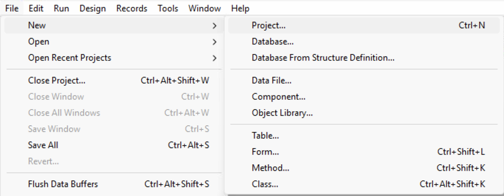
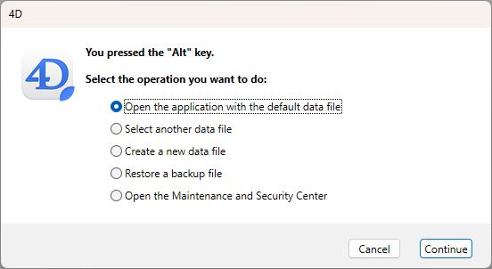

## Créer un projet

Les nouveaux projets d'application 4D peuvent être créés à partir de **4D** ou de **4D Server**. Dans les deux cas, les fichiers de projet sont stockés sur la machine locale.

Pour créer un nouveau projet :

1. Lancez 4D ou 4D Server.
2. Effectuez l'une des opérations suivantes :
   - Sélectionnez **Nouveau > Projet...** dans le menu **Fichier** : 
   - (4D uniquement) Sélectionnez **Projet...** à partir du bouton **Nouveau** de la barre d'outils :
   
     Une boîte de dialogue **Enregistrer** standard s'affiche pour vous permettre de choisir le nom et l'emplacement du dossier principal du projet 4D.

:::note

Les commandes **Base de données...** et **Base de données à partir d'une définition de structure...** ne sont disponibles que si vous avez sélectionné l'option [**Activer la création de bases de données binaires**](../Preferences/general.md#enable-binary-database-creation) dans vos Préférences (désactivée par défaut).

:::

3. Saisissez le nom du dossier de projet et cliquez sur **Sauvegarder**. Ce nom sera utilisé :

   - comme nom du dossier du projet,
   - comme nom du fichier .4DProject au premier niveau du [dossier "Project"](../Project/architecture.md#project-folder).

Vous pouvez choisir n'importe quel nom autorisé par votre système d'exploitation. Toutefois, si votre projet est destiné à fonctionner sur d'autres systèmes ou à être enregistré via un outil de source control, vous devez tenir compte de leurs recommandations de dénomination spécifiques.

Lorsque vous validez la boîte de dialogue **Nouveau projet**, 4D ferme le projet en cours (le cas échéant), crée un dossier de projet à l'emplacement indiqué et y place tous les fichiers nécessaires au projet. Pour plus d'informations, voir [Architecture d'un projet 4D](Project/architecture.md).

Vous pouvez alors commencer à développer votre projet.

## Ouvrir un projet

Pour ouvrir un projet existant depuis 4D :

1. Effectuez l'une des opérations suivantes :

   - Sélectionnez **Ouvrir > Projet local...** à partir du menu **Fichier** ou du bouton **Ouvrir** de la barre d'outils.
   - Sélectionnez **Ouvrir un projet d'application local** dans la boîte de dialogue de l'assistant de bienvenue

La boîte de dialogue standard Ouvrir apparaît.

2. Sélectionnez le fichier `.4dproject` du projet (situé dans le [dossier "Project" du projet](../Project/architecture.md#project-folder)) et cliquez sur **Ouvrir**.

   Par défaut, le projet est ouvert avec son fichier de données courant. D'autres types de fichiers sont suggérés :

   - *Fichiers Packed project* : extension `.4dz` - projets de déploiement
   - *Fichiers de raccourcis* : extension `.4DLink` - stocke des paramètres supplémentaires nécessaires à l'ouverture de projets ou d'applications (adresses, identifiants, etc.)
   - *Fichiers binaires* : extension `.4db` ou `.4dc` - anciens formats de base de données 4D

:::note

Vous pouvez également ouvrir des projets 4D sans aucune interface graphique via l'[interface  en ligne de commande](../Admin/cli.md) (CLI).

:::

### Options

Outre les options standard du système, la boîte de dialogue *Ouvrir* de 4D propose deux menus avec des options spécifiques disponibles via le bouton **Ouvrir** et le menu **Data file**.

- **Ouvrir** - mode d'ouverture du projet :
  - **Interprété** ou **Compilé** : Ces options sont disponibles lorsque le projet sélectionné contient à la fois [du code interprété et du code compilé](Concepts/interpreted.md).
  - **[Maintenance Security Center](MSC/overview.md)**: Ouverture en mode sécurisé permettant d'accéder aux projets endommagés afin d'effectuer les réparations nécessaires.

- **Fichier de données** - spécifie le fichier de données à utiliser avec le projet. Par défaut, l'option **Fichier de données courant** est sélectionnée. Ce menu comporte deux options supplémentaires, car 4D vous permet d'utiliser le même projet avec différents fichiers de données.
  - **Choisir un autre fichier de données** : ouvre le projet avec un fichier de données existant autre que le fichier courant. Lorsque vous sélectionnez cette option puis cliquez sur **Ouvrir**, la boîte de dialogue standard d'ouverture de fichier de données s'affiche pour vous permettre de choisir un fichier de données.
  - **Créer un nouveau fichier de données** : permet de créer un fichier de données vierge pour le projet. Lorsque vous sélectionnez cette option puis cliquez sur **Ouvrir**, la boîte de dialogue standard d'enregistrement de fichier de données s'affiche.

:::note

Afin de préserver l'intégrité des données, 4D ne permet pas d'ouvrir un fichier de données s'il n'a pas été créé par le fichier de projet courant. Le programme attribue automatiquement des numéros de lien internes (UUID) aux fichiers de données et aux fichiers de projet lors de leur création ou lors de la conversion du projet. Ces numéros sont vérifiés lors de l'ouverture du fichier de données.

:::

Une fois que vous avez changé de fichier de données courant, 4D l'ouvre par défaut par la suite. Si vous déplacez ou renommez le fichier de données, vous devrez le localiser à nouveau. Il est possible de changer de fichier de données à l'aide d'un raccourci clavier au démarrage (voir ci-dessous). Vous pouvez connaître à tout moment le fichier de données courant dans la [page d'informations du MSC](../MSC/information.md#data).

### Dialogue de maintenance au démarrage

Si vous devez interrompre la séquence de démarrage, par exemple si le projet ne se lance pas correctement ou si vous souhaitez utiliser un autre fichier de données, maintenez enfoncée la touche **Alt** (Windows) ou **Option** (macOS) pendant le démarrage de la base de données pour afficher la boîte de dialogue de maintenance au démarrage :

Les options de maintenance suivantes sont disponibles :

- **Ouvrir l'application avec le fichier de données par défaut** : poursuit la séquence d'ouverture standard.
- **Sélectionner un autre fichier de données** / **Créer un nouveau fichier de données** : vous permet de changer de fichier de données (voir ci-dessus).
- **Restaurer un fichier de sauvegarde** : ouvre la boîte de dialogue standard d'ouverture de fichier afin que vous puissiez sélectionner un fichier de sauvegarde (.4bk) ou un fichier de sauvegarde de journal (.4bl) à [restaurer](../Backup/restore.md#manually-restoring-a-backup-standard-dialog).
- **Ouvrir le Centre de maintenance et de sécurité** : ouvre le projet en [mode maintenance](../MSC/overview.md#display-in-maintenance-mode).

## Raccourcis d’ouverture des projets

4D offre plusieurs façons d'ouvrir des projets directement sans devoir utiliser la boîte de dialogue Ouvrir :

- via le sous-menu **Ouvrir les projets récents / {nom du projet}** du menu **Fichier** ou via le bouton **Ouvrir** de la barre d'outils.  
  
- double-cliquer sur un fichier `.4DLink` ou le glisser-déposer sur l'application 4D (voir ci-dessous).
- en configurant la préférence générale **Au démarrage** sur [**Ouvrir le dernier projet utilisé**](../Preferences/general.md#at-startup).

:::note Notes

- Sous Windows, un projet 4D Server peut être lancé automatiquement au démarrage de la session s'il est [enregistré en tant que Service](../server/service.md).
- Une [application 4D générée](../Desktop/building.md) peut être lancée en double-cliquant sur l'icône de l'application.

:::

## À propos des fichiers 4DLink

Les fichiers portant l'extension `.4DLink` sont des fichiers XML contenant des paramètres destinés à automatiser et à simplifier l'ouverture de projets 4D locaux ou distants.

Les fichiers `.4DLink` peuvent enregistrer l'adresse d'un projet 4D ainsi que ses identifiants de connexion et son mode d'ouverture, ce qui permet de gagner du temps lors de l'ouverture des projets.

4D génère automatiquement un fichier `.4DLink` lors de la première ouverture d'un projet local ou lors de la première connexion à un serveur. Le fichier est stocké dans le dossier des préférences locales à l'emplacement suivant :

- Windows: C:\Users\UserName\AppData\Roaming\4D\Favorites vXX\
- macOS : Users/UserName/Library/Application Support/4D/Favorites vXX/

XX représente le numéro de version de l'application. Par exemple, "Favoris v19" pour 4D v19.

Ce dossier est divisé en deux sous-dossiers :

- le dossier **Local** contient les fichiers `.4DLink` qui peuvent être utilisés pour ouvrir des projets locaux
- le dossier **Remote** contient les fichiers `.4DLink` des projets distants récents

Les fichiers `.4DLink` peuvent également être créés à l'aide d'un éditeur XML.

4D fournit une DTD décrivant les clés XML qui peuvent être utilisées pour construire un fichier `.4DLink` . Cette DTD est nommée database_link.dtd et se trouve dans le sous-dossier `\Resources\DTD\` de l'application 4D.

