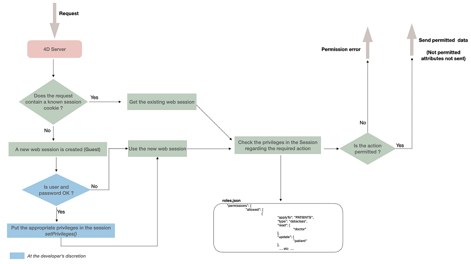

L'architecture de sécurité ORDA contrôle l'accès aux ressources du projet pour les sessions web et REST. Elle vous permet d'accorder des permissions spécifiques sur des ressources telles que le datastore, les dataclass, les attributs et les fonctions.

## Vue d’ensemble

Le modèle de sécurité combine des **privilèges**, des **actions** (comme `read` et `create`), et des **ressources**.

Assignez des privilèges à une **session** en utilisant [`Session.setPrivileges()`](../API/SessionClass.md#setprivileges).

Chaque requête est vérifiée par rapport aux permissions définies dans le fichier `roles.json` du projet. Une action non autorisée génère une erreur de privilège. Les attributs sans permission de lecture ne sont pas présents dans la réponse.



:::tip Articles de blog liés

[**Filtrez l'accès à vos données avec un système complet de permissions**](https://blog.4d.com/filter-access-to-your-data-with-a-complete-system-of-permissions/)

:::

:::info

Les permissions contrôlent l'accès aux objets ou fonctions du datastore. Si vous voulez filtrer les données de lecture selon certains critères, vous pouvez envisager d'utiliser les [entity selections restreintes](entities.md#restricting-entity-selections) qui peuvent être plus appropriées dans ce cas.

:::

## Portée

Les permissions s'appliquent aux **sessions Web et REST** : [les requêtes REST](../REST/gettingStarted.md), y compris les [pages Qodly](https://developer.4d.com/qodly/4DQodlyPro/pageLoaders/pageLoaderOverview), les sessions [`Open datastore`](../commands/open-datastore), les [sessions MCP](../WebServer/mcp-server.md) et le **code 4D exécuté dans un process Web**. Cela inclut les [fonctions exposées](./ordaClasses.md), les [gestionnaires de requêtes HTTP](../WebServer/http-request-handler.md), la méthode base [Sur connexion Web](../commands/on-web-connection-database-method), et tout le code qu'ils appellent. Par exemple, un appel à une fonction autorisée échoue malgré tout si la fonction lit une dataclass pour laquelle la session n'a pas de permission de lecture.

:::info Exception

La permission **execute** d'un [singleton partagé](../Concepts/classes.md#shared-singleton) ou d'une [fonction de singleton](../Concepts/classes.md#singleton-classes) n'est vérifiée que lorsque la fonction est [appelée via REST](../REST/$singleton.md). Lorsque le code 4D qui s'exécute dans une session web l'appelle directement (`cs.MySingleton.me.myFunction()`), aucune permission n'est vérifiée, contrairement aux fonctions de dataclass, d'entités, d'entity selection d'entités et de datastore qui sont vérifiées dans les deux cas.

:::

Les permissions ne s'appliquent jamais à au [code d'une session desktop](../Desktop/sessions.md) (autonome, client/serveur, procédures stockées) ou [tool4d](../Admin/cli.md#tool4d).

:::warning

Lorsqu'une permission référence un [privilège](#privileges-and-roles) non déclaré, 4D enregistre une erreur et ignore le tout. Dans ce cas, la permission est ignorée. Si le [mode restreint par défaut](#restriction-modes) n'est pas activé, la ressource est accessible dans les sessions `guest`.

:::

## Resources

4D vérifie les permissions de la session chaque fois que l'accès à une ressource est requis. Les ressources suivantes peuvent avoir des permissions spécifiques :

| Ressource                                                                                                                                                                        | `applyTo`                 | `type`            |
| -------------------------------------------------------------------------------------------------------------------------------------------------------------------------------- | ------------------------- | ----------------- |
| [Datastore](./dsMapping.md#datastore)                                                                                                                                            | `ds`                      | `datastore`       |
| [Fonction de datastore class](./ordaClasses.md#datastore-class)                                                                                                                  | `ds.<function>`           | `method`          |
| [Dataclass](./dsMapping.md#dataclass)                                                                                                                                            | `<Dataclass>`             | `dataclass`       |
| [Attribut](./dsMapping.md#attribute) (y compris [attributs calculés](./ordaClasses.md#computed-attributes-1) et [alias](./ordaClasses.md#alias-attributes-1)) | `<Dataclass>.<attribute>` | `attribut`        |
| [Fonction de dataclass, entity selection ou entité](./ordaClasses.md)                                                                                                            | `<Dataclass>.<function>`  | `method`          |
| [Singleton partagé](../Concepts/classes.md#shared-singleton) (toutes ses fonctions exposées)                                                                  | `<Singleton>`             | `singleton`       |
| [Fonction de singleton](../Concepts/classes.md#singleton-classes)                                                                                                                | `<Singleton>.<function>`  | `singletonMethod` |

Utilisez les valeurs `applyTo` et `type` décrites dans ce tableau lors de la définition des permissions dans [`roles.json`](#rolesjson-file).

:::note Attribution de permissions aux fonctions de la classe ORDA

Dans `roles.json`, vous identifiez une fonction de classe ORDA dans `applyTo` avec cette syntaxe :

```json
<DataclassName>.<functionName>
```

Par exemple, si vous voulez appliquer une permission à la fonction suivante :

```4d
// cs.CityEntity class
Class extends Entity
  Function getPopulation() : Integer
   ...
```

Vous utilisez cette valeur :

```json
"applyTo":"City.getPopulation"
```

Comme les permissions identifient des fonctions par dataclass et nom de fonction, des fonctions avec le même nom mais dans différentes classes ORDA (entité, entity selection, dataclass) ne pourront pas se voir assigner des privilèges différents. Donnez-leur des noms distincts à la place. Par exemple, nommez les fonctions `dropEntity()` et `dropSelection()` dans `cs.CityEntity` et `cs.CitySelection`, respectivement :

```json
	"permissions": {
		"allowed": [
			{
				"applyTo": "City.dropEntity",
				"type": "method",
				"execute": [
					"cityAdmin"
				],
				"promote": [
					"name"
				]
			},
			{
				"applyTo": "City.dropSelection",
				"type": "method",
				"promote": [
					"name"
				]
			}
		]
	}
}
```

:::

## Permissions

Une **permission** permet une action sur une ressource ; par exemple, exécuter `ds.myTable.myFunction()`. Les permissions sont définies dans [`roles.json`](#rolesjson-file) et accordées à un ou plusieurs [privilège(s)](#privileges-and-roles).

Si aucune permission n'est définie pour une ressource, l'accès dépend du [mode de restriction](#restriction-modes) du projet.

### Actions de permission

Les actions disponibles dépendent de la ressource :

| Action                                                   | Datastore                                                                                                                      | Dataclass                                                                                                                                                        | Attribut                                                                                                                               | Function                                                                                                                                                                                                                                                                                                                                                                                  |
| -------------------------------------------------------- | ------------------------------------------------------------------------------------------------------------------------------ | ---------------------------------------------------------------------------------------------------------------------------------------------------------------- | -------------------------------------------------------------------------------------------------------------------------------------- | ----------------------------------------------------------------------------------------------------------------------------------------------------------------------------------------------------------------------------------------------------------------------------------------------------------------------------------------------------------------------------------------- |
| **create**                                               | Créer une entité dans n'importe quelle dataclass                                                                               | Créer une entité dans cette dataclass                                                                                                                            | Créer une entité avec une valeur qui n'est pas celle par défaut pour cet attribut (ignoré pour les attributs alias) | n/a                                                                                                                                                                                                                                                                                                                                                                                       |
| **read**                                                 | Lire les attributs de n'importe quelle dataclass                                                                               | Lire les attributs de cette dataclass                                                                                                                            | Lire le contenu de cet attribut                                                                                                        | n/a                                                                                                                                                                                                                                                                                                                                                                                       |
| **update**                                               | Mettre à jour les attributs dans n'importe quelle dataclass                                                                    | Mettre à jour les attributs de cette dataclass                                                                                                                   | Mettre à jour le contenu de cet attribut (ignoré pour les attributs alias)                                          | n/a                                                                                                                                                                                                                                                                                                                                                                                       |
| **drop** ("Delete" dans Qodly Studio) | Supprimer des données dans n'importe quelle dataclass                                                                          | Supprimer des données dans cette dataclass                                                                                                                       | Supprimer une valeur non nulle pour cet attribut (sauf alias et attributs calculés)                                 | n/a                                                                                                                                                                                                                                                                                                                                                                                       |
| **execute**                                              | Exécuter n'importe quelle fonction du projet (datastore, dataclass, entity selection, entité, ou singleton) | Exécuter n'importe quelle fonction sur la dataclass ; les fonctions de dataclass, d'entités et d'entity selection sont traitées comme des fonctions de dataclass | n/a                                                                                                                                    | Exécuter cette fonction                                                                                                                                                                                                                                                                                                                                                                   |
| **promote**                                              | n/a                                                                                                                            | n/a                                                                                                                                                              | n/a                                                                                                                                    | Ajoute temporairement un privilège pendant la durée de l'appel de la fonction. Seul le process qui exécute la fonction le reçoit, pas la session entière. Utilisez [`promote()`](../API/SessionClass.md#promote) et [`demote()`](../API/SessionClass.md#demote) pour définir ou supprimer cette action dynamiquement dans un process web. |

### Règles des permissions

- **update** et **drop** nécessitent **read** sur la ressource ; pas **create**.
- Une fonction peut avoir un **promote** par plusieurs privilèges. Lors de l'exécution, elle reçoit les permissions combinées de tous ces privilèges ; il n'y a pas d'ordre de priorité.
- Un [attribut alias](./ordaClasses.md#alias-attributes-1) peut être lu si la session a la permission de lire l'alias, même si elle ne peut pas lire les attributs qui résolvent l'alias.
- Un [attribut calculé](./ordaClasses.md#computed-attributes-1) est accessible même si ses attributs sous-jacents n'ont pas de permissions.
- En [mode force login](../REST/authUsers.md#force-login-mode) de REST, les utilisateurs guest peuvent toujours exécuter [`authentify()`](../REST/authUsers.md#function-authentify), quelle que soit la configuration des permissions.

### Permissions héritées

Les actions de permission sont héritées selon les règles suivantes :

1. Les permissions descendent **datastore → dataclass → attribut / fonction**, et **datastore → singleton → fonction singleton**.
2. La résolution est **par action**. Définir `read` sur une dataclass ne change pas comment `create`, `update`, `drop` ou `execute` sont résolus pour elle.
3. **La dataclass remplace le datastore**. Une permission définie sur une dataclasse pour une action remplace l'autorisation du datastore pour cette action. Les privilèges permettant l'action uniquement sur le datastore la perdent pour cette dataclass.
4. **La fonction remplace la dataclass**. Une permission `execute` définie sur une fonction remplace la permission `execute` pour cette fonction sur la dataclass (et le datastore). Les fonctions d'entity selection et d'entité suivent la même règle que les fonctions de dataclass.
5. **Le singleton remplace le datastore**, **la fonction singleton remplace le singleton**.
6. **La fonction de datastore remplace le datastore**.
7. **Une fonction hérite de ce qu'elle ne définit pas**. À chaque niveau, une action qui ne figure pas dans la liste des permissions d'une fonction est héritée de sa dataclass ou de son singleton, puis du datastore. Par exemple, une permission de fonction singleton qui ne définit que `promote` conserve l'autorisation `execute` de son singleton. Une permission `promote` n'accorde jamais `execute` : pour laisser un privilège appeler une fonction promue, listez-la dans la permission `execute` de la fonction.
8. **L'attribut s'ajoute à son parent**. Pour agir sur un attribut qui a sa propre permission, une session a besoin du privilège accordé par la permission de l'attribut **et** un privilège accordé à l'action sur la dataclass (directement ou via le datastore).
9. Une action accordée à **aucun privilège** (par exemple, `"read": []`) est "non définie", donc la permission au niveau du dessus s'applique. Cela ne veut pas dire "personne". Pour refuser l'action, utilisez [mode restreint](#restriction-modes) sans définir cette permission, ou accordez-la à un privilège qu'aucune session ne reçoit.

Les permissions ne peuvent que permettre l'accès ; il n'y a pas de refus explicite. Une permission de dataclass ou de fonction peut donc réduire une permission plus large du datastore en la remplaçant. Une permission d'attribut s'ajoute : elle n'autorise l'accès à cet attribut que lorsque la session a aussi l'action sur sa dataclass.

:::tip Pratique recommandée

- Assignez les accès aux sessions via les **rôles** avec `Session.setPrivileges({roles: [...]})`. Définissez les rôles autour des profils métiers ; les privilèges sont les blocs de construction réutilisables. [Qodly Studio](https://developer.4d.com/qodly/4DQodlyPro/roles/overview) affiche les permissions réelles par rôle.
- Si un rôle d'administration a besoin d'un accès complet, incluez tous les privilèges dans ce rôle sauf un droit de verrouillage, s'il est utilisé. Ajoutez chaque nouveau privilège à ce rôle : une permission au niveau du dataclass peut remplacer une permission plus large du datastore .
- Examinez l'effet des changements de privilèges sur chaque rôle. Dans Qodly Studio, la **vue détaillée des permissions** montre l'accès effectif d'un rôle. Un rôle sans privilège peut vous aider à visualiser l'accès réservé aux guests.

:::

## Privilèges et Rôles

Un **privilège** autorise l'exécution d'actions sur des ressources. Un **rôle** regroupe des privilèges au sein d'un profil métier qu'un administrateur peut attribuer à une session.

Par exemple, "manageInvoices" pourrait être un privilège tandis que "secrétaire" pourrait être un rôle (qui inclut "manageInvoices" et d'autres privilèges). Attribuez des rôles aux sessions à l'aide de [`Session.setPrivileges({roles: [...]})`](../API/SessionClass.md#setprivileges) ; le rôle accorde tous ses privilèges.

Les privilèges peuvent être associés à plusieurs combinaisons "action-ressource", et une action peut être associée à plusieurs privilèges.

Définissez les privilèges et les rôles dans [`roles.json`](#rolesjson-file), puis attribuez ces rôles aux sessions à l'aide de `Session.setPrivileges()`.

### Privilèges inclus

Un privilège peut inclure d'autres privilèges à l'aide de la propriété `includes` dans le fichier `roles.json`. L'inclusion est transitive et unidirectionnelle : si A inclut B et que B inclut C, A hérite des permisions de B et de C.

La fonction [`Session.getPrivileges()`](../API/SessionClass.md#getprivileges) renvoie la collection complète (par exemple, A, B et C) sans garantir l'ordre des éléments. Déclarez un privilège inclus avant le privilège qui l'inclut ; sinon, 4D ignore l'inclusion et consigne une erreur dans le journal.

### Exemple

Cette fonction d'authentification attribue le rôle de l'utilisateur à la session :

```4d

exposed Function authenticate($identifier : Text; $password : Text)->$result : Text

    var $user : cs.UsersEntity

    Session.clearPrivileges()

    $result:="You are authenticated as Guest"

    $user:=ds.Users.query("identifier = :1"; $identifier).first()

    If ($user#Null)
        If (Verify password hash($password; $user.password))
            Session.setPrivileges(New object("roles"; $user.role))
            $result:="Your are authenticated as "+$user.role
        End if
    End if


```

## Privilège `guest`

`guest` est intégré automatiquement ; la déclaration d'un privilège nommé `Guest` génère une erreur ("privilège déjà défini"). Les sessions sans privilèges (`Session.isGuest() = True`) bénéficient des permissions accordées à `guest`.

Les permissions accordées à `guest` sont disponibles pour chaque session, indépendamment de ses autres privilèges. N'accordez pas à `guest` des droits d'accès qui doivent être refusés à certaines sessions, et tenez compte de ses permissions lorsque vous limitez l'accès au niveau de la dataclass.

## `roles.json`

Les paramètres de sécurité Web du projet sont définis dans le fichier `roles.json` :

| Propriété                       | Type                           | Obligatoire | Description                                                                                                                                                |
| ------------------------------- | ------------------------------ | ----------- | ---------------------------------------------------------------------------------------------------------------------------------------------------------- |
| `privileges`                    | Collection d'objets privilèges | Oui         | Privilèges définis. Chaque objet a un nom de privilège et peut disposer d'une collection `includes` de noms de privilèges. |
| `roles`                         | Collection d'objets rôles      | Non         | Rôles définis. Chaque objet possède un nom de rôle et une collection de noms de privilèges.                                |
| `permissions.allowed`           | Collection d'objets permission | Oui         | Permissions assignées aux ressources.                                                                                                      |
| `permissions.allowed[].applyTo` | Text                           | Oui         | Nom de la [ressource](#resources) cible.                                                                                                   |
| `permissions.allowed[].type`    | Text                           | Oui         | Type de [ressource](#ressources) : `datastore`, `dataclass`, `attribute`, `method`, `singletonMethod` ou `singleton`.      |
| `permissions.allowed[].read`    | Collection de chaînes          | Non         | Privilèges permettant l'accès en lecture.                                                                                                  |
| `permissions.allowed[].create`  | Collection de chaînes          | Non         | Privilèges permettant l'accès en création.                                                                                                 |
| `permissions.allowed[].update`  | Collection de chaînes          | Non         | Privilèges permettant l'accès en modification.                                                                                             |
| `permissions.allowed[].drop`    | Collection de chaînes          | Non         | Privilèges permettant la suppression.                                                                                                      |
| `permissions.allowed[].execute` | Collection de chaînes          | Non         | Privilèges permettant l'exécution.                                                                                                         |
| `permissions.allowed[].promote` | Collection de chaînes          | Non         | Privilèges accordés à titre temporaire pendant l'exécution d'une fonction.                                                                 |
| `restrictedByDefault`           | Boolean                        | Non         | Si `true`, l'accès aux ressources sans permission explicite est refusé.                                                                    |
| `forceLogin`                    | Boolean                        | Non         | Si `true`, active le mode ["forceLogin"](../REST/authUsers.md#force-login-mode).                                                           |

:::note Notes

- Le nom de privilège `WebAdmin` est réservé à l'application ; ne pas l'utiliser pour des privilèges personnalisés.
- Les noms de privilèges et de rôles ne sont pas sensibles à la casse. Les noms inconnus passés à [`.setPrivileges()`](../API/SessionClass.md#setprivileges) sont ignorés.
- Qodly Studio peut ajouter une propriété `id` facultative aux privilèges et aux rôles afin de conserver les références en cas de changement de nom.
- Les entrées multiples ayant le même `applyTo` ne sont pas fusionnées : c'est la dernière entrée qui prévaut, sans générer d'erreur. Ne définissez qu'une seule entrée par ressource.
- Une entrée de ressource qui n'accorde aucune action n'a aucun effet.

:::

:::warning

Lorsqu'une permission référence un [privilège](#privileges-and-roles) non déclaré, 4D enregistre une erreur et ignore le tout. Dans ce cas, la permission est ignorée. Si le [mode restreint par défaut](#restriction-modes) n'est pas activé, la ressource est accessible dans les sessions `guest`.

:::

### Emplacement et contenu par défaut

Les nouveaux projets génèrent le fichier `roles.json` à l'emplacement suivant :

```
<project folder>/Project/Sources/ 
```

Pour plus de détails, consultez la section [Architecture](../Project/architecture.md#sources).

Contenu par défaut :

```json title="/Project/Sources/roles.json"

{
  "privileges": [
  ],
  "roles": [
  ],
  "permissions": {
    "allowed": [
      {
        "applyTo": "ds",
        "type": "datastore",
        "read": [],
        "create": [],
        "update": [],
        "drop": [],
        "execute": [],
        "promote": []
      }
    ]
  },
  "restrictedByDefault": false,
  "forceLogin": false
}
```

:::note Compatibilité

Dans les versions antérieures à 4D 20 R6, le fichier `roles.json` n'était pas créé par défaut. Dans 4D 20 R6 et les versions ultérieures, l'ouverture d'un projet existant ne comportant pas de fichier `roles.json` ni de paramètre `"forceLogin": true` active le bouton **Activer l'authentification REST via la fonction ds.authentify()** sur la [page Fonctionnalités Web de la boîte de dialogue des Propriétés](../settings/web.md#access). Ce bouton renforce les paramètres de sécurité ; vous devrez peut-être modifier votre code. Plus d'informations dans [cet article de blog](https://blog.4d.com/force-login-becomes-default-for-all-rest-auth/).

:::

:::note Qodly Studio

Dans Qodly Studio pour 4D, le mode de connexion peut être réglé en utilisant l'option [**Force login**](https://developer.4d.com/qodly/4DQodlyPro/force-login) dans le panneau Rôles et Privilèges.

:::

## Modes de restriction

`restrictedByDefault` determines access to a [resource](#resources) when no [specific permission](#permissions) is defined:

- **Unrestricted mode** (`restrictedByDefault: false`): Resources without defined permissions are accessible to all requests.
- **Restricted mode** (`restrictedByDefault: true`): Resources without defined permissions are blocked. Access is granted explicitly, and the [permission inheritance rules](#inherited-permissions) still apply.

:::note Compatibilité

- New projects set `restrictedByDefault` to `false` by default; see [recommended configurations](#recommended-configuration).
- For projects converted from earlier releases, enabling access to Qodly Studio through the [One-click configuration dialog](https://developer.4d.com/qodly/4DQodlyPro/gettingStarted#one-click-configuration) adds `restrictedByDefault: true` to `roles.json`.

:::

### Restriction strategies

#### Lock everything and open gradually

Choose either restricted mode or a lock privilege to close access by default:

|                              | Restricted mode                                                                                                                                                                                                                                                                                                                                            | Lock privilege                                                                                                                                     |
| ---------------------------- | ---------------------------------------------------------------------------------------------------------------------------------------------------------------------------------------------------------------------------------------------------------------------------------------------------------------------------------------------------------- | -------------------------------------------------------------------------------------------------------------------------------------------------- |
| Setting                      | `"restrictedByDefault": true` (Qodly Studio: **Restrict Access By Default**)                                                                                                                                                                                                                                            | `"restrictedByDefault": false`, with every action on `ds` granted to a privilege that no session receives (for example, `none`) |
| What is closed               | Every resource without a permission                                                                                                                                                                                                                                                                                                                        | Every resource that inherits datastore permissions                                                                                                 |
| How to open                  | Grant permissions on the datastore, dataclasses, attributes, and functions                                                                                                                                                                                                                                                                                 | Grant permissions on dataclasses and functions to replace the lock                                                                                 |
| If 4D drops an invalid entry | The resource stays closed                                                                                                                                                                                                                                                                                                                                  | The resource falls back to the lock and stays closed                                                                                               |
| Important                    | Explicitly grant access to public resources, usually to `guest`, including the login function unless [force login](../REST/authUsers.md#force-login-mode) is used, and [HTTP request handlers](../WebServer/http-request-handler.md) called before login. In this mode, Qodly Studio's role review is currently incorrect. | Never assign the lock privilege to a role, including the administration role.                                                      |

Both approaches close access by default and follow the same inheritance and replacement rules. A lock privilege makes the lock visible in the editor; restricted mode requires no extra privilege.

#### Open everything, restrict gradually

Set unrestricted mode (`"restrictedByDefault": false`), grant `guest` read access to `ds`, then restrict sensitive dataclasses with dataclass-level permissions.

Remember that [guest](#guest-privilege) permissions apply to every session. Without a lock privilege, an invalid entry dropped by 4D leaves the resource open in unrestricted mode.

#### Configuration recommandée {#recommended-configuration}

Use these settings as a starting point:

- **Development**: Set both properties to `false` for easier access while developing and debugging. Apply restrictions gradually as needed.
- **Production**: Set `restrictedByDefault` and [`forceLogin`](../REST/authUsers.md#force-login-mode) to `true` so that users must authenticate and resource access must be explicitly granted.

## Permission errors

### `Roles_Errors.json`

4D parses `roles.json` at startup. Restart the application for changes to take effect.

If parsing fails, 4D writes the errors to `Roles_Errors.json` in the project's [`Logs` folder](../Project/architecture.md#logs). It deletes this file after `roles.json` is corrected.

Check at startup, especially in production, whether `Roles_Errors.json` exists. Its presence indicates a parsing error, and permissions may not be enforced as intended. Vous pouvez écrire par exemple :

```4d title="/Sources/DatabaseMethods/onStartup.4dm"
If (Not(File("/LOGS/"+"Roles_Errors.json").exists))
...
Else // you can prevent the project to open
 ALERT("The roles.json file is malformed or contains inconsistencies, the application will quit.")
 QUIT 4D
End if
```

Permission errors are returned as follows:

| Chemin                                | read / create / update / drop refused                                                                                                                                                                                                                                                                                                                                                                                                                                                                  | execute refused                                                                                                                               |
| ------------------------------------- | ------------------------------------------------------------------------------------------------------------------------------------------------------------------------------------------------------------------------------------------------------------------------------------------------------------------------------------------------------------------------------------------------------------------------------------------------------------------------------------------------------ | --------------------------------------------------------------------------------------------------------------------------------------------- |
| REST                                  | HTTP 401 with message                                                                                                                                                                                                                                                                                                                                                                                                                                                                                  | **HTTP 500** with message (singleton: "Bad permission...") |
| Code (web session) | Read: error 1557 (dataclass) or 1607 (attribute). Create: error 1608 when assigning an attribute to a new entity if create is restricted by a permission; in restricted mode without permission, `save()` returns `success: false` and `statusText: "Permission Error"`. Update/drop: error 1557 when loading the entity (both require read). | Error 1561                                                                                                                                    |

## Exemple

This example grants a broad set of permissions through a `manager` privilege, while the `payroll` privilege grants read access to the sensitive `Salaries` dataclass.

```json title="roles.json"
{
  "forceLogin": true,
  "restrictedByDefault": true,
  "privileges": [
    {"privilege": "payroll", "includes": []},
    {"privilege": "manager", "includes": []}
  ],
  "roles": [
    {"role": "administrator", "privileges": ["manager", "payroll"]}
  ],
  "permissions": {
    "allowed": [
      {
        "applyTo": "ds",
        "type": "datastore",
        "read": ["manager"],
        "create": ["manager"],
        "update": ["manager"],
        "drop": ["manager"],
        "execute": ["manager"]
      },
      {
        "applyTo": "Salaries",
        "type": "dataclass",
        "read": ["payroll"]
      }
    ]
  }
}

```

Here are the resulting rules:

| Session              | Read Salaries                                                                                 | Create Salaries                                                                    | Update/drop Salaries                          | Read other dataclasses |
| -------------------- | --------------------------------------------------------------------------------------------- | ---------------------------------------------------------------------------------- | --------------------------------------------- | ---------------------- |
| `manager`            | Refused (the `Salaries` read permission replaces the datastore permission) | Allowed (inherited from the datastore)                          | Refused (read is required) | Allowed                |
| `payroll`            | Allowed                                                                                       | Refused (the datastore permission is granted only to `manager`) | Refused                                       | Refused                |
| `administrator` role | Allowed                                                                                       | Allowed                                                                            | Allowed                                       | Allowed                |

The `Salaries` read permission replaces the datastore read permission, so `manager` alone cannot read that dataclass. The `administrator` role receives the combined permissions of `manager` and `payroll`.
