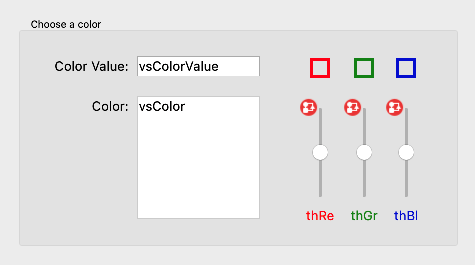
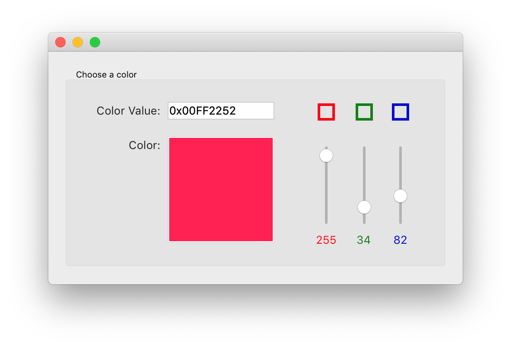
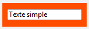
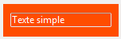
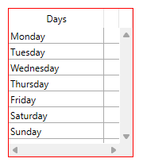

---
id: object-set-rgb-colors
title: OBJECT SET RGB COLORS
slug: /commands/object-set-rgb-colors
displayed_sidebar: docs
---

<!--REF #_command_.OBJECT SET RGB COLORS.Syntax-->**OBJECT SET RGB COLORS** ( * ; *objet* : Text ; *couleurAvantPlan* : Text, Integer {; *couleurArrièrePlan* : Text, Integer {; *couleurArrièrePlanAlt* : Text, Integer {; *borderColor* : Text, Integer}}} )<br/>**OBJECT SET RGB COLORS** ( *objet* : Variable, Field ; *couleurAvantPlan* : Text, Integer {; *couleurArrièrePlan* : Text, Integer {; *couleurArrièrePlanAlt* : Text, Integer {; *borderColor* : Text, Integer}}} )<!-- END REF-->
<!--REF #_command_.OBJECT SET RGB COLORS.Params-->
<div class="no-index">

| Paramètre | Type |  | Description |
| --- | --- | --- | --- |
| * | Opérateur | &#8594;  | Si spécifié, objet est un nom d'objet (chaîne) Si omis, objet est un champ ou une variable |
| objet | Text, Variable, Field | &#8594;  | Nom d'objet (si * est spécifié) ou Champ ou Variable (si * est omis) |
| couleurAvantPlan | Text, Integer | &#8594;  | Valeur de la couleur RVB d'avant-plan ("" = ne pas changer)|
| couleurArrièrePlan | Text, Integer | &#8594;  | Valeur de la couleur RVB d'arrière-plan ("" = ne pas changer)|
| couleurArrièrePlanAlt | Text, Integer | &#8594;  | Valeur de la couleur RVB d'arrière-plan alternée ("" = ne pas changer)|
| borderColor | Text, Integer | &#8594; | Valeur de la couleur RVB de la bordure ("" = ne pas changer)|
</div>
<!-- END REF-->

<div class="no-index">
<details><summary>Historique</summary>

|Version|Changements|
|---|---|
|21 R5|Prise en charge du paramètre *borderColor*|
|17 R6|Modifié|
|14|Modifié|
|12|Renommé|
|2004|Modifié|
|<6|Créé|

</details>
</div>

## Description 

<!--REF #_command_.OBJECT SET RGB COLORS.Summary-->La commande **OBJECT SET RGB COLORS** modifie les couleurs d'avant-plan et d'arrière-plan des objets désignés par le paramètre *objet* et le paramètre optionnel *\**.<!-- END REF--> Selon l'objet auquel la commande est appliquée, deux autres paramètres de couleur peuvent être disponibles.

Si vous passez le paramètre optionnel *\**, vous indiquez que *objet* est un nom d'objet (une chaîne de caractères). Si vous omettez le paramètre \*, *objet* désigne un champ ou une variable. Dans ce cas, vous passez une référence de champ ou de variable (champs ou variables objet uniquement) et non une chaîne.

Le paramètre facultatif *couleurArrièrePlanAlt* permet de désigner une couleur alternative pour l’arrière-plan (c’est-à-dire le fond) des lignes paires. Ce paramètre n’est utile que lorsque l’objet désigné est de type list box ou colonne de list box. Lorsque ce paramètre est utilisé, la *couleurArrièrePlan* est utilisée pour le fond des lignes impaires uniquement. Utiliser des couleurs alternées améliore la lisibilité des tableaux. Si *objet* désigne l’objet list box, les couleurs alternées sont utilisées dans la totalité de la list box. Si *objet* désigne une colonne de list box, seule cette colonne utilisera les couleurs définies.

Le paramètre facultatif *borderColor* permet de modifier la couleur de la bordure à l'exécution. Il ne peut être appliqué qu'aux objets prenant en charge la propriété `borderColor` et nécessite un style de bordure "plain" ou "dotted" (sauf pour les boutons avec un style personnalisé). Pour plus de détails, consultez la section ["Couleur de la bordure"](../../FormObjects/properties_BackgroundAndBorder.md#border-color).

:::note

Le paramètre *borderColor* n'est pas disponible dans les bases de données binaires.

:::

Vous pouvez passer "" (chaîne vide) dans *couleurAvantPlan*, *couleurArrièrePlan*, *couleurArrièrePlanAlt* et/ou *borderColor* pour laisser la couleur inchangée.

**Définition des couleurs**

Vous passez des valeurs de couleurs RVB dans les paramètres *couleurAvantPlan* et, éventuellement, *couleurArrièrePlan*, *couleurArrièrePlanAlt* et *borderColor*. Les formats suivants sont pris en charge :

| **Nom du format**                      | **Type**    | **Description**                                                                                                                                                                                                                                                                                                                                                                                                                                                                                                   | **Exemples**                                                                                                |
| -------------------------------------- | ----------- | ----------------------------------------------------------------------------------------------------------------------------------------------------------------------------------------------------------------------------------------------------------------------------------------------------------------------------------------------------------------------------------------------------------------------------------------------------------------------------------------------------------------- | ----------------------------------------------------------------------------------------------------------- |
| Nom de la couleur CSS                  | Texte       | Nom de la couleur CSS standard. <ul><li>La liste des noms est disponible en ligne, comme par exemple sur le site web [htmlcolorcodes.com](https://htmlcolorcodes.com/color-names/).</li><li>Utilisez "transparent" pour obtenir un fond transparent (peut être utilisé uniquement avec les paramètres *couleurArrièrePlan* et *couleurArrièrePlanAlt*).</li></ul>   | "red", "cyan", "lightblue"                                                                                  |
| Syntaxe "#rrggbb" de la couleur CSS    | Texte       | Code couleur standard CSS2 en notation hexadécimale :<ul><li>rr = Composante rouge de la couleur</li><li>gg = Composante verte de la couleur</li><li>bb = Composante bleue de la couleur</li></ul>                                                                                                                                                                                                                                                                                                                 | "#ff0000", "#00FFFF", "#ADD8E6"                                                                             |
| Syntaxe "rgb(r,g,b)" de la couleur CSS | Texte       | Code couleur standard CSS2 en notation rvb :<ul><li>r = Composante rouge de la couleur (0...255)</li><li>g = Composante verte de la couleur (0...255)</li><li>b = Composante bleue de la couleur (0...255)</li></ul>                                                                                                                                                                                                                                                                                                  | "rgb(255,255,0)", "rgb(255,0,0)"                                                                            |
| Valeur RVB de 4 octets                 | Entier long | Entier long de 4 octets (format 0x00rrggbb). Valeurs hexadécimales :<ul><li>rr = Composante rouge de la couleur</li><li>gg = Composante verte de la couleur</li><li>bb = Composante bleue de la couleur</li></ul>                                                                                                                                                                                                                                                                                                     | 0x00000000, 0x00FF7F7F                                                                                      |
| Constante couleur "système" 4D         | Entier long | Couleurs utilisées par 4D pour dessiner des objets avec des couleurs automatiques. Constantes disponibles (du thème *FIXER COULEUR RVB*):<ul><li>Background color</li><li>Background color none (cette constante peut être utilisée uniquement avec les paramètres *couleurArrièrePlan* et *couleurArrièrePlanAlt*)</li><li>Dark shadow color</li><li>Disable highlight item color</li><li>Foreground color</li><li>Highlight menu background color</li><li>Highlight menu text color</li><li>Highlight text background color</li><li>Highlight text color</li><li>Light shadow color</li></ul> | **Note :* Les couleurs automatiques dépendent du système et du type d'objet auxquels elles sont affectées.* |

## Exemple 1 

Voici un formulaire contenant deux variables non saisissables, *vsColorValue* et *vsColor* ainsi que trois thermomètres, *thRouge*, *thVert* et *thBleu* :



Les méthodes associées à ces objets sont les suivantes :

```4d
  // Méthode objet de la variable non saisissable vsColorValue
 Case of
    :(FORM Event.code=On Load)
       vsColorValue:="0x00000000"
 End case
 
  // Méthode objet de la variable non saisissable vsColor
 Case of
    :(FORM Event.code=On Load)
       vsColor:=""
       OBJECT SET RGB COLORS(vsColor;0x00FFFFFF;0x0000)
 End case
 
  // Méthode objet du thermomètre thRouge
 CLIC SUR THERMOMETRE COULEUR
 
  // Méthode objet du thermomètre thVert
 CLIC SUR THERMOMETRE COULEUR
 
  // Méthode objet du thermomètre thBleu
 CLIC SUR THERMOMETRE COULEUR
```

La méthode projet appelée par les trois thermomètres est la suivante :

```4d
  // Méthode projet CLIC SUR THERMOMETRE COULEUR
 OBJECT SET RGB COLORS(vsColor;0x00FFFFFF;(thRouge << 16)+(thVert << 8)+thBleu)
 vsColorValue:=String((thRouge << 16)+(thVert << 8)+thBleu;" & x")
 If(thRouge=0)
    vsColorValue:=Substring(vsColorValue;1;2)+"0000"+Substring(vsColorValue;3)
 End if
```

Notez l'utilisation des **[SET AUTOMATIC RELATIONS](../commands/set-automatic-relations)** pour le calcul des valeurs des couleurs à partir de celles des thermomètres.

En exécution, le formulaire a l'aspect suivant :



## Exemple 2 

Passage du fond en transparent avec couleur de police claire :



```4d
 OBJECT SET RGB COLORS(*;"maVar";Light shadow color;Background color none)
```



## Exemple 3

Modification de la seule couleur de bordure de la list box :


```4d
    //Modifier le style de bordure en plain (system par défaut)
OBJECT SET BORDER STYLE(*; "listOfDays"; Border Plain)
    //Définir la couleur de bordure en rouge
OBJECT SET RGB COLORS(*; "listOfDays"; ""; ""; ""; "#ff0000")
```



## Voir aussi 

[OBJECT GET RGB COLORS](../commands/object-get-rgb-colors)  
[Select RGB color](../commands/select-rgb-color)  

## Propriétés

|  |  |
| --- | --- |
| Numéro de commande | 628 |
| Thread safe | no |

