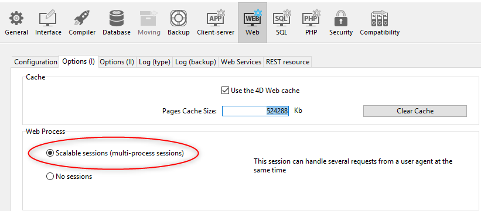
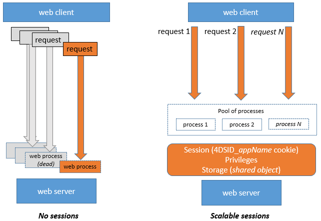
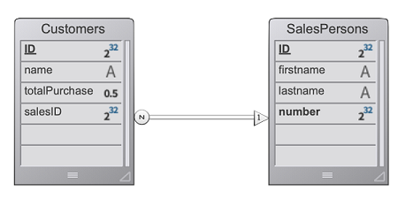
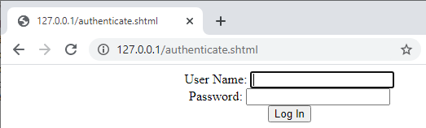

The 4D web server provides built-in features for managing **user sessions**. La création et le maintien de sessions web vous permettent de contrôler et d'améliorer l'expérience de l'utilisateur sur votre application web. Lorsque les sessions web sont activées, les clients web peuvent réutiliser le même contexte de serveur d'une requête à une autre.

Les sessions utilisateur du serveur web permettent de :

- handle multiple requests simultaneously from the same web client through an unlimited number of preemptive processes (web server sessions are **scalable**),
- partager des données entre les process d'un client web,
- associer des privilèges aux sessions d'utilisateurs,
- handle access through a `Session` object and the [Session API](API/SessionClass.md).

> **Note:** The current implementation is only the first step of an upcoming comprehensive feature allowing developers to manage hierarchical user permissions through sessions in the whole web application.

## Activation des sessions

La gestion de session peut être activée et désactivée sur votre serveur Web 4D. Il y a différentes façons d'activer la gestion de session :

- Utiliser l'option **Sessions évolutives** dans la page "Web/Options (I)" des Propriétés (réglage permanent) :
  

Cette option est sélectionnée par défaut dans les nouveaux projets. Elle peut cependant être désactivée en sélectionnant l'option **Pas de sessions**, auquel cas les fonctionnalités de session web sont désactivées (aucun objet `Session` n'est disponible).

- En utilisant la propriété [`.scalableSession`](API/WebServerClass.md#scalablession) de l'objet Web Server (à passer dans le paramètre *settings* de la fonction [`.start()`](API/WebServerClass.md#start) ). Dans ce cas, ce paramètre remplace l'option définie dans la boîte de dialogue Propriétés pour l'objet Web Server (il n'est pas stocké sur disque).

> La commande `WEB SET OPTION` peut également définir le mode de session pour le serveur Web principal.

Dans tous les cas, ce paramètre est local à la machine ; il peut donc être différent sur le serveur Web 4D Server et les serveurs Web des machines 4D distantes.

> **Compatibilité** : Une option **Anciennes sessions** est disponible dans les projets créés avec une version 4D antérieure à 4D v18 R6 (pour plus d'informations, veuillez consulter le site web [doc.4d.com](https://doc.4d.com)).

## Implémentation des sessions

Lorsque [les sessions sont activées](#activation-des-sessions), des mécanismes automatiques sont mis en place, basés sur un cookie privé défini par 4D lui-même : "4DSID_*NomApp*", où *NomApp* est le nom du projet d'application. Ce cookie référence la session web courante pour l'application.

> Le nom du cookie peut être obtenu en utilisant la propriété [`.sessionCookieName`](API/WebServerClass.md#sessioncookiename).

1. Dans chaque requête de client web, le serveur Web vérifie la présence et la valeur du cookie privé "4DSID__AppName_".

2. Si le cookie a une valeur, 4D recherche la session qui a créé ce cookie parmi les sessions existantes ; si cette session est trouvée, elle est réutilisée pour l'appel.

3. Si la requête du client ne correspond pas à une session déjà ouverte :

- une nouvelle session avec un cookie privé "4DSID__AppName_" est créée sur le serveur web
- un nouvel objet `Session` Guest est créé et est dédié à la session web évolutive.

The current `Session` object can then be accessed through the [`Session`](API/SessionClass.md#session) command in the code of any web processes.



Les process Web ne se terminent généralement pas, ils sont recyclés dans un pool pour des raisons d'optimisation. Lorsqu'un process termine l'exécution d'une requête, il est replacé dans le pool et rendu disponible pour la requête suivante. Comme un process web peut être réutilisé par n'importe quelle session, les [variables process](Concepts/variables.md#process-variables) doivent être effacées par votre code à la fin de son exécution (en utilisant [`CLEAR VARIABLE`](https://doc.4d.com/4dv18/help/command/en/page89.html) par exemple). Ce nettoyage est nécessaire pour toute information liée au process, comme une référence à un fichier ouvert. C'est la raison pour laquelle **il est recommandé** d'utiliser l'objet [Session](API/SessionClass.md) lorsque vous souhaitez conserver les informations relatives à la session.

## Partage d'informations

Chaque objet `Session` fournit une propriété [`.storage`](API/SessionClass.md#storage) qui est un [objet partagé](Concepts/shared.md). Cette propriété vous permet de partager des informations entre tous les process gérés par la session.

## Durée de vie des sessions

Une session web évolutive est fermée lorsque:

- le serveur web est arrêté,
- le délai d'attente du cookie de session a été atteint.

La durée de vie d'un cookie inactif est de 60 minutes par défaut, ce qui signifie que le serveur Web fermera automatiquement les sessions inactives après 60 minutes.

This timeout can be set using the [`.idleTimeout`](API/SessionClass.md#idletimeout) property of the `Session` object (the timeout cannot be less than 60 minutes).

When a scalable web session is closed, if the [`Session`](API/SessionClass.md#session) command is called afterwards:

- l'objet `Session` ne contient pas de privilèges (c'est une session Guest)
- la propriété [`storage`](API/SessionClass.md#storage) est vide
- un nouveau cookie de session est associé à la session

## Privilèges

Des privilèges peuvent être associés aux sessions. Sur le serveur web, vous pouvez fournir un accès spécifique ou des fonctionnalités en fonction des privilèges de la session.

You can assign privileges usign the [`.setPrivileges()`](API/SessionClass.md#setprivileges) function. Dans votre code, vous pouvez vérifier les privilèges de la session pour autoriser ou refuser l'accès à l'aide de la fonction [`.hasPrivilege()`](API/SessionClass.md#hasprivilege). By default, new sessions do not have any privilege: they are **guest** sessions ([`.isGuest()`](API/SessionClass.md#isguest) function returns true).

> Dans l'implémentation actuelle, seul le privilège "WebAdmin" est disponible.

Exemple :

```4d
If (Session.hasPrivilege("WebAdmin"))
	//Accès autorisé, on ne fait rien
Else
	//Afficher une page d'authentification
End if
```

## Exemple

Dans une application CRM, chaque commercial gère son propre portefeuille de clients. Le datastore contient au moins deux dataclass liées : Customers et SalesPersons (un commercial a plusieurs clients).



Nous voulons qu'un(e) commercial(e) s'authentifie, ouvre une session sur le serveur web et que les 3 meilleurs clients soient chargés dans la session.

1. Nous exécutons cette URL pour ouvrir une session :

```
http://localhost:8044/authenticate.shtml
```

> Dans un environnement de production, il est nécessaire d'utiliser une [connexion HTTPS](API/WebServerClass.md#httpsenabled) pour éviter la circulation d'informations non chiffrées sur le réseau.

2. La page `authenticate.shtml` est un formulaire contenant des champs de saisie *userId* et *password* et envoie une action POST 4DACTION :

```html
<!DOCTYPE html>
<html>
<body bgcolor="#ffffff">
<FORM ACTION="/4DACTION/authenticate" METHOD=POST>
	UserId: <INPUT TYPE=TEXT NAME=userId VALUE=""><br/>
	Password: <INPUT TYPE=TEXT NAME=password VALUE=""><br/>
<INPUT TYPE=SUBMIT NAME=OK VALUE="Log In">
</FORM>
</body>
</html>
```



3. La méthode projet d'authentification recherche la personne *userID* et valide le mot de passe par rapport à la valeur hachée déjà stockée dans la table *SalesPersons* :

```4d
var $indexUserId; $indexPassword; $userId : Integer
var $password : Text
var $userTop3; $sales; $info : Object


ARRAY TEXT($anames; 0)
ARRAY TEXT($avalues; 0)

WEB GET VARIABLES($anames; $avalues)

$indexUserId:=Find in array($anames; "userId")
$userId:=Num($avalues{$indexUserId})

$indexPassword:=Find in array($anames; "password")
$password:=$avalues{$indexPassword}

$sales:=ds.SalesPersons.query("userId = :1"; $userId).first()

If ($sales#Null)
    If (Verify password hash($password; $sales.password))
        $info:=New object()
        $info.userName:=$sales.firstname+" "+$sales.lastname
        Session.setPrivileges($info)
        Use (Session.storage)
            If (Session.storage.myTop3=Null)
                $userTop3:=$sales.customers.orderBy("totalPurchase desc").slice(0; 3)
                Session.storage.myTop3:=$userTop3
            End if
        End use
        WEB SEND HTTP REDIRECT("/authenticationOK.shtml")
    Else
        WEB SEND TEXT("This password is wrong")
    End if
Else
    WEB SEND TEXT("This userId is unknown")
End if
```
