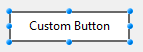
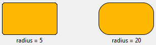
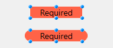
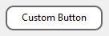
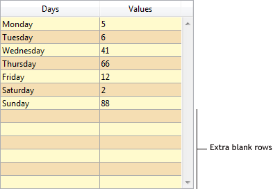
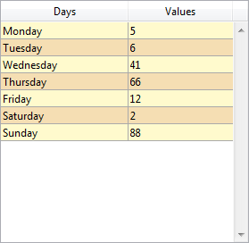
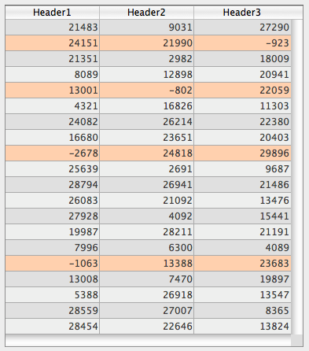
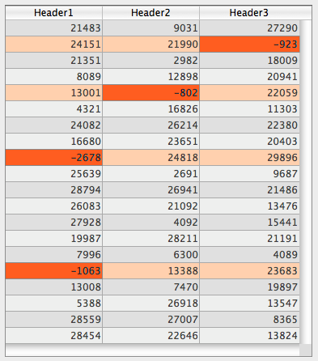

## Couleur de fond alternée

Permet de définir une couleur d'arrière-plan différente pour les lignes / colonnes impaires dans une list box. Par défaut, l'option *Automatique* est sélectionnée pour les colonnes des listbox : la colonne utilise la couleur d'arrière-plan alternée définie au niveau de la listbox.

Vous pouvez également définir cette propriété à l'aide de la commande [`OBJECT SET RGB COLORS`](../commands/object-set-rgb-colors).

#### Grammaire JSON

| Nom           | Type de données | Valeurs possibles                                                        |
| ------------- | --------------- | ------------------------------------------------------------------------ |
| alternateFill | string          | toutes les valeurs css; "transparent"; "automatic"; "automaticAlternate" |

#### Objets pris en charge

[List Box](listbox_overview.md) - [Colonne de List Box](listbox-column.md)

#### Commandes

[`OBJECT GET RGB COLORS`](../commands/object-get-rgb-colors) - [`OBJECT SET RGB COLORS`](../commands/object-set-rgb-colors)

---

## Couleur de fond

Définit la couleur de fond / couleur de remplissage d'un objet. Elle peut être définie pour certains objets standard (propriété JSON `fill`) ou pour des [objets de style "Custom"](#custom-button-custom-check-box-or-custom-radio-button) (propriété JSON `borderFillColor`).

:::note

La propriété **Couleur de fond** est parfois appelée **Couleur d'arrière-plan** notamment pour les objets [List box](listbox_overview.md), [Colonne de List box](listbox-column.md) et [Pied de List box](listbox-header-footer.md#footers).

:::

### Objets standard

Dans le cas d'une colonne de list box, par défaut *Automatique* est sélectionné : la colonne utilise la couleur de fond définie au niveau de la list box.

#### Grammaire JSON

| Nom  | Type de données | Valeurs possibles                          |
| ---- | --------------- | ------------------------------------------ |
| fill | string          | une valeur css; "transparent"; "automatic" |

#### Objets pris en charge

[Hierarchical List](list_overview.md) - [Input](input_overview.md) - [List Box](listbox_overview.md) - [List Box Column](listbox-column.md) - [List Box Footer](listbox-header-footer.md#footers) - [Oval](shapes_overview.md#oval) - [Rectangle](shapes_overview.md#rectangle) - [Text Area](text.md)

#### Commandes

[`LISTBOX Get row color`](../commands/listbox-get-row-color) - [`LISTBOX SET ROW COLOR`](../commands/listbox-set-row-color) - [`OBJECT GET RGB COLORS`](../commands/object-get-rgb-colors) - [`OBJECT SET RGB COLORS`](../commands/object-set-rgb-colors)

### Bouton personnalisé, case à cocher personnalisée ou bouton radio personnalisé

Cette propriété vous permet d'attribuer une couleur de fond aux [boutons personnalisés](./button_overview.md#custom), aux [cases à cocher personnalisées](./checkbox_overview.md#custom) ou aux [boutons radio personnalisés](./radio_overview.md#custom). De plus, les [boutons personnalisés](./button_overview.md#custom) doivent avoir le [style de bordure "personnalisé"](#border-line-style). Dans les autres contextes, cette propriété n'est pas prise en compte.

#### Grammaire JSON

| Nom             | Type de données | Valeurs possibles                          |
| --------------- | --------------- | ------------------------------------------ |
| borderFillColor | string          | une valeur css; "transparent"; "automatic" |

#### Objets pris en charge

[Bouton personnalisé](./button_overview.md#custom) (avec le [style de bordure "Personnalisé"](#border-line-style)) - [Case à cocher personnalisée](checkbox_overview.md#custom) - [Bouton radio personnalisé](radio_overview.md#custom)

#### Commandes

[`OBJECT GET RGB COLORS`](../commands/object-get-rgb-colors) - [`OBJECT SET RGB COLORS`](../commands/object-set-rgb-colors)

#### Voir également

[Transparent](#transparent)

---

## Expression couleur de fond {#background-color-expression}

`List box de type collection et entity selection`

Une expression ou une variable (les variables de tableau ne peuvent pas être utilisées) pour appliquer une couleur d'arrière-plan personnalisée à chaque ligne de la list box. L'expression ou la variable sera évaluée pour chaque ligne affichée et doit retourner une valeur de couleur RGB. Pour plus d'informations, reportez-vous à la description de la commande [`OBJECT SET RGB COLORS`](../commands/object-set-rgb-colors).

Vous pouvez également définir cette propriété en utilisant la commande [`LISTBOX SET PROPERTY`](../commands/listbox-set-property) avec la constante `lk background color expression`.

> Avec les list box de type collection ou sélection d'entité, cette propriété peut également être définie à l'aide d'une [Meta Info Expression](properties_Text.md#meta-info-expression).

#### Grammaire JSON

| Nom           | Type de données | Valeurs possibles                                   |
| ------------- | --------------- | --------------------------------------------------- |
| rowFillSource | string          | Une expression retournant une valeur de couleur RGB |

#### Objets pris en charge

[List Box](listbox_overview.md) - [Colonne de List Box](listbox-column.md)

#### Commandes

[`LISTBOX Get property`](../commands/listbox-get-property) - [`LISTBOX SET PROPERTY`](../commands/listbox-set-property)

---

## Couleur de bordure {#border-color}

Permet de définir la couleur de la bordure. L'effet de cette propriété varie légèrement en fonction du type d'objet auquel elle s'applique.

- **objets avec des propriétés de texte** : [boutons](./button_overview.md) (tous les styles sauf "Personnalisé", voir  ci-dessous), [listes hiérarchiques](list_overview.md), [champs de saisie](input_overview.md), [listboxes](listbox_overview.md), [indicateurs de progression](./progressIndicator.md), [règles](./ruler.md) et [zones de texte](text.md).  
  Par défaut, la couleur de la bordure de ces objets est automatiquement définie en fonction de leur propriété [**Couleur de la police**](./properties_Text.md#font-color). Cette configuration par défaut correspond à l'option **Identique à la police** dans la liste des propriétés (la propriété `borderColor` n'est pas définie dans le JSON).  
  Vous pouvez distinguer ces deux propriétés en définissant une valeur de couleur pour la propriété "Couleur de la bordure" de l'objet (cette option n'est disponible que lorsque la propriété [**Style de la bordure**](#border-line-style) est définie sur **Normal** (`solid` dans la propriété JSON) ou **Trait pointillé**).

- **objets sans propriétés de texte** : [zones 4D View Pro](viewProArea_overview.md), [zones 4D Write Pro](writeProArea_overview.md), [grilles de boutons](buttonGrid_overview.md), [boutons image](pictureButton_overview.md), [pop up menus image](picturePopupMenu_overview.md), [zones de plug-ins](pluginArea_overview.md), [sous-formulaires](subform_overview.md), [spinners](spinner.md), [séparateurs](splitters.md), [steppers](stepper.md), [zones Web](webArea_overview.md).  
  La propriété couleur de la bordure permet de définir la couleur des bordures. La valeur par défaut pour la couleur est "Automatique" ; cela signifie que la bordure s'affiche avec la couleur définie automatiquement par votre système d'exploitation.

- **boutons personnalisés** : [boutons personnalisés](./button_overview.md#custom) (avec [style de la bordure "Personnalisé"](#border-line-style)) - [Case à cocher personnalisée](./checkbox_overview.md#custom) - [Bouton radio personnalisé](./radio_overview.md#custom).  
  Dans ce cas, la propriété de couleur de la bordure définit la couleur d'une bordure *intérieure*, qui est un attribut de l'objet lui-même et non une propriété de décoration. Cette bordure intérieure peut également avoir une [largeur](#border-width) (elle n'apparaît que si la largeur est supérieure à 0).

#### Grammaire JSON

| Nom         | Type de données | Valeurs possibles                          |
| ----------- | --------------- | ------------------------------------------ |
| borderColor | string          | une valeur css; "transparent"; "automatic" |

#### Objets pris en charge

[4D View Pro area](viewProArea_overview.md) - [4D Write Pro area](writeProArea_overview.md) - [Button](./button_overview.md) - [Button Grid](buttonGrid_overview.md) - [Check Box ("custom" style)](checkbox_overview.md#custom) - [Hierarchical List](list_overview.md) - [Input](input_overview.md) - [List Box](listbox_overview.md) - [Picture Button](pictureButton_overview.md) - [Picture Pop-up Menu](picturePopupMenu_overview.md) - [Plug-in Area](pluginArea_overview.md) - [Progress Indicator](./progressIndicator.md) - [Radio Button ("custom" style)](radio_overview.md#custom) - [Ruler](./ruler.md) - [Text Area](text.md) - [Spinner](spinner.md) - [Splitter](splitters.md) - [Stepper](stepper.md) - [Subform](subform_overview.md) - [Web Area](webArea_overview.md)

#### Commandes

[`OBJECT GET RGB COLORS`](../commands/object-get-rgb-colors) - [`OBJECT SET RGB COLORS`](../commands/object-set-rgb-colors)

#### Voir également

[Couleur du trait](#line-color) (pour les formes)

## Style de la bordure {#border-line-style}

Permet de définir un style pour la bordure de l'objet. Les options suivantes sont disponibles (toutes les options ne sont pas disponibles selon l'objet) :

| Style            | Objets (\*)                                         | Description                                                                                                                                                                                                                                                                                                                                                                                                                                                                                                                                                                                                                                                                                                                                                                                                                                              |
| ---------------- | ---------------------------------------------------------------------- | -------------------------------------------------------------------------------------------------------------------------------------------------------------------------------------------------------------------------------------------------------------------------------------------------------------------------------------------------------------------------------------------------------------------------------------------------------------------------------------------------------------------------------------------------------------------------------------------------------------------------------------------------------------------------------------------------------------------------------------------------------------------------------------------------------------------------------------------------------- |
| Aucun            | all                                                                    | Les objets apparaissent sans bordure.                                                                                                                                                                                                                                                                                                                                                                                                                                                                                                                                                                                                                                                                                                                                                                                                    |
| Normal           | all                                                                    | Les objets apparaissent encadrés d'une ligne continue de 1 pt. d'épaisseur (valeur json "solid")                                                                                                                                                                                                                                                                                                                                                                                                                                                                                                                                                                                                                                                                                                                      |
| Trait pointillé  | all                                                                    | Les objets apparaissent encadrés d'une ligne pointillée de 1 pt. d'épaisseur                                                                                                                                                                                                                                                                                                                                                                                                                                                                                                                                                                                                                                                                                                                                                             |
| Relief           | all                                                                    | Les objets apparaissent encadrés avec un effet 3D.                                                                                                                                                                                                                                                                                                                                                                                                                                                                                                                                                                                                                                                                                                                                                                                       |
| Relief inversé   | all                                                                    | Les objets apparaissent comme encadrés, avec un effet 3D en creux.                                                                                                                                                                                                                                                                                                                                                                                                                                                                                                                                                                                                                                                                                                                                                                       |
| Double           | all                                                                    | Les objets apparaissent encadrés d'une double ligne, c'est-à-dire de deux lignes continues de 1 pt. séparées par un pixel.                                                                                                                                                                                                                                                                                                                                                                                                                                                                                                                                                                                                                                                                                               |
| Système          | tous *sauf* [boutons](button_overview.md) et [zones de texte](text.md) | Les objets s'affichent avec une bordure respectant les spécifications graphiques du système d'exploitation.                                                                                                                                                                                                                                                                                                                                                                                                                                                                                                                                                                                                                                                                                                                              |
| Système arrondie | [zones de saisie](input_overview.md)                                   | Sous macOS, les objets s'affichent avec un effet de bordure système natif appelé « Liquid Glass » (pour plus d'informations sur Liquid Glass, consultez [cet article du blog 4D](https://blog.4d.com/the-new-macos-tahoe-design-comes-to-your-4d-applications/)). Il comprend une bordure intérieure définie par le système, un rayon d'arrondi, une couleur de bordure grise et un espacement intérieur. Notez que l'apparence « Liquid Glass » n'est *pas* utilisée dans un objet de saisie multiligne si la [propriété barres de défilement](./properties_Appearance.md#vertical-scroll-bar) est activée (dans ce cas, c'est l'apparence "System" qui est utilisée).<br/> Sous Windows, ce style est similaire à "Système" lors de l'exécution. |
| Personnalisé     | [boutons personnalisés](./button_overview.md#custom)                   | Active le style de bordure intérieure, qui comprend un ensemble de propriétés supplémentaires : [Couleur de fond](#fill-color), [Couleur de la bordure](#border-color), [Épaisseur de la bordure](#border-width) et [Rayon d'arrondi](#corner-radius). <br/>                                                                                                                                                                                                                                                                                                                                                                                                                                                                                                              |

(\*) "tous" signifie "tous les objets pris en charge" listés ci-dessous.

:::tip Articles de blog sur le sujet

- [Personnaliser les boutons, les boutons radio et les cases à cocher à l'aide des propriétés de fond et de bordure](https://blog.4d.com/customize-buttons-radio-buttons-and-check-boxes-with-background-and-border-properties).
- [Donnez à vos objets de formulaire la couleur de bordure qu’ils méritent](https://blog.4d.com/give-your-form-objects-the-border-color-they-deserve)
- [Choisissez le style de saisie natif le mieux adapté à votre interface sous macOS](https://blog.4d.com/choose-the-right-native-input-style-for-your-interface-on-macos)

:::

#### Grammaire JSON

| Nom         | Type de données | Valeurs possibles                                                                            |
| ----------- | --------------- | -------------------------------------------------------------------------------------------- |
| borderStyle | text            | "custom", "dotted", "double", "none", "raised", "solid", "sunken", "system", "systemRounded" |

#### Objets pris en charge

[4D View Pro Area](viewProArea_overview.md) - [4D Write Pro areas](writeProArea_overview.md) - [Buttons](button_overview.md) - [Button Grid](buttonGrid_overview.md) - [Hierarchical List](list_overview.md) - [Input](input_overview.md) - [List Box](listbox_overview.md) - [Picture Button](pictureButton_overview.md) - [Picture Pop-up Menu](picturePopupMenu_overview.md) - [Plug-in Area](pluginArea_overview.md) - [Progress Indicator](progressIndicator.md) - [Ruler](ruler.md) - [Spinner](spinner.md) - [Stepper](stepper.md) - [Subform](subform_overview.md) - [Text Area](text.md) - [Web Area](webArea_overview.md)

#### Commandes

[`OBJECT Get border style`](../commands/object-get-border-style) - [`OBJECT SET BORDER STYLE`](../commands/object-set-border-style)

#### Voir également

[Type de pointillé](#dotted-line-type) (formes)

---

## Largeur de bordure {#border-width}

Permet de définir la largeur de la bordure intérieure pour :

- les [boutons personnalisés](./button_overview.md#custom) avec le [style de bordure "personnalisé"](#border-line-style),
- les [cases à cocher personnalisées](./checkbox_overview.md#custom),
- les [boutons radio personnalisés](./radio_overview.md#custom).

Dans les autres contextes, cette propriété n'est pas prise en compte.

La valeur est exprimée en pixels.

#### Grammaire JSON

| Nom         | Type de données | Valeurs possibles                                                               |
| ----------- | --------------- | ------------------------------------------------------------------------------- |
| borderWidth | number          | Valeur entière (pixels). Valeur minimale = 0 |

#### Objets pris en charge

[Bouton personnalisé](./button_overview.md#custom) (avec le [style de bordure "Personnalisé"](#border-line-style)) - [Case à cocher personnalisée](checkbox_overview.md#custom) - [Bouton radio personnalisé](radio_overview.md#custom)

---

## Rayon d'arrondi

<details><summary>Historique</summary>

| Release | Modifications                                                              |
| ------- | -------------------------------------------------------------------------- |
| 21 R5   | Prise en charge des boutons, boutons radio et cases à cocher personnalisés |
| 19 R7   | Prise en charge pour les zones de saisie et de texte                       |

</details>

Définit l'arrondi des coins (en pixels) de l'objet. Par défaut, la valeur du rayon est de 0 pixel. Vous pouvez modifier cette propriété pour dessiner des objets arrondis avec des formes personnalisées :



La valeur minimale est de 0. Dans ce cas, un rectangle d'objet standard non arrondi est dessiné.
La valeur maximale dépend de la taille du rectangle (elle ne peut pas dépasser la moitié de la taille du côté le plus court du rectangle) et est calculée dynamiquement.

Dans les [zones de texte](./text.md) et les [zones de saisie](./input_overview.md) :

- la propriété rayon d"arrondi n'est disponible qu'avec les [styles de ligne de bordure](#border-line-style) "none", "solid" ou "dotted",
- l'arrondi du coin est dessiné **à l'extérieur** de la zone de l'objet (l'objet apparaît plus grand dans le formulaire mais sa [largeur](./properties_CoordinatesAndSizing.md#width) et sa [hauteur](./properties_CoordinatesAndSizing.md#height) ne sont pas étendues).



Dans les [boutons personnalisés](./button_overview.md#custom) (avec un [style de bordure "personnalisé"](#border-line-style)), les [cases à cocher personnalisées](checkbox_overview.md#custom) et les [boutons radio personnalisés](radio_overview.md#custom), le rayon d'arrondi est tracé **à l'intérieur** de la zone de l'objet.

  


#### Grammaire JSON

| Nom          | Type de données | Valeurs possibles           |
| ------------ | --------------- | --------------------------- |
| borderRadius | integer         | minimum : 0 |

#### Objets pris en charge

[Bouton (style "personnalisé")](./button_overview.md#custom) (avec [style de bordure "personnalisé"](#border-line-style)) - [Case à cocher (style "personnalisé")](checkbox_overview.md#custom) - [Champ de saisie](input_overview.md) - [Rectangle](shapes_overview.md#rectangle) - [Zone de texte](text.md) - [Bouton radio (style "personnalisé")](radio_overview.md#custom)

#### Commandes

[OBJECT GET CORNER RADIUS](../commands/object-get-corner-radius) - [OBJECT SET CORNER RADIUS](../commands/object-set-corner-radius)

---

## Type de pointillé {#dotted-line-type}

Décrit le type de ligne en pointillé comme une séquence de points noirs et blancs.

#### Grammaire JSON

| Nom             | Type de données            | Valeurs possibles                                                                                                                                                     |
| --------------- | -------------------------- | --------------------------------------------------------------------------------------------------------------------------------------------------------------------- |
| strokeDashArray | tableau numérique ou texte | Ex : Ex : "6 1" ou \[6,1\] pour une séquence de 6 points noirs et 1 point blanc |

#### Objets pris en charge

[Rectangle](shapes_overview.md#rectangle) - [Ovale](shapes_overview.md#oval) - [Ligne](shapes_overview.md#line)

---

## Masquer lignes vides finales

Contrôle l'affichage des lignes vides supplémentaires ajoutées au bas d'un objet list box. Par défaut, 4D ajoute ces lignes supplémentaires pour remplir la zone vide :



Vous pouvez supprimer ces lignes vides en sélectionnant cette option. Le bas de l'objet list box est alors laissé vide :



#### Grammaire JSON

| Nom                | Type de données | Valeurs possibles |
| ------------------ | --------------- | ----------------- |
| hideExtraBlankRows | boolean         | true, false       |

#### Objets pris en charge

[List Box](listbox_overview.md)

#### Commandes

[`LISTBOX Get property`](../commands/listbox-get-property) - [`LISTBOX SET PROPERTY`](../commands/listbox-set-property)

---

## Couleur du trait

Désigne la couleur des lignes de l'objet.
La couleur peut être spécifiée par :

- un nom de couleur - comme "red"
- une valeur HEX - comme "# ff0000"
- une valeur RVB - comme "rgb (255,0,0)"

Vous pouvez également définir cette propriété à l'aide de la commande [`OBJECT SET RGB COLORS`](../commands/object-set-rgb-colors).

#### Grammaire JSON

| Nom    | Type de données | Valeurs possibles                          |
| ------ | --------------- | ------------------------------------------ |
| stroke | string          | une valeur css; "transparent"; "automatic" |

:::note

Cette propriété est également disponible pour les objets comportant des propriétés de texte ; dans ce cas, elle définit à la fois la [Couleur de la police](properties_Text.md#font-color) et les lignes de l'objet, sauf si vous avez utilisé la propriété [Couleur de la bordure](#border-color).

:::

#### Objets pris en charge

[Ligne](shapes_overview.md#line) - [Ovale](shapes_overview.md#oval) - [Rectangle](shapes_overview.md#rectangle)

#### Commandes

[`OBJECT GET RGB COLORS`](../commands/object-get-rgb-colors) - [`OBJECT SET RGB COLORS`](../commands/object-set-rgb-colors)

---

## Epaisseur du trait

Désigne l'épaisseur d'une ligne.

#### Grammaire JSON

| Nom         | Type de données | Valeurs possibles                                                                                                |
| ----------- | --------------- | ---------------------------------------------------------------------------------------------------------------- |
| strokeWidth | number          | 0 pour la plus petite largeur dans un formulaire imprimé, ou toute valeur d'entier < 20 |

#### Objets pris en charge

[Ligne](shapes_overview.md#line) - [Ovale](shapes_overview.md#oval) - [Rectangle](shapes_overview.md#rectangle)

---

## Tableau couleurs de fond {#row-background-color-array}

`List box de type tableau`

Le nom d'un tableau pour appliquer une couleur d'arrière-plan personnalisée à chaque ligne ou colonne de la list box.

Le nom d'un tableau Entier long doit être saisi. Chaque élément de ce tableau correspond à une ligne de la zone de list box (si elle est appliquée à la liste box) ou à une cellule de la colonne (si elle est appliquée à une colonne), le tableau doit donc avoir la même taille que le tableau associé à la colonne. Vous pouvez utiliser les constantes décrites dans la commande [`OBJECT SET RGB COLORS`](../commands/object-set-rgb-colors). Si vous souhaitez que la cellule hérite de la couleur d'arrière-plan définie au niveau supérieur, passez la valeur -255 à l'élément de tableau correspondant.

Par exemple, considérons une list box où les lignes ont une couleur alternée gris/gris clair, définie dans les propriétés de la list box. Un tableau de couleurs d'arrière-plan a également été défini pour la list box afin de changer en orange clair la couleur des lignes où au moins une valeur est négative :

```4d
 <>_BgndColors{$i}:=0x00FFD0B0 // orange
 <>_BgndColors{$i}:=-255 // default value
```



Vous souhaitez ensuite colorer les cellules avec des valeurs négatives en orange foncé. Vous souhaitez ensuite colorer les cellules avec des valeurs négatives en orange foncé. Les valeurs de ces tableaux ont la priorité sur celles définies dans les propriétés de list box ainsi que sur celles du tableau de couleurs d'arrière-plan général :

```4d
 <>_BgndColorsCol_3{2}:=0x00FF8000 // dark orange
 <>_BgndColorsCol_2{5}:=0x00FF8000
 <>_BgndColorsCol_1{9}:=0x00FF8000
 <>_BgndColorsCol_1{16}:=0x00FF8000
```



Vous pouvez obtenir le même résultat en utilisant les commandes [`LISTBOX SET ROW FONT STYLE`](../commands/listbox-set-row-font-style) et [`LISTBOX SET ROW COLOR`](../commands/listbox-set-row-color). Elles ont l'avantage de vous permettre d'éviter d'avoir à prédéfinir des tableaux de style/couleur pour les colonnes : ils sont créés dynamiquement par les commandes.

#### Grammaire JSON

| Nom           | Type de données | Valeurs possibles                             |
| ------------- | --------------- | --------------------------------------------- |
| rowFillSource | string          | Nom d'un tableau entier long. |

#### Objets pris en charge

[List Box](listbox_overview.md) - [Colonne de List Box](listbox-column.md)

#### Commandes

[`LISTBOX Get array`](../commands/listbox-get-array) - [`LISTBOX GET ARRAYS`](../commands/listbox-get-arrays)

---

## Transparent

Définit l'arrière-plan de la list box sur "Transparent". Lorsqu'elle est définie, toute [autre couleur d'arrière-plan](#alternate-background-color) ou [couleur d'arrière-plan](#background-color--fill-color) définie pour la colonne est ignorée.

#### Grammaire JSON

| Nom  | Type de données | Valeurs possibles |
| ---- | --------------- | ----------------- |
| fill | text            | "transparent"     |

#### Objets pris en charge

[List Box](listbox_overview.md)

#### Commandes

[`OBJECT GET RGB COLORS`](../commands/object-get-rgb-colors) - [`OBJECT SET RGB COLORS`](../commands/object-set-rgb-colors)

#### Voir également

[Couleur de fond](#background-color--fill-color)

