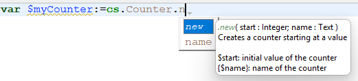

## 基本

コメントとは、コード内の実行されないテキストのことです。これらのテキストは、コード実行時にインタープリターによって無視されます。 Specific features rely on comments for documenting and tagging your code.

コメントの書き方は2通りあります:

- `//` 記号の後はすべてコメントとして扱われるため、これを使って1行のコメントが書けます
- `/* ... */` for inline or multiline comments.

これらの書き方は同時に使用できます。

### 単一行のコメント (`//コメント`)

コードの後や行の最初に `//` を使うと、その後のテキストはすべてコメントとなります。例:

```4d
// これはコメントです
For($vCounter;1;100) // ループを開始します
  // コメント
  // コメント
  // コメント
 End for
```

### インラインコメント、および複数行コメント (`/*コメント*/`)

コメントを `/*` と  `*/` で囲むと、そのあいだのテキストはコメントとなります。この方法でインラインおよびマルチラインコメントが書けます。

- **インラインコメント** はコード内のどこにでも挿入することが可能です。例:

```4d
For /* インラインコメント */ ($vCounter;1;100)
    ...
End for
```

- **Multiline comment blocks** allow commenting an unlimited number of lines. この形式のコメントは入れ子にすることができ、4D コードエディターではこれを展開したり折りたたんだりすることができます。例:

```4d
For ($vCounter;1;100)
/*
コメント  
    /* 
    詳細なコメント
    */
*/
...
End for
```

## Comments for syntax description

Comments can describe the syntax of your methods, class functions, or constructors.

- For a method, write the comment block in the first lines of the method. In the 4D code editor, comments are displayed in its [Help tips](../code-editor/write-class-method.md#help-tips) (the 5 first lines are displayed).
- For a class function or constructor, write the comment block immediately above the `Function` or `Class constructor` declaration. Comments are displayed with the signature in 4D code assistance and in VS Code (completion details, help tips, and signature help). Add a dedicated comment for every parameter with the `// $paramName: <text>` syntax (see below).

例:

```4d

// Adds or updates a local dependency (as a file URL) in the "dependencies" object of the environment file
// $folder: folder of the dependency to register
// $optionalName: optional dependency name (defaults to the folder's full name)
#DECLARE($folder : 4D.Folder; $optionalName : Text)

//...code

```

The comment block follows these rules:

- It is made of `//` lines and/or a `/* */` block. Each line of a `/* */` block is handled like a `//` line, and the `/*` and `*/` markers are not displayed.
- For a class function or constructor, it must be placed immediately above the declaration. A blank line between the comment block and the declaration breaks the association: only the signature is displayed.
- Each comment block is associated only with the next declaration, even when it is written right after the code of the previous function.
- Only the saved code is read: after you edit a comment, the code assistance shows the new text once the class is saved.
- The text is displayed as plain text: Markdown markers such as `**` or `*` are shown as written.

#### 例題 1

You want to document a function and its parameter so that they are displayed in the code editor:

```4d
// Class: Invoice

// Returns the price with taxes
// The rate is a percentage
// $rate: tax rate to apply (20 for 20%)
Function priceWithTaxes($rate : Real) : Real
	return This.price*(1+($rate/100))
```

When you type `$invoice.priceWithTaxes(` in a method, the help displays the signature with:

```
Returns the price with taxes
The rate is a percentage

$rate: tax rate to apply (20 for 20%)
```

#### 例題 2

You want to document a class constructor with a `/* */` block:

```4d
// Class: Counter
property value : Integer
property name : Text

/*
Creates a counter starting at a value
$start: initial value of the counter
{$name}: name of the counter
*/
Class constructor($start : Integer; $name : Text)
	This.value:=$start
	This.name:=$name || "default name"
```

You can display:



## Comments for specific features

### MCP tool

When a function is published as an **MCP tool**, its comments are used to provide [MCP tool code description](../WebServer/mcp-server.md#describing-the-tools), including MCP behavior tags.

### Code navigation markers

Code navigation markers such as `MARK:`, `TODO:`, and `FIXME:` are inserted through comments. See [Manual tagging](../code-editor/write-class-method.md#manual-tagging).

