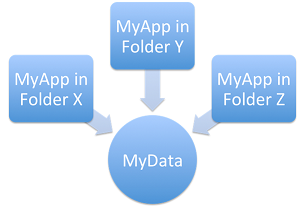
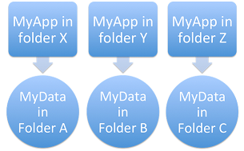
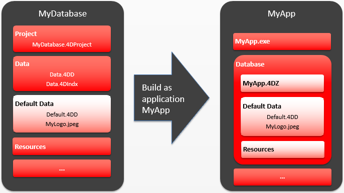

## データファイルを開く

ユーザーが組み込みアプリ、またはアプリのアップデート (シングルユーザー、またはクライアント/サーバーアプリ) を起動すると、4D は有効なデータファイルを選択しようとします。アプリケーションによって、複数の場所が順次検索されます。

組み込みアプリ起動時のオープニングシーケンスは以下のようになっています:

1. 4D は最後に開かれたデータファイルを開こうとします。詳しくは [後述の説明](#最後に開かれたデータファイル) を参照ください (これは初回起動時には適用されません)。
2. 見つからない場合、4D は .4DZ ファイルと同階層の Default Data フォルダー内にあるデータファイルを、読み取り専用モードで開こうとします。
3. これも見つからない場合、4D は標準のデフォルトデータファイルを開こうとします (.4DZ ファイルと同じ場所にある、同じ名前のファイル)。
4. これも見つからない場合、4D は "データファイルを開く" ダイアログボックスを表示します。

## 最後に開かれたデータファイル

### 最後に開かれたファイルへのパス

4D でビルドされたスタンドアロンまたはサーバーアプリケーションは、最後に開かれたデータファイルのパスをアプリケーションのユーザー設定フォルダー内に保存します。

アプリケーションのユーザー設定フォルダーの場所は、以下のコマンドで返されるパスに対応しています:

```4d
userPrefs:=Get 4D folder(Active 4D Folder)
```

データファイルパス は *lastDataPath.xml* という名前の専用ファイルに保存されます。

これにより、アプリケーションのアップデートを提供したときにも、ローカルのユーザーデータファイル (最後に使用されたデータファイル) が初回の起動から自動的に開かれます。

このメカニズムは標準的な運用に適しています。しかしながら特定の場合、たとえば組み込みアプリケーションを複製した場合などにおいて、データファイルとアプリケーションのリンクを変えたいことがあるかもしれません (次章参照)。

### データリンクモードの設定

コンパイルされたアプリケーションでは、4D は最後に使用されたデータファイルを自動的に使用します。デフォルトでは、データファイルのパスはアプリケーションのユーザー設定フォルダー内に保存され、**アプリケーション名** でリンクされます。

異なるデータファイルを使用するために組み込みアプリを複製する場合には、この方法は適さないかもしれません。複製されたアプリは同じアプリケーションユーザー設定フォルダーを共有するため、同じデータファイルを使用することになります (最後に使用されたファイルが開かれるため、データファイル名を変更した場合でも結果は同じです)。

そのため 4D では、アプリケーションパスを使用してデータファイルとリンクすることも可能です。このとき、データファイルは特定のパスを使用してリンクされるので、最後に開かれたファイルであるかは問われません。この設定を使うには、データリンクモードの基準を **アプリケーションパス** に設定します。

このモードを使えば、組み込みアプリがいくつあっても、それぞれが専用のデータファイルを使えます。ただし、デメリットもあります: アプリケーションパッケージを移動させてしまうとアプリケーションパスが変わってしまうため、データファイルを見つけられなくなります。 この場合、ユーザーは開くデータファイルを指定するダイアログを提示され、正しいファイルを選択しなくてはなりません。 一度選択されれば、*lastDataPath.xml* ファイルが更新され、新しい "executablePath" 属性のエントリーが保存されます。

*データがアプリケーション名でリンクされている場合の複製:*


*データがアプリケーションパスでリンクされている場合の複製:*


このデータリンクモードはアプリケーションビルドの際に選択することができます。これには、次の二つの方法があります:

- Use the [Application page](building.md#application-page) or [Client/Server page](building.md#clientserver-page) of the Build Application dialog box.
- Use the **LastDataPathLookup** XML key ([single-user application](../BuildApplication/runtime-vl.md#lastdatapathlookup) or [server application](../BuildApplication/client-server.md#lastdatapathlookup)).

## デフォルトのデータフォルダーを定義する

4D では、アプリケーションビルド時にデフォルトのデータファイルを指定することができます。アプリケーションの初回起動時に、開くべきローカルデータファイルが見つからなかった場合 (前述の [オープニングシーケンス](#データファイルを開く)参照)、デフォルトのデータファイルが読み取り専用モードで自動的に開かれます。この機能を使って、組み込みアプリを初回起動したときのデータファイル作成・選択の操作をより制御することができます。

具体的には、次のような場合に対応できます:

- 新しい、またはアップデートされた組み込みアプリを起動したときに、"データファイルを開く" ダイアログが表示されるのを防ぐことができます。たとえば、デフォルトデータファイルが開かれたことを起動時に検知して、独自のコードやダイアログを実行して、ローカルデータファイルの作成や選択を促すことができます。
- デモアプリなどの用途で、読み取り専用データしか持たない組み込みアプリを配布することができます。

デフォルトのデータファイルを定義・使用するには:

- デフォルトのデータファイル (名称は必ず "Default.4DD") を、データベースプロジェクトのデフォルトフォルダー (名称は必ず "Default Data") 内に保存します。このデフォルトのデータファイルには、プロジェクト構成に応じて必要なファイルもすべて揃っている必要があります: インデックス (.4DIndx)、外部BLOB、ジャーナル、他。必ず、有効なデフォルトデータファイルを用意するようにしてください。なお、デフォルトデータファイルはつねに読み取り専用モードで開かれるため、データファイルの作成前に、あらかじめ大元のストラクチャー設定の "ログを使用" オプションを非選択にしておくことが推奨されます。
- アプリケーションをビルドすると、このデフォルトデータフォルダーが組み込みアプリに統合されます。同フォルダー内ファイルはすべて一緒に埋め込まれます。

この機能を図示すると次のようになります:



デフォルトのデータファイルが初回起動時に検知された場合、データファイルは自動的に読み取り専用モードで開かれ、データファイルの変更を伴わないカスタムオペレーションを実行できるようになります。
