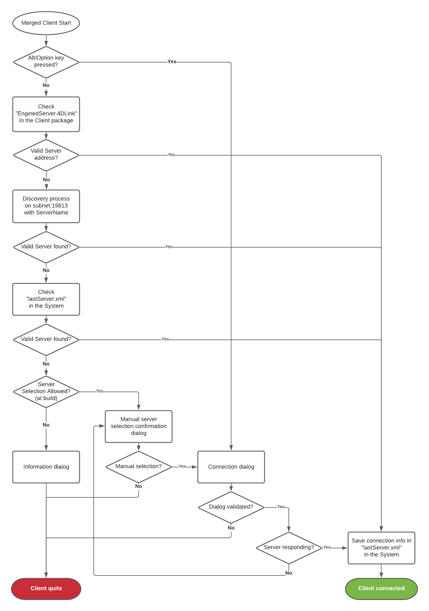
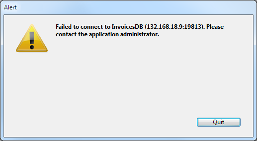
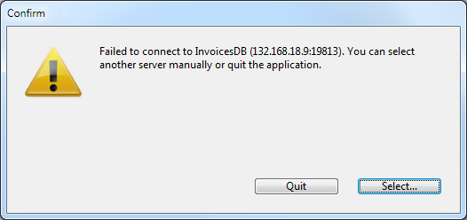
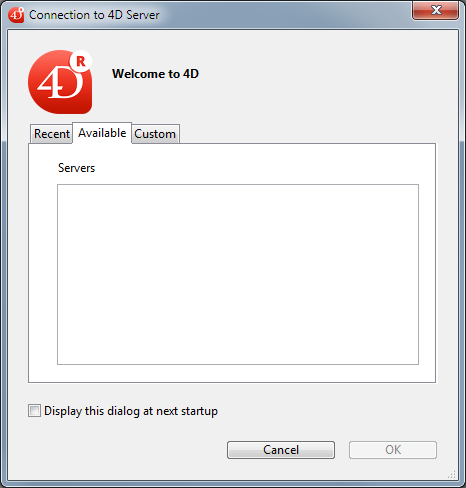

ここでは、組み込みクライアントアプリが運用環境において対象サーバーへと接続する際のメカニズムについて説明します。

## 接続シナリオ

組み込みクライアントアプリの接続プロシージャーは、専用サーバーが使用不可能な場合にも柔軟に対応します。 4Dクライアントアプリのスタートアップシナリオは、次のとおりです:

1. クライアントアプリ内の "EnginedServer.4DLink" ファイルに有効な接続情報が保存されていた場合、クライアントアプリはその指定されたサーバーアドレスへ接続を試みます。  
   またはクライアントアプリは検索サービスを使用してサーバーへの接続を試みます (同じサブネット内に公開されたサーバー名に基づいて検索します)。

2. これが失敗した場合、クライアントアプリケーションは、アプリケーションのユーザー設定フォルダーに保存されている情報 ("lastServer.xml" ファイル、詳細は後述参照) を使用してサーバーへの接続を試みます。
3. これが失敗した場合、クライアントアプリケーションは接続エラーダイアログボックスを表示します。

- ユーザーが **選択...** ボタンをクリックした場合、標準の "サーバー接続" ダイアログボックスが表示されます (ビルドの段階で許可されていた場合に限ります。詳細は後述)。
- ユーザーが **終了** ボタンをクリックした場合、クライアントアプリケーションは終了します。

4. 接続が成功した場合、クライアントアプリケーションは将来の使用のために、その接続情報をアプリケーションのユーザー設定フォルダーに保存します。

この手順を図示すると以下のようになります:



## 最後に使用したサーバーパスを保存する

最後に使用され検証されたサーバーパスは、アプリケーションのユーザー設定フォルダー内の "lastServer.xml" ファイルに自動的に保存されます。このフォルダーは次の場所に保存されています:

```4d
userPrefs:=Get 4D folder(Active 4D Folder)
```

このメカニズムは、最初に指定したサーバーが何らかの理由 (例えばメンテナンスモードなど) で一時的に使用できないケースに対応します。こういった状態が初めて起こったときにはサーバー選択ダイアログボックスが表示され (ただし許可されていた場合に限ります、後述参照)、ほかのサーバーをユーザーが手動で選択すると、その接続が成功した場合にはそのパスが保存されます。それ以降に接続ができなかった場合には、"lastServer.xml" のパス情報によって自動的に対処されます。

> - When client applications cannot permanently benefit from the discovery service, for example because of the network configuration, it is recommended that the developer provide a host name at build time using the [IPAddress](../BuildApplication/client-server.md#ipaddress) key in the "BuildApp.4DSettings" file. このメカニズムはあくまで一時的な接続不可状態の場合を想定しています。
> - スタートアップ時に **Alt/Option** キーを押しながら起動してサーバー接続ダイアログボックスを表示する方法は、すべての場合において可能です。

## エラー時のサーバー選択ダイアログボックス使用の可・不可

組み込みクライアントアプリがサーバーに接続できない場合、標準のサーバー選択ダイアログボックスを表示するかどうかは設定しておくことができます。 The configuration depends on the value of the [ServerSelectionAllowed](../BuildApplication/client-server.md#serverselectionallowed) XML key on the machine where the application was built:

- **エラーメッセージを表示し、サーバー選択ダイアログボックスを表示させない**。  
  デフォルトの挙動です。アプリケーションは終了する以外の選択肢がありません。  
  `ServerSelectionAllowed`: **False** or key omitted

  

- **エラーメッセージを表示し、サーバー選択ダイアログボックスへのアクセスを可能にする**。  
  ユーザーは **選択...** ボタンをクリックすることによって、サーバー選択ウィンドウにアクセスできます。  
  `ServerSelectionAllowed`: **True**

    
  
