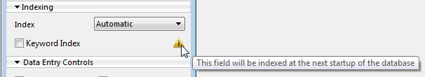

<!-- REF my.section.id.Desc -->
## 定義

[インスペクターパレット](../Develop/structure-editor.md#inspector-palette)の「定義」エリアでは、フィールドの基本プロパティを設定します。一部のプロパティは、特定のフィールド型を選択した場合にのみ使用できます。

### カラー

各フィールド名に色を割り当て、役割や属性に応じて区別できます。たとえば、一意フィールドと必須フィールドに別々の色を使用できます。また、[テーブル](../Develop/structure-tables.md#color-of-the-table-image)やリレーションごとに個別の色を設定することもできます。

1つ以上のフィールドの色を設定するには、対象を選択し、次のいずれかを使用して色を選択します:

- ストラクチャーエディターのツールバーにある**カラー ボタン**
- フィールドのコンテキストメニューにある**カラー**コマンド
- **インスペクターパレット**の**カラー**オプション

**自動**オプションを使用すると、フィールド名に標準の元の色を適用できます。

### 非表示

フィールドの**非表示**プロパティを選択すると、アプリケーション環境およびプラグインに対してフィールドを非表示にできます。この属性を設定するとユーザーからフィールドが隠されます。非表示フィールドは、アプリケーション環境に表示される4Dの標準エディターやダイアログボックスには表示されず、プラグインからも使用できません。対象となるエディターとダイアログボックスは次のとおりです:

- すべての**クエリエディター**
- **並べ替えエディター**
- **ラベルエディター**
- **クイックレポート**
- **データの書き出し／読み込み**ダイアログボックス
- **フォーミュラエディター**

これらの場所では、ユーザーはフィールドを表示したり選択したりできません。たとえば、[ラベルエディター](../Desktop/labels.md)で作成したデザインで非表示フィールドを選択することはできません。

**注記:** エディターの使用時に、ユーザーは仕様（作成したクエリや並べ替えなど）をディスク上のファイルに保存できます。この場合、後から非表示に設定したフィールドも引き続き処理に使用されます。また、ユーザーは**フォーミュラエディター**で非表示フィールドの名前を入力できます。

非表示フィールドはストラクチャーエディターのウィンドウで*イタリック体*で表示されます。

### 一意

各レコードのこのフィールドに異なる（一意の）値を保証するには、**一意**属性を使用します。この属性は、テーブル内の各レコードを一意に識別するフィールドに設定します。従業員番号、社会保障番号、発注番号などを保存するフィールドの検証に役立ちます。

一意属性は、他の値と同様に空の値の重複も禁止します。空のフィールドを別のレコードに重複して保存することはできません。

ストラクチャーエディターの[情報バー](../Develop/structure-editor.md#information-bar)には、フィールドで一意プロパティが選択されているかどうかが表示されます。

4Dでは、一意属性が設定されたフィールドにインデックスが必要です。フィールドで一意属性を選択すると、インデックスがまだ存在しない場合は作成されることを示す視覚的な表示が現れます:



エディターでは、一意フィールドのインデックスを削除できません（このフィールドの選択時には**なし**オプションやインデックス削除コマンドを使用できません）。一意フィールドのインデックスを削除するには、先に一意属性を解除してください。

### RESTリソースとして公開

このオプションは、[フィールドをRESTリクエストに公開するかどうか](../REST/configuration.md#exposing-field)を設定します。

:::note 注記

- このオプションはテーブルレベルでも設定できます。
- このオプションは[ORDAリモートデータストア機能](../ORDA/remoteDatastores.md)で使用されます。

:::

### NULL値の入力を拒否

このプロパティは、NULL値の保存を禁止します。フィールドでこのプロパティを選択すると、NULL値を保存できません。この属性が設定されたフィールドにNULL値が渡されると、エラーが生成されます。この低レベルプロパティはSQLのNOT NULL属性に正確に対応します。

:::note

4Dのフィールドには「必須」属性（以下を参照）も設定できます。両者は似ていますが、適用範囲が異なります。「必須」属性はデータ入力を制御する一方、「NULL値の入力を拒否」属性はデータベースエンジンのレベルで動作します。

:::

### NULL値を空の値にマップ

このプロパティを使用すると、4Dランゲージでフィールドの「空の」値とNULL値を一貫して処理できます。

:::warning ORDAとの互換性

NULL値が完全にサポートされている[ORDA](../ORDA/overview.md)ベースの開発では、このオプションの使用は推奨されません。

:::

互換性のため、4Dデータベーステーブルに保存されたNULL値は、4Dランゲージで操作される際に自動的にデフォルト値に変換されます。たとえば、次のステートメントの場合:

```4d
$myTextVar:=[myTable]myTextField
```

*myTextField*フィールドにNULL値が含まれていると、*$myTextVar*変数には""（空の文字列）が格納されます。[デフォルト値](../Concepts/data-types.md#default-values)はデータ型によって異なります。一方、このメカニズムはクエリなど、4Dデータベースエンジンレベルで実行される処理には原則として適用されません。そのため、「空の」値（例: $myvalue=0）を検索してもNULL値を格納するレコードは見つからず、その逆も同様です。同じフィールドのレコードにデフォルト値とNULL値の両方が存在する場合、一部の処理の結果が変わったり、追加コードが必要になったりすることがあります。このような問題を避けるため、**NULL値を空の値にマップ**オプションを使用して、4Dランゲージでの処理を統一できます。このプロパティを使用すると、NULL値を格納するフィールドは常にデフォルト値を格納するものとして扱われます。

:::note 注記

- 生成されていないUUID形式のAlphaフィールドはNULLとして扱われません（UUID形式を参照）。
- このプロパティはデータベースエンジンの非常に低いレベルで考慮されます。特に[`Is field value Null`](../commands/is-field-value-null)コマンドに作用します。

:::

### 自動インクリメント

**自動インクリメント**プロパティは、テーブル内で連番を生成します。[Integer、Long Integer、Integer 64 bits型](../Concepts/data-types.md)のフィールドで使用できます。

このプロパティを持つフィールドは、テーブルにレコードが作成されるたびに自動でインクリメントされます。割り当てられる連番は、4Dが管理するテーブルの「内部カウンター」の値に対応します。この内部カウンターには、4Dコマンド[`Sequence number`](../commands/sequence-number)、[`Get database parameter`](../commands/get-database-parameter)、および`#N`マーカー（デフォルト値を参照）からもアクセスできます。

レコードが削除されても、割り当てられた番号がテーブル内で再利用されることはありません。キャンセルされたトランザクション中に生成された番号は「失われます」。自動インクリメントプロパティはSQLのAUTO_INCREMENT属性に対応します。この属性を持つフィールドでは、[インスペクター](../Develop/structure-editor.md#inspector-palette)のSQL情報エリアにもAUTO INCREMENTラベルが表示されます。

:::warning

生成時にはテーブル内で一意であっても、自動インクリメントされた番号をレコードの一意ID主キーとして使用することは推奨されません。特に複数のデータファイルでストラクチャーを使用する場合、内部カウンターが同期しなくなる可能性があります。また、テーブルの内部カウンターは[`SET DATABASE PARAMETER`](../commands/set-database-parameter)コマンドでリセットできます。レコードの一意IDを作成するには、次の利点があるUUIDの使用を強く推奨します:

- UUIDはすべてのテーブルおよびデータベース間で一意のIDを生成します。
- UUIDを生成するには、**Auto UUID**オプション（以下を参照）と[`Generate UUID`](../commands/generate-uuid)コマンドを組み合わせることができます。

:::

### レコード内、データファイル内、またはデータファイル外に保存

このオプションメニューは、Text、BLOB、Picture、Object [型](../Concepts/data-types.md)のフィールドでのみ使用できます。フィールドデータの保存場所を設定できます。

#### レコード内

データは各レコードとともに保存されます。通常、大量のデータを含むフィールドにはこのオプションを選択しないでください。ただし、標準的なB-Treeインデックスを使用するにはこの保存形式が必要なため、Textフィールドではデフォルトで選択されています。Textデータをレコード外に保存する場合、インデックス選択メニューは非表示になります。

#### データファイル内

データはデータファイル内に保存されますが、各レコードの外部に保存されます。このオプションはBLOBおよびPictureフィールドでデフォルト選択されています。大量データを扱う場合、テキスト、ピクチャー、Blob、オブジェクトをレコード外に保存するとデータベースの動作を最適化できます。

#### データファイル外

データは[データファイル](../Project/architecture.md#data)の外部にある別ファイルに保存されます。このオプションについては「外部データの保存」で説明しています。

:::note 注記

- このオプションは、以降にテーブルで作成される新規レコードにのみ適用されます。既存レコードのあるテーブルでこのオプションを設定しても、既存レコードは変更されず、テーブルは内部／外部の混在保存モードで動作します。既存レコードにも適用するには、[データを圧縮](../MSC/compact.md)し、[**レコードを強制更新**](../MSC/compact.md#force-updating-of-the-records)オプションを使用します。
- データファイル外に保存されたデータは、[データ暗号化機能](../MSC/encrypt.md)が有効な場合でも暗号化されません。
- このオプションは[Object型フィールド](../Concepts/dt_object.md)では使用できません。

:::

#### 内部保存の最大サイズ

最適化のため、BLOB、Picture、Text、Object型フィールドのデータはデフォルトでレコード外またはデータファイル外に保存されます。パフォーマンス上、サイズが限られたデータをレコード内に強制保存するとよい場合があります。サイズにばらつきのあるBLOB、Picture、テキスト、オブジェクトデータをアプリケーションで扱う場合に特に有効です。ここで指定する値は、これを下回るサイズのフィールドデータをレコード内に保存するしきい値（バイト単位）です。たとえばPictureフィールドに30,000を指定すると、20 KBの画像はレコード内に、40 KBの画像は設定された保存場所（データファイル内または外）に保存されます。デフォルト値は0で、フィールドデータはすべてレコード外に保存されます。

### UUID形式

このプロパティは[Alpha型](../Concepts/data-types.md)フィールドで使用できます。フィールドにUUID識別子を保存することを示します。保存するデータはUUID形式（32個の文字（A-F、a-f）と数字（0-9）の組み合わせ）に準拠する必要があります。[**Auto UUID**](#auto-uuid)プロパティ、[`Generate UUID`](../commands/generate-uuid)コマンド、または任意のカスタムアルゴリズムを使用できます。

UUID形式に準拠しない文字列をこのフィールドに保存しようとすると、4Dが自動的に変換します。同じ処理は、UUIDフィールドに変換された既存の非Alphaフィールドの内容にも適用されます。レコードの読み込み時に値が再フォーマットされ、再保存されます。

UUID形式プロパティが設定されたフィールドはフォームに表示でき、編集も可能です。内容は大文字で表示されます。小文字で表示するには変数を経由する必要があります。

:::note 注記

- UUID形式のフィールドをキーワードインデックスや選択リストに関連付けることはできません。
- UUID形式を持つ2つのフィールド間にはリレーションを作成できますが、標準AlphaフィールドとUUID形式のフィールドを関連付けることはできません。
- 初期化（生成）されたUUIDフィールドの値がNULLの場合、空の文字列を返します。生成されていないUUIDフィールドはNULLではなく、「000...」を返します（ゼロの数は文字数と同じです）。生成されていないUUIDフィールドでは、このプロパティは考慮されません（「000...」と表示されます）。

:::

#### Auto UUID

このオプションは[**UUID形式**](#uuid-format)プロパティを選択した場合にのみ有効です。**Auto UUID**プロパティを使用すると、フィールドにUUID番号が自動生成されます。

UUIDは次の場合に自動計算されます:

- レコードが作成されたとき
- UUIDフィールドにNull値を含むレコードが読み込まれたとき。これは特に、テーブルにUUIDフィールドを追加する前に作成、保存されたレコードで、[**NULL値を空の値にマップ**](#map-null-values-to-blank-values)オプションが選択されていなかった場合に発生します。

いずれの場合も、自動生成されたUUIDをフィールドに保存するにはレコードを保存する必要があります。

:::note

このプロパティを選択していても、データ読み込み時に4Dは新しい番号を生成せず、読み込まれた値を使用します（形式が無効な場合は必要に応じて変換します）。ただし、読み込まれたフィールドの値が空の場合はUUIDが自動生成されます。

:::

<!-- END REF -->

### タグのないテキストに対するクエリと並べ替え

このプロパティはText型およびAlpha型フィールドで使用できます。選択すると、フィールドに保存されたデータへのクエリや並べ替えでスタイルタグが考慮されません。

このオプションは、フォームの同じテキストエリア内で複数のスタイル（リッチテキスト）を適用できる4Dの機能に関連しています。詳細については、「マルチスタイル（リッチテキストエリア）」を参照してください。

スタイルはテキストにHTMLタグを挿入して定義します。これらのタグはテキストエリアの表示時に解釈されます。

スタイルタグはデータとともに保存されます。たとえば、Textフィールドに「week end」と入力すると、4Dは`"week <SPAN STYLE = "color: #D81E05">end</SPAN>"`を保存します。この処理はフォーム上ではユーザーに対して透過的です。ただしクエリや並べ替えでスタイルタグを無視するには、専用の設定が必要です。フィールドに対してストラクチャーエディターで「タグのないテキストに対するクエリと並べ替え」オプションを選択した場合にのみ、「week end」という語句を検索できます。

注記: このオプションを使用したフィールドデータのテキスト値に対するクエリは、4Dで次のステートメントを実行するのと同じです:

```4d
QUERY BY FORMULA(OBJECT Get plain text(thefield)="thevalue")
```

### インデックス

インデックスプロパティは、BLOBとPictureを除くすべてのフィールド型で使用できます。キーワードインデックスプロパティは、Alpha、Text、Picture型のフィールドで使用できます。

インデックスを使用すると、データ処理と検索を高速化できます。

インデックスの管理については「インデックスの作成と変更」で詳しく説明しています。

## データ入力コントロール

フォームレベルで、フィールドや入力可能オブジェクトにデータ入力コントロールを設定できます。これらのコントロールは、特定のフォームでユーザーがフィールドまたは入力可能オブジェクトに入力できる内容を制限します。

### 必須

フィールドに必須属性を設定すると、データ入力時にユーザーはそのフィールドに値を入力しなければなりません。必須フィールドが空のレコードは4Dに受け付けられません。データベースに不可欠な情報を含むフィールドに必須属性を設定してください。各レコードを一意に識別するフィールドが適しています。レコードの整合性を守るため、社会保障番号、請求書番号、特定の日付、従業員番号などに設定するとよい場合があります。

特定のフォームでフィールドにこの属性を設定することもできます。ストラクチャーエディターで必須属性を選択すると、個別フォームで解除できません。一方、ストラクチャーエディターで必須属性が設定されていないフィールドに、フォーム上で属性を適用できます。フォームで必須属性を設定する方法については、「入力可／必須属性とフィールドプロパティ」セクションを参照してください。

注記: 4Dでは、フィールドに「NULL値の入力を拒否」プロパティを設定することもできます（上記を参照）。両者は似ていますが、適用範囲が異なります。「必須」属性はデータ入力を制御し、「NULL値の入力を拒否」属性はデータベースエンジンレベルで動作します。

### 変更不可

この属性をフィールドに設定すると、4Dは最初に入力された値を検証しますが、レコード保存後にユーザーが値を変更することを許可しません。ユーザーがフィールドを編集できるのは、レコードの新規作成時、検証前のみです。レコードを保存するとフィールドの値は編集できなくなります。このオプションを解除した後に、メソッドまたはデザイン環境でのみ値を変更できます。

受信日や支払日など、監査証跡が必要なフィールドに変更不可属性を使用します。テーブル内の各レコードを一意に識別するフィールドにもよく使用されます。

注記: この属性は、ページモードの入力フォームに表示されるフィールドでのみ機能します。リスト入力や、リスト／ページモードのサブフォームでの入力など、その他の場合はフィールドの値を変更できます。

### 表示のみ

表示のみ属性を設定したフィールドには、キーボードから値を入力できません。このようなフィールドにはデフォルト値を使用するか、値を挿入するメソッドを記述する必要があります。計算済み合計やメソッドで割り当てられた連番など、データベースユーザーに変更させたくない値の表示に便利です。

特定のフォームで任意のフィールドを入力不可にすることもできます。詳細については、「入力可／必須属性とフィールドプロパティ」セクションを参照してください。

### 複数行

このオプションはText型フィールドでのみ使用できます。選択すると、以降に作成されるフォームでTextフィールドが自動的に複数行テキストに設定されます。デフォルトの特性は次のとおりです:

- 複数行に対応した高さ
- 水平スクロールバー
- 実行時にキャリッジリターンを入力すると改行

このオプションを選択しない場合、フォーム上のTextフィールドのデフォルト表示はAlphaフィールドと同じです。高さは1行分でスクロールバーはなく、キャリッジリターンを入力するとフォームの次のフィールドに移動します。

フィールドのデフォルト表示はフォームエディターでいつでも変更できます。

### 選択リストを許可

フィールドへの情報入力時に選択リストを表示するには、「選択リストを許可」属性を使用します。まずリストエディターで選択リストを作成する必要があります（「リスト」を参照）。

この属性を使用すると、フィールドへの入力内容を標準化し、入力ミスを防げます。有効な値や一般的な値が限られているフィールドに適しています。選択リストを使用しても、リストにない値をユーザーが入力できる場合があります。

特定のフォームでフィールドに選択リストを割り当てることもできます。ただし、フォームのみにリストを割り当てた場合、そのリストはクエリエディターなど他のエディターやダイアログボックスには表示されません。フォームで選択リストを使用する方法については、「データ入力コントロールと入力支援」セクションを参照してください。

注記: フォームレベルで必須値と除外値の選択リストを設定することもできます。

「選択リストを許可」オプションを選択すると、関連するドロップダウンメニューが有効になります。既存の選択リストを選んでフィールドに割り当てるか、[...]をクリックしてリストエディターを直接開くことができます（「リスト」を参照）。

### ヘルプTip

フィールドにヘルプTipを追加して、ユーザーに補足情報を提供できます。ヘルプTipエリアに入力したテキストは、フィールドを含むフォーム上でユーザーがポインターを合わせるとフィールドの横に表示されます。ヘルプTipはすべてのプラットフォームで表示されます。

ユーザーがマウスポインターをフィールドに合わせると、次の例のようにTipがフィールドの下に表示されます:

注記: SET DATABASE PARAMETERコマンドのTips enabledセレクターを使用して、アプリケーションのヘルプTipを一括で有効または無効にできます。

フィールドにヘルプメッセージを関連付ける方法は、ほかに2つあります:

- フォームエディターのレベルで設定します。この場合、フィールドのヘルプTipは他のフォームには表示されません。フォームでのヘルプTipの使用については、「ヘルプメッセージ」セクションを参照してください。
- 現在のプロセスに対してOBJECT SET HELP TIPコマンドを使用します。

### コメント

インスペクターパレットのコメントエリアには、フィールドに関する追加情報を保存できます。このコメントはすべての開発者が参照できます。各テーブルとリレーションにも個別のコメントエリアがあります。

### SQL

インスペクターパレットのSQLエリアには、SQLランゲージでフィールドを使用する際に役立つ情報が表示されます。

特に、フィールド名がSQLの命名規則に準拠しているかを示します（たとえば、4Dとは異なりSQLではフィールド名に空白を使用できません）。

注記: SQLにはSQL関数やキーワードを含む予約語のリストも定義されています。予約語はメソッドエディターで確認できます。

フィールドのSQL情報エリアには、SQL属性（型とプロパティ）も表示されます。
