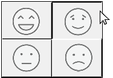
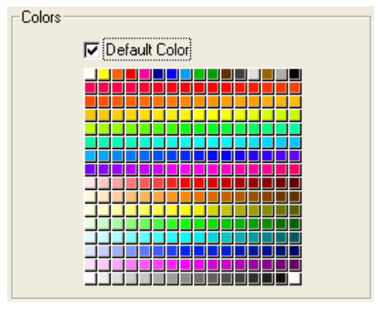

ボタングリッドは透明なオブジェクトであり、画像の最前面に配置されます。おもに、列と行の配列を表現する画像との組み合わせで使用します。ユーザーがグラフィック上でクリックすると、そこが凹んだように描画されます。

ボタングリッドのオブジェクトを使用すると、グラフィック上でユーザーがクリックした場所を判別することができます。オブジェクトメソッドでは `On Clicked` イベントを使用し、クリックされた場所に応じて適切な動作を実行します。

## ボタングリッドの作成

ボタングリッドを作成するには、背景グラフィックをフォームに追加し、その最前面にボタングリッドを配置します。"行列数" テーマの [行](properties_Crop.md#行) と [列](properties_Crop.md#列)
に行数と列数を指定します。

4D では、カラーパレットにボタングリッドが使用されています:

## ボタングリッドの使用

グリッド上のボタンには、左上から右下に向けて番号が振られます。上の例で、グリッドは 16列×16行で構成されています。左上にあるボタンはクリックされると 1 を返します。 2行目の右端にある赤いボタンが選択されると、ボタングリッドは 32 を返します。選択されたボタンがなければ、0が返されます。

### ページ指定アクション

ボタングリッドにページ指定用の `gotoPage` [標準アクション](/Desktop/standard-actions)を割り当てることができます。この標準アクションを設定すると、4D はボタングリッドで選択されたボタンの番号に相当するフォームページを自動的に表示します。たとえばグリッド上の 10 番目のボタンを選択すると、4D は現在のフォームの 10 ページ目を表示します (存在する場合)。

## プロパティ一覧

[Border color](./properties_BackgroundAndBorder.md#border-color) - [Border Line Style](properties_BackgroundAndBorder.md#border-line-style) - [Bottom](properties_CoordinatesAndSizing.md#bottom) - [Class](properties_Object.md#css-class) - [Columns](properties_Crop.md#columns) - [Height](properties_CoordinatesAndSizing.md#height) - [Help Tip](properties_Help.md#help-tip) - [Horizontal Sizing](properties_ResizingOptions.md#horizontal-sizing) - [Left](properties_CoordinatesAndSizing.md#left) - [Object Name](properties_Object.md#object-name) - [Right](properties_CoordinatesAndSizing.md#right) - [Rows](properties_Crop.md#rows) - [Standard action](properties_Action.md#standard-action) - [Top](properties_CoordinatesAndSizing.md#top) - [Type](properties_Object.md#type) - [Variable or Expression](properties_Object.md#variable-or-expression) - [Vertical Sizing](properties_ResizingOptions.md#vertical-sizing) - [Width](properties_CoordinatesAndSizing.md#width) - [Visibility](properties_Display.md#visibility)

## サポートされるイベント

[On Begin Drag Over](../Events/onBeginDragOver.md) - [On Clicked](../Events/onClicked.md) - [On Double Clicked](../Events/onDoubleClicked.md) - [On Drag Over](../Events/onDragOver.md) - [On Drop](../Events/onDrop.md) - [On Header](../Events/onHeader.md) - [On Load](../Events/onLoad.md) - [On Getting focus](../Events/onGettingFocus.md) - [On Mouse Enter](../Events/onMouseEnter.md) - [On Mouse Leave](../Events/onMouseLeave.md) - [On Mouse Move](../Events/onMouseMove.md) - [On Printing Break](../Events/onPrintingBreak.md) - [On Printing Detail](../Events/onPrintingDetail.md) - [On Printing Footer](../Events/onPrintingFooter.md) - [On Unload](../Events/onUnload.md) - [On Validate](../Events/onValidate.md)