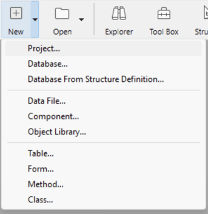

## プロジェクトの作成

新規の 4Dアプリケーションプロジェクトは **4D** または **4D Server** アプリケーションを使って作成します。いずれの場合も、プロジェクトファイルはローカルマシン上に保存します。いずれの場合も、プロジェクトファイルはローカルマシン上に保存します。

新規プロジェクトを作成するには:

1. 4D または 4D Server を起動します。
2. 次のいずれかの方法をおこないます:
   - **ファイル** メニューより \*\*新規 > プロジェクト...\*\*を選択します: 
   - (4D のみ) **新規** ツールバーボタンより \*\*プロジェクト...\*\*を選択します:
 標準の **保存** ダイアログが表示され、4D プロジェクトの名前と保存場所を指定します。

:::note

**データベース...** および **ストラクチャー定義を使用したデータベス...** の項目は、環境設定において[**バイナリー形式のデータベース作成を有効化する** オプション](../Preferences/general.md#バイナリー形式のデータベース作成を有効化する) をチェックしている場合にのみ利用可能です。

:::

3. プロジェクトフォルダー名を入力したら、**保存**をクリックします。この名称はつぎの場所に使用されます: この名称はつぎの場所に使用されます:

   - プロジェクト全体を保存するフォルダーの名称
   - ["Project" フォルダー](../Project/architecture.md#project-フォルダー) 内の最初の階層にある .4DProject ファイルの名称

OS によって許可されている名称であれば使用可能です。しかしながら、異なる OS での使用を予定していたり、ソース管理ツールを利用したりするのであれば、それらの命名規則を考慮する必要があります。

**保存** ダイアログを受け入れると、4D は開いているプロジェクト (あれば) を閉じ、指定の場所にプロジェクトフォルダーを作成し、プロジェクトに必要なファイルを設置します。(詳細については [4D プロジェクトのアーキテクチャー](Project/architecture.md) を参照ください)。(詳細については [4D プロジェクトのアーキテクチャー](Project/architecture.md) を参照ください)。

これで、プロジェクトの開発を始めることができます。

## プロジェクトを開く

既存のプロジェクトを 4D で開くには:

1. 次のいずれかの方法をおこないます:

   - **ファイル** メニューより \*\*開く ＞ ローカルプロジェクト...\*\*を選択するか、**開く** ツールバーボタンより同様に選択します。
   - Welcome ウィザードにて **ローカルアプリケーションプロジェクトを開く** を選択します。

標準のファイルを開くためのダイアログが表示されます。

2. プロジェクトの ["Project" フォルダー](../Project/architecture.md#project-フォルダー) 内にある `.4dproject` ファイルを選択し、**開く** をクリックします。

   デフォルトで、プロジェクトはカレントデータファイルとともに開かれます。ほかにも、次のファイルタイプを選択できます: ほかにも、次のファイルタイプを選択できます:

   - *圧縮されたプロジェクトファイル*: `.4dz` 拡張子 - 運用プロジェクト
   - *ショートカットファイル*: `.4DLink` 拡張子 - プロジェクトやアプリケーションを起動する際に必要な追加のパラメーターを格納しています (アドレス、認証情報、他)
   - *バイナリーファイル*: `.4db` または `.4dc` 拡張子 - 従来の 4D データベース形式

:::note

4D [CLI (コマンドラインインターフェース)](../Admin/cli.md) により、インターフェースなしで 4Dプロジェクトを起動することもできます。

:::

### オプション

標準のシステムオプションに加え、4D が提供する *開く* ダイアログボックスには、*開く* と**データファイル** という、2つのオプションがあります。

- **開く** - プロジェクトを開くモードを指定できます:
  - **インタープリター** または **コンパイル済み**: これらのオプションは、選択したプロジェクトが [インタープリターおよびコンパイル済みコード](Concepts/interpreted.md) を含んでいる場合に選択可能となります。
  - **[Maintenance Security Center](MSC/overview.md)**: 損傷を受けたプロジェクトに必要な修復を施すために、保護モードでプロジェクトを開きます。

- **データファイル** - プロジェクトで使用するデータファイルを指定できます。デフォルトでは、**現在のデータファイル** オプションが選択されています。**データファイル** - プロジェクトで使用するデータファイルを指定できます。デフォルトでは、**現在のデータファイル** オプションが選択されています。 4D では同じプロジェクトに対して異なるデータファイルを使用することができるため、このメニューには二つの追加のオプションが提供されています。
  - **他のデータファイルを選択**: プロジェクトを、カレントのものとは異なる既存のデータファイルで開きます。このオプションを選択して**開く** をクリックした場合、標準のファイルを開くダイアログボックスが開かれ、データファイルを選択することができます。このオプションを選択して**開く** をクリックした場合、標準のファイルを開くダイアログボックスが開かれ、データファイルを選択することができます。
  - **新しいデータファイルを作成**: プロジェクトに対して空のデータファイルを作成します。このオプションを選択して**開く** をクリックした場合、標準のファイルを保存ダイアログボックスが開かれます。このオプションを選択して**開く** をクリックした場合、標準のファイルを保存ダイアログボックスが開かれます。

:::note

データの整合性を保持するため、4D は、カレントのプロジェクトによって作成されたものではないデータファイルの場合にはそれを開くことを許可しません。プログラムは、データファイルとプロジェクトファイルに対して作成時とプロジェクトの変換時に、内部的なリンク番号(UUID) を自動的に割り当てます。これらの番号はデータファイルが開かれるときに検証されます。プログラムは、データファイルとプロジェクトファイルに対して作成時とプロジェクトの変換時に、内部的なリンク番号(UUID) を自動的に割り当てます。これらの番号はデータファイルが開かれるときに検証されます。

:::

カレントのデータファイルを変更したあとは、4D はその後そのファイルをデフォルトで開くようになります。データファイルを移動したり名称変更したりした場合には、そのファイルを再度指定する必要があります。キーボードショートカットを使用することで起動時にデータファイルを変更することが可能です(以下参照)。カレントのデータファイルは、[MSC の情報ページ](../MSC/information.md#データ)においていつでも閲覧することができます。

### メンテナンスダイアログを起動

プロジェクトが正常に起動しない、あるいは異なるデータファイルに切り替えたいなど、起動シークエンスを中断したいような場合には、データベース開始時に**Alt** (Windows) あるいは **Option** (macOS) キーを押すことでスタートアップメンテナンスダイアログボックスを表示することができます。

以下のメンテナンスオプションが利用可能です:

- **アプリケーションをデフォルトのデータファイルで開く**: 標準の開始プロセスをそのまま継続します。
- **他のデータファイルを選択** / **新しいデータファイルを作成**: データファイルを切り替えることができます(上記参照)。
- **バックアップファイルを復元**: 標準のファイルを開くダイアログボックスが開かれ、[復元](../Backup/restore.md#手動でバックアップから復元する-標準ダイアログ) したいバックアップファイル(.4bk) またはジャーナルファイル(.4bl) を選択することができます。
- **MSC を開く**: プロジェクトを[メンテナンスモード](../MSC/overview.md#メンテナンスモードでの表示) で開きます。

## プロジェクトを開く (その他の方法)

4D では、開くダイアログを経由しなくてもプロジェクトを開くことのできる方法がいくつかあります:

- **ファイル** メニューまたは**開く** ツールバーボタンの**最近開いたプロジェクトを開く / {プロジェクト名}** サブメニューを使用する。  
    
  
- `.4DLink` ファイルをダブルクリックするか4D アプリケーション上にドラッグ&ドロップする(以下参照)。
- 環境設定の**開始時** 設定を[**最後に使用したプロジェクトを開く**](../Preferences/general.md#開始時) に設定する。

:::note 注記

- Windows 上では、4D Server プロジェクトが[サービスとして登録](../server/service.md) されていれば、セッションの開始時に自動的に開始されるようにすることができます。
- [ビルドされた4D アプリケーション](../Desktop/building.md) はアプリケーションアイコンをダブルクリックすることで起動することができます。

:::

## 4DLinkファイルについて

`.4DLink` 拡張子が付いたファイルは XMLファイルで、ローカルまたはリモート4Dプロジェクトの開始を簡略化・自動化するための設定を格納します。

`.4DLink` ファイルは、4Dプロジェクトのアドレスや接続識別子を保存し、プロジェクトを開くための操作を短縮します。

ローカルプロジェクトを初めて開くとき、またはサーバーに初めて接続するとき、4D は `.4DLink` ファイルを自動生成します。このファイルは、次の場所にあるローカル環境設定フォルダーに置かれます: このファイルは、次の場所にあるローカル環境設定フォルダーに置かれます:

- Windows: C:\Users\UserName\AppData\Roaming\4D\Favorites vXX\
- macOS: Users/UserName/Library/Application Support/4D/Favorites vXX/

XX はアプリケーションのバージョン番号を意味します。たとえば、4D v19 なら "Favorites v19" となります。たとえば、4D v19 なら "Favorites v19" となります。

このフォルダーには、2つのサブフォルダーがあります:

- **Local** フォルダーには、ローカルプロジェクトの開始に使用できる `.4DLink` ファイルが格納されます。
- **Remote** フォルダーには、最近のリモートプロジェクトの `.4DLink` ファイルが置かれます。

`.4DLink` ファイルは XMLエディターで作成することもできます。

`.4DLink` ファイルを構築するために使用できる XMLキーを定義した DTD が4D より提供されます。この DTD は database_link.dtd という名前で、4Dアプリケーションの `\Resources\DTD\` サブフォルダーにあります。この DTD は database_link.dtd という名前で、4Dアプリケーションの `\Resources\DTD\` サブフォルダーにあります。

