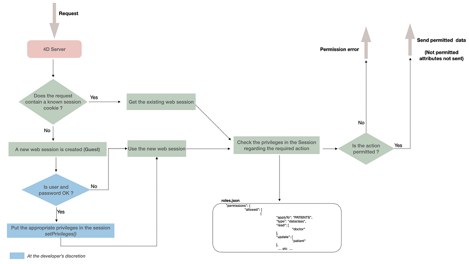

ORDA セキュリティアーキテクチャーはWeb およびREST セッションに対してプロジェクトリソースへのアクセスを制御します。これを使用するとデータストア、データクラス、属性、関数といったリソースに対する特定の権限を付与することができます。

## 概要

セキュリティモデルは**privileges**、**actions** (`read` や `create` などのアクション)、および**resources** などを組み合わせて構成されています。

[`Session.setPrivileges()`](../API/SessionClass.md#setprivileges) を使用して**session** に権限を割り当てます。

各リクエストはプロジェクトの`roles.json` ファイル内で定義されているパーミッションに対してチェックされます。未認証のアクションは権限エラーを起こします。読み出し(read)権限がない属性はレスポンスから省略されます。



:::tip 関連したBlog 記事

[**Filter access to your data with a complete system of permissions**](https://blog.4d.com/filter-access-to-your-data-with-a-complete-system-of-permissions/)

:::

:::info

パーミッションは、データストアオブジェクトや関数へのアクセスを制御します。特定の条件に基づいて読み取りデータをフィルタリングしたい場合は、[制限付エンティティセレクション](entities.md#制限付エンティティセレクション) の利用がより適切かもしれません。

:::

## スコープ

Permissions apply to **web and REST sessions**: [REST requests](../REST/gettingStarted.md), including [Qodly pages](https://developer.4d.com/qodly/4DQodlyPro/pageLoaders/pageLoaderOverview), [`Open datastore`](../commands/open-datastore) sessions, [MCP sessions](../WebServer/mcp-server.md) and **4D code executed in a web process**. これには[公開された関数](./ordaClasses.md)、[HTTP リクエストハンドラ](../WebServer/http-request-handler.md)、[On Web Connection データベースメソッド](../commands/on-web-connection-database-method)、 およびそれらが呼び出すあらゆるコードが含まれます。例えば、関数がデータクラスを読み出すがセッションに読み出しのパーミッション(許可)がない場合には、許可された関数の呼び出しも失敗します。

:::info 例外

[共有シングルトン](../Concepts/classes.md#共有シングルトン) あるいは [シングルトンクラス](../Concepts/classes.md#シングルトンクラス) の**execute** パーミッションは、関数が[REST 経由で呼び出された](../REST/$singleton.md) ときにのみチェックされます。 Web セッション内で実行された4D コードがそれ(`cs.MySingleton.me.myFunction()`) を直接呼び出した場合、パーミッションは何もチェックされません。これはどちらの場合にもチェックされるデータクラス、エンティティ、エンティティセレクションおよびデータストア関数などとは異なります。

:::

パーミッションは、[デスクトップセッションコード](../Desktop/sessions.md)(スタンドアロン、クライアント/サーバー、ストアドプロシージャー) あるいは [tool4d](../Admin/cli.md#tool4d) に対して適用されることは決してありません。

:::warning

パーミッションエントリが宣言されていない[権限](#権限とロール) を参照する場合、4D はエラーをログに記録し、そのエントリを無視します。この場合、パーミッションは無視されます。[デフォルトの制限モード](#制限モード) が有効化されていない場合、リソースは`guest` セッションからアクセス可能となります。

:::

## リソース

4D は、リソースがアクセスされるときにセッションのパーミッションをチェックします。以下のリソースは特定のパーミッションを持つことができます:

| リソース                                                                                                                      | `applyTo`                 | `type`            |
| ------------------------------------------------------------------------------------------------------------------------- | ------------------------- | ----------------- |
| [データストア](./dsMapping.md#datastore)                                                                                        | `ds`                      | `datastore`       |
| [データストアクラス関数](./ordaClasses.md#datastore-class)                                                                           | `ds.<function>`           | `method`          |
| [データクラス](./dsMapping.md#dataclass)                                                                                        | `<Dataclass>`             | `dataclass`       |
| [属性](./dsMapping.md#属性) ([計算属性](./ordaClasses.md#計算属性-1) および[エイリアス属性](./ordaClasses.md#エイリアス属性-1) を含む) | `<Dataclass>.<attribute>` | `attribute`       |
| [データクラス、エンティティまたはエンティティセレクション関数](./ordaClasses.md)                                                                        | `<Dataclass>.<function>`  | `method`          |
| [共有シングルトン](../Concepts/classes.md#共有シングルトン) (ただし公開された関数を除く)                                            | `<Singleton>`             | `singleton`       |
| [シングルトン関数](../Concepts/classes.md#シングルトンクラス)                                                                              | `<Singleton>.<function>`  | `singletonMethod` |

パーミッションを[`roles.json`](#rolesjson-ファイル) 内で定義する際には、上記の表の`applyTo` および `type` の値を使用してください。

:::note ORDA クラス関数の権限の設定

`roles.json` 内では、以下のシンタックスを使用して`applyTo` 内でORDA クラス関数を識別します:

```json
<DataclassName>.<functionName>
```

例えば、以下の関数にパーミッションを適用したい場合を考えます:

```4d
// cs.CityEntity class
Class extends Entity
  Function getPopulation() : Integer
   ...
```

この場合、以下の値を使用します:

```json
"applyTo":"City.getPopulation"
```

パーミッションはデータクラスと関数名で関数を識別するため、異なるORDA クラス(エンティティ、エンティティセレクション、データクラス)で同じ名前をもつ関数を異なる権限に割り当てることはできません。その場合にはそれぞれ個別の名前をつけてください。例えば、`cs.CityEntity` および `cs.CitySelection` 内の`dropEntity()` および `dropSelection()` 関数は、それぞれ以下のように名前をつけます:

```json
	"permissions": {
		"allowed": [
			{
				"applyTo": "City.dropEntity",
				"type": "method",
				"execute": [
					"cityAdmin"
				],
				"promote": [
					"name"
				]
			},
			{
				"applyTo": "City.dropSelection",
				"type": "method",
				"promote": [
					"name"
				]
			}
		]
	}
}
```

:::

## パーミッション

**パーミッション** は、リソースに対するアクションを許可します。例えば`ds.myTable.myFunction()` を実行するなどです。パーミッションは[`roles.json`](#rolesjson-ファイル) 内で定義され、一つまたは複数の[権限](#権限とロール) に対して付与されます。

リソースに対してパーミッションが何も定義されていなければ、そこへのアクセスはプロジェクトの[制限モード](#制限モード) に依存します。

### 許諾アクション

利用可能なアクションは、リソースに依存します:

| 動作                                                    | データストア                                                                           | データクラス                                                           | 属性                                                               | Function                                                                                                                                                                                                     |
| ----------------------------------------------------- | -------------------------------------------------------------------------------- | ---------------------------------------------------------------- | ---------------------------------------------------------------- | ------------------------------------------------------------------------------------------------------------------------------------------------------------------------------------------------------------ |
| **create**                                            | 任意のデータクラス内にてエンティティを作成する                                                          | 当該データクラス内にてエンティティを作成する                                           | 当該属性にデフォルト以外の値でエンティティを作成する(エイリアス属性の場合は無視されます) | n/a                                                                                                                                                                                                          |
| **read**                                              | 任意のデータクラスにおいて属性を読み取り                                                             | 当該データクラスにおいて属性を読み取り                                              | 当該属性を読み取り                                                        | n/a                                                                                                                                                                                                          |
| **update**                                            | 任意のデータクラスにおいて属性を更新                                                               | 当該データクラスにおいて属性を更新                                                | 当該属性を更新(エイリアス属性の場合は無視されます)                    | n/a                                                                                                                                                                                                          |
| **drop** (Qodly Studio では"Delete") | 任意のデータクラスにおいてデータを削除                                                              | 当該データクラスにおいてデータを削除                                               | 当該属性の null でない値を削除 (エイリアス属性と計算属性を除く)          | n/a                                                                                                                                                                                                          |
| **execute**                                           | プロジェクトの任意の関数を実行 (データストア、データクラス、エンティティセレクション、エンティティ、またはシングルトン) | デークラス上で任意の関数を実行。データクラス、エンティティ、およびエンティティセレクション関数はデータクラス関数として扱われます | n/a                                                              | 当該関数を実行                                                                                                                                                                                                      |
| **promote**                                           | n/a                                                                              | n/a                                                              | n/a                                                              | 関数の呼び出しの間、権限を一時的に追加します。セッション全体ではなく、関数を実行しているプロセスのみがその権限を受け取ります。 Web プロセス内においてこのアクションを動的に設定あるいは削除したい場合には[`promote()`](../API/SessionClass.md#promote) および [`demote()`](../API/SessionClass.md#demote) を使用します。 |

### パーミッションルール

- **update** および **drop** はリソースに対して**read** を持っている必要があります。**create** を持っているは必要ありません。
- 関数は複数の権限で**promoted** (昇格)させることができます。実行の間、関数はこれらすべての権限を組み合わせたパーミッションを受け取ります。優先順位はありません。
- [エイリアス属性](./ordaClasses.md#エイリアス属性-1) は、セッションがそのエイリアスを読み出すパーミッションを持っていれば(たとえそのエイリアスが解決する先の属性を読むことができなくても)読み出すことができます。
- [計算属性](./ordaClasses.md#計算属性-1) は、セッションがその計算属性の下地となる属性に対するアクセス件を持っていなくても、その計算属性へのアクセス権があれば、それを読み出すことができます。
- REST [強制ログインモード](../REST/authUsers.md#強制ログインモード) においては、パーミッション設定に関係なく、ゲストユーザーは常に[`authentify()`](../REST/authUsers.md#function-authentify) を実行することができます。

### 継承されたパーミッション

パーミッションは、以下のルールに従って継承されます:

1. パーミッションは **データストア → データクラス → 属性 / 関数**、および **データストア → シングルトン → シングルトン関数** の順番で継承されます。
2. 解決は**アクションごと** に行われます。データクラスに対して`read` を定義しても、`create`、`update`、`drop` あるいは `execute` がデータクラスに対してどのように解決されるかは変わりません。
3. **データクラスはデータストアを置き換えます**。アクションに対してデータクラスに定義されたパーミッションは、そのアクションに対するデータストアパーミッションを置き換えます。データストア上でのみ権限が付与されたアクションは、データクラス上ではその権限を失います。
4. **関数はデータクラスを置き換えます**。関数に対して定義された`execute` パーミッションは、その関数に対するデータクラス(およびデータストア) の`execute` パーミッションを置き換えます。エンティティとエンティティセレクションの関数はデータクラス関数と同じルールに従います。
5. **シングルトンはデータストアを置き換え**、**シングルトン関数はシングルトンを置き換えます**。
6. **データストア関数はデータストアを置き換えます**。
7. **A function inherits what it does not set**. At every level, an action that a function permission does not list is inherited from its dataclass or singleton, then from the datastore. For example, a singleton function permission that only defines `promote` keeps the `execute` permission of its singleton. A `promote` permission never grants `execute`: to let a privilege call a promoted function, list it in the function's `execute` permission.
8. **属性はその親に対して追加されます**。独自のパーミッションを持つ属性に対してアクションを行うには、セッションは属性パーミッションから付与された権限 **に加えて** データクラス上でのアクションを許可する権限も(直接、あるいはデータクラスを通して)必要になります。
9. **権限が与えられていないアクション** (例えば、`"read": []` など) は"未設定"とみなされ、一つ上のレベルのパーミッションが適用されます。これは"誰も実行できない"ということを意味しません。アクションを拒否するためには、パーミッションを定義しないで[制限モード](#制限モード) を使用するか、どのセッションにも付与されない権限に付与します。

パーミッションはアクセスを許可するだけです。明示的な拒否を示すものではありません。そのためデータクラスまたは関数のパーミッションを使うと、より広いデータストアパーミッションを上書きすることでそれを狭めることができます。属性パーミッションは加算的です。セッションがその属性のデータクラスへのアクションを持っている場合にのみ属性へのアクセスが認可されます。

:::tip 推奨される手法

- `Session.setPrivileges({roles: [...]})` を使用して**roles** を通してセッションにアクセス件を割り当てるようにします。ビジネスプロフィールに基づいてロールを定義してください。権限は言わば再利用可能な構成要素として活用します。 [Qodly Studio](https://developer.4d.com/qodly/4DQodlyPro/roles/overview) では、ロールごとに有効なパーミッションを表示します。
- 管理者のロールに完全なアクセスが必要な場合、ロック権限(使用していれば)を除く全ての権限を含めてください。そのロールに新しい権限を加えていってください。データクラスレベルのパーミッションはより広いデータストアのパーミッションを置き換えるからです。
- 全てのロールに対して権限の変更がおよび影響を確認してください。 Qodly Studio では、**詳細なパーミッションレビュー** を見ればロールの有効なアクセス権が表示されます。権限のないロールを使用することでゲスト用のアクセス権を確認することができます。

:::

## 権限とロール

**権限** はリソースへのアクション許可します。**ロール** は権限をビジネスプロフィールとしてまとめたもので、管理者はこれをセッションへと割り当てることができます。

例えば、`manageInvoices` (請求管理)は権限の一例で、`secretary` はそれとその他の権限を持ったロールの一例です。ロールは[`Session.setPrivileges({roles: [...]})`](../API/SessionClass.md#setprivileges)を使用してセッションへと割り当てます。ロールは持っている全ての権限を付与します。

権限は、複数のアクションとリソースの組み合わせに対して付与することができ、単一のアクションに複数の権限を付与することもできます。

権限とロールを[`roles.json`](#rolesjson-ファイル) で定義したあとに、`Session.setPrivileges()` を使用してセッションにロールを付与します。

### 権限を含める

権限は、`roles.json` 内で`includes` プロパティを使用することで他の権限を内包することができます。権限を含めた場合それは一方向に伝播します。つまりA がB を内包し、B がC を内包する場合、A はB とC 両方の権限を受け取ります。

[`Session.getPrivileges()`](../API/SessionClass.md#getprivileges) は権限の展開されたコレクション(例えばA、B、およびC) を順不同で返します。権限を内包する場合、内包される権限を、内包する権限よりも先に宣言して下さい。そうでない場合、4D はその内包を無視し、エラーをログに記録します。

### 例題

認証用の関数はユーザーのロールをセッションに割り当てます:

```4d

exposed Function authenticate($identifier : Text; $password : Text)->$result : Text

    var $user : cs.UsersEntity

    Session.clearPrivileges()

    $result:="You are authenticated as Guest"

    $user:=ds.Users.query("identifier = :1"; $identifier).first()

    If ($user#Null)
        If (Verify password hash($password; $user.password))
            Session.setPrivileges(New object("roles"; $user.role))
            $result:="Your are authenticated as "+$user.role
        End if
    End if


```

## `guest` 権限

`guest` はビルトインされた権限です。`Guest` という名前の権限を宣言した場合、エラーとなります("権限がすでに定義されています")。権限がないセッション(`Session.isGuest() = True` の場合)は、`guest` に付与された権限を受け取ります。

`guest` に付与された権限は、全てのセッションで利用可能です(そのセッションに割り当てられた他の権限に関わらず)。他のセッションからは拒否したいアクセスには`guest` 権限を付与しないでください。またデータクラスレベルでアクセスを制限したい場合、このアカウントの権限を考慮するようにして下さい。

## `roles.json` ファイル

プロジェクトのWeb セキュリティ設定は`roles.json` 内で定義されています:

| プロパティ                           | 型                                | 必須 | 説明                                                                                                                                               |
| ------------------------------- | -------------------------------- | -- | ------------------------------------------------------------------------------------------------------------------------------------------------ |
| `privileges`                    | 権限オブジェクトのコレクション                  | ◯  | 定義された権限。それぞれのオブジェクトは`privilege` 名を持ち、また権限名のコレクションである`includes` を持ちます。                                                                            |
| `roles`                         | ロールオブジェクトのコレクション                 | ×  | 定義されたロール。それぞれのオブジェクトは`role` 名を持ち、権限名の`privileges` コレクションであるを持ちます。                                                                                |
| `permissions.allowed`           | Collection of permission objects | ◯  | Permissions assigned to resources.                                                                                               |
| `permissions.allowed[].applyTo` | Text                             | ◯  | Target [resource](#resources) name.                                                                                              |
| `permissions.allowed[].type`    | Text                             | ◯  | [Resource](#resources) type: `datastore`, `dataclass`, `attribute`, `method`, `singletonMethod`, or `singleton`. |
| `permissions.allowed[].read`    | String の Collection              | ×  | Privileges granted read access.                                                                                                  |
| `permissions.allowed[].create`  | String の Collection              | ×  | Privileges granted create access.                                                                                                |
| `permissions.allowed[].update`  | String の Collection              | ×  | Privileges granted update access.                                                                                                |
| `permissions.allowed[].drop`    | String の Collection              | ×  | Privileges granted delete access.                                                                                                |
| `permissions.allowed[].execute` | String の Collection              | ×  | Privileges granted execute access.                                                                                               |
| `permissions.allowed[].promote` | String の Collection              | ×  | Privileges temporarily granted during function execution.                                                                        |
| `restrictedByDefault`           | Boolean                          | ×  | If `true`, access to resources without explicit permissions is denied.                                                           |
| `forceLogin`                    | Boolean                          | ×  | If `true`, enables [force login mode](../REST/authUsers.md#force-login-mode).                                                    |

:::note 注記

- The `WebAdmin` privilege name is reserved for the application; do not use it for custom privileges.
- Privileges および roles の名称においては文字の大小が区別されません。 Unknown names passed to [`.setPrivileges()`](../API/SessionClass.md#setprivileges) are ignored.
- Qodly Studio can add an optional `id` property to privileges and roles to preserve references when they are renamed.
- Multiple entries with the same `applyTo` are not merged: the last entry wins without an error. Define only one entry per resource.
- A resource entry that grants no actions has no effect.

:::

:::warning

パーミッションエントリが宣言されていない[権限](#権限とロール) を参照する場合、4D はエラーをログに記録し、そのエントリを無視します。この場合、パーミッションは無視されます。[デフォルトの制限モード](#制限モード) が有効化されていない場合、リソースは`guest` セッションからアクセス可能となります。

:::

### Default location and content

New projects generate `roles.json` at:

```
<project folder>/Project/Sources/ 
```

See the [Architecture](../Project/architecture.md#sources) section for details.

デフォルトの内容:

```json title="/Project/Sources/roles.json"

{
  "privileges": [
  ],
  "roles": [
  ],
  "permissions": {
    "allowed": [
      {
        "applyTo": "ds",
        "type": "datastore",
        "read": [],
        "create": [],
        "update": [],
        "drop": [],
        "execute": [],
        "promote": []
      }
    ]
  },
  "restrictedByDefault": false,
  "forceLogin": false
}
```

:::note 互換性

In releases before 4D 20 R6, `roles.json` was not created by default. In 4D 20 R6 and later, opening an existing project without a `roles.json` file or `"forceLogin": true` setting makes the **Activate REST authentication through ds.authentify() function** button available on the [Web Features page of the Settings dialog box](../settings/web.md#access). This button upgrades the security settings; you may need to modify your code. [こちらの blog 記事](https://blog.4d.com/force-login-becomes-default-for-all-rest-auth/) をご覧ください。

:::

:::note Qodly Studio

Qodly Studio for 4D においては、ログインモードはRoles and Privileges パネルの [**Force login** オプション](https://developer.4d.com/qodly/4DQodlyPro/force-login) を使用することで設定することが可能です。

:::

## 制限モード

`restrictedByDefault` determines access to a [resource](#resources) when no [specific permission](#permissions) is defined:

- **Unrestricted mode** (`restrictedByDefault: false`): Resources without defined permissions are accessible to all requests.
- **Restricted mode** (`restrictedByDefault: true`): Resources without defined permissions are blocked. Access is granted explicitly, and the [permission inheritance rules](#inherited-permissions) still apply.

:::note 互換性

- New projects set `restrictedByDefault` to `false` by default; see [recommended configurations](#recommended-configuration).
- For projects converted from earlier releases, enabling access to Qodly Studio through the [One-click configuration dialog](https://developer.4d.com/qodly/4DQodlyPro/gettingStarted#one-click-configuration) adds `restrictedByDefault: true` to `roles.json`.

:::

### Restriction strategies

#### Lock everything and open gradually

Choose either restricted mode or a lock privilege to close access by default:

|                              | Restricted mode                                                                                                                                                                                                                                                                                                                                            | Lock privilege                                                                                                                                     |
| ---------------------------- | ---------------------------------------------------------------------------------------------------------------------------------------------------------------------------------------------------------------------------------------------------------------------------------------------------------------------------------------------------------- | -------------------------------------------------------------------------------------------------------------------------------------------------- |
| Setting                      | `"restrictedByDefault": true` (Qodly Studio: **Restrict Access By Default**)                                                                                                                                                                                                                                            | `"restrictedByDefault": false`, with every action on `ds` granted to a privilege that no session receives (for example, `none`) |
| What is closed               | Every resource without a permission                                                                                                                                                                                                                                                                                                                        | Every resource that inherits datastore permissions                                                                                                 |
| How to open                  | Grant permissions on the datastore, dataclasses, attributes, and functions                                                                                                                                                                                                                                                                                 | Grant permissions on dataclasses and functions to replace the lock                                                                                 |
| If 4D drops an invalid entry | The resource stays closed                                                                                                                                                                                                                                                                                                                                  | The resource falls back to the lock and stays closed                                                                                               |
| 重要                           | Explicitly grant access to public resources, usually to `guest`, including the login function unless [force login](../REST/authUsers.md#force-login-mode) is used, and [HTTP request handlers](../WebServer/http-request-handler.md) called before login. In this mode, Qodly Studio's role review is currently incorrect. | Never assign the lock privilege to a role, including the administration role.                                                      |

Both approaches close access by default and follow the same inheritance and replacement rules. A lock privilege makes the lock visible in the editor; restricted mode requires no extra privilege.

#### Open everything, restrict gradually

Set unrestricted mode (`"restrictedByDefault": false`), grant `guest` read access to `ds`, then restrict sensitive dataclasses with dataclass-level permissions.

Remember that [guest](#guest-privilege) permissions apply to every session. Without a lock privilege, an invalid entry dropped by 4D leaves the resource open in unrestricted mode.

#### 推奨される設定{#recommended-configuration}

Use these settings as a starting point:

- **Development**: Set both properties to `false` for easier access while developing and debugging. Apply restrictions gradually as needed.
- **Production**: Set `restrictedByDefault` and [`forceLogin`](../REST/authUsers.md#force-login-mode) to `true` so that users must authenticate and resource access must be explicitly granted.

## Permission errors

### `Roles_Errors.json` ファイル

4D parses `roles.json` at startup. Restart the application for changes to take effect.

If parsing fails, 4D writes the errors to `Roles_Errors.json` in the project's [`Logs` folder](../Project/architecture.md#logs). It deletes this file after `roles.json` is corrected.

Check at startup, especially in production, whether `Roles_Errors.json` exists. Its presence indicates a parsing error, and permissions may not be enforced as intended. たとえば、次のように書くことができます:

```4d title="/Sources/DatabaseMethods/onStartup.4dm"
If (Not(File("/LOGS/"+"Roles_Errors.json").exists))
...
Else // you can prevent the project to open
 ALERT("The roles.json file is malformed or contains inconsistencies, the application will quit.")
 QUIT 4D
End if
```

Permission errors are returned as follows:

| パス                                    | read / create / update / drop refused                                                                                                                                                                                                                                                                                                                                                                                                                                                                  | execute refused                                                                                                                               |
| ------------------------------------- | ------------------------------------------------------------------------------------------------------------------------------------------------------------------------------------------------------------------------------------------------------------------------------------------------------------------------------------------------------------------------------------------------------------------------------------------------------------------------------------------------------ | --------------------------------------------------------------------------------------------------------------------------------------------- |
| REST                                  | HTTP 401 with message                                                                                                                                                                                                                                                                                                                                                                                                                                                                                  | **HTTP 500** with message (singleton: "Bad permission...") |
| Code (web session) | Read: error 1557 (dataclass) or 1607 (attribute). Create: error 1608 when assigning an attribute to a new entity if create is restricted by a permission; in restricted mode without permission, `save()` returns `success: false` and `statusText: "Permission Error"`. Update/drop: error 1557 when loading the entity (both require read). | Error 1561                                                                                                                                    |

## 例題

This example grants a broad set of permissions through a `manager` privilege, while the `payroll` privilege grants read access to the sensitive `Salaries` dataclass.

```json title="roles.json"
{
  "forceLogin": true,
  "restrictedByDefault": true,
  "privileges": [
    {"privilege": "payroll", "includes": []},
    {"privilege": "manager", "includes": []}
  ],
  "roles": [
    {"role": "administrator", "privileges": ["manager", "payroll"]}
  ],
  "permissions": {
    "allowed": [
      {
        "applyTo": "ds",
        "type": "datastore",
        "read": ["manager"],
        "create": ["manager"],
        "update": ["manager"],
        "drop": ["manager"],
        "execute": ["manager"]
      },
      {
        "applyTo": "Salaries",
        "type": "dataclass",
        "read": ["payroll"]
      }
    ]
  }
}

```

Here are the resulting rules:

| Session              | Read Salaries                                                                                 | Create Salaries                                                                    | Update/drop Salaries                          | Read other dataclasses |
| -------------------- | --------------------------------------------------------------------------------------------- | ---------------------------------------------------------------------------------- | --------------------------------------------- | ---------------------- |
| `manager`            | Refused (the `Salaries` read permission replaces the datastore permission) | Allowed (inherited from the datastore)                          | Refused (read is required) | Allowed                |
| `payroll`            | Allowed                                                                                       | Refused (the datastore permission is granted only to `manager`) | Refused                                       | Refused                |
| `administrator` role | Allowed                                                                                       | Allowed                                                                            | Allowed                                       | Allowed                |

The `Salaries` read permission replaces the datastore read permission, so `manager` alone cannot read that dataclass. The `administrator` role receives the combined permissions of `manager` and `payroll`.
