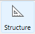
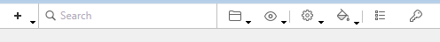
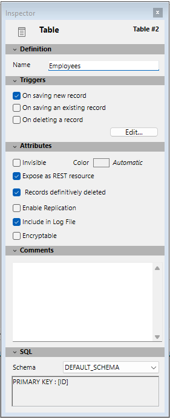
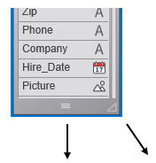
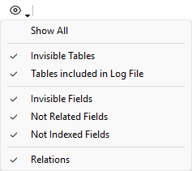
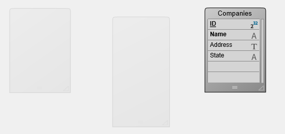
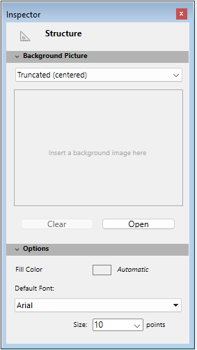

ストラクチャーエディターを使用してデータベースストラクチャー (テーブルとリレーション) を管理できます。このエディターを使用してテーブル、テーブルプロパティ、フィールド、フィールドプロパティ、インデックスやテーブルリレーションを管理できます。

**ストラクチャーエディター**には**デザイン**メニューの**データベースストラクチャー**コマンドを選択するか、4Dツールバーのストラクチャーボタン  をクリックすることでアクセスできます。

ストラクチャーエディターはデータベースストラクチャーをグラフィカルに表示し、データベースデザイン操作に使用するツールバーやコンテキストメニューを提供します。エディター内では、それぞれのテーブルはテーブルイメージとして表現されます。テーブルにはフィールドとその型がアイコンで表示されます。マウスを重ねると、情報バーにテーブルやフィールドの情報が表示されます。

フローティングパレット上に表示される**インスペクターパレット**を使用して、ストラクチャーオブジェクトやストラクチャーエディター自身のプロパティを表示したり変更したりできます。このウィンドウについては[インスペクターパレット](#インスペクターパレット) の章で説明します。

## ツールバー

ストラクチャーエディターにはオブジェクト追加などの機能、およびナビゲーションや表示オプションを格納するツールバーがあります:



左から右へ順に、アイコンは以下のアクションを実行します:

- オブジェクト(テーブル、フィールド、インデックス、リレーション)の追加
- エディター内を検索
- エクスプローラーのホームページ内で定義されたフォルダに基づいてテーブルの表示/非表示を切り替える
- フィルターを表示
- ツール (サイズ、配置、並べ替え)
- カラー
- インデックス一覧ウィンドウ
- プライマリーキー(主キー)マネージャー

### ロック情報

ストラクチャーファイルがロックされている時には、閉じた南京錠のアイコン  が表示されます。  
ロックは、プロジェクトモードおよびクライアント/サーバーモードの両方において、以下ような場合に起こり得ます:

- `catalog.4DCatalog` ファイルが*読み出し専用* であるとき(プロジェクトモードのみ)。南京錠のアイコンをクリックすると、可能である場合にはそれを解錠するアラートが表示されます。
- 2人以上のユーザーが同じストラクチャーを同時に編集しようとしたとき。ストラクチャーは、最初のユーザーがウィンドウを閉じて解放するまで使用することができません。*(クライアント/サーバーモードのみ)*

どちらのケースにおいても、設定は *読み取り専用* として開くことはできますが、ロックが解除されるまでは使用することができません。

## 情報バー

エディターウィンドウの下部にはマウスが重なっているオブジェクトのエリアに対応する情報を表示する情報バーがあります:テーブル、フィールド、リレーション。

#### テーブルに関する情報

- テーブル名とテーブル番号
- テーブルトリガ:
  - **NEW:** 新規レコード保存時
  - **SAVE:** 既存レコード保存時
  - **DEL:** レコード削除時

#### フィールドに関する情報

- テーブル名とテーブル番号
- フィールド名とフィールド番号
- フィールドの型
- フィールド属性:
  - **NUL:** 空値にヌル値をマップ
  - **UNI:** 重複不可

#### リレーションに関する情報

- リレーション元のテーブルとフィールド(Nフィールド)
- リレーション先のテーブルとフィールド(1フィールド)
- リレーションの種類とORDA 名:
  - **N→1** (N対1) および `relatedEntities` リレーション属性名
  - **1→N** (1対N) および `relatedEntity` リレーション属性名

:::note

ORDA 名についての詳細な情報に関しては、[データモデルオブジェクト](../ORDA/dsMapping.md#structure-mapping) のページを参照して下さい。

:::

## インスペクターパレット

ストラクチャーエディターオブジェクト (テーブル、フィールド、リレーション) のプロパティはインスペクターパレットに表示し編集することができます:



このパレットはオブジェクト上でダブルクリックすると表示されます。表示されているとき、表示内容は選択されたオブジェクトに基づきダイナミックに更新されます。ウィンドウの空のエリアをクリックすると、[インスペクターにはストラクチャーエディターの一般的なプロパティ](#エディターウィンドウのカスタマイズ) が表示されます。

パレットの異なるエリアは、パネルごとに展開・折りたたみができます。すぐとなりの三角形をクリックすることで対応する情報を表示、または非表示にすることができます。

以下のショートカットが使用することができます:

- 折りたたまれたパネルのタイトルバーを**Shift+クリック**すると、そのパネルを展開し、他を折りたたみます。
- 折りたたまれたパネルのタイトルバーを**Alt** (Windows) または**Option** (macOS) + **クリック**すると、すべてのパネルを展開します。
- 展開されたパネルのタイトルバーを**Alt** (Windows) または**Option** (macOS) + **クリック**すると、すべてのパネルを折りたたみます。

パレットの位置とパネルの展開/折りたたみ状態は保存されます。

## オブジェクトを選択する

ストラクチャーエディター中のオブジェクトのイメージを操作するには、まずそれを選択します。そしてそのプロパティを定義したり、移動したり、サイズ変更したり、削除したりできます。同時に同じタイプのオブジェクトを複数選択して、例えばインスペクターパレットで共通のプロパティを表示し、変更することができます。

選択の仕方は以下の通りです:

- **テーブル:** テーブルイメージをクリックする、または `Tab` / `Shift+Tab` を押して、ストラクチャーエディター中のテーブルを移動しながら選択します。
- **フィールドまたはリレーション:** フィールドまたはリレーション上をクリックする、または矢印キーを押して移動する。
- **複数のオブジェクト:** 連続した(隣り合った)オブジェクトを選択するには`Shift+Click` を、連続していないオブジェクトを選択するには`Ctrl+Click` (Windows) または `Command+Click` (macOS) を使用します。

## テーブルイメージを操作する

必要に応じて、ストラクチャーエディター中でテーブルイメージのサイズを変更したり移動したりできます。

**4D Server**: [開発モード](../Desktop/clientServer.md#開発モード) でテーブルイメージをサイズ変更(リサイズや位置の変更など)すると、すべてのユーザーのデザインモードでテーブルイメージサイズが変更されます。

### フィールドリストのスクロール

テーブルにフィールドを追加するときや、テーブルのサイズを小さくしたときなど、テーブルイメージが表示できるよりも多くのフィールドがテーブルに含まれることがあります。このような場合、4D は自動でスクロールバーを追加し、フィールドリストをスクロールして表示できるようにします:


### テーブルイメージのサイズ変更

テーブルイメージのサイズを変更して、より多くのフィールドを表示したり、画面を再構成したりできます。

- **手動によるサイズ変更**: テーブルイメージの下部または右下の角をクリックしドラッグします。



- **最適サイズ**: これは選択されたテーブルを自動でサイズ変更し、含まれるフィールド全体がぴったり表示されるようにします(空の行は表示されないようになります)。**最適サイズ** コマンドを適用するには、エディタのツールバーボタンに割り当てられたメニュー、またはエディタのコンテキストメニューから**最適サイズ**コマンドを選択します。

- **折りたたむ**: この機能はテーブルイメージを折りたたみ、テーブル名のみが表示されるようにします。これは大きなストラクチャーで便利です。

**折りたたむ**コマンドを適用するには、以下を行います:

 ```
 - エディターのコンテキストメニューから **折りたたむ** コマンドを選択します (テーブルのタイトルエリア上でクリック)。
 - テーブルの名前部分を **Shift+ダブルクリック** します。この操作を繰り返すと、以下の動作が適用されます: *元のサイズ -> 折りたたむ*
 ```

:::note 注記

- テーブル名エリアで標準のダブルクリックを行うと**インスペクター**が表示されます。
- **Alt** (Windows) または **Option** (macOS) + ダブルクリックでテーブルのトリガーメソッドが **メソッドエディタ** 中で開かれます。
- **Ctrl** (Windows) または **Command** (macOS) + ダブルクリックで **エクスプローラー** のフォームページが開かれます。

:::

### テーブルイメージの移動

機能に基づいてテーブルをグループ化したり、ストラクチャーエディターウィンドウを再編成したりするために、テーブルイメージをエディター内で移動することができます。ストラクチャーの可読性を向上させるためにテーブルを揃えることもできます。リレーションは新しいテーブル位置に基づいて再描画されます。

手動でテーブルイメージを移動するには、マウスカーソルでテーブル名エリアをクリックしドラッグします。テーブル名バーのみをドラッグします。テーブルイメージの他の部分をドラッグすると、異なる効果を起こします。例えば新しいテーブルリレーションが作成されたりテーブルイメージのサイズが変更されたりします。

複数のテーブルの位置を揃えるには、揃えるテーブルを選択し、ツールメニューから対応するメニューを選択します:


これらのコマンドは少なくとも2つ以上のテーブルが選択されている場合にのみ有効となります。

## スクロール

巨大なストラクチャーにおいては特別なスクロール機能がナビゲーションを容易にします:

- マウスホイールを使用するとエディターウィンドウが縦にスクロールされます。カーソルがテーブル上にあるときはテーブルのフィールドがスクロールされます。
- マウスホイールスクロール時に **Shift** を押すと、ウィンドウを横にスクロールします。
- **Shift** キーを押して空のエリアをクリック＆ドラッグすると"ハンド"ツールが使用可能になり、ウィンドウの内容全体をスクロールすることができます。

## 拡大

情報バーの右側にある**ズーム**機能を使用して、データベースストラクチャーの表示倍率を変更できます。データベースを開く際のデフォルトは100%です。セレクションがフォーム内にある場合にはそこへズームされます。

ズーム設定はユーザーごとに異なります。設定はウィンドウを閉じる際に保存されます。

:::note

環境設定を使用して[ズーム時のストラクチャーエディターの描画品質を設定する](../Preferences/structure.md#ストラクチャーの描画クォリティ) ことができます。

:::

## オブジェクトタイプの表示

ストラクチャーエディターのツールバーの**表示**ボタンには、タイプに基づいてストラクチャーオブジェクトの表示と非表示を切り替えるメニューが割り当てられています:



デフォルトでは、全てのオブジェクトが表示されています。この機能を使用してさまざまな表現 (もっとも単純なものから完全な表示まで) を得ることができます。そして必要な情報のレベルに基づくストラクチャーの検証ツールを提供します。

選択はすべてのテーブルとフィールドに適用されます。設定はユーザーごとに異なり、ウィンドウを閉じる際に保存されます。特定のオブジェクトを非表示にしてもテーブルの位置は変わりません。

- 複数のフィールドタイプがチェックされている場合、論理 OR 演算を使用して表示するオブジェクトが決定されます。例えば*非表示フィールド* と*インデックスされていないフィールド* オプションが選択されている場合、(表示・非表示属性に関わらず) すべてのインデックスがないフィールドと、(インデックス属性に関わらず) すべての非表示フィールドが表示されます。
- テーブルはフィールドに対して優先されます。テーブルが表示されない場合、フィールドも表示されません。
- 表示されないタイプのオブジェクト (テーブル、フィールド、リレーション) を追加すると、オブジェクトはエディターに表示されます。それを非表示にするには、**表示** ボタンに割り当てられた対応するオプションで改めてチェックを外す必要があります。

## フォルダーごとにテーブルをハイライト/薄暗くする

エクスプローラーウィンドウの**ホームページ** で定義されたフォルダーに基づき、ストラクチャーエディター内でテーブルグループを非表示にすることができます。ストラクチャーエディターのツールバーにある**フォルダー**ボタンを使用してテーブルの表示を設定します。

ボタンに割り当てあられたメニューには表示を管理するコマンドと、データベースに定義されたフォルダーのリストが表示されます。表示されるフォルダーの隣にはチェックが付けられます。このメニューでフォルダーを選択/選択解除することで、表示を変更できます。

**すべてのフォルダーをハイライト** / **すべてのフォルダーを薄暗く表示** コマンドを使用してデータベースのフォルダー中のテーブルをすべて表示したり隠したりできます。

ツールバーのフォルダーボタンをクリックするたびにテーブルの表示が切り替えられます: ハイライトされたテーブルは薄暗くなり、薄暗くなっていたテーブルがハイライトされます。

テーブルが薄暗く表示されているとき、デフォルトでストラクチャーウィンドウにはその外周部だけが表示されます。隠されていないテーブルのみが全体として表示されます。



:::note

ストラクチャーエディター中で薄暗く表示するテーブルのアピアランスを、[環境設定の**ストラクチャー**ページにあるオプション](../Preferences/structure.md#フォルダーが表示対象外のとき) を使用して、*薄暗く表示* するか *非表示* にするかを切り替えることができます。この環境設定を変更した場合には設定を有効にするために、ストラクチャーエディターウィンドウを一度閉じて開きなおす必要があります。

:::

## エディターウィンドウのカスタマイズ

ストラクチャーエディターの特定のプロパティは**インスペクター**を使用して変更することができます。

これらのプロパティを表示するには:

- ウィンドウの空のエリアをダブルクリックします。またはインスペクターウィンドウが既に表示されている場合は空のエリアをクリックします。
- ウィンドウの空のエリアで右クリックをし、コンテキストメニューから**ストラクチャープロパティ**コマンドを選択します。

インスペクターパレットにストラクチャープロパティが表示されます。



以下のプロパティを設定できます:

- **バックグランドピクチャー**: 使用するバックグランドピクチャーとその表示フォーマットを変更できます。ピクチャーを変更するには、**開く**ボタンをクリックするかプレビューエリアをクリックしてコンテキストメニューから**開く**を選択します。そして表示するピクチャーを選択します。どのピクチャーフォーマットも使用できます。選択されたピクチャーをすぐにプレビューエリアとエディターウィンドウに表示されます。ピクチャーの表示フォーマットを変更するには、ピクチャーフォーマットメニューから値を選択します。提供される選択肢は4D 標準のピクチャー表示フォーマットです。カスタムピクチャーを削除するには、**クリア** ボタンをクリックするか、プレビューエリアをクリックしてコンテキストメニューから**クリア** を選択します。
- **塗りカラー**: エディターウィンドウのバックグランドに使用されるカラーを変更できます。これを行うにはカラー選択エリアをクリックして選択メニューからカラーを選択します。
- **デフォルトフォント**: テーブルやフィールド名に使用されるデフォルトのフォントを変更するには、このメニューから使用するフォントを選択します。サイズメニューを使用してデフォルトのフォントサイズを変更することもできます。

## ストラクチャーを検索

4D ではストラクチャーエディターウィンドウ内で検索を行えます。検索は以下の要素に対して行われます:

- テーブル名やフィールド名
- テーブル番号

検索を行うには、ストラクチャーを**検索**エリアに検索する文字列やテーブル番号を入力します。エリアに値を入力するとその下にオプションバーが表示され、検索のスコープとタイプを指定できます:


- **スコープ**: *テーブル & フィールド* または *テーブル* (つまりテーブルのみ)。
- **タイプ**:
  - *含む* (デフォルト): “le”を検索すると“Table”、“Letter”、等が見つかります。
  - *前方一致* : “pa”を検索すると“paper”や“paid”が見つかりますが、“repair”は見つかりません。
  - *番号* : “2”を検索するとテーブル番号2、12、20、などが見つかります。

検索は値を入力するに従いリアルタイムで実行されます。検索されたテーブルやフィールドは強調表示されます。何も見つからないと、検索条件エリアが赤に変わります。**検索** モードを抜けるには、検索バーの **X** ボタンをクリックするか、検索エリア内の文字をすべて削除します。

