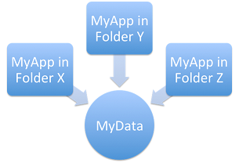
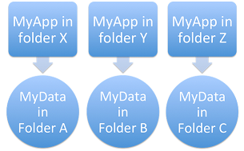
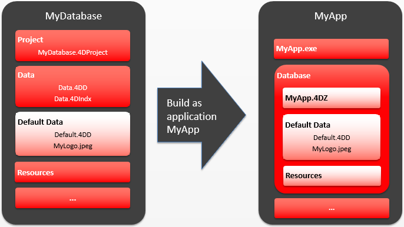

## Abrindo o arquivo de dados  

Quando um usuário inicia um aplicativo mesclado ou uma atualização (aplicativos monousuário ou cliente/servidor), o 4D tenta selecionar um arquivo de dados válido. Vários locais são examinados sucessivamente pelo aplicativo.

A sequência de abertura ao iniciar um aplicativo mesclado é:

1. O 4D tenta abrir o último arquivo de dados aberto, [conforme descrito abaixo](#last-data-file-opened) (não aplicável durante o lançamento inicial).
2. Se não for encontrado, o 4D tenta abrir o arquivo de dados em uma pasta de dados padrão ao lado do arquivo .4DZ em modo somente leitura.
3. Se não for encontrado, o 4D tenta abrir o arquivo de dados padrão (mesmo nome e mesmo local do arquivo .4DZ).
4. Se não for encontrado, o 4D exibe uma caixa de diálogo padrão "Abrir arquivo de dados".

## Último arquivo de dados aberto

### Caminho do último arquivo de dados  

Qualquer aplicativo standalone ou servidor criado com o 4D armazena o caminho do último arquivo de dados aberto na pasta de preferências do usuário do aplicativo.

A localização da pasta de preferências do usuário do aplicativo corresponde ao caminho retornado pela seguinte instrução:

```4d
userPrefs:=Get 4D folder(Active 4D Folder)
```

O caminho do arquivo de dados é armazenado em um arquivo dedicado, chamado *lastDataPath.xml*.

Graças a essa arquitetura, quando você fornece uma atualização do seu aplicativo, o arquivo de dados local do usuário (último arquivo de dados utilizado) é aberto automaticamente no primeiro lançamento.

Esse mecanismo geralmente é adequado para implantações padrão. No entanto, para necessidades específicas, por exemplo se você duplicar seus aplicativos mesclados, pode ser necessário alterar a forma como o arquivo de dados é vinculado ao aplicativo (descrito abaixo).

### Configurando o modo de vinculação de dados
  
Com seus aplicativos compilados, o 4D utiliza automaticamente o último arquivo de dados aberto. Por padrão, o caminho do arquivo de dados é armazenado na pasta de preferências do usuário do aplicativo e está vinculado ao **nome do aplicativo**.

Isso pode ser inadequado se você quiser duplicar um aplicativo mesclado destinado a usar arquivos de dados diferentes. Aplicativos duplicados, na verdade, compartilham a pasta de preferências do usuário do aplicativo e, assim, sempre utilizam o mesmo arquivo de dados -- mesmo que o arquivo de dados seja renomeado, pois o último arquivo utilizado para o aplicativo é aberto.

O 4D permite, portanto, que você vincule o caminho do arquivo de dados ao caminho do aplicativo. Nesse caso, o arquivo de dados será vinculado usando um caminho específico e não será apenas o último arquivo aberto. Assim, você vincula seus dados **por caminho do aplicativo**.

Esse modo permite duplicar seus aplicativos mesclados sem quebrar o vínculo com o arquivo de dados. No entanto, com essa opção, se o pacote do aplicativo for movido no disco, o usuário será solicitado a selecionar um arquivo de dados, já que o caminho do aplicativo não corresponderá mais ao atributo "executablePath" (após o usuário selecionar um arquivo de dados, o arquivo *lastDataPath.xml* é atualizado de acordo).

*Duplicação quando os dados estão vinculados por nome do aplicativo:*


*Duplicação quando os dados estão vinculados por caminho do aplicativo:*


Você pode selecionar o modo de vinculação de dados durante o processo de construção do aplicativo. Você pode:

* Utilizar a [página Application](building.md#application-page) ou a [página Client/Server](building.md#clientserver-page) da caixa de diálogo Build Application.
* Utilizar a chave XML **LastDataPathLookup** ([aplicativo monousuário](../BuildApplication/runtime-vl.md#lastdatapathlookup) ou [aplicativo servidor](../BuildApplication/client-server.md#lastdatapathlookup)).

## Definindo uma pasta de dados padrão

O 4D permite que você defina um arquivo de dados padrão na etapa de construção do aplicativo. Quando o aplicativo é iniciado pela primeira vez, se nenhum arquivo de dados local for encontrado (veja [sequência de abertura descrita acima](#opening-the-data-file)), o arquivo de dados padrão é aberto automaticamente e silenciosamente pelo 4D em modo somente leitura. Isso oferece maior controle sobre a criação e/ou abertura do arquivo de dados ao iniciar um aplicativo mesclado pela primeira vez.

Mais especificamente, os seguintes casos são contemplados:

* Evitar a exibição da caixa de diálogo "Abrir arquivo de dados" do 4D ao iniciar um aplicativo mesclado novo ou atualizado. Você pode detectar, por exemplo no startup, que o arquivo de dados padrão foi aberto e assim executar seu próprio código e/ou diálogos para criar ou selecionar um arquivo de dados local.
* Permitir a distribuição de aplicativos mesclados com dados somente leitura (para aplicativos de demonstração, por exemplo).

Para definir e utilizar um arquivo de dados padrão:

* Você fornece um arquivo de dados padrão (nomeado "Default.4DD") e o armazena em uma pasta padrão (nomeada "Default Data") dentro da pasta do projeto do aplicativo. Esse arquivo deve ser fornecido juntamente com todos os outros arquivos necessários, dependendo da configuração do projeto: índice (.4DIndx), Blobs externos, journal, etc. É sua responsabilidade fornecer um arquivo de dados padrão válido. Note, porém, que como um arquivo de dados padrão é aberto em modo somente leitura, recomenda-se desmarcar a opção "Use Log File" no arquivo de estrutura original antes de criar o arquivo de dados.
* Quando o aplicativo é construído, a pasta de dados padrão é integrada ao aplicativo mesclado. Todos os arquivos dentro dessa pasta de dados padrão também são incorporados.

O gráfico a seguir ilustra esse recurso:



Quando o arquivo de dados padrão é detectado no primeiro lançamento, ele é aberto silenciosamente em modo somente leitura, permitindo assim que você execute quaisquer operações personalizadas que não modifiquem o próprio arquivo de dados.
