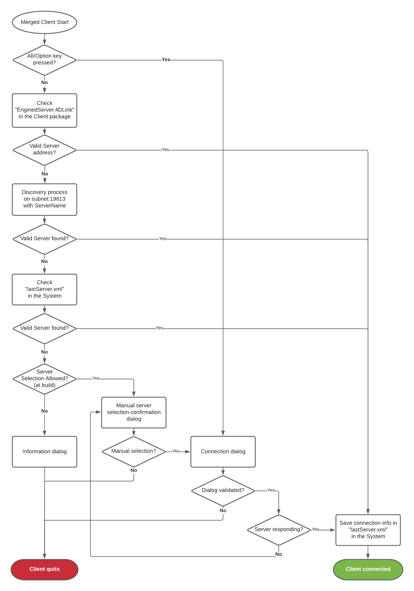
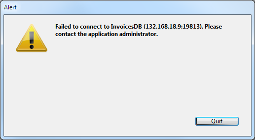
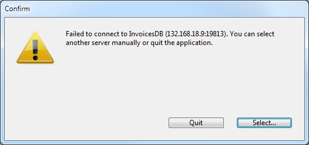
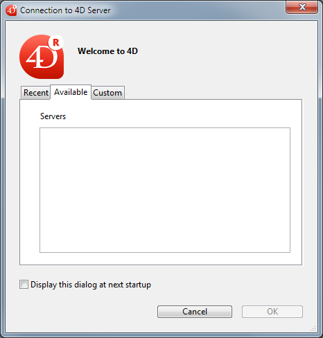

O gerenciamento de conexões por aplicações cliente abrange os mecanismos pelos quais um aplicativo cliente mesclado se conecta ao servidor de destino, uma vez que está em seu ambiente de produção.

## Cenário de conexão  

O procedimento de conexão para aplicações cliente mescladas suporta casos em que o servidor dedicado não está disponível. O cenário de inicialização para um aplicativo cliente 4D é o seguinte:

1. Se informações de conexão válidas estiverem armazenadas no arquivo "EnginedServer.4DLink" dentro do aplicativo cliente, o aplicativo cliente conecta-se ao endereço do servidor especificado.  
 OU  
 O aplicativo cliente tenta se conectar ao servidor usando o serviço de descoberta (baseado no nome do servidor, transmitido na mesma sub-rede).

2. Se isso falhar, o aplicativo cliente tenta se conectar ao servidor usando as informações armazenadas na pasta de preferências do usuário do aplicativo (arquivo "lastServer.xml", veja o último passo).
3. Se isso falhar, o aplicativo cliente exibe uma caixa de diálogo de erro de conexão.

* Se o usuário clicar no botão **Selecionar...** (quando permitido pelo desenvolvedor 4D na etapa de compilação, veja abaixo), a caixa de diálogo padrão "Conexão com o servidor" é exibida.
* Se o usuário clicar no botão **Sair**, o aplicativo cliente é encerrado.

4. Se a conexão for bem-sucedida, o aplicativo cliente salva essas informações de conexão na pasta de preferências do usuário do aplicativo para uso futuro.

Todo o procedimento está descrito no seguinte diagrama:



## Armazenamento do caminho do último servidor  

O caminho do servidor utilizado e validado por último é salvo automaticamente em um arquivo chamado "lastServer.xml" na pasta de preferências do usuário do aplicativo. Esta pasta é armazenada no seguinte local:

```4d
userPrefs:=Get 4D folder(Active 4D Folder)
```

Esse mecanismo atende ao caso em que o servidor principal de destino está temporariamente indisponível por algum motivo (modo de manutenção, por exemplo). Quando esse caso ocorre pela primeira vez, a caixa de diálogo de seleção de servidor é exibida (se permitido, veja abaixo) e o usuário pode selecionar manualmente um servidor alternativo, cujo caminho é então salvo se a conexão for bem-sucedida. Qualquer indisponibilidade subsequente será tratada automaticamente através das informações do caminho em "lastServer.xml".

> * Quando aplicações cliente não podem se beneficiar permanentemente do serviço de descoberta, por exemplo devido à configuração da rede, recomenda-se que o desenvolvedor forneça um nome de host no momento da compilação usando a chave [IPAddress](../BuildApplication/client-server.md#ipaddress) no arquivo "BuildApp.4DSettings". O mecanismo atende a casos de indisponibilidade temporária.  
> * Pressionar a tecla **Alt/Option** na inicialização para exibir a caixa de diálogo de seleção de servidor ainda é suportado em todos os casos.

## Disponibilidade da caixa de diálogo de seleção de servidor em caso de erro

Você pode escolher exibir ou não a caixa de diálogo padrão de seleção de servidor em aplicações cliente mescladas quando o servidor não puder ser alcançado. A configuração depende do valor da chave XML [ServerSelectionAllowed](../BuildApplication/client-server.md#serverselectionallowed) na máquina onde o aplicativo foi compilado:

* **Exibição de uma mensagem de erro sem acesso possível à caixa de diálogo de seleção de servidor**.  
Operação padrão. O aplicativo só pode ser encerrado.  
`ServerSelectionAllowed`: **False** ou chave omitida  

    

* **Exibição de uma mensagem de erro com acesso possível à caixa de diálogo de seleção de servidor**.  
O usuário pode acessar a janela de seleção de servidor clicando no botão **Selecionar...**   
`ServerSelectionAllowed`: **True**  

     
  
