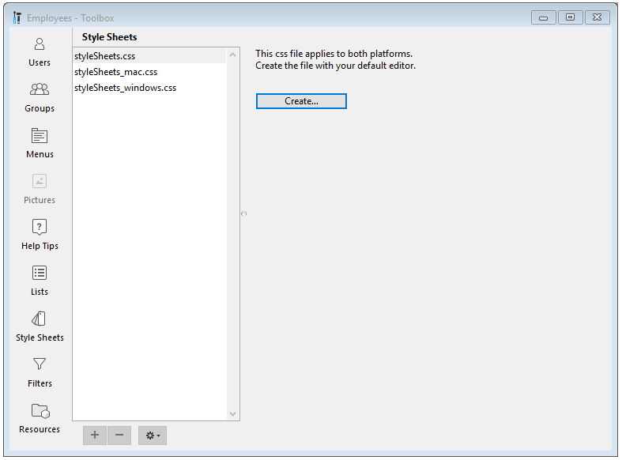

Uma folha de estilo agrupa junto uma combinação de atributos para objetos formulário - de atributos de texto a quase qualquer atributo de objeto disponível.

Além de harmonizar uma interface de aplicação, folhas de estilo oferecem três vantagens principais:

- Poupa tempo durante o desenvolvimento: cada objeto tem agrupamentos de configurações específicos dentro de uma única operação.
- Manutenção facilitada: folhas de estilo modificam a aparência de qualquer objeto que as usa, então mudar o tamanho de fonte em uma folha de estilo vai mudar o estilo de fonte para todos os objetos que usarem essa mesma folha de estilo.
- Controle de desenvolvimento multiplataforma: as folhas de estilo podem ser aplicadas para plataformas macOS e Windows, apenas macOS ou só Windows. Quando uma folha de estilo for aplicada, 4D automaticamente usa a folha de estilo apropriada.

## Criação ou modificação de folhas de estilo

Pode criar folhas de estilo utilizando seu editor de texto preferido e salvando o arquivo com extensão ".css" na pasta "/SOURCES" do projeto.

A Caixa de Ferramentas do 4D oferece uma página **Folhas de Estilo** como opção de atalho para criar e editar uma das três folhas de estilo nomeadas específicas para cada plataforma.

1. Abra a página **Folhas de Estilo** escolhendo **Caixa de Ferramentas > Folha de Estilo** no menu Design ou clique no ícone **Caixa de Ferramentas** na barra de ferramentas do Editor de Formulários.



2. Selecione o tipo de folha de estilos a criar e clique no botão **Criar** ou **Editar**: 

3. A folha de estilo se abrirá em seu editor de texto predeterminado.

## Arquivos de folhas de estilo

4D aceita três arquivos específicos de folhas de estilo:

| Folha de estilo                                              | Plataforma                                                               |
| ------------------------------------------------------------ | ------------------------------------------------------------------------ |
| styleSheets.css                              | Folha de estilo global para macOS e Windows                              |
| styleSheets_mac.css     | Para definir os estilos de atributos específicos de macOS unicamente     |
| styleSheets_windows.css | Para definir os estilos de atributos específicos para Windows unicamente |

Estes arquivos se armazenam na pasta "/SOURCES" do projeto. Eles também podem ser acessados diretamente via [CSS Preview](formEditor.md#css-preview) na barra de ferramentas do editor de formulários.

## Arquitetura das folhas de estilo

Apesar de adaptadas para satisfazer às necessidades específicas dos formulários 4D, as folhas de estilo dos bancos de dados projeto geralmente seguem a sintaxe e a gramática CSS2.

Cada régua de estilo em uma folha de estilo contém duas partes:

- um *Seletor* - Um seletor define onde aplicar o estilo. 4D é compatível com os seletores "object type", "object name", "class", "all objects" e "attribute value".

- uma *Declaração* - A declaração define o estilo real a ser aplicado. Podem ser agrupadas várias linhas de declaração para formar um bloco de declaração. Cada linha de um bloco de declaração CSS deve terminar com um ponto e vírgula, e o bloco inteiro deve ser rodeado por chaves.

## Seletores de folhas de estilo

### Tipo de objeto

O tipo de objeto define o tipo de objeto ao que vai aplicar o estilo, e corresponde ao seletor de elementos CSS.

Especifique o tipo de objeto, depois entre chaves, declare os estilos a aplicar.

:::note

- O tipo de objeto corresponde à propriedade JSON [type](FormObjects/properties_Object.md#type) dos objetos formulário.
- Para listboxes, os seguintes tipos específicos estão disponíveis: *column*, *header*, *footer*.

:::

No exemplo a seguir, todos os objetos do tipo *button* exibirão texto na fonte Helvetica Neue, com tamanho de 20 pixels:

```css
button {
    font-family: Helvetica Neue;
    font-size: 20px;
}
```

Para aplicar o mesmo estilo para múltiplos tipos de objetos, especifique os tipos de objeto separados por uma "," então em chaves, declare os estilos a aplicar:

```css
text, input {
  text-align: left;
  stroke: grey;
}
```

### Nome de objeto

O nome do objeto corresponde ao **seletor de ID** CSS e define um objeto específico ao qual aplicar o estilo, já que o nome do objeto é único dentro do formulário.

Determine o objeto com um caractere '#' antes do nome de objeto, depois entre chaves, declare os estilos a aplicar.

:::note

O nome do objeto corresponde à propriedade JSON [object name](../FormObjects/properties_Object.md#object-name) dos objetos formulário.

:::

No exemplo a seguir, o texto do objeto com o nome "okButton" será exibido
na fonte Helvetica Neue, com tamanho de 20 pixels:

```css
#okButton {
    font-family: Helvetica Neue;
    font-size: 20px;
}
```

### Classe

Classe corresponde ao **seletor de classe** CSS e define o estilo para todos os objetos formulário com o atributo `class`.

Pode especificar as classes a usar com um caractere "." seguido pelo nome da classe, e entre chaves, declare os estilos a aplicar.

No exemplo a seguir, o texto de todos os objetos com o nome da classe `okButtons` será exibido na fonte Helvetica Neue, com tamanho de 20 pixels, alinhado ao centro:

```css
.okButtons {
    font-family: Helvetica Neue;
    font-size: 20px;
    text-align: center;
}
```

Para indicar que um estilo deve aplicar-se só aos objetos de um tipo determinado, especifique o tipo seguido de "." e o nome da classe, e depois, entre chaves, declare o estilo ou os estilos a aplicar.

```css
text.center {
  text-align: center;
  stroke: red;
}
```

Na descrição do formulário 4D, você associa um nome de classe a um objeto usando o atributo [CSS Class](../FormObjects/properties_Object.md#css-class). Este atributo contém um ou vários nomes de classe, separados por um espaço:

```css
class: "okButtons important"       
```

### Todos os objetos

Em correspondência com o seletor CSS **universal**, o caractere "\*" indica que o próximo estilo será aplicado a todos os objetos do formulário.

Indique que um estilo deve aplicar-se a todos os objetos formulário com o carácter "\*" e, a seguir, entre chaves, declare os estilos que devem aplicar-se.

No seguinte exemplo, todos os objetos terão um fundo cinza:

```css
* {
  fill: gray;
}
```

### Atributo específico

Correspondente aos **seletores de atributos** CSS, estilos podem ser aplicados a todos os objetos formulário com um atributo específico.

Especifique o atributo entre colchetes, depois entre chaves, declare os estilos a aplicar.

#### Sintaxes compatíveis

| Sintaxe                                                                                           | Descrição                                                                                                                        |
| ------------------------------------------------------------------------------------------------- | -------------------------------------------------------------------------------------------------------------------------------- |
| [attribute]                                   | coincide com objetos com o `attribute`                                                                                          |
| [attribute="value"]                           | coincide com objetos cujo valor do `attribute` contenha exatamente o "valor" especificado                                     |
| [attribute~="value"]          | coincide com os objetos com o valor do `attribute` que contém o "valor" entre uma lista de palavras separadas por espaços |
| [attribute&#124;="value"] | coincide com objetos com um `attribute` cujo valor começa por "valor"                                                           |

#### Exemplos

Todos os objetos com o atributo `borderStyle` terão linhas roxas:

```css
[borderStyle]
{
     stroke: purple;
}
```

Todos os objetos do tipo texto com um atributo de texto cujo valor seja "Hello" terão letras azuis:

```css
text[text=Hello]
{
     stroke: blue;
}
```

Todos os objetos com um atributo texto cujo valor contenha "Hello" terão linhas azuis:

```css
[text~=Hello]
{
     stroke: blue;
}

```

Todos os objetos do tipo texto com um atributo texto cujo valor começa com "Hello" terão letras amarelas:

```css
text[text|=Hello]
{
     stroke: yellow;


}
```

## Declarações de folhas de estilo

### Media Queries

Media queries permitem aplicar estilos com base em condições específicas. 4D suporta media queries para **esquemas de cores** e **temas de plataforma**.

Uma media query é composta por uma feature de mídia e um valor (por exemplo, `<media feature>:<value>`).

Features e valores de mídia disponíveis:

| Media features         | Valores                                                                                                  | Descrição                                                                                                                                                    |
| ---------------------- | -------------------------------------------------------------------------------------------------------- | ------------------------------------------------------------------------------------------------------------------------------------------------------------ |
| `prefers-color-scheme` | <ul><li>**light**</li><li>**dark**</li></ul>                                                             | Esquema de cor a ser usado                                                                                                                                   |
| `form-theme`           | <ul><li>**fluent-ui**</li><li>**win-classic**</li><li>**liquid-glass**</li><li>**mac-classic**</li></ul> | Tema de plataforma a ser usado. Para mais informações sobre o tema **fluent-ui**, consulte [esta seção](./forms.md#fluent-ui-rendering). |

:::note

Esquemas de cor não são suportados com o tema de plataforma **win-classic**.

:::

##### Exemplo 1

Esse CSS define uma combinação de cores para o texto e o fundo do texto no esquema claro (padrão) e outra combinação quando o esquema escuro é selecionado:

```css
@media (prefers-color-scheme: light) {
 .textScheme {
   fill: LightGrey;
   stroke: Black;
  }
}

@media (prefers-color-scheme: dark) {
  .textScheme {
    fill: DarkSlateGray;
    stroke: LightGrey;
  }
}
```

##### Exemplo 2

```css
/* Default style (all themes and modes) */
.textLabel {
    fontFamily: "Segoe UI";
}
 
/* Fluent UI theme*/
@media (form-theme: fluent-ui) {
    .textLabel {
        stroke: #2A2A2A;
        fontSize: 14px;
    }
 
    /* dark mode */
    @media (prefers-color-scheme: dark) {
        .textLabel {
            stroke: #E0E0E0;
        }
    }
}
 
/* Windows classic theme */
@media (form-theme: win-classic) {
    .textLabel {
        stroke: #000000;
        fontSize: 12px;
    }
}

```

### Atributos de objeto

A maioria dos atributos do objeto formulário podem ser definidos dentro de uma folha de estilo, exceto os seguintes atributos:

- `method`
- `type`
- `class`
- `event`
- `choiceList`, `excludedList`, `labels`, `list`, `requiredList` (tipo de lista)

Os atributos do objeto formulário podem ser declarados com seu [nome JSON](FormObjects/properties_Reference.md) como atributos CSS (não incluindo tipos de objeto, métodos, eventos e listas).

#### Mapa de atributos

<div class="no-index">
<details><summary>História</summary>

| Release | Mudanças                      |
| ------- | ----------------------------- |
| 21 R5   | Support of padding attributes |

</details>
</div>
<br />

Os atributos listados a continuação podem aceitar o nome 4D ou o nome CSS.

| 4D               | CSS                |
| ---------------- | ------------------ |
| `borderStyle`    | `border-style`     |
| `borderColor`    | `border-color`     |
| `fill`           | `background-color` |
| `fontFamily`     | `font-family`      |
| `fontSize`       | `font-size`        |
| `fontStyle`      | `font-style`       |
| `fontWeight`     | `font-weight`      |
| `paddingBottom`  | `padding-bottom`   |
| `paddingLeft`    | `padding-left`     |
| `paddingRight`   | `padding-right`    |
| `paddingTop`     | `padding-top`      |
| `stroke`         | `color`            |
| `textAlign`      | `text-align`       |
| `textDecoration` | `text-decoration`  |
| `verticalAlign`  | `vertical-align`   |

:::note

Valores específicos do 4D (*por exemplo*, `sunken`) não são suportados quando se utilizam nomes de atributos CSS.

:::

#### Valores de atributos específicos

- Para os atributos `icon`, `picture` e `customBackgroundPicture` que suportam um caminho para uma imagem, a sintaxe é:

```css
icon: url("/RESOURCES/Images/Buttons/edit.png"); /* rota absoluta */
icon: url("edit.png"); /* rota relativa ao arquivo de formulário */
```

- Para `fill`, `stroke` , `alternateFill` , `horizontalLineStroke` e `verticalLineStroke`, três sintaxes são suportadas:

  - Nome da cor CSS: `fill: red;`
  - Valor hexa: `fill: #FF0000;` (apenas 6 caracteres, transparência não é suportada)
  - função `rgb()`: `fill:rgb(255,0,0)`

- Se uma string utilizar caracteres proibidos em CSS, pode rodear a string com aspas simples ou duplas. Por exemplo:
  - uma referência xliff: `tooltip: ":xliff:CommonMenuFile";`
  - um datasource com expressão de campo: `dataSource: "[Table_1:1]ID:1";`

## Ordem de prioridade

Os projetos 4D priorizam as definições de estilo em conflito, primeiro pela definição do formulário e depois pelas folhas de estilo.

### JSON vs Folha de estilo

Se um atributo estiver definido na descrição do formulário JSON e em uma folha de estilo, 4D utilizará o valor do arquivo JSON.

Para sobrescrever esse comportamento, o valor do estilo deve ser seguido de uma declaração `!important`.

**Exemplo 1:**

| Descrição do formulário JSON | Folha de estilo | 4D exibe   |
| ------------------------------ | --------------- | ---------- |
| `"text": "Button",`            | `text: Edit;`   | `"Button"` |

**Exemplo 2:**

| Descrição do formulário JSON | Folha de estilo          | 4D exibe |
| ------------------------------ | ------------------------ | -------- |
| `"text": "Button",`            | `text: Edit !important;` | `"Edit"` |

### Folhas de estilo múltiplas

Durante a execução, 4D prioriza automaticamente as folhas de estilo na seguinte ordem:

1. O formulário 4D irá primeiro carregar o arquivo CSS padrão `/SOURCES/styleSheets.css`.
2. Em seguida, irá carregar o arquivo CSS para a plataforma atual `/SOURCES/styleSheets_mac.css` ou `/SOURCES/styleSheets_windows.css`.
3. Se um [atributo "css" nas propriedades do formulário](../FormEditor/properties_FormProperties.md#css) estiver definido no formulário 4D, então irá carregar arquivos CSS específicos. Você pode passar:

- um arquivo para ambas plataformas:

```json
"css": "<path>" 
```

- ou uma lista de arquivos para ambas plataformas:

```json
"css": [
     "<path1>",
     "<path2>" 
      ],
```

- ou uma lista de arquivos por plataforma:

```json
 "css": [
        {"path": "<path>", "media": "mac"},
        {"path": "<path>", "media": "windows"},
    ],
```

:::note

As rotas dos arquivos podem ser relativas ou absolutas.

- Rotas relativas são resolvidas em relação ao arquivo de descrição do formulário JSON.
- Por razões de segurança, apenas [filesystem paths](../Concepts/paths.md#filesystem-pathnames) são aceitos para caminhos absolutos (*por exemplo*, "/RESOURCES", "/DATA").

:::

## Veja também

Veja a apresentação em vídeo [**CSS para Formulários 4D**](https://www.youtube.com/watch?v=3Hk4FUQENyQ).
