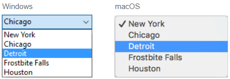
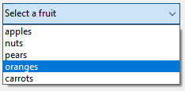
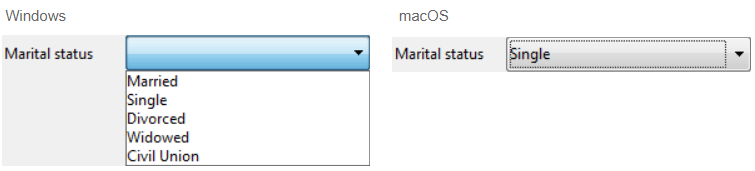
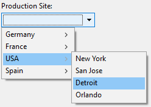

Listas drop-down são objetos que permitem que os usuários selecionem de uma lista. Gerenciar os itens exibidos na lista drop down usando um objeto, um array, uma lista de escolha ou uma ação padrão.

Em macOS, listas drop down são também chamadas de "menu pop up" Ambos os nomes referem aos mesmos objetos. Ambos os nomes referem aos mesmos objetos. Como no exemplo abaixo, a aparência desses objetos podem diferenciar levemente de acordo com a plataforma:



## Tipos de listas pendentes

Pode criar diferentes tipos de listas pendentes com diferentes funcionalidades. Para definir un tipo, seleccione los valores apropiados **Tipo de expressão** y **Tipo de dados** en la lista Propiedades o utilice su equivalente JSON.

| Tipo                                | Funcionalidades                                                                      | Tipo de expressão | Tipo de dados                         | Definição JSON                                                                                                                      |
| ----------------------------------- | ------------------------------------------------------------------------------------ | ----------------- | ------------------------------------- | ----------------------------------------------------------------------------------------------------------------------------------- |
| Object                              | Construído sobre uma colecção                                                        | Object            | Numeric, Text, Date, ou Time          | `dataSourceTypeHint: object` + `numberFormat: <format>` or `textFormat: <format>` o `dateFormat: <format>` o `timeFormat: <format>` |
| Array                               | Construído sobre um array                                                            | Array             | Numeric, Text, Date, ou Time          | `dataSourceTypeHint: arrayNumber` o `arrayText` o `arrayDate` o `arrayTime`                                                         |
| Lista de opções guardada como valor | Construído com base numa lista de opções (“padrão”)               | Lista             | Valor do item seleccionado            | `dataSourceTypeHint: text` + `saveAs: value`                                                                                        |
| Salvar como                         | Construído sobre numa lista de escolha. A posição do item é guardada | Lista             | Referência do item seleccionado       | `dataSourceTypeHint: integer` + `saveAs: reference`                                                                                 |
| Lista de seleção hierárquica        | Pode apresentar conteúdos hierárquicos                                               | Lista             | Referência da lista                   | `dataSourceTypeHint: integer`                                                                                                       |
| Ação padrão                         | Criado automaticamente pela ação                                                     | *qualquer*        | *qualquer exceto referência de lista* | toda definición + `action: <action>` (+ `focusable: false` para acciones que se aplican a otras áreas)           |

## Manuseamento de listas pendentes

### Utilização de um objecto

> Esta funcionalidade só está disponível em projectos 4D.

Um [objeto](Concepts/dt_object.md) que encapsula uma [coleção](Concepts/dt_collection.md) pode ser usado como a fonte de dados de uma lista suspensa. O objeto deve conter as seguintes propriedades:

| Propriedade    | Tipo             | Descrição                                                                                                                                                                                                                                                               |
| -------------- | ---------------- | ----------------------------------------------------------------------------------------------------------------------------------------------------------------------------------------------------------------------------------------------------------------------- |
| `valores`      | Collection       | Obrigatório - Coleção de valores escalares. Todos os valores devem ser do mesmo tipo. Tipos suportados:<li>cadeias</li><li>números</li><li>datas</li><li>horas</li>se estiver vazio ou não, a lista suspensa está vazia |
| `index`        | number           | Índice do item selecionado no momento (valor entre 0 e `collection.length-1`). Se você definir -1, `currentValue` será exibido como uma cadeia de caracteres de espaço reservado                                                     |
| `currentValue` | igual a Colecção | Item atualmente selecionado (utilizado como valor de marcador de posição se definido por código)                                                                                                                                                     |

Se o objeto contiver outras propriedades, estas são ignoradas.

- Insira uma lista de valores padrão nas propriedades do objeto selecionando `\<Static List>` no tema [Fonte de dados](properties_DataSource.md) da Property List. Os valores por defeito são carregados automaticamente para um objeto.

- Executar código que cria o objeto e as suas propriedades. Por exemplo, se "myList" for a [variable](properties_Object.md#variable-or-expression) associada à lista suspensa, você poderá escrever no evento de formulário [On Load](Events/onLoad.md):

```4d
// Form.myDrop é a datasource do objeto formulário
 
Form.myDrop:=New object
Form.myDrop.values:=New collection("apples"; "nuts"; "pears"; "oranges"; "carrots")
Form.myDrop.index:=-1 //currentValue é um placeholder
Form.myDrop.currentValue:="Select a fruit" 
```

A lista suspensa é exibida com a string de placeholder:


Depois de o utilizador selecionar um valor:



```4d
Form.myDrop.values // ["apples","nuts","pears","oranges","carrots"]
Form.myDrop.currentValue //"oranges"
Form.myDrop.index //3
```

### Usar um array

Uma [array](Concepts/arrays.md) é uma lista de valores na memória que é referenciada pelo nome do array. Uma lista drop down exibe um array como lista de valores quando clicar nela.

Para inicializar o array associado à lista pendente, pode:

- Insira uma lista de valores padrão nas propriedades do objeto selecionando `\<Static List>` no tema [Fonte de dados](properties_DataSource.md) da Lista de Propriedades. Os valores padrão são carregados em um array automático. Pode fazer uma referência ao array usando o nome da variável associado com o objeto.

- Antes que o objeto seja exibido, execute um código que atribua valores aos elementos do array. Por exemplo:

```4d
  ARRAY TEXT(aCities;6) 
  aCities{1}:="Philadelphia" 
  aCities{2}:="Pittsburg" 
  aCities{3}:="Grand Blanc" 
  aCities{4}:="Bad Axe" 
  aCities{5}:="Frostbite Falls" 
  aCities{6}:="Green Bay" 
```

Nesse caso, o nome da [variável](properties_Object.md#variable-or-expression) associada ao objeto no formulário deve ser `aCities`. Esse código pode ser colocado no método do formulário e ser executado quando o evento `On Load` do formulário for executado.

- Antes de que se muestre el objeto, cargue los valores de una lista en el array utilizando el comando [`LIST TO ARRAY`](../commands/list-to-array). Por exemplo:

```4d
   LIST TO ARRAY("Cities";aCities)
```

Nesse caso também, o nome da [variável](properties_Object.md#variable-or-expression) associada ao objeto no formulário deve ser `aCities`. Este código pode ser executado ao invés das sentenças de atribuição mostradas anteriormente.

Se precisar salvar as escolhas do usuário em um campo, precisa usar uma declaração de atribuição que rode depois que o registro seja aceito. O código poderia ser assim:

```4d
  Case of
    :(Form event=On Load)
       LIST TO ARRAY("Cities";aCities)
       If(Record number([People])<0) //novo registro
          aCities:=3 //exibe um valor padrão
       Else //registro existente, exibe o valor armazenado
          aCities:=Find in array(aCities;City)
       End if
    :(Form event=On Clicked) //seleção modificada pelo usuário
       City:=aCities{aCities} //campo recebe novo valor
    :(Form event=On Validate)
       City:=aCities{aCities}
    :(Form event=On Unload)
       CLEAR VARIABLE(aCities)
 End case
```

Deve selecionar cada event que teste nas estruturas Case. Os arrays sempre contém um número finito de elementos. A lista de elementos é dinâmica e pode ser modificada por um método. Itens em um array podem ser modificados, ordenados e terem itens adicionados.

### Utilizar uma lista de seleção

Se quiser usar uma lista suspensa para gerenciar os valores de uma área de entrada (campo ou variável listada), 4D permite que você faça referência ao campo ou à variável diretamente como [fonte de dados] da lista suspensa (properties_Object.md#variable-or-expression). Isso facilita gerenciar variáveis/campos listados.

Por exemplo, no caso de um campo "Cor" que só possa conter os valores "White", "Blue", "Green" ou "Red", agora é possível criar uma lista que contenha esses valores e associe-os a um objeto emergente menu que faça referência ao campo "Color". 4D então se encarrega automaticamente de gerenciar o input e exibir os valores atuais no formulário.

> Se usar uma lista hierárquica, só o primeiro nível é mostrado e pode ser selecionado. Se quiser exibir conteúdos hierárquicos, precisa usar uma [lista de seleção hierárquica](#se-usar-uma-lista-hierarquica-so-o-primeiro-nivel-e-mostrado-e-pode-ser-selecionado).

Para associar uma lista suspensa a um campo ou variável, digite o nome do campo ou da variável diretamente como o campo [Variable or Expression](properties_Object.md#variable-or-expression) da lista suspensa na Lista de propriedades.

> Não é possível combinar esse princípio com o uso de um array para iniciar o objeto. Se digitar um nome de campo na área Nome da variável, deve usar uma lista de seleção.

Quando o formulário for executado, 4D automaticamente gerencia o menu pop up ou com box durante a entrada ou a visualização: quando um usuário escolher um valor, é salvo no campo; esse valor de campo é mostrado no menu pop up quando o formulário for exibido:



#### Valor do item selecionado ou Referência do item selecionado

Quando você tiver associado uma lista suspensa com uma lista de escolha e com um campo ou uma variável, você pode definir a propriedade [**Tipo de dados**](properties_DataSource.md#data-type-list) para **O valor do item selecionado** ou **Referência do item selecionado**. Essa opção permite otimizar o tamanho dos dados salvos.

### Se usar uma lista hierárquica, só o primeiro nível é mostrado e pode ser selecionado.

Uma lista suspensa hierárquica tem uma sub-lista associada a cada item da lista. Eis um exemplo de uma lista pendente hierárquica:



> Nos formulários, as listas pendentes hierárquicas estão limitadas a dois níveis.

Você pode atribuir a lista de opções hierárquicas ao objeto de lista suspensa usando o campo [Choice List](properties_DataSource.md#choice-list) da Lista de propriedades.

Pode gerenciar as listas suspensas hierárquicas usando os comandos **listas hierárquicas** do idioma 4D. Todos os comandos compatíveis com a sintaxe `(*; "name")` podem ser usados com listas suspensas hierárquicas, por exemplo, [`List item parent`](../commands/list-item-parent).

### Usar uma ação padrão

Você pode criar automaticamente uma lista suspensa usando uma [ação padrão](properties_Action.md#standard-action). Esta funcionalidade é suportada nos seguintes contextos:

- Uso da ação padrão `gotoPage`. Nesse caso, o 4D exibirá automaticamente a [página do formulário](FormEditor/forms.md#form-pages) que corresponde ao número do item selecionado. Por exemplo, se o usuário selecionar o terceiro item, 4D exibirá a terceira página do formulário atual (se existir). No tempo de execução, por padrão a lista suspensa exibe os números de página (1, 2...).

- Uso de uma ação padrão que exibe uma sub-lista de itens, por exemplo, `backgroundColor`. Essa funcionalidade exige que:
  - uma área de texto com estilo ([4D Write Pro area](writeProArea_overview.md) ou [input](input_overview.md) com a propriedade [multistyle](properties_Text.md#multi-style)) está presente no formulário como o alvo da ação padrão.
  - A propriedade [focusable](properties_Entry.md#focusable) não esteja definida para a lista suspensa.
    Em tempo de execução, a lista suspensa exibirá uma lista automática de valores, por exemplo, cores de fundo. Pode substituir esta lista automática atribuindo além disso uma lista de seleção na qual cada elemento tenha atribuída uma ação padrão personalizada.

> Esta funcionalidade não pode ser utilizada com uma lista pendente hierárquica.

## Ações padrão compatíveis

As seguintes ações estão disponíveis no seletor de ação padrão da lista suspensa. Veja [Ações padrão](../Desktop-legacy/standard-actions.md) e [Ações padrão do 4D Write Pro](../WritePro/user-legacy/standard-actions.md) para descrições e requisitos das ações.

[`gotoPage`](../Desktop-legacy/standard-actions.md#gotopage) - [`fontSize`](../Desktop-legacy/standard-actions.md#fontsize) - [`color`](../Desktop-legacy/standard-actions.md#color) - [`backgroundColor`](../WritePro/user-legacy/standard-actions.md#action-backgroundcolor) - [`textUnderlineStyle`](../WritePro/user-legacy/standard-actions.md#action-textunderlinestyle) - [`textUnderlineColor`](../WritePro/user-legacy/standard-actions.md#action-textunderlinecolor) - [`textLinethroughStyle`](../WritePro/user-legacy/standard-actions.md#action-textlinethroughstyle) - [`textLinethroughColor`](../WritePro/user-legacy/standard-actions.md#action-textlinethroughcolor) - [`textShadowOffset`](../WritePro/user-legacy/standard-actions.md#action-textshadowoffset) - [`textShadowColor`](../WritePro/user-legacy/standard-actions.md#action-textshadowcolor) - [`textTransform`](../WritePro/user-legacy/standard-actions.md#action-texttransform) - [`dpi`](../WritePro/user-legacy/standard-actions.md#action-dpi) - [`zoom`](../WritePro/user-legacy/standard-actions.md#action-zoom) - [`userUnit`](../WritePro/user-legacy/standard-actions.md#action-userunit) - [`pageMode`](../WritePro/user-legacy/standard-actions.md#action-pagemode) - [`pageSize`](../WritePro/user-legacy/standard-actions.md#action-pagesize) - [`tabDecimalSeparator`](../WritePro/user-legacy/standard-actions.md#action-tabdecimalseparator) - [`pageOrientation`](../WritePro/user-legacy/standard-actions.md#action-pageorientation) - [`section/pageOrientation`](../WritePro/user-legacy/standard-actions.md#action-pageorientation) - [`columnCount`](../WritePro/user-legacy/standard-actions.md#action-columncount) - [`section/columnCount`](../WritePro/user-legacy/standard-actions.md#action-columncount) - [`columnSpacing`](../WritePro/user-legacy/standard-actions.md#action-columnspacing) - [`section/columnSpacing`](../WritePro/user-legacy/standard-actions.md#action-columnspacing) - [`columnRuleStyle`](../WritePro/user-legacy/standard-actions.md#action-columnrulestyle) - [`section/columnRuleStyle`](../WritePro/user-legacy/standard-actions.md#action-columnrulestyle) - [`columnRuleColor`](../WritePro/user-legacy/standard-actions.md#action-columnrulecolor) - [`section/columnRuleColor`](../WritePro/user-legacy/standard-actions.md#action-columnrulecolor) - [`columnRuleWidth`](../WritePro/user-legacy/standard-actions.md#action-columnrulewidth) - [`section/columnRuleWidth`](../WritePro/user-legacy/standard-actions.md#action-columnrulewidth) - [`bookmark`](../WritePro/user-legacy/standard-actions.md#action-bookmark) - [`width`](../WritePro/user-legacy/standard-actions.md#action-width) - [`paragraph/width`](../WritePro/user-legacy/standard-actions.md#action-width) - [`image/width`](../WritePro/user-legacy/standard-actions.md#action-width) - [`column/width`](../WritePro/user-legacy/standard-actions.md#action-width) - [`image/height`](../WritePro/user-legacy/standard-actions.md#action-height) - [`row/height`](../WritePro/user-legacy/standard-actions.md#action-height) - [`minWidth`](../WritePro/user-legacy/standard-actions.md#action-minwidth) - [`paragraph/minWidth`](../WritePro/user-legacy/standard-actions.md#action-minwidth) - [`image/minWidth`](../WritePro/user-legacy/standard-actions.md#action-minwidth) - [`minHeight`](../WritePro/user-legacy/standard-actions.md#action-minheight) - [`paragraph/minHeight`](../WritePro/user-legacy/standard-actions.md#action-minheight) - [`image/minHeight`](../WritePro/user-legacy/standard-actions.md#action-minheight) - [`margin`](../WritePro/user-legacy/standard-actions.md#action-margin) - [`doc/margin`](../WritePro/user-legacy/standard-actions.md#action-margin) - [`paragraph/margin`](../WritePro/user-legacy/standard-actions.md#action-margin) - [`paragraph/inside/margin`](../WritePro/user-legacy/standard-actions.md#action-margin) - [`paragraph/outside/margin`](../WritePro/user-legacy/standard-actions.md#action-margin) - [`image/margin`](../WritePro/user-legacy/standard-actions.md#action-margin) - [`section/margin`](../WritePro/user-legacy/standard-actions.md#action-margin) - [`header/margin`](../WritePro/user-legacy/standard-actions.md#action-margin) - [`footer/margin`](../WritePro/user-legacy/standard-actions.md#action-margin) - [`table/margin`](../WritePro/user-legacy/standard-actions.md#action-margin) - [`padding`](../WritePro/user-legacy/standard-actions.md#action-padding) - [`doc/padding`](../WritePro/user-legacy/standard-actions.md#action-padding) - [`paragraph/padding`](../WritePro/user-legacy/standard-actions.md#action-padding) - [`paragraph/inside/padding`](../WritePro/user-legacy/standard-actions.md#action-padding) - [`paragraph/outside/padding`](../WritePro/user-legacy/standard-actions.md#action-padding) - [`image/padding`](../WritePro/user-legacy/standard-actions.md#action-padding) - [`section/padding`](../WritePro/user-legacy/standard-actions.md#action-padding) - [`header/padding`](../WritePro/user-legacy/standard-actions.md#action-padding) - [`footer/padding`](../WritePro/user-legacy/standard-actions.md#action-padding) - [`cell/padding`](../WritePro/user-legacy/standard-actions.md#action-padding) - [`column/padding`](../WritePro/user-legacy/standard-actions.md#action-padding) - [`doc/backgroundColor`](../WritePro/user-legacy/standard-actions.md#action-backgroundcolor) - [`paragraph/backgroundColor`](../WritePro/user-legacy/standard-actions.md#action-backgroundcolor) - [`image/backgroundColor`](../WritePro/user-legacy/standard-actions.md#action-backgroundcolor) - [`section/backgroundColor`](../WritePro/user-legacy/standard-actions.md#action-backgroundcolor) - [`header/backgroundColor`](../WritePro/user-legacy/standard-actions.md#action-backgroundcolor) - [`footer/backgroundColor`](../WritePro/user-legacy/standard-actions.md#action-backgroundcolor) - [`table/backgroundColor`](../WritePro/user-legacy/standard-actions.md#action-backgroundcolor) - [`row/backgroundColor`](../WritePro/user-legacy/standard-actions.md#action-backgroundcolor) - [`cell/backgroundColor`](../WritePro/user-legacy/standard-actions.md#action-backgroundcolor) - [`column/backgroundColor`](../WritePro/user-legacy/standard-actions.md#action-backgroundcolor) - [`backgroundPositionH`](../WritePro/user-legacy/standard-actions.md#action-backgroundpositionh) - [`doc/backgroundPositionH`](../WritePro/user-legacy/standard-actions.md#action-backgroundpositionh) - [`paragraph/backgroundPositionH`](../WritePro/user-legacy/standard-actions.md#action-backgroundpositionh) - [`image/backgroundPositionH`](../WritePro/user-legacy/standard-actions.md#action-backgroundpositionh) - [`section/backgroundPositionH`](../WritePro/user-legacy/standard-actions.md#action-backgroundpositionh) - [`header/backgroundPositionH`](../WritePro/user-legacy/standard-actions.md#action-backgroundpositionh) - [`footer/backgroundPositionH`](../WritePro/user-legacy/standard-actions.md#action-backgroundpositionh) - [`table/backgroundPositionH`](../WritePro/user-legacy/standard-actions.md#action-backgroundpositionh) - [`row/backgroundPositionH`](../WritePro/user-legacy/standard-actions.md#action-backgroundpositionh) - [`cell/backgroundPositionH`](../WritePro/user-legacy/standard-actions.md#action-backgroundpositionh) - [`column/backgroundPositionH`](../WritePro/user-legacy/standard-actions.md#action-backgroundpositionh) - [`backgroundPositionV`](../WritePro/user-legacy/standard-actions.md#action-backgroundpositionv) - [`doc/backgroundPositionV`](../WritePro/user-legacy/standard-actions.md#action-backgroundpositionv) - [`paragraph/backgroundPositionV`](../WritePro/user-legacy/standard-actions.md#action-backgroundpositionv) - [`image/backgroundPositionV`](../WritePro/user-legacy/standard-actions.md#action-backgroundpositionv) - [`section/backgroundPositionV`](../WritePro/user-legacy/standard-actions.md#action-backgroundpositionv) - [`header/backgroundPositionV`](../WritePro/user-legacy/standard-actions.md#action-backgroundpositionv) - [`footer/backgroundPositionV`](../WritePro/user-legacy/standard-actions.md#action-backgroundpositionv) - [`table/backgroundPositionV`](../WritePro/user-legacy/standard-actions.md#action-backgroundpositionv) - [`row/backgroundPositionV`](../WritePro/user-legacy/standard-actions.md#action-backgroundpositionv) - [`cell/backgroundPositionV`](../WritePro/user-legacy/standard-actions.md#action-backgroundpositionv) - [`column/backgroundPositionV`](../WritePro/user-legacy/standard-actions.md#action-backgroundpositionv) - [`backgroundRepeat`](../WritePro/user-legacy/standard-actions.md#action-backgroundrepeat) - [`doc/backgroundRepeat`](../WritePro/user-legacy/standard-actions.md#action-backgroundrepeat) - [`paragraph/backgroundRepeat`](../WritePro/user-legacy/standard-actions.md#action-backgroundrepeat) - [`image/backgroundRepeat`](../WritePro/user-legacy/standard-actions.md#action-backgroundrepeat) - [`section/backgroundRepeat`](../WritePro/user-legacy/standard-actions.md#action-backgroundrepeat) - [`header/backgroundRepeat`](../WritePro/user-legacy/standard-actions.md#action-backgroundrepeat) - [`footer/backgroundRepeat`](../WritePro/user-legacy/standard-actions.md#action-backgroundrepeat) - [`table/backgroundRepeat`](../WritePro/user-legacy/standard-actions.md#action-backgroundrepeat) - [`row/backgroundRepeat`](../WritePro/user-legacy/standard-actions.md#action-backgroundrepeat) - [`cell/backgroundRepeat`](../WritePro/user-legacy/standard-actions.md#action-backgroundrepeat) - [`column/backgroundRepeat`](../WritePro/user-legacy/standard-actions.md#action-backgroundrepeat) - [`backgroundClip`](../WritePro/user-legacy/standard-actions.md#action-backgroundclip) - [`doc/backgroundClip`](../WritePro/user-legacy/standard-actions.md#action-backgroundclip) - [`paragraph/backgroundClip`](../WritePro/user-legacy/standard-actions.md#action-backgroundclip) - [`image/backgroundClip`](../WritePro/user-legacy/standard-actions.md#action-backgroundclip) - [`section/backgroundClip`](../WritePro/user-legacy/standard-actions.md#action-backgroundclip) - [`header/backgroundClip`](../WritePro/user-legacy/standard-actions.md#action-backgroundclip) - [`table/backgroundClip`](../WritePro/user-legacy/standard-actions.md#action-backgroundclip) - [`row/backgroundClip`](../WritePro/user-legacy/standard-actions.md#action-backgroundclip) - [`cell/backgroundClip`](../WritePro/user-legacy/standard-actions.md#action-backgroundclip) - [`column/backgroundClip`](../WritePro/user-legacy/standard-actions.md#action-backgroundclip) - [`backgroundOrigin`](../WritePro/user-legacy/standard-actions.md#action-backgroundorigin) - [`doc/backgroundOrigin`](../WritePro/user-legacy/standard-actions.md#action-backgroundorigin) - [`paragraph/backgroundOrigin`](../WritePro/user-legacy/standard-actions.md#action-backgroundorigin) - [`image/backgroundOrigin`](../WritePro/user-legacy/standard-actions.md#action-backgroundorigin) - [`section/backgroundOrigin`](../WritePro/user-legacy/standard-actions.md#action-backgroundorigin) - [`header/backgroundOrigin`](../WritePro/user-legacy/standard-actions.md#action-backgroundorigin) - [`footer/backgroundOrigin`](../WritePro/user-legacy/standard-actions.md#action-backgroundorigin) - [`table/backgroundOrigin`](../WritePro/user-legacy/standard-actions.md#action-backgroundorigin) - [`row/backgroundOrigin`](../WritePro/user-legacy/standard-actions.md#action-backgroundorigin) - [`cell/backgroundOrigin`](../WritePro/user-legacy/standard-actions.md#action-backgroundorigin) - [`column/backgroundOrigin`](../WritePro/user-legacy/standard-actions.md#action-backgroundorigin) - [`backgroundSizeH`](../WritePro/user-legacy/standard-actions.md#action-backgroundsizeh) - [`doc/backgroundSizeH`](../WritePro/user-legacy/standard-actions.md#action-backgroundsizeh) - [`paragraph/backgroundSizeH`](../WritePro/user-legacy/standard-actions.md#action-backgroundsizeh) - [`image/backgroundSizeH`](../WritePro/user-legacy/standard-actions.md#action-backgroundsizeh) - [`section/backgroundSizeH`](../WritePro/user-legacy/standard-actions.md#action-backgroundsizeh) - [`header/backgroundSizeH`](../WritePro/user-legacy/standard-actions.md#action-backgroundsizeh) - [`footer/backgroundSizeH`](../WritePro/user-legacy/standard-actions.md#action-backgroundsizeh) - [`table/backgroundSizeH`](../WritePro/user-legacy/standard-actions.md#action-backgroundsizeh) - [`row/backgroundSizeH`](../WritePro/user-legacy/standard-actions.md#action-backgroundsizeh) - [`cell/backgroundSizeH`](../WritePro/user-legacy/standard-actions.md#action-backgroundsizeh) - [`column/backgroundSizeH`](../WritePro/user-legacy/standard-actions.md#action-backgroundsizeh) - [`backgroundSizeV`](../WritePro/user-legacy/standard-actions.md#action-backgroundsizev) - [`doc/backgroundSizeV`](../WritePro/user-legacy/standard-actions.md#action-backgroundsizev) - [`paragraph/backgroundSizeV`](../WritePro/user-legacy/standard-actions.md#action-backgroundsizev) - [`image/backgroundSizeV`](../WritePro/user-legacy/standard-actions.md#action-backgroundsizev) - [`section/backgroundSizeV`](../WritePro/user-legacy/standard-actions.md#action-backgroundsizev) - [`header/backgroundSizeV`](../WritePro/user-legacy/standard-actions.md#action-backgroundsizev) - [`footer/backgroundSizeV`](../WritePro/user-legacy/standard-actions.md#action-backgroundsizev) - [`table/backgroundSizeV`](../WritePro/user-legacy/standard-actions.md#action-backgroundsizev) - [`row/backgroundSizeV`](../WritePro/user-legacy/standard-actions.md#action-backgroundsizev) - [`cell/backgroundSizeV`](../WritePro/user-legacy/standard-actions.md#action-backgroundsizev) - [`column/backgroundSizev`](../WritePro/user-legacy/standard-actions.md#action-backgroundsizev) - [`borderStyle`](../WritePro/user-legacy/standard-actions.md#action-borderstyle) - [`doc/borderStyle`](../WritePro/user-legacy/standard-actions.md#action-borderstyle) - [`paragraph/borderStyle`](../WritePro/user-legacy/standard-actions.md#action-borderstyle) - [`paragraph/inside/borderStyle`](../WritePro/user-legacy/standard-actions.md#action-borderstyle) - [`paragraph/outside/borderStyle`](../WritePro/user-legacy/standard-actions.md#action-borderstyle) - [`image/borderStyle`](../WritePro/user-legacy/standard-actions.md#action-borderstyle) - [`section/borderStyle`](../WritePro/user-legacy/standard-actions.md#action-borderstyle) - [`header/borderStyle`](../WritePro/user-legacy/standard-actions.md#action-borderstyle) - [`footer/borderStyle`](../WritePro/user-legacy/standard-actions.md#action-borderstyle) - [`table/borderStyle`](../WritePro/user-legacy/standard-actions.md#action-borderstyle) - [`row/borderStyle`](../WritePro/user-legacy/standard-actions.md#action-borderstyle) - [`cell/borderStyle`](../WritePro/user-legacy/standard-actions.md#action-borderstyle) - [`column/borderStyle`](../WritePro/user-legacy/standard-actions.md#action-borderstyle) - [`borderColor`](../WritePro/user-legacy/standard-actions.md#action-bordercolor) - [`doc/borderColor`](../WritePro/user-legacy/standard-actions.md#action-bordercolor) - [`paragraph/borderColor`](../WritePro/user-legacy/standard-actions.md#action-bordercolor) - [`paragraph/inside/borderColor`](../WritePro/user-legacy/standard-actions.md#action-bordercolor) - [`paragraph/outside/borderColor`](../WritePro/user-legacy/standard-actions.md#action-bordercolor) - [`image/borderColor`](../WritePro/user-legacy/standard-actions.md#action-bordercolor) - [`section/borderColor`](../WritePro/user-legacy/standard-actions.md#action-bordercolor) - [`header/borderColor`](../WritePro/user-legacy/standard-actions.md#action-bordercolor) - [`footer/borderColor`](../WritePro/user-legacy/standard-actions.md#action-bordercolor) - [`table/borderColor`](../WritePro/user-legacy/standard-actions.md#action-bordercolor) - [`row/borderColor`](../WritePro/user-legacy/standard-actions.md#action-bordercolor) - [`cell/borderColor`](../WritePro/user-legacy/standard-actions.md#action-bordercolor) - [`column/borderColor`](../WritePro/user-legacy/standard-actions.md#action-bordercolor) - [`borderWidth`](../WritePro/user-legacy/standard-actions.md#action-borderwidth)- [`doc/borderWidth`](../WritePro/user-legacy/standard-actions.md#action-borderwidth) - [`paragraph/borderWidth`](../WritePro/user-legacy/standard-actions.md#action-borderwidth) - [`paragraph/inside/borderWidth`](../WritePro/user-legacy/standard-actions.md#action-borderwidth) - [`paragraph/outside/borderWidth`](../WritePro/user-legacy/standard-actions.md#action-borderwidth) - [`image/borderWidth`](../WritePro/user-legacy/standard-actions.md#action-borderwidth) - [`section/borderWidth`](../WritePro/user-legacy/standard-actions.md#action-borderwidth) - [`header/borderWidth`](../WritePro/user-legacy/standard-actions.md#action-borderwidth) - [`footer/borderWidth`](../WritePro/user-legacy/standard-actions.md#action-borderwidth) - [`table/borderWidth`](../WritePro/user-legacy/standard-actions.md#action-borderwidth) - [`row/borderWidth`](../WritePro/user-legacy/standard-actions.md#action-borderwidth) - [`cell/borderWidth`](../WritePro/user-legacy/standard-actions.md#action-borderwidth) - [`column/borderWidth`](../WritePro/user-legacy/standard-actions.md#action-borderwidth) - [`borderRadius`](../WritePro/user-legacy/standard-actions.md#action-borderradius) - [`doc/borderRadius`](../WritePro/user-legacy/standard-actions.md#action-borderradius) - [`paragraph/borderRadius`](../WritePro/user-legacy/standard-actions.md#action-borderradius) - [`image/borderRadius`](../WritePro/user-legacy/standard-actions.md#action-borderradius) - [`section/borderRadius`](../WritePro/user-legacy/standard-actions.md#action-borderradius) - [`header/borderRadius`](../WritePro/user-legacy/standard-actions.md#action-borderradius) - [`footer/borderRadius`](../WritePro/user-legacy/standard-actions.md#action-borderradius) - [`direction`](../WritePro/user-legacy/standard-actions.md#action-direction) - [`textAlign`](../WritePro/user-legacy/standard-actions.md#action-textalign) - [`lineHeight`](../WritePro/user-legacy/standard-actions.md#action-lineheight) - [`listStyleType`](../WritePro/user-legacy/standard-actions.md#action-liststyletype) - [`listStartNumber`](../WritePro/user-legacy/standard-actions.md#action-liststartnumber) - [`listNumberFormat`](../WritePro/user-legacy/standard-actions.md#action-listnumberformat) - [`textIndent`](../WritePro/user-legacy/standard-actions.md#action-textindent) - [`verticalAlign`](../WritePro/user-legacy/standard-actions.md#action-verticalalign) - [`image/verticalAlign`](../WritePro/user-legacy/standard-actions.md#action-image-verticalalign) - [`cell/verticalAlign`](../WritePro/user-legacy/standard-actions.md#action-verticalalign) - [`column/verticalAlign`](../WritePro/user-legacy/standard-actions.md#action-verticalalign) - [`tableAlign`](../WritePro/user-legacy/standard-actions.md#action-tablealign) - [`table/tableAlign`](../WritePro/user-legacy/standard-actions.md#action-tablealign) - [`emptyDatasource`](../WritePro/user-legacy/standard-actions.md#action-emptydatasource) - [`table/emptyDatasource`](../WritePro/user-legacy/standard-actions.md#action-emptydatasource) - [`styleSheet`](../WritePro/user-legacy/standard-actions.md#action-stylesheet) - [`paragraph/styleSheet`](../WritePro/user-legacy/standard-actions.md#action-stylesheet) - [`image/styleSheet`](../WritePro/user-legacy/standard-actions.md#action-stylesheet) - [`newLineStyleSheet`](../WritePro/user-legacy/standard-actions.md#action-newlinestylesheet) - [`anchorLayout`](../WritePro/user-legacy/standard-actions.md#action-anchorlayout) - [`anchorHorizontalAlign`](../WritePro/user-legacy/standard-actions.md#action-anchorhorizontalalign) - [`anchorVerticalAlign`](../WritePro/user-legacy/standard-actions.md#action-anchorverticalalign) - [`anchorOrigin`](../WritePro/user-legacy/standard-actions.md#action-anchororigin) - [`anchorSection`](../WritePro/user-legacy/standard-actions.md#action-anchorsection) - [`anchorPage`](../WritePro/user-legacy/standard-actions.md#action-anchorpage) - [`image/displayMode`](../WritePro/user-legacy/standard-actions.md#action-image-displaymode) - [`backgroundDisplayMode`](../WritePro/user-legacy/standard-actions.md#action-backgrounddisplaymode) - [`doc/backgroundDisplayMode`](../WritePro/user-legacy/standard-actions.md#action-backgrounddisplaymode) - [`paragraph/backgroundDisplayMode`](../WritePro/user-legacy/standard-actions.md#action-backgrounddisplaymode) - [`image/backgroundDisplayMode`](../WritePro/user-legacy/standard-actions.md#action-backgrounddisplaymode) - [`section/backgroundDisplayMode`](../WritePro/user-legacy/standard-actions.md#action-backgrounddisplaymode) - [`header/backgroundDisplayMode`](../WritePro/user-legacy/standard-actions.md#action-backgrounddisplaymode) - [`footer/backgroundDisplayMode`](../WritePro/user-legacy/standard-actions.md#action-backgrounddisplaymode) - [`table/backgroundDisplayMode`](../WritePro/user-legacy/standard-actions.md#action-backgrounddisplaymode) - [`row/backgroundDisplayMode`](../WritePro/user-legacy/standard-actions.md#action-backgrounddisplaymode) - [`cell/backgroundDisplayMode`](../WritePro/user-legacy/standard-actions.md#action-backgrounddisplaymode) - [`column/backgroundDisplayMode`](../WritePro/user-legacy/standard-actions.md#action-backgrounddisplaymode) - [`formulaHighlight`](../WritePro/user-legacy/standard-actions.md#action-formulahighlight) - [`formulaHighlightColor`](../WritePro/user-legacy/standard-actions.md#action-formulahighlightcolor) - [`headerRowCount`](../WritePro/user-legacy/standard-actions.md#action-headerrowcount)

:::note

Para listas automáticas de formatação de texto, veja [Usar uma ação padrão](#usar-uma-ação-padrão) para requisitos de área-alvo e foco, e a restrição sobre listas suspensas hierárquicas. Os requisitos de área-alvo e foco de formatação de texto não se aplicam ao `gotoPage`.

Ações atribuídas a itens individuais da lista de seleção são separadas da ação atribuída à lista suspensa.

:::

Veja a [tabela de compatibilidade de ações padrão](../Desktop-legacy/standard-actions.md#supported-form-objects).

## Propriedades compatíveis

[Alpha Format](properties_Display.md#alpha-format) - [Bold](properties_Text.md#bold) - [Bottom](properties_CoordinatesAndSizing.md#bottom) - [Choice List](properties_DataSource.md#choice-list) - [Class](properties_Object.md#css-class) - [Data Type (expression type)](properties_DataSource.md#data-type-expression-type) - [Data Type (list)](properties_DataSource.md#data-type-list) - [Date Format](properties_Display.md#date-format) - [Expression Type](properties_Object.md#expression-type) - [Focusable](properties_Entry.md#focusable) - [Font](properties_Text.md#font) - [Font Color](properties_Text.md#font-color) - [Font Size](properties_Text.md#font-size) - [Height](properties_CoordinatesAndSizing.md#height) - [Help Tip](properties_Help.md#help-tip) - [Horizontal Alignment](properties_Text.md#horizontal-alignment) - [Horizontal Sizing](properties_ResizingOptions.md#horizontal-sizing) - [Italic](properties_Text.md#italic) - [Left](properties_CoordinatesAndSizing.md#left) - [Not rendered](properties_Display.md#not-rendered) - [Object Name](properties_Object.md#object-name) - [Right](properties_CoordinatesAndSizing.md#right) - [Standard action](properties_Action.md#standard-action) - [Save value](properties_Object.md#save-value) - [Time Format](properties_Display.md#time-format) - [Top](properties_CoordinatesAndSizing.md#top) - [Type](properties_Object.md#type) - [Underline](properties_Text.md#underline) - [Variable or Expression](properties_Object.md#variable-or-expression) - [Vertical Sizing](properties_ResizingOptions.md#vertical-sizing) - [Visibility](properties_Display.md#visibility) - [Width](properties_CoordinatesAndSizing.md#width)

## Supported Events

[On After Edit](../Events/onAfterEdit.md) - [On After Keystroke](../Events/onAfterKeystroke.md) - [On Before Keystroke](../Events/onBeforeKeystroke.md) - [On Begin Drag Over](../Events/onBeginDragOver.md) - [On Clicked](../Events/onClicked.md) - [On Data Change](../Events/onDataChange.md) - [On Drag Over](../Events/onDragOver.md) - [On Drop](../Events/onDrop.md) - [On Header](../Events/onHeader.md) - [On Load](../Events/onLoad.md) - [On Mouse Enter](../Events/onMouseEnter.md) - [On Mouse Leave](../Events/onMouseLeave.md) - [On Mouse Move](../Events/onMouseMove.md) - [On Printing Break](../Events/onPrintingBreak.md) - [On Printing Detail](../Events/onPrintingDetail.md) - [On Printing Footer](../Events/onPrintingFooter.md) - [On Unload](../Events/onUnload.md) - [On Validate](../Events/onValidate.md)

