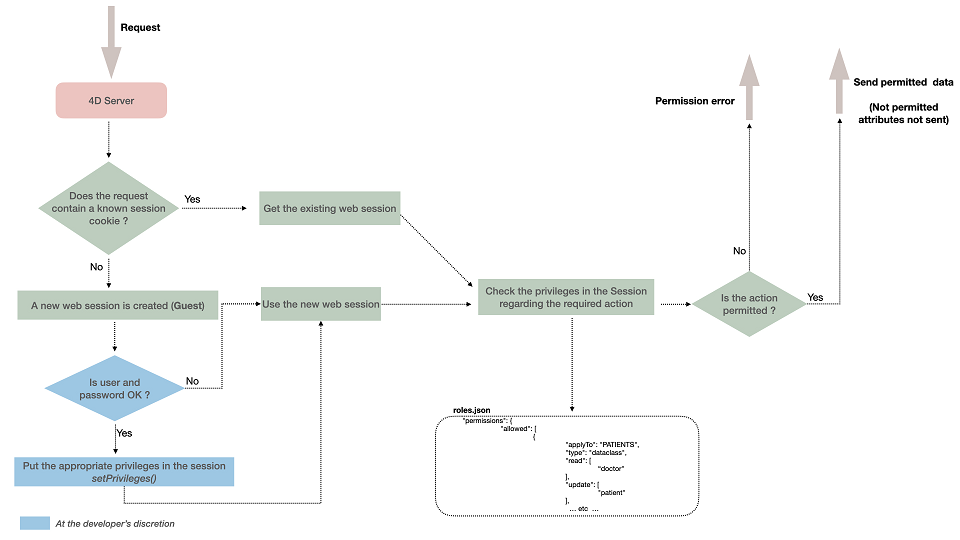

A arquitetura de segurança ORDA controla o acesso aos recursos do projeto para sessões web e REST. Ela permite conceder permissões específicas em recursos como o datastore, dataclasses, atributos e funções.

## Visão Geral

O modelo de segurança combina **privilégios**, **ações** (como `read` e `create`) e **recursos**.

Atribua privilégios a uma **sessão** usando [`Session.setPrivileges()`](../API/SessionClass.md#setprivileges).

Cada requisição é verificada em relação às permissões definidas no arquivo `roles.json` do projeto. Uma ação não autorizada gera um erro de privilégio. Atributos sem permissão de leitura são omitidos da resposta.



:::tip Related Blog posts

[**Filter access to your data with a complete system of permissions**](https://blog.4d.com/filter-access-to-your-data-with-a-complete-system-of-permissions/)

:::

:::info

Permissões controlam o acesso a objetos ou funções de armazenamento de dados. Se você deseja filtrar os dados lidos de acordo com alguns critérios, você pode considerar [restringir as seleções de entidades](entities.md#restricting-entity-selections) que pode ser mais apropriado neste caso.

:::

## Escopo

As permissões se aplicam a **sessões web e REST**: [requisições REST](../REST/gettingStarted.md), incluindo [páginas Qodly](https://developer.4d.com/qodly/4DQodlyPro/pageLoaders/pageLoaderOverview), e **código 4D executado em um processo web**. Isso inclui [funções expostas](./ordaClasses.md), [HTTP request handlers](../WebServer/http-request-handler.md), o [método de banco de dados On Web Connection](../commands/on-web-connection-database-method), e qualquer código chamado por eles. Por exemplo, uma chamada de função permitida ainda falha se a função ler uma dataclass para a qual a sessão não tem permissão de leitura.

:::info Exception

A permissão **execute** de um [singleton compartilhado](../Concepts/classes.md#shared-singleton) ou [função singleton](../Concepts/classes.md#singleton-classes) é verificada apenas quando a função é [chamada via REST](../REST/$singleton.md). Quando código 4D rodando em uma sessão web chama diretamente (`cs.MySingleton.me.myFunction()`), nenhuma permissão é verificada, ao contrário de funções de dataclass, entity, entity selection e datastore, que são verificadas em ambos os casos.

:::

Permissões nunca se aplicam a [código de sessão desktop](../Desktop/sessions.md) (standalone, client/server, stored procedures) ou [tool4d](../Admin/cli.md#tool4d).

### Ferramentas MCP

As mesmas permissões se aplicam às sessões do [servidor MCP](../WebServer/mcp-server.md), sem nada específico para configurar:

- Uma [ferramenta personalizada](../WebServer/mcp-server.md#custom-tools) (`exposed MCP Function`) requer permissão **execute** em sua função, e se beneficia da permissão **promote**.
- As [ferramentas CRUD integradas](../WebServer/mcp-server.md#built-in-crud-tools) requerem permissão **read**, **create**, **update** ou **drop** na dataclass, e as permissões de atributo se aplicam. Cada atributo de um caminho usado em filtro, ordenação ou projeção requer permissão **read**.
- As ferramentas CRUD só são listadas se a sessão tiver pelo menos uma permissão de dados em uma dataclass, e a ferramenta `describeModel` só descreve as dataclasses nas quais a sessão tem permissão de dados, com seus atributos legíveis ou graváveis.
- Uma ferramenta, dataclass ou atributo que a sessão não pode acessar é relatado como se não existisse.

#### Exemplo

Clientes MCP autenticados com o privilégio "salesReader" podem ler as dataclasses Customer e Order com as ferramentas CRUD, e chamar as ferramentas publicadas pelo singleton `OrderManager` (por exemplo, `OrderManager-getYearTotal`):

```json
{
	"privileges": [{"privilege": "salesReader", "includes": []}],
	"roles": [],
	"permissions": {
		"allowed": [
			{"applyTo": "Customer", "type": "dataclass", "read": ["salesReader"]},
			{"applyTo": "Order", "type": "dataclass", "read": ["salesReader"]},
			{"applyTo": "OrderManager", "type": "singleton", "execute": ["salesReader"]}
		]
	},
	"restrictedByDefault": true
}
```

## Recursos

O 4D verifica as permissões da sessão sempre que um recurso é acessado. Os seguintes recursos podem ter permissões específicas:

| Recurso | `applyTo` | `type` |
|---|---|---|
| [Datastore](./dsMapping.md#datastore) | `ds` | `datastore` |
| [Função de classe Datastore](./ordaClasses.md#datastore-class) | `ds.<function>` | `method` |
| [Dataclass](./dsMapping.md#dataclass) | `<Dataclass>` | `dataclass` |
| [Atributo](./dsMapping.md#attribute) (incluindo [computed](./ordaClasses.md#computed-attributes-1) e [alias](./ordaClasses.md#alias-attributes-1)) | `<Dataclass>.<attribute>` | `attribute` |
| [Função de dataclass, entity ou entity selection](./ordaClasses.md) | `<Dataclass>.<function>` | `method` |
| [Singleton compartilhado](../Concepts/classes.md#shared-singleton) (todas as funções expostas) | `<Singleton>` | `singleton` |
| [Função singleton](../Concepts/classes.md#singleton-classes) | `<Singleton>.<function>` | `singletonMethod` |

Use os valores de `applyTo` e `type` mostrados na tabela ao definir permissões no [`roles.json`](#rolesjson-file).

:::note Atribuição de permissões a funções de classe ORDA

No `roles.json`, identifique uma função de classe ORDA em `applyTo` com esta sintaxe:

```json
<DataclassName>.<functionName>
```
Por exemplo, se você quiser aplicar uma permissão à seguinte função:

```4d
// cs.CityEntity class
Class extends Entity
  Function getPopulation() : Integer
   ...
```
Use este valor:

```json
"applyTo":"City.getPopulation"
```

Como as permissões identificam funções por dataclass e nome da função, funções com o mesmo nome em diferentes classes ORDA (entity, entity selection, dataclass) não podem receber privilégios diferentes. Dê nomes distintos a elas. Por exemplo, nomeie as funções como `dropEntity()` e `dropSelection()` em `cs.CityEntity` e `cs.CitySelection`, respectivamente:

```json
	"permissions": {
		"allowed": [
			{
				"applyTo": "City.dropEntity",
				"type": "method",
				"promote": [
					"name"
				]
			},
			{
				"applyTo": "City.dropSelection",
				"type": "method",
				"promote": [
					"name"
				]
			}
		]
	}
}
```

:::

## Permissões

Uma **permissão** permite uma ação em um recurso; por exemplo, executar `ds.myTable.myFunction()`. Permissões são definidas em [`roles.json`](#rolesjson-file) e concedidas a um ou mais [privilégios](#privileges-and-roles).

Se nenhuma permissão for definida para um recurso, o acesso depende do [modo de restrição](#restriction-modes) do projeto.

### Ações de permissão

As ações disponíveis dependem do recurso:

| Ação | Datastore | Dataclass | Atributo | Função |
|---|---|---|---|---|
| **create** | Criar entidades em qualquer dataclass | Criar entidades nesta dataclass | Criar uma entidade com valor diferente do padrão para este atributo (ignorado para atributos alias) | n/a |
| **read** | Ler atributos em qualquer dataclass | Ler atributos nesta dataclass | Ler o conteúdo deste atributo | n/a |
| **update** | Atualizar atributos em qualquer dataclass | Atualizar atributos nesta dataclass | Atualizar o conteúdo deste atributo (ignorado para atributos alias) | n/a |
| **drop** ("Delete" no Qodly Studio) | Excluir dados em qualquer dataclass | Excluir dados nesta dataclass | Excluir um valor não nulo para este atributo (exceto para alias e atributos computados) | n/a |
| **execute** | Executar qualquer função no projeto (datastore, dataclass, entity selection, entity ou singleton) | Executar qualquer função na dataclass; funções de dataclass, entity e entity selection são tratadas como funções de dataclass | n/a | Executar esta função |
| **promote** | n/a | n/a | n/a | Adiciona temporariamente um privilégio durante a chamada da função. Apenas o processo que executa a função recebe o privilégio, não toda a sessão. Use [`promote()`](../API/SessionClass.md#promote) e [`demote()`](../API/SessionClass.md#demote) para definir ou remover esta ação dinamicamente em um processo web. |

### Regras de permissão

- **update** e **drop** requerem **read** no recurso; **create** não requer.
- Uma função pode ser **promoted** por múltiplos privilégios. Durante a execução, ela recebe as permissões combinadas de todos esses privilégios; não há ordem de prioridade.
- Um [atributo alias](./ordaClasses.md#alias-attributes-1) pode ser lido se a sessão tiver permissão para ler o alias, mesmo que não possa ler os atributos que o alias resolve.
- Um [atributo computado](./ordaClasses.md#computed-attributes-1) pode ser acessado mesmo que seus atributos subjacentes não tenham permissões.
- No REST [modo de login forçado](../REST/authUsers.md#force-login-mode), usuários guest sempre podem executar [`authentify()`](../REST/authUsers.md#function-authentify), independentemente da configuração de permissões.

### Permissões herdadas

Ações de permissão são herdadas conforme as seguintes regras:

1. Permissões descem **datastore → dataclass → atributo / função**, e **datastore → singleton → função singleton**.
2. A resolução é **por ação**. Definir `read` em uma dataclass não altera como `create`, `update`, `drop` ou `execute` são resolvidos para ela.
3. **Dataclass substitui datastore**. Uma permissão definida em uma dataclass para uma ação substitui a permissão do datastore para essa ação. Privilégios concedidos apenas no datastore perdem o acesso naquela dataclass.
4. **Função substitui dataclass**. Uma permissão `execute` definida em uma função substitui a permissão `execute` da dataclass (e do datastore) para aquela função. Funções de entity e entity selection seguem a mesma regra das funções de dataclass.
5. **Singleton substitui datastore**, **função singleton substitui singleton**.
6. **Função de datastore substitui datastore**.
7. **Atributo soma ao pai**. Para agir em um atributo que tem permissão própria, a sessão precisa de um privilégio concedido pela permissão do atributo **e** um privilégio concedido para a ação na dataclass (diretamente ou via datastore).
8. Uma ação concedida a **nenhum privilégio** (por exemplo, `"read": []`) é "não definida", então a permissão do nível acima se aplica. Não significa "ninguém". Para negar a ação, use [modo restrito](#restriction-modes) sem definir aquela permissão, ou conceda a um privilégio que nenhuma sessão recebe.

Permissões apenas concedem acesso; não há negação explícita. Uma permissão de dataclass ou função pode, portanto, restringir uma permissão mais ampla do datastore ao substituí-la. Uma permissão de atributo é aditiva: concede acesso ao atributo apenas quando a sessão também tem a ação na dataclass.

:::tip Prática recomendada

- Conceda acesso às sessões por meio de **funções** com `Session.setPrivileges({roles: [...]})`. Defina funções em torno de perfis de negócio; privilégios são blocos reutilizáveis. O [Qodly Studio](https://developer.4d.com/qodly/4DQodlyPro/roles/overview) exibe permissões efetivas por função.
- Se uma função administrativa precisa de acesso total, inclua todos os privilégios nela, exceto um privilégio de bloqueio, se usado. Adicione cada novo privilégio a essa função: uma permissão de dataclass pode substituir uma permissão mais ampla do datastore.
- Revise o efeito das mudanças de privilégio em cada função. No Qodly Studio, a **Revisão Detalhada de Permissões** mostra o acesso efetivo de uma função; uma função sem privilégios pode ajudar a revisar o acesso apenas de guest.

:::

## Privilégios e funções

Um **privilégio** concede ações sobre recursos. Uma **função** agrupa privilégios em um perfil de negócio que um administrador pode atribuir a uma sessão.

Por exemplo, `manageInvoices` pode ser um privilégio e `secretary` uma função que o inclui e outros privilégios. Atribua funções às sessões com [`Session.setPrivileges({roles: [...]})`](../API/SessionClass.md#setprivileges); a função concede todos os seus privilégios.

Privilégios podem receber permissão em múltiplas combinações ação-recurso, e uma ação pode ser concedida a múltiplos privilégios.

Defina privilégios e funções em [`roles.json`](#rolesjson-file), depois conceda funções às sessões com `Session.setPrivileges()`.

### Inclusão de privilégios

Um privilégio pode incluir outros privilégios usando a propriedade `includes` no `roles.json`. A inclusão é transitiva e unidirecional: se A inclui B, e B inclui C, A recebe as permissões de B e C.

[`Session.getPrivileges()`](../API/SessionClass.md#getprivileges) retorna a coleção expandida (por exemplo, A, B e C) sem ordem garantida. Declare um privilégio incluído antes do privilégio que o inclui; caso contrário, o 4D descarta a inclusão e registra um erro.

### Exemplo

Esta função de autenticação atribui a função do usuário à sessão:

```4d

exposed Function authenticate($identifier : Text; $password : Text)->$result : Text

    var $user : cs.UsersEntity

    Session.clearPrivileges()

    $result:="Você está autenticado como Convidado"

    $user:=ds.Users.query("identifier = :1"; $identifier).first()

    If ($user#Null)
        If (Verify password hash($password; $user.password))
            Session.setPrivileges(New object("roles"; $user.role))
            $result:="Você está autenticado como "+$user.role
        End if
    End if


```

## Privilégio `guest`

`guest` é embutido; declarar um privilégio chamado `Guest` é um erro ("privilege already defined"). Sessões sem privilégios (`Session.isGuest() = True`) recebem as permissões concedidas a `guest`.

Permissões concedidas a `guest` estão disponíveis para toda sessão, independentemente de seus outros privilégios. Não conceda a `guest` acesso que deva ser negado a outras sessões, e leve em conta suas permissões ao restringir acesso no nível da dataclass.

## arquivo `roles.json`

As configurações de segurança web do projeto são definidas em `roles.json`:

| Propriedade | Tipo | Obrigatório | Descrição |
|---|---|---|---|
| `privileges` | Coleção de objetos de privilégio | Sim | Privilégios definidos. Cada objeto tem um nome `privilege` e pode ter uma coleção `includes` de nomes de privilégios. |
| `roles` | Coleção de objetos de função | Não | Funções definidas. Cada objeto tem um nome `role` e uma coleção `privileges` de nomes de privilégios. |
| `permissions.allowed` | Coleção de objetos de permissão | Sim | Permissões atribuídas a recursos. |
| `permissions.allowed[].applyTo` | Texto | Sim | Nome do [recurso](#resources) alvo. |
| `permissions.allowed[].type` | Texto | Sim | Tipo de [recurso](#resources): `datastore`, `dataclass`, `attribute`, `method`, `singletonMethod` ou `singleton`. |
| `permissions.allowed[].read` | Coleção de strings | Não | Privilégios com acesso de leitura. |
| `permissions.allowed[].create` | Coleção de strings | Não | Privilégios com acesso de criação. |
| `permissions.allowed[].update` | Coleção de strings | Não | Privilégios com acesso de atualização. |
| `permissions.allowed[].drop` | Coleção de strings | Não | Privilégios com acesso de exclusão. |
| `permissions.allowed[].execute` | Coleção de strings | Não | Privilégios com acesso de execução. |
| `permissions.allowed[].promote` | Coleção de strings | Não | Privilégios concedidos temporariamente durante a execução da função. |
| `restrictedByDefault` | Booleano | Não | Se `true`, o acesso a recursos sem permissões explícitas é negado. |
| `forceLogin` | Booleano | Não | Se `true`, ativa o [modo de login forçado](../REST/authUsers.md#force-login-mode). |

:::note Notas

- O nome de privilégio `WebAdmin` é reservado para a aplicação; não o utilize para privilégios personalizados.
- Nomes de privilégio e função não diferenciam maiúsculas de minúsculas. Nomes desconhecidos passados para [`.setPrivileges()`](../API/SessionClass.md#setprivileges) são ignorados.
- O Qodly Studio pode adicionar uma propriedade opcional `id` a privilégios e funções para preservar referências ao serem renomeados.
- Múltiplas entradas com o mesmo `applyTo` não são mescladas: a última entrada prevalece sem erro. Defina apenas uma entrada por recurso.
- Uma entrada de recurso que não concede nenhuma ação não tem efeito.

:::

:::warning

Quando uma entrada de permissão faz referência a um [privilégio](#privileges-and-roles) não declarado, o 4D registra um erro e ignora a entrada. Neste caso, a permissão é ignorada. Se o [modo restrito por padrão](#restriction-modes) não estiver habilitado, o recurso fica acessível para sessões `guest`.

:::

### Localização e conteúdo padrão

Novos projetos geram o arquivo `roles.json` em:

```
<project folder>/Project/Sources/ 
```

Veja a seção [Arquitetura](../Project/architecture.md#sources) para detalhes.

Conteúdo padrão:

```json title="/Project/Sources/roles.json"

{
  "privileges": [
  ],
  "roles": [
  ],
  "permissions": {
    "allowed": [
      {
        "applyTo": "ds",
        "type": "datastore",
        "read": [],
        "create": [],
        "update": [],
        "drop": [],
        "execute": [],
        "promote": []
      }
    ]
  },
  "restrictedByDefault": false,
  "forceLogin": false
}
```

:::note Compatibidade

Em versões anteriores ao 4D 20 R6, o `roles.json` não era criado por padrão. No 4D 20 R6 e posteriores, ao abrir um projeto existente sem um arquivo `roles.json` ou configuração `"forceLogin": true`, o botão **Ativar autenticação REST através da função ds.authentify()** fica disponível na [página Recursos Web da caixa de diálogo Configurações](../settings/web.md#access). Este botão atualiza as configurações de segurança; pode ser necessário modificar seu código. Veja [este post do blog](https://blog.4d.com/force-login-becomes-default-for-all-rest-auth/).

:::

:::note Qodly Studio

No Qodly Studio para 4D, o modo de login pode ser definido usando a opção [**Force login**](https://developer.4d.com/qodly/4DQodlyPro/force-login) no painel Roles and Privileges.

:::

## Modos de restrição

`restrictedByDefault` determina o acesso a um [recurso](#resources) quando nenhuma [permissão específica](#permissions) é definida:

- **Modo irrestrito** (`restrictedByDefault: false`): Recursos sem permissões definidas são acessíveis a todas as requisições.
- **Modo restrito** (`restrictedByDefault: true`): Recursos sem permissões definidas são bloqueados. O acesso é concedido explicitamente, e as [regras de herança de permissão](#inherited-permissions) ainda se aplicam.

:::note Compatibidade

- Novos projetos definem `restrictedByDefault` como `false` por padrão; veja [configurações recomendadas](#recommended-configuration).
- Para projetos convertidos de versões anteriores, ao habilitar acesso ao Qodly Studio pelo [diálogo de configuração com um clique](https://developer.4d.com/qodly/4DQodlyPro/gettingStarted#one-click-configuration), `restrictedByDefault: true` é adicionado ao `roles.json`.

:::

### Estratégias de restrição

#### Bloquear tudo e abrir gradualmente

Escolha modo restrito ou um privilégio de bloqueio para fechar o acesso por padrão:

| | Modo restrito | Privilégio de bloqueio |
|---|---|---|
| Configuração | `"restrictedByDefault": true` (Qodly Studio: **Restrict Access By Default**) | `"restrictedByDefault": false`, com toda ação em `ds` concedida a um privilégio que nenhuma sessão recebe (por exemplo, `none`) |
| O que é fechado | Todo recurso sem permissão | Todo recurso que herda permissões do datastore |
| Como abrir | Conceda permissões no datastore, dataclasses, atributos e funções | Conceda permissões em dataclasses e funções para substituir o bloqueio |
| Se o 4D descartar uma entrada inválida | O recurso permanece fechado | O recurso volta ao bloqueio e permanece fechado |
| Importante | Conceda acesso explicitamente a recursos públicos, geralmente para `guest`, incluindo a função de login, a menos que [force login](../REST/authUsers.md#force-login-mode) seja usado, e [HTTP request handlers](../WebServer/http-request-handler.md) chamados antes do login. Neste modo, a revisão de funções do Qodly Studio atualmente está incorreta. | Nunca atribua o privilégio de bloqueio a uma função, incluindo a função administrativa. |

Ambas as abordagens fecham o acesso por padrão e seguem as mesmas regras de herança e substituição. Um privilégio de bloqueio torna o bloqueio visível no editor; modo restrito não requer privilégio extra.

#### Abrir tudo, restringir gradualmente

Defina modo irrestrito (`"restrictedByDefault": false`), conceda ao `guest` acesso de leitura ao `ds`, depois restrinja dataclasses sensíveis com permissões no nível da dataclass.

Lembre-se que as permissões de [guest](#guest-privilege) se aplicam a toda sessão. Sem privilégio de bloqueio, uma entrada inválida descartada pelo 4D deixa o recurso aberto em modo irrestrito.

#### Configuração recomendada {#recommended-configuration}

Use estas configurações como ponto de partida:

- **Desenvolvimento**: Defina ambas as propriedades como `false` para facilitar o acesso durante o desenvolvimento e depuração. Aplique restrições gradualmente conforme necessário.
- **Produção**: Defina `restrictedByDefault` e [`forceLogin`](../REST/authUsers.md#force-login-mode) como `true` para que os usuários precisem autenticar e o acesso aos recursos seja explicitamente concedido.

## Erros de permissão

### Arquivo `Roles_Errors.json`

O 4D analisa o `roles.json` na inicialização. Reinicie o aplicativo para que as alterações tenham efeito.

Se a análise falhar, o 4D grava os erros em `Roles_Errors.json` na [`pasta Logs` do projeto](../Project/architecture.md#logs). Ele exclui este arquivo após o `roles.json` ser corrigido.

Verifique na inicialização, especialmente em produção, se existe o arquivo `Roles_Errors.json`. Sua presença indica erro de análise, e as permissões podem não ser aplicadas como esperado. Você pode escrever, por exemplo:

```4d title="/Sources/DatabaseMethods/onStartup.4dm"
Se (Not(File("/LOGS/"+"Roles_Errors.json").exists))
...
Senão // você pode impedir o projeto de abrir
 ALERT("O arquivo roles.json está malformado ou contém inconsistências, o aplicativo será encerrado.")
 QUIT 4D
Finalizado, se
```

Erros de permissão são retornados da seguinte forma:

| Caminho | read / create / update / drop recusado | execute recusado |
|---|---|---|
| REST | HTTP 401 com mensagem | **HTTP 500** com mensagem (singleton: "Bad permission...") |
| Código (sessão web) | Leitura: erro 1557 (dataclass) ou 1607 (atributo). Criação: erro 1608 ao atribuir um atributo a uma nova entidade se create for restrito por permissão; em modo restrito sem permissão, `save()` retorna `success: false` e `statusText: "Permission Error"`. Update/drop: erro 1557 ao carregar a entidade (ambos requerem read). | Erro 1561 |

## Exemplo

Este exemplo concede um conjunto amplo de permissões via privilégio `manager`, enquanto o privilégio `payroll` concede acesso de leitura à dataclass sensível `Salaries`.

```json title="roles.json"
{
  "forceLogin": true,
  "restrictedByDefault": true,
  "privileges": [
    {"privilege": "payroll", "includes": []},
    {"privilege": "manager", "includes": []}
  ],
  "roles": [
    {"role": "administrator", "privileges": ["manager", "payroll"]}
  ],
  "permissions": {
    "allowed": [
      {
        "applyTo": "ds",
        "type": "datastore",
        "read": ["manager"],
        "create": ["manager"],
        "update": ["manager"],
        "drop": ["manager"],
        "execute": ["manager"]
      },
      {
        "applyTo": "Salaries",
        "type": "dataclass",
        "read": ["payroll"]
      }
    ]
  }
}
```

Aqui estão as regras resultantes:

| Sessão | Ler Salaries | Criar Salaries | Atualizar/excluir Salaries | Ler outras dataclasses |
|---|---|---|---|---|
| `manager` | Recusado (a permissão read de `Salaries` substitui a permissão do datastore) | Permitido (herdado do datastore) | Recusado (read é obrigatório) | Permitido |
| `payroll` | Permitido | Recusado (a permissão do datastore é concedida apenas a `manager`) | Recusado | Recusado |
| função `administrator` | Permitido | Permitido | Permitido | Permitido |

A permissão read de `Salaries` substitui a permissão read do datastore, então apenas `manager` não pode ler essa dataclass. A função `administrator` recebe as permissões combinadas de `manager` e `payroll`.
