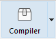
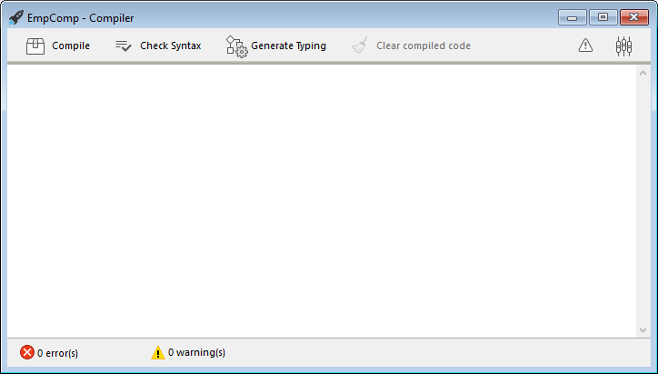
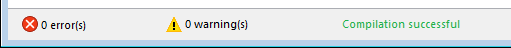
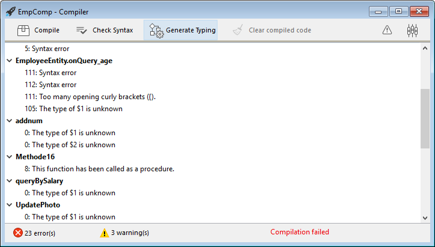
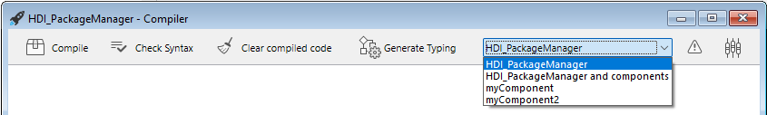
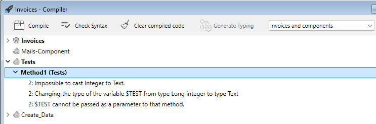
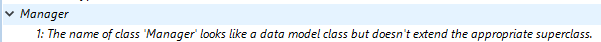
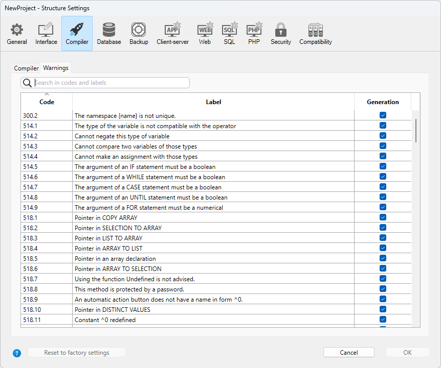

Você pode compilar seus projetos, ou seja, traduzir todos os seus métodos para a linguagem da máquina. Compilar um projeto permite que você verifique a consistência do código e acelere a sua execução, Além de tornar possível ofuscar o código na sua totalidade. A compilação constitui um passo indispensável entre o desenvolvimento de projetos que utilizam o 4D e a sua implantação como aplicações isoladas.

## Compilar

A compilação é tratada da sua aplicação 4D e é inteiramente automática.

> Em macOS, a compilação requer que você instale o `Xcode`. Veja [esta seção](#silicon-compiler) para mais informações sobre este requisito.

1. Abra la ventana de compilação selecionando o comando **Compilador...** no menu **Design** ou o botão **Compilador** da barra de ferramentas.

   

   

> Você também pode iniciar diretamente a compilação selecionando o item de menu **Iniciar Compilação** no menu **Design**.

2. Clique no botão **Compilar** para iniciar a compilação usando as [configurações de compilação](#compiler-settings) atuais.

Se nenhum erro for detectado, a compilação atual começa e a mensagem "Compilação com sucesso" é exibida na parte inferior da janela quando a compilação é concluída:



Você pode imediatamente [executar sua aplicação em modo compilado](#run-compiled) e ver como ela está mais rápida.

Se erros forem detectados, o processo é interrompido e a mensagem "Compilação falhou" é exibida. A área de informação da janela exibe os nomes de métodos e números de linha envolvidos em uma lista hierárquica:



Clique duas vezes em cada erro detectado para abrir o método ou a classe em questão diretamente no Editor de Código 4D. A linha que contém o erro é destacada e o tipo de erro é exibido na área de sintaxe da janela.

Utilize os comandos **Erro Anterior** / **Próximo Erro** do menu **Método** para navegar de um erro a outro.

O número de erros encontrados durante as suas primeiras compilações podem ser um desafio, mas não deixe isso te avisar. Logo você descobrirá que eles muitas vezes nascem da mesma fonte, ou seja, não conformidade com certas convenções do projeto. O compilador sempre oferece um [diagnóstico preciso](#error-file) dos erros para ajudá-lo a corrigi-los.

:::note

Compilation requires an [appropriate license](../Admin/licenses.md). Sem esta licença, não é possível realizar uma compilação (os botões estão desativados). No entanto, ainda é possível verificar a sintaxe e gerar métodos de digitação.

:::

### Compile components

<details><summary>História</summary>

| Release | Mudanças   |
| ------- | ---------- |
| 21 R5   | Adicionado |

</details>

While developing your application, you can compile the components used by the host project directly from the host project, without having to open them separately. When the host project contains one or more *eligible* components (see [Requirements](#requirements) below), an additional menu is displayed in the Compiler window. This menu lets you select which project(s) you want to compile:

- the host project only (default)
- the host project and all its eligible components
- a single eligible component among the list of all eligible components.



:::note

You can open the Compiler window from the **Methods>Component Methods** section of the Explorer: right-click on an eligible component name and select **Compiler...** from the contextuel menu.

:::

A list of components being compiled is displayed in the Compiler window. If an error is detected in a component, its compilation is stopped but the process continues for other components.

- Components with at least one error can be unfolded to display the list of errors and appear **in bold**.
- Components with at least one warning can be unfolded to display the list of warnings.
- Components wihout errors cannot be unfolded.

#### Requisitos

To be eligible for compilation from the host project, a component must comply with the following requirements:

- the component uses the [project architecture](../Project/architecture.md),
- the component's [interpreted code](../Concepts/interpreted.md) is available and the component is not [running in compiled mode](#run-compiled),
- the component uses [direct typing](#enabling-direct-typing) declarations.

:::note

The additional menu is not displayed if the project does not contain any eligible component.

:::

#### Compiler features & Settings

All available features of the Compiler window are applied to the selected component(s): **Compile**, **Check syntax**, **Clear compiled code**.

The [Settings](../settings/) cannot be edited when a component is selected (the button is dimmed).

Each component's [settings](../settings/) are applied for the compilation, except the [error file and symbol file generation options](#compilation-options): settings of the host project override the component's options. When enabled, [error and warning file](#error-file) as well as [symbol file](#symbol-file) of each component are stored in the [**Logs** folder of the host project](../Project/architecture.md#logs), within a dedicated folder (the name of the folder is the component name).

When you start a compilation or a syntax check, every processed project is listed in the compiler window. If errors or warnings are detected, they are displayed in hierarchical lists beneath the corresponding project. Projects that contain errors are displayed in **bold**:



## Executar a compilação

Uma vez compilado um projeto, é possível passar do [modo interpretado ao modo compilado](Concepts/interpreted.md), e vice-versa, em qualquer momento e sem ter que sair da aplicação 4D (exceto quando o código interpretado foi removido). Para isso, utilize os comandos **Reiniciar em interpretado** e **Reiniciar em compilado** do menu **Executar**. A [caixa de diálogo de abertura do projeto](GettingStarted/creating.md#options) também oferece escolher entre o modo interpretado ou compilado para iniciar o banco de dados.

Quando você alternar de um modo para o outro, a 4D fecha o modo atual e abre o novo. Isto é equivalente a sair e reabrir a aplicação. Cada vez que você muda de um modo para outro, o 4D executa os dois métodos base seguintes (se especificados) nesta ordem: `On Exit` -> `On Startup`.

Se você modificar seu projeto em modo interpretado, é necessário recompilá-lo para que suas edições sejam consideradas no modo compilado.

## Características da janela do compilador

Além do botão [**Compilar**](#compilar), a janela Compilador oferece recursos adicionais que são úteis durante a fase de desenvolvimento do projeto.

### Verificar sintaxe

O botão **Verificar a sintaxe** inicia a execução da fase de verificação de sintaxe. No final do processo de verificação, todos os erros detectados são listados na área de informações. Você pode clicar duas vezes em uma linha de erro para exibir o método ou objeto de formulário correspondente.

A verificação de sintaxe também pode ser iniciada diretamente usando o comando **Verificar sintaxe** associado ao botão da barra de ferramentas **Compilador**. Esta é a única opção disponível se você não tiver uma licença adequada para permitir a compilação de aplicações.

### Gerar digitação

:::info Compatibidade

Este botão só será exibido em projetos convertidos se as **variáveis forem digitadas (digitação direta)** [opção do caminho de compilação](#enabling-direct-typing) não estiverem selecionadas. Para informações sobre este botão, consulte a [documentação de versões 4D anteriores](../Project/compiler.md#generate-typing).

:::

### Limpar código compilado

O botão **Limpar o código compilado** exclui o código compilado do projeto. Ao clicar nele, todo o [código gerado durante a compilação](#classic-compiler) é excluído, o comando **Reiniciar compilado** do menu **Executar** é desativado e a opção "Projeto compilado" não está disponível na inicialização.

### Mostrar/ocultar avisos

Você pode alternar a exibição de [warnings](#warnings) na janela do Compilador clicando no botão **Mostrar/Esconder Warnings**:


Quando essa opção for marcada, os avisos (se houver) são exibidos na janela, após os outros tipos de erro. Estas aparecem em itálico:



Um duplo clique num aviso abre o método correspondente.

## Parâmetros do compilador

A aba "Compilador" da caixa de diálogo de Configurações permite definir parâmetros relacionados à compilação do projeto. Você pode abrir diretamente esta página através da [janela do compilador](#compiler-window-features) clicando no botão **Parâmetros do Compilador**:


### Opções de compilação

Essa área agrupa as opções genéricas usadas durante o processo de compilação.

#### Gerar o arquivo de símbolo

Usado para gerar o arquivo de símbolo (veja [arquivo de símbolos](#symbol-file)). O arquivo de símbolo é criado na [pasta Logs](../Project/architecture.md#logs) do projeto com o nome `ProjectName_symbols.txt`.

#### Gerar ficheiro de erros

Usado para gerar o arquivo de erro (veja [arquivo de erro](#error-file)) no momento da verificação de sintaxe. O arquivo de erro foi criado na [pasta Logs](../Project/architecture.md#logs) do projeto com o nome `ProjectName_errors.xml`.

#### Objectivo de compilação

<details><summary>História</summary>

| Release | Mudanças   |
| ------- | ---------- |
| 19      | Adicionado |

</details>

Este parâmetro permite selecionar a família de processadores para a qual seu projeto 4D deve ser compilado nativamente. O compilador 4D pode criar código nativo para duas famílias de processadores:

- **Processadores Intel/AMD** (todas as máquinas),
- **Processadores Apple Silicon**.

Duas opções de alvo estão disponíveis. O resultado depende do processador da máquina em que 4D está em execução.

| *Opção*                                                                   | *no Windows Intel/AMD*                                                             | *no macOS Intel*                                                                                    | *no macOS Silicon*                                                                               |
| ------------------------------------------------------------------------- | ---------------------------------------------------------------------------------- | ------------------------------------------------------------------------------------------------ | ------------------------------------------------------------------------------------------------ |
| **Todos os processadores (Intel/AMD e Apple Silicon)** | Código para Intel/AMD<br/>*Não é possível produzir código Apple Silicon no Windows* | Código para Apple Silicon + Código para Intel/AMD<br/>*Dois códigos compilados estarão disponíveis* | Código para Apple Silicon + Código para Intel/AMD<br/>*Dois códigos compilados estarão disponíveis* |
| **O meu processador (processador)**                    | Código para Intel/AMD                                                              | Código para Intel/AMD                                                                            | Código para Apple Silicon                                                                        |

> O alvo do compilador Apple Silicon requer que o aplicativo **Clang** esteja instalado em sua máquina. Clang vem com a versão mais recente do Xcode. Veja os [requisitos do compilador Silicon](#requirements) para mais informações.

### Opções adicionais (Compatibilidade)

Em projetos convertidos de versões 4D anteriores a 20 R7, opções de compilação adicionais estão disponíveis:

- **Caminho de compilação**
- **Digitação padrão**
- **Métodos Compilador para...**

Essas opções só são mantidas para compatibilidade com os códigos legados. Para mais informações, consulte a [documentação de lançamentos 4D anteriores](../Project/compiler.md#compiler-settings).

Em projetos convertidos, é recomendado [ativar o modo de digitação direta](#enabling-direct-typing) e escrever o código de declaração em conformidade, i.e.:

- declarar explicitamente todas as variáveis [usando palavras-chave `var`](../Concepts/variables.md#declaring-variables)
- declarar explicitamente todos os parâmetros em protótipos de função (ou seja, usando as palavras-chave `Function` ou `Class constructor`) ou com palavras-chave `#DECLARE` em métodos (veja [Declarando parâmetros](../Concepts/parameters.md#declaring-parameters).

#### Ativando digitação direta

:::info

O modo de digitação direta é opcional somente em projetos convertidos. É utilizado nativamente em projetos criados com 4D 20 R7 e superior.

:::

Selecione **Todas as variáveis são digitadas (digitação direta)** no menu **Compilação de Caminho** para habilitar o modo de digitação direta. Quando esta opção for selecionada, outras opções de compatibilidade se tornam inúteis e não são mais exibidas.

Recomenda-se a utilização desta opção, uma vez que proporciona flexibilidade e eficiência. O conceito de digitação direta assume que todos os elementos são declarados diretamente onde eles são definidos em seu código. Você só precisa ter certeza de que todas as suas variáveis são declaradas usando o recurso regular [`var` syntax](../Concepts/variables.md#declaring-variables) e que seu método e parâmetros de função são declarados [em seus protótipos](../Concepts/parameters.md) (o recurso [Verificar sintaxe](#check-syntax) pode ajudá-lo a detectar declarações ausentes ou inválidas).

## Avisos

Avisos são mensagens específicas geradas pelo compilador quando verifica a sintaxe. Essas mensagens têm o objetivo de chamar sua atenção para declarações que podem levar a erros de execução. Não impedem a compilação.

Dependendo das circunstâncias e do estilo de programação utilizado, os avisos podem ser mais ou menos relevantes. Você pode ativar ou desativar avisos, na janela do compilador e nos editores de código (editor de código 4D e VS Code), globalmente através da [aba de avisos](#warnings-tab) ou localmente usando [`//%W`](#disabling-and-enabling-warnings-locally).

### Aba de avisos



Esta aba permite definir quais avisos devem ser exibidos globalmente. A partir da lista de todos os avisos possíveis com seus tipos, seus códigos e seus rótulos localizados, ordenados por código de aviso.

Para reduzir a lista, você pode pesquisar palavras por etiquetas e códigos de aviso usando a caixa de texto **Pesquisar em códigos e rótulos** ou o ícone da lupa à esquerda.

Por padrão, todos os tipos de aviso estão marcados e ativados.

Quando você modifica o status de exibição de um aviso, a informação é armazenada no arquivo "warnings.json", colocado na pasta de Configurações do projeto.

O botão **Restaurar configurações de fábrica** define todas as caixas de seleção de status de exibição de aviso para os valores padrão e exclui o arquivo "warnings.json".

### Desativar e ativar avisos localmente

Você pode controlar avisos em partes específicas do seu código usando comentários especiais para desativá-los ou ativá-los.

Para desativar avisos, insira os seguintes comentários antes e depois da seção de código onde deseja desativar os avisos:

```4d
// Antes da parte selecionada do código use
  //%W-<número do aviso>

// Depois da parte selecionada do código use
  //%W+<número do aviso>
```

Para reativar os avisos em uma seção de código, use os seguintes comentários:

```4d
// Antes da parte selecionada do código use
  //%W+<número do aviso>

// Depois da parte selecionada do código use
  //%W-<número do aviso>
```

Somente avisos com números podem ser desativados ou ativados. Os números dos avisos são especificados ao final de cada mensagem na lista de erros de compilação ou na lista encontrada na aba de avisos.
Por exemplo, para desativar o seguinte aviso:

*1: Redefinição da variável $a (550.10)*

... você só precisa escrever os seguintes comentários em seu método 4D:

```4d
  var $a : Text
  $a:="hello world"
  
  //%W-550.10
  var $a : Text
  //%W+550.10
  
```

:::note

Os comentários especiais de avisos têm prioridade sobre as configurações de exibição de avisos definidas na aba de avisos.

:::

## Ferramentas de compilação

### Ficheiro Symbol

Se você marcar a opção [**Gerar o arquivo de símbolos**](#symbol-file) nas configurações do compilador, um arquivo de símbolo chamado `ProjectName_symbols.txt` é criado na [pasta Logs](../Project/architecture.md#logs) do projeto durante a compilação. Está dividido em várias partes:

#### Lista das variáveis processo e interprocesso

Estas duas listas contêm quatro colunas:

- Nomes de variáveis e arrays processo e interprocesso usadas em seu projeto. Estas variáveis são enumeradas por ordem alfabética.
- Tipo da variável. Os tipos são definidos por comandos da diretiva do compilador ou são determinados pelo compilador com base na utilização da variável. Se o tipo de uma variável não puder ser determinado, a coluna estará vazia.
- Número de dimensões se a variável for um array.
- Referência ao contexto onde o compilador estabeleceu o tipo da variável. Se a variável é usada em vários contextos, o contexto mencionado é o usado pelo compilador para determinar seu tipo.
  - Se a variável foi encontrada em um método de banco de dados, o nome do método de banco de dados é dado, precedido por (M)\*.
  - Se a variável foi encontrada em um método do projeto, o método é identificado como foi definido em 4D, precedido por (M).
  - Se a variável for encontrada em um gatilho, o nome da tabela é dado, precedido por (TM).
  - Se a variável foi encontrada em um método do formulário, o nome do formulário é dado, precedido pelo nome da tabela e (FM).
  - Se a variável foi encontrada em um método do objeto, o nome do método do objeto é fornecido, precedido pelo nome do formulário, nome da tabela, e por (OM).
  - Se a variável for um objeto em um formulário e não aparecer em qualquer projeto, formulário, método do objeto, ou gatilho, o nome do formulário em que aparece é dado, precedido por (F).
    No final de cada lista, você pode encontrar os tamanhos das variáveis do processo e interprocessos em bytes.

> Durante a compilação, o compilador não pode determinar em qual processo uma determinada variável de processo é usada. Uma variável processo pode ter um valor diferente em cada processo. Consequentemente, todas as variáveis do processo são sistematicamente duplicadas à medida que cada novo processo é lançado: portanto, é aconselhável ter cuidado com a quantidade de memória que eles vão utilizar. Além disso, lembre-se de que o espaço para as variáveis do processo não está relacionado ao tamanho da pilha do processo.

#### Lista de variáveis locais

A lista de variáveis locais é classificada pelo método banco de dados, método projeto, trigger, método formulário e método objeto, na mesma ordem que em 4D.

Esta lista está dividida em três colunas:

- lista das variáveis locais utilizadas no método;
- tipo da variável;
- número de dimensões se a variável for um array.

#### Lista completa de métodos

Uma lista completa de seus métodos banco de dados e projeto é apresentada no final do ficheiro com:

- o seu tipo (procedimento ou função que devolve um valor)
- os tipos de dados de seus parâmetros e o resultado retornado
- o número de chamadas
- a propriedade Thread Safe ou Thread Unsafe.

Esta informação aparece da seguinte forma:

```
Procedimiento o función <Method name>(tipos de datos de los parámetros):
tipo resultado, número de llamadas, Thread Safe o Thread Unsafe
```

### Arquivo de erros

Você pode escolher se deseja ou não gerar um arquivo de erro durante a compilação usando a opção [**Gerar arquivo de erro**](#generate-error-file) nas configurações do compilador. O arquivo de erro é automaticamente chamado `projectName_errors.xml` e é colocado na [pasta de logs](../Project/architecture.md#logs) do projeto.

Embora os erros possam ser acessados diretamente pela [janela do compilador](#compile), pode ser útil ter um arquivo de erro que possa ser transmitido de uma máquina para outra. O arquivo de erro é gerado no formato XML para facilitar a análise automática de seu conteúdo. Também permite a criação de interfaces customizadas de exibição de erros.

O tamanho do arquivo de erros depende do número de erros e avisos emitidos pelo compilador.

A estrutura do ficheiro de erros é a seguinte:

- Na parte superior do arquivo está a lista de erros e avisos, classificados por método e em sua ordem de criação em 4D.
- Na seção ***Erros gerais***, todas as impossibilidades de digitação e ambiguidades de identidade são agrupadas. Esses erros e avisos são listados usando o seguinte formato:
  - número da linha no método (0 indica erros gerais)
  - atributo de aviso indicando se a anomalia detectada é um aviso (warning="true") ou um erro (warning="false")
  - diagnóstico que descreve o erro

Se seu projeto não tiver erros gerais, o arquivo não terá uma seção *Erros gerais*.

Um ficheiro de erros pode conter três tipos de mensagens:

- **Erros associados a uma linha específica**: esses erros são exibidos em contexto — a linha em que foram encontrados — com uma explicação. O compilador relata esse tipo de erro quando encontra uma expressão em que vê uma inconsistência relacionada ao tipo de dados ou sintaxe. Na janela do compilador, clique duas vezes em cada erro detectado para abrir o método em questão diretamente no Editor de Código 4D, com a linha que contém o erro destacado.

- **Erros gerais**: são erros que impossibilitam a compilação do projeto. Existem dois casos em que o compilador relata um erro geral:
  - Não foi possível determinar o tipo de dados de uma variável processo.
  - Dois tipos diferentes de objetos têm o mesmo nome.

Os erros gerais são assim chamados porque não podem ser vinculados a nenhum método específico. No primeiro caso, o compilador não pôde executar uma digitação especificada em nenhum lugar do projeto. No segundo, ele não conseguiu decidir se associava um determinado nome a um objeto e não a outro.

- **Avisos**: avisos não são erros. Eles não impedem que o projeto seja compilado, mas simplesmente apontam possíveis erros de código. Na janela do compilador, os avisos aparecem em itálico. Clique duas vezes em cada aviso para abrir o método em questão diretamente no Editor de Código 4D, com a linha que contém o aviso destacado.

### Controlo de execução

O código gerado pelo compilador 4D verifica automaticamente que todo acesso a um elemento de array ou uma referência de caractere é feito no intervalo real de elementos do array, ou de caracteres de string. Os acessos fora do intervalo provocarão erros de execução em tempo de execução.

Em alguns casos, pode preferir que a verificação de intervalos não se aplique a certas partes do código consideradas fiáveis. Mais especificamente, no caso de repetições que se repetem por diversas vezes. e ao executar a base de dados compilada em máquinas mais antigas, a verificação por intervalo pode diminuir significativamente o processamento. Se você tiver certeza de que o código em questão é confiável e não pode causar erros no sistema, poderá desativar a verificação de intervalo localmente.

Para isso, você deve envolver o código a ser excluído da verificação de intervalo com os comentários especiais `//%R-` e `//%R+`. O comentário `//%R-` desativa a verificação de intervalo e `//%R+` a ativa novamente:

```4d
  // %R-   to disable range checking
 
 ... //Place the code to be excluded from range checking here
 
  // %R+   to enable range checking again for the rest
```

## Sobre os compiladores

4D contém dois compiladores:

- um compilador "clássico", usado para compilar código nativo para processadores Intel/AMD;
- um compilador Silicon, para compilar código nativo para processadores Apple Silicon.

O compilador clássico pode ser usado em qualquer plataforma, enquanto o compilador do Silicon só pode ser usado em uma máquina Mac:

|             |     Compilar para Windows    |    Compilar para Intel Mac   |   Compilar para Silicon Mac  |
| ----------- | :--------------------------: | :--------------------------: | :--------------------------: |
| Em Windows  | &#10003; | &#10003; | &#10007; |
| Intel Mac   | &#10003; | &#10003; | &#10003; |
| Silicon Mac | &#10003; | &#10003; | &#10003; |

Ambos os compiladores estão integrados em 4D. O compilador apropriado é selecionado automaticamente dependendo da opção [objetivo de compilação](#compilation-target).

### Compilador clássico

O compilador clássico gera código compilado nativo para processadores Intel/AMD em qualquer máquina. Não necessita de qualquer configuração específica.

O código compilado resultante é armazenado na pasta [DerivedData](architecture.md#deriveddata) do projeto.

### Compilador Silicon

O compilador Silicon gera código compilado nativo para processadores Apple Silicon, como *Apple M1*.

O código compilado resultante é armazenado na pasta [Libraries](architecture.md#libraries) do projeto.

#### Requisitos

- **Máquina Apple**: o compilador Silicon só pode ser executado a partir de uma máquina Apple.
- **Arquitetura de Projeto 4D**: o compilador Silicon só está disponível para desenvolvimentos 4D que utilizam [arquitetura de projeto](architecture.md).
- **Xcode ou Developer Tools**: o compilador Silicon chama o compilador open-source de macOS **Clang** para compilar o projeto a partir de código C++ na [segunda etapa](#incremental-compiler) da compilação. *clang* requer bibliotecas nativas da Apple, que são fornecidas pelo pacote **Xcode** ou **Developer Tools**.
  - **Se você já tem** Xcode ou Developer Tools instalados em seu computador, só precisa garantir que sua versão está em conformidade com os requisitos do 4D.
  - **Se você não tem** nenhuma dessas ferramentas instaladas em seu computador, será necessário baixar uma delas no site Apple Developer.

> Recomendamos instalar o **Xcode**, que é bastante simples de instalar. Você pode decidir instalar o **Developer Tools**, que é mais compacto, porém sua instalação é um pouco mais complexa.

Em quaisquer casos, o compilador 4D de Silicon irá avisá-lo se sua configuração não corresponder com seus requisitos.

#### Compilador incremental

O compilador Silicon é incremental, o que significa que:

- Durante a primeira compilação, **todos os métodos 4D** são compilados. Esta etapa pode demorar algum tempo. No entanto, só ocorre uma vez.
- Durante todas as compilações subsequentes, apenas **novos ou métodos modificados** são processados, reduzindo drasticamente o tempo de compilação.
