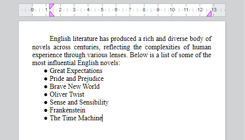
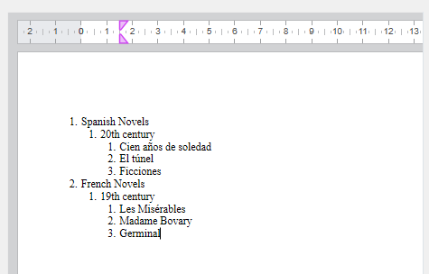

to import

<!-- REF lists-WP.Desc -->

## Listas

4D Write Pro supports flat lists (single-level) and multi-level lists.

### 単一レベルのリスト

4D Write Pro は主に2つのタイプの単一レベルのリストをサポートします:

- 順番なしリスト: リストの項目は箇条書き記号、カスタムの箇条書き記号、あるいはマーカーとして使用される画像でマークされます。
- 順番付きリスト: リストの項目は番号または文字でマークされます。

これらは以下の方法で作成することができます:

- [4D Write Pro インターフェース](https://doc.4d.com/4Dv20/4D/20.2/Entry-areas.300-6750367.ja.html#5865253) のツールバーまたはサイドバー
- `listStyleType` あるいは `listStyleImage` の[標準アクション](./standard-actions)
- あるいは[WP SET ATTRIBUTE](../commands/wp-set-attributes) コマンドを使用して[プログラムで作成する](../commands-legacy/4d-write-pro-attributes.md#リスト)。

標準アクション(`listStyleType` あるいは `listStyleImage`) あるいはツールバー/サイドバーを使用してリストが作成された場合、4D Write Pro はマーカーがテキストの内側に表示されるように、自動的にテキストの前に余白を挿入します。 挿入される余白の値は、デフォルトタブのオフセット(`wk tab default`) に対応します。



[WP SET ATTRIBUTE コマンド](../commands-legacy/4d-write-pro-attributes.md#リスト)コマンドを使用してリストが作成された場合、具体的な余白は設定されておらず、デフォルトでマーカーは段落の左端に追加されます。 必要であれば開発者はカスタムの余白を追加することができます。

:::tip Related blog post

[4D Write Pro – Adding a margin automatically when bullets are set using standard actions](https://blog.4d.com/4d-write-pro-adding-a-margin-automatically-when-bullets-are-set-using-standard-actions)

:::

### 複数レベルのリスト

Multi-level lists contain a root-level style sheet and one or more sub-level style sheet(s). Multi-level lists are based on [multi-level list style sheets](../user-legacy/stylesheets.md#multi-level-list-style-sheets). Each level is attached to a multi-level list style sheet and represents a depth in the list (level 1, level 2, level 3, etc.).

新しいサブレベルが作成されると、レベルの番号振り分けは1 から再スタートします。 マルチレベルリスト内で要素を追加または削除した場合、番号は自動的に調整されます。



[WP New style sheet](../commands/wp-new-style-sheet.md) コマンドで作成され、[WP SET ATTRIBUTE](../commands/wp-set-attributes.md) を使用して段落に適用することができます。

マルチレベルリストは以下の方法で管理することができます:

- 段落[スタイルシート属性](../commands-legacy/4d-write-pro-attributes.md#スタイルシート) (例えば`wk list level index`、 `wk list level count`、および `wk list concat string format` など)
- レベル管理専用の[標準アクション](../user-legacy/standard-actions.md) (`listLevelAppend`、 `listLevelInc`、 `listLevelDec` など)
- マーカー管理の番号管理専用の標準アクション(`listConcatStringFormat`、 `listNumberFormat`)。

:::tip Related blog post

[4D Write Pro – Creating Multi-level Bullet or Numbered Lists Using Multi-level list Style Sheets](https://blog.4d.com/4d-write-pro-creating-multi-level-bullet-or-numbered-lists-using-multi-level-paragraph-style-sheets)

:::

<!-- END REF -->

<!-- REF multi-level-list-style-sheets.Desc -->

## Multi-level list style sheets

Multi-level list style sheets are used to create [multi-level lists](../user-legacy/using-a-4d-write-pro-area.md#multi-level-lists).

To create a multi-level list style sheet, use [WP New style sheet](../commands/wp-new-style-sheet.md) and pass in *listLevelCount* the desired number of levels. You then define a hierarchy of related paragraph style sheets: one **root-level** style sheet and one or more **sub-level** style sheets linked to it. Each level represents a depth in the list (level 1, level 2, level 3, etc.) and is automatically named "root-level name + lvl + index", for example "Mylist lvl 2".

To customize multi-level list styles, the paragraph style sheet object can be customized using [style sheet attributes](../commands-legacy/4d-write-pro-attributes.md#style-sheets).

Multi-level list style sheets are fully supported by the following commands: [`WP Get style sheet`](../commands/wp-get-style-sheet.md), [`WP SET ATTRIBUTES`](../commands/wp-set-attributes.md), [`WP DELETE STYLE SHEET`](../commands/wp-delete-style-sheet.md).

### Exemplo

The following example creates a three-level multi-level list style sheet and applies it to paragraphs.

```4d
// Create 3 multi-level list style sheets
WP New style sheet(wpArea; wk type paragraph; "MyList"; 3)

// Retrieve each level
var $level1; $level2; $level3 : Object
$level1:=WP Get style sheet(wpArea; "MyList"; 1) // Root level
$level2:=WP Get style sheet(wpArea; "MyList"; 2) // 1st sub-level
$level3:=WP Get style sheet(wpArea; "MyList"; 3) // 2nd sub-level

// Customize styles
WP SET ATTRIBUTES($level1; {listStyleType: wk upper latin; fontBold: wk true})
WP SET ATTRIBUTES($level2; {listConcatStringFormat: True})
WP SET ATTRIBUTES($level3; {listStringFormatLtr: "(#)"})

// Apply multi-level style sheets to paragraphs
var $paragraphs : Collection
$paragraphs:=WP Get elements(wpArea; wk type paragraph)

WP SET ATTRIBUTES($paragraphs[0]; wk style sheet; $level1)
WP SET ATTRIBUTES($paragraphs[1]; wk style sheet; $level2)
WP SET ATTRIBUTES($paragraphs[2]; wk style sheet; $level3)
```

実行結果:


最初のサブレベルを削除するには以下を実行します:

```4d
WP DELETE STYLE SHEET(wpArea; "MyList"; 2)
```

実行結果:


### 定義済属性値

When created, multi-level list style sheets use predefined values:

- カレントのレイアウト単位によって、`wk margin left` = 0.75 cm \* (そこまでのレベルの数) あるいは 0.25 インチ \* (そこまでのレベルの数)
- `wk list type` = `wk decimal`
- `wk name` is derived from the root style sheet name (Read-only for sub-levels)
- `wk list level count` is set to the specified value for all levels

  - Exemplo:

    - ルートレベル: `"MyList"`
    - 最初のサブレベル: `"MyList lvl 2"`
    - 二つ目のサブレベル: `"MyList lvl 3"`

<!-- END REF -->

