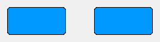
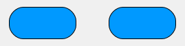
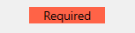
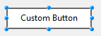
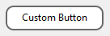

<!--REF #_command_.OBJECT SET CORNER RADIUS.Syntax-->**OBJECT SET CORNER RADIUS** ( * ; *objeto* : Text ; *radio* : Integer )<br/>**OBJECT SET CORNER RADIUS** ( *objeto* : Variable, Field ; *radio* : Integer )<!-- END REF-->
<!--REF #_command_.OBJECT SET CORNER RADIUS.Params-->
<div class="no-index">

| Parâmetro | Tipo |  | Descrição |
| --- | --- | --- | --- |
| * | Operador | &#8594; | Se especificar, objeto é um nome de objeto (cadeia)<br/>Se omitir, objeto é uma variável ou um campo |
| objeto | Text, Variable, Field | &#8594; | Nome de objeto (se especificar *) ou <br/>Variável ou campo (se omitir *) |
| radio | Integer | &#8594; | Novo rádio de esquinas arredondadas (em píxels) |
</div>
<!-- END REF-->

<div class="no-index">
<details><summary>Histórico</summary>

|Versão|Alterações|
|---|---|
|21 R5|Suporte para botões, botões de opção e caixas de seleção com estilo personalizado |
|19 R7|Modificado|
|14 R4|Criado por|

</details>
</div>

## Descrição 

<!--REF #_command_.OBJECT SET CORNER RADIUS.Summary-->O comando **OBJECT SET CORNER RADIUS** modifica o rádio das esquinas dos objetos que você passou no parâmetro *objeto*.<!-- END REF--> O novo rádio só se define para o processo e não é guardado no formulário. 

Você pode usar este comando com os seguintes objetos de formulário:

- [retângulos](../../FormObjects/shapes_overview.md#rectangle)
- [entradas](../../FormObjects/input_overview.md) (somente projetos 4D)
- [áreas de texto](../../FormObjects/text.md) (somente projetos 4D)
- [botões](../../FormObjects/button_overview.md#custom) com estilo personalizado e ["custom" Border Line Style](../../FormObjects/properties_BackgroundAndBorder.md#border-line-style), [botões de opção](../../FormObjects/radio_overview.md#custom) com estilo personalizado e [caixas de seleção](../../FormObjects/checkbox_overview.md#custom) com estilo personalizado (somente projetos 4D)

Ao passar o parâmetro opcional *\** indica que o parâmetro *objeto* é um nome de objeto (cadeia). Se não passar este parâmetro, indica que o parâmetro *objeto* é um campo ou uma variável. Neste caso, se passa uma referência de campo ou variável em vez de uma cadeia (campo ou variável objeto somente). 

No parâmetro *radio*, passe um novo valor do rádio em píxels a ser aplicado nas esquinas do objeto. 

**Nota:** Com objetos de entrada e área de texto, a propriedade de raio de canto só está disponível com estilos de linha de borda "none", "solid" ou "dotted".

Você pode modificar este valor a nível de formulário utilizando a [**propriedade Corner radius**](../../FormObjects/properties_BackgroundAndBorder.md#corner-radius).

## Exemplo 1 

Você têm os seguintes retângulos em seu formulário, chamados respectivamente "Rect1" e "Rect2":



Pode executar o seguinte código para mudar seu rádio:

```4d
 OBJECT SET CORNER RADIUS(*;"Rect@";20)
```



## Exemplo 2 

Você tem a seguinte área de texto em seu formulário, chamada "required-label":



Se você executar o seguinte código:

```4d
 OBJECT SET CORNER RADIUS(*;"required-label";10)
```


Note que para áreas de texto (assim como entradas), diferente dos retângulos, o arredondamento dos cantos é desenhado **fora** da área inicial do objeto.

## Exemplo 3

Com botões com estilo personalizado que possuem ["custom" Border Line Style](#border-line-style), o raio dos cantos é desenhado dentro da área inicial do objeto:



```4d
 OBJECT SET CORNER RADIUS(*;"custom-button";8)
```




## Ver também 

[OBJECT Get corner radius](../commands/object-get-corner-radius)  
[OBJECT SET BORDER STYLE](../commands/object-set-border-style)  


## Propriedades

|  |  |
| --- | --- |
| Número do comando | 1323 |
| Thread-seguro | no |


